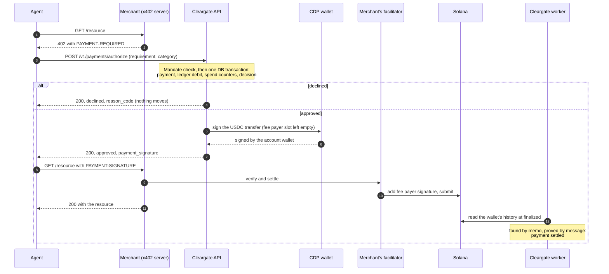

# Cleargate Core

[](https://github.com/CleargateFinance/cleargate-core/actions/workflows/ci.yml)


[](https://x402.org)

The buyer-side authorization layer for AI agents that pay with [x402](https://x402.org) on Solana. A person funds an account and sets a **mandate** for each agent. The agent then pays merchants within that mandate. **Agents hold spending authority, never money.**

This repository is the core service: a Go modular monolith built into two binaries, the API and the worker. The SDK, MCP server and console live in separate repositories and generate their clients from [`api/openapi.yaml`](api/openapi.yaml).

> **Status: testnet MVP on Solana devnet.** It must not hold real money; see [Known gaps](#known-gaps). Submitted to Encode Club's Solana hackathon, track *Best Use of x402 on Solana*: see [SUBMISSION.md](SUBMISSION.md).

- [Why](#why)
- [How a payment works](#how-a-payment-works)
- [Settlement on Solana](#settlement-on-solana)
- [The ledger](#the-ledger)
- [When a payment fails](#when-a-payment-fails)
- [Running it locally](#running-it-locally)
- [Demo](#demo)
- [API](#api)
- [Architecture](#architecture)
- [Testing](#testing)
- [Status](#status)
- [Further reading](#further-reading)

## Why

An agent holding a funded wallet can spend all of it. A prompt injection, a tool call stuck in a loop or a lookalike merchant is enough, and an x402 payment is final once it lands on chain.

Cleargate sits between the merchant's `402` and the payment. The agent asks Cleargate to pay. Cleargate checks the request against the mandate the agent's owner approved, and only an approved payment comes back signed. The agent never holds a key that can move money. Its API key only proves which agent is asking, so a compromised agent can spend no more than its mandate still allows.

A mandate sets:

- caps per payment, per day and per month, in USD (calendar windows in UTC, so the owner can predict when an agent may spend again);
- the categories of purchase it permits;
- optionally, an allowlist of payee addresses;
- an expiry.

Money is pooled per account, and each agent has spend counters rather than a balance. Every decision, approvals and declines alike, is recorded with the inputs it was made on, and the owner reads it in the console. The MVP runs the mandate check only. The counterparty, intent and behaviour checks described in the [whitepaper](docs/cleargate-finance-whitepaper.md) (§6) are recorded as `skipped` until they are built.

Cleargate needs no integration from the merchant. Any server that speaks x402 `exact` on Solana can be paid through it.

## How a payment works



1. The agent requests a resource. The merchant answers `402` with its x402 v2 `PAYMENT-REQUIRED`.
2. The agent sends that requirement, unchanged, to `POST /v1/payments/authorize`, with the category of purchase and an `Idempotency-Key`. Cleargate reads the amount and payee from the requirement itself, so the agent cannot misstate them.
3. Cleargate reads every input first: the mandate, spend so far, the balance and whether the account is frozen. The decision is then a pure function of those inputs, with no I/O. One database transaction records the payment, its idempotency key, the decision with a snapshot of its inputs and, on approval, the ledger debit and the spend counters.
4. On approval, Cleargate builds the USDC transfer, has the account's CDP wallet sign it, and returns it as `payment_signature`. The fee payer's signature is left for the merchant's facilitator. A decline is also a `200`, with a `reason_code`, and nothing moves.
5. The agent retries the merchant with that value as the `PAYMENT-SIGNATURE` header. The merchant's facilitator verifies the transaction, adds its signature as fee payer and submits it, and the merchant delivers the resource.
6. Every 30 seconds the worker reads the account wallet's history at `finalized`. It finds the transaction and marks the payment `settled`, or releases the funds if it can never land (see [When a payment fails](#when-a-payment-fails)).

## Settlement on Solana

| | How |
|---|---|
| **Token** | USDC, an SPL token, is the only one accepted. On devnet the mint is `4zMMC9srt5Ri5X14GAgXhaHii3GnPAEERYPJgZJDncDU`. The unit of account is USD, and each USD is one USDC at par. The token's decimals come from configuration, never from a merchant. |
| **Wallets** | One [Coinbase CDP](https://docs.cdp.coinbase.com) Server Wallet per account per chain, never one per agent. CDP holds the keys and signs on request, so no private key exists in this service. |
| **Scheme** | x402 v2 `exact` on `solana:EtWTRABZaYq6iMfeYKouRu166VU2xqa1` (devnet). The transfer is built with the x402 Go SDK's SVM client, so its instruction layout is one that facilitators accept. |
| **Fees** | The merchant's facilitator (`extra.feePayer`) pays the fee and submits the transaction, so account wallets hold no SOL. A merchant naming the account's own wallet as fee payer is refused. |
| **Finding a payment** | The memo is the payment's ID, or the merchant's `extra.memo` if it set one. Because a merchant can reuse a memo, the memo only narrows the search. The signed message bytes prove that the transaction is this payment. |
| **Finality** | Every chain read is at `finalized`, so a reorganised fork can never credit a deposit or settle a payment. |
| **Expiry** | A transaction carries a recent blockhash, and once the chain passes its last valid block height it can never land. Cleargate waits 150 blocks beyond that and needs a complete read of the wallet's history before it releases anything. |
| **Deposits** | The worker reads each wallet's finalized history and credits the net USDC change of each transaction. It keys every credit by transaction and wallet, so reading the same history twice credits nothing twice. |

**What each process can do:**

- **The API** holds the CDP credentials and is the only process that can request a signature. It never submits a transaction.
- **The worker** only reads the chain. It holds no credential that can move money.
- **An agent's API key** only proves which agent is asking. What the agent may spend comes from its mandate.

The custodian's answer is checked as well: the returned message must equal what was sent, and the signature must verify against the wallet. A custodian that signed something else therefore fails at this point rather than on chain.

The x402 SDK, `solana-go` and the CDP SDK are confined to `internal/infrastructure/solana` and `internal/infrastructure/cdp`. Modules see only the `settlement.Rail` and `WalletProvider` interfaces. That is what lets Base become a second rail later without a rewrite of the money path.

## The ledger

The ledger is a double-entry book. It is the system of record for money: the chain is where USDC moves, and the ledger is what it was for.

| Event | Entry | From | To |
|---|---|---|---|
| USDC arrives in an account wallet | `funding` | on-chain float | customer funds |
| A payment is approved | `payment` | customer funds | payee payable |
| Its transfer lands | `payout` | payee payable | on-chain float |
| Its transfer fails or expires | `reversal` | payee payable | customer funds |

- **Append-only.** An entry is never updated or deleted, and a correction is a new entry. The database refuses `UPDATE` and `DELETE`.
- **Every entry sums to zero.** This is checked in Go and again by a database trigger. A worker job re-checks the whole book every hour.
- **Customer funds never go below zero.** The debited buckets are locked, then the balance is checked, all inside the payment's transaction. Two concurrent payments therefore cannot both spend the last dollar.
- **The on-chain float is negative by design.** It is the mirror image of the USDC the wallets hold.
- **Spend counters are a cache** of what the postings already say. A daily job derives them again and compares the two.

Rules that must hold whatever code path runs are enforced in the database, using CHECK constraints, partial unique indexes and triggers. The same rules are also validated in Go so the caller gets a clear error. [docs/data-architecture.md](docs/data-architecture.md) has the full schema design.

## When a payment fails

An agent should treat a timeout, a network error or a `5xx` from Cleargate as *not paid*, and must not pay by another route. It can retry with the same idempotency key, because a `5xx` is not remembered.

| What happens | What the agent gets | What happens to the money |
|---|---|---|
| The mandate refuses it: over a cap, category or payee not allowed, mandate expired or missing, account frozen | `200`, `outcome: declined` and a `reason_code` | Nothing moves. The decline is in the decision log. |
| The balance does not cover it | `200`, declined, `insufficient_funds` | Nothing moves. |
| The agent retries a request it lost the answer to | The same answer, `replayed: true` and the same transaction | Charged once. Keys are remembered for 24 hours. |
| The same key is used for a different request: another amount, payee or merchant order | `409` | Nothing new. |
| The merchant offers no `exact` USDC option on this network, or the requirement is malformed | `400` | Nothing moves. This case does not appear in the decision log yet ([Known gaps](#known-gaps)). |
| The transaction was signed but never submitted, for example because the merchant was down or the agent gave up | Status becomes `expired` once the blockhash can no longer land | A `reversal` returns the funds, and the spend is given back to the windows it was charged to. |
| The transaction lands but fails on chain | Status becomes `failed` | The same as expiry. |
| Signing failed after approval, and the agent never retried | Status becomes `expired` after 10 minutes | The same as expiry. |
| Two payments for one merchant order produce identical transactions, which happens when a merchant's memo repeats within a block | The second gets `409 transaction_in_flight` with `Retry-After` | It stays held. A retry after the blockhash moves on signs a transaction of its own. |
| The Solana node is unreachable, or a history read comes back incomplete | Nothing changes | Nothing is concluded and nothing is released. The worker tries again on its next cycle. |

The worker is deliberately late rather than early. Releasing funds for a payment that then lands is the one mistake here that loses money, so a node outage can never look like a transfer that did not happen.

The reason codes are a public contract. They come in check order, each with what an agent should do about it, in the spec's [`ReasonCode`](api/openapi.yaml).

## Running it locally

**You need:**

- Go 1.26 or later.
- Docker, for Postgres 17 and Redis 7 locally and for the integration tests' containers.
- [golangci-lint](https://golangci-lint.run) v2, for `make lint` and `make check`.
- A [Coinbase CDP](https://portal.cdp.coinbase.com) project of its own for development, with a Secret API Key (Ed25519) and a wallet secret. The API refuses to start without them.
- Optionally, a Solana devnet RPC URL from a provider. The public endpoint rate-limits hard.

```sh
cp .env.example .env
# Edit .env:
#   CRYPTO_MASTER_KEYS=1:<output of: openssl rand -base64 32>
#   CDP_API_KEY_ID, CDP_API_KEY_SECRET, CDP_WALLET_SECRET from the CDP portal

make dev-up                      # Postgres on :5432, Redis on :6380
set -a; source .env; set +a      # export the variables into this shell
make migrate-up

make run-api                     # :8080
make run-worker                  # in a second shell, after exporting .env there too

curl -s localhost:8080/v1/health # {"status":"ok",...}
```

Configuration comes only from the environment. [`.env.example`](.env.example) documents every variable. The `SOLANA_*` variables default to devnet, so reaching mainnet means changing each one on purpose. With `SERVER_MODE=debug` and `MAIL_TRANSPORT=log`, links that would be emailed (email verification, password reset) are written to the API's log instead.

### From sign-up to a first payment

The console is a separate repository. The demo's [`console`](demo/console/main.go) stands in for it and makes these calls for you (see [Demo](#demo)). These are the routes, in order:

1. `POST /v1/auth/signup` creates a person and their account. Then `POST /v1/auth/verify-email` with the token from the link in the API's log.
2. `POST /v1/auth/login` sets the `cg_session` cookie.
3. `POST /v1/mfa/totp`, then `POST /v1/mfa/totp/confirm`, enrols a TOTP second factor. `POST /v1/mfa/step-up` opens a 15-minute window, which issuing a key and setting a mandate both require.
4. `POST /v1/accounts/{id}/agents` connects an agent. `POST /v1/agents/{id}/credentials` issues its API key, `cg_live_…`, which is shown once.
5. `PUT /v1/agents/{id}/mandate` sets its rules.
6. `GET /v1/accounts/{id}/deposit-address` returns the account wallet's address. Send it devnet USDC from [Circle's faucet](https://faucet.circle.com) (choose Solana Devnet). The worker credits it within about a minute of finality. The basic verification tier allows 100 USD in total per account holder, across all their accounts. A deposit past that is recorded but not credited.
7. The agent calls `POST /v1/payments/authorize` with `Authorization: Bearer cg_live_…`.
8. `GET /v1/agents/{id}/decisions` and `GET /v1/accounts/{id}/summary` show what happened.

[`TestMVP_DefinitionOfDone`](internal/app/settle_test.go) walks this whole path through the real API and the worker's jobs.

## Demo

[`demo/`](demo/README.md) runs the whole loop on Solana devnet. A research agent with a Cleargate API key and no wallet buys market data from **Atlas Data**, an ordinary x402 merchant that knows nothing about Cleargate. The public x402.org facilitator pays the fee and submits each payment.

The agent tries five purchases under a mandate of 0.60 USD a payment and 1.00 a day, payable only to the merchant:

| Purchase | Price | Result |
|---|---|---|
| A quote | 0.01 | Paid, landed on devnet, data delivered |
| A sector report | 0.50 | Paid, landed on devnet, data delivered |
| The full dataset | 5.00 | Declined `over_per_tx_cap` |
| A partner's feed, paid to another wallet | 0.05 | Declined `payee_not_permitted` |
| A second report | 0.50 | Declined `over_daily_cap`, since 0.51 is already spent today |

The owner's side shows the decision log, with the two payments `settled` once the worker finds them at `finalized`, and a freeze that stops every agent at once.

```sh
cd demo
./run.sh deps                                   # once: the demo's own Postgres and Redis, then migrations
./run.sh api                                    # terminal 1
./run.sh worker                                 # terminal 2
go run ./merchant keygen                        # once: the merchant's wallet
go run ./console setup                          # owner, TOTP, agent, mandate, API key
go run ./console fund                           # devnet USDC from CDP's faucet, then waits for the credit
go run ./merchant                               # terminal 3
go run ./agent                                  # the five purchases
go run ./console decisions                      # what the owner sees
```

[demo/README.md](demo/README.md) explains each step, the three wallets involved, and a script for recording the video. A run on 8 November 2026 paid the quote in [this transaction](https://explorer.solana.com/tx/3av7JQG5ZCZ1y9FersMXhyy1XKMrxcxfZ9WxF2oNcDT5mA4Yugaih4JeSB14enZMZuWAg9B4tyn58vYnWEqtR3Ts?cluster=devnet). The facilitator is the fee payer, the account's wallet signs only as the owner of the USDC, and the memo is the payment's ID.

## API

The contract is [`api/openapi.yaml`](api/openapi.yaml). `internal/app/openapi_routes_test.go` holds it to the server: every route is in the spec, and every response the integration tests receive must match it.

| Surface | Credential | Routes |
|---|---|---|
| Agent | `Authorization: Bearer cg_live_…` | `POST /v1/payments/authorize` |
| Console | The `cg_session` cookie, plus the `X-Cleargate-Console` header on every request that changes something | Accounts, agents, keys, mandates, freeze, second factor, decision log, summary, deposit address |
| Public | The `X-Cleargate-Console` header | Sign-up, email verification, login, password reset, health |

The two surfaces share no credential. Mandates can only be changed on the console, so an agent can never raise its own limits.

**Paying a merchant.** `requirement` is the merchant's `PAYMENT-REQUIRED` header, base64-decoded, passed unchanged:

```http
POST /v1/payments/authorize
Authorization: Bearer cg_live_…
Idempotency-Key: 0b6f3c1e-2f4a-4d1e-9a51-7c2d8e4f6a10
Content-Type: application/json

{
  "requirement": {
    "x402Version": 2,
    "resource": { "url": "https://merchant.example/v1/report" },
    "accepts": [{
      "scheme": "exact",
      "network": "solana:EtWTRABZaYq6iMfeYKouRu166VU2xqa1",
      "asset": "4zMMC9srt5Ri5X14GAgXhaHii3GnPAEERYPJgZJDncDU",
      "amount": "10000",
      "payTo": "<merchant address>",
      "maxTimeoutSeconds": 60,
      "extra": { "feePayer": "<facilitator address>" }
    }]
  },
  "category": "market_data",
  "purpose": "Price history for the weekly report"
}
```

An approval. `amount` `10000` is 0.01 USDC:

```json
{
  "payment_id": "5d0c6a1e-8f7b-4c47-b0a9-2e3f1d9c7b64",
  "status": "authorized",
  "outcome": "approved",
  "reason_code": "ok",
  "reason": "within mandate",
  "decided_at": "2026-11-08T12:00:00Z",
  "replayed": false,
  "payment_signature": "eyJ4NDAyVmVyc2lvbiI6Miwi…"
}
```

A decline, also a `200`:

```json
{
  "payment_id": "a3c9e2f0-1b7d-4e8a-9c65-0f4d2b1e7a38",
  "status": "declined",
  "outcome": "declined",
  "reason_code": "over_per_tx_cap",
  "reason": "over the 1 USD per-transaction limit",
  "decided_at": "2026-11-08T12:00:05Z",
  "replayed": false,
  "payment_signature": null
}
```

Branch on `reason_code`, never on `reason`, which may be reworded. Amounts throughout the API are decimal strings, never JSON numbers.

## Architecture

The service is a modular monolith. Each feature is a module under `internal/modules/<feature>/` with the same shape: domain, ports, service, Postgres repository, HTTP handler. Modules call each other only through interfaces they declare in their own `ports.go`. The concrete wiring lives only in `internal/app`. `make lint` enforces these rules with depguard: domain and service code never import the web framework or the database driver, and no module imports `internal/app`.

| Module | Owns |
|---|---|
| `account` | People, accounts, roles, agents and their API keys, sessions, TOTP, freeze, funding tiers |
| `mandate` | Spending rules: immutable, versioned, never edited |
| `authz` | The decision: a pure function with no context, no error and no I/O |
| `ledger` | The double-entry book, spend counters and their reconciliation |
| `payment` | One payment end to end. It owns the transaction boundary and applies outcomes from the chain |
| `decisionlog` | Every decision with its checks and a snapshot of its inputs |
| `counterparty` | Payees, recorded from the first time an agent tries to pay one |
| `settlement` | Account wallets, reading x402 requirements, signing transfers, deposits, confirming outcomes |
| `summary` | The console's front page for an account. It owns no tables |

Infrastructure lives in `internal/infrastructure`:

- `solana`: the JSON-RPC client and x402 signing;
- `cdp`: the custodian adapter;
- `database`: Postgres and the unit of work;
- `crypto`: API keys, passwords, TOTP and envelope encryption;
- `outbox`, `ratelimit`, `server` and `config`.

| Binary | Role |
|---|---|
| `cmd/api` | The hot path: authorization, the console and auth routes. Holds the CDP credentials. |
| `cmd/worker` | Everything slow. Reads the chain, never signs. |
| `cmd/migrate` | Runs migrations as a deploy step, never when the API boots. |

| Worker job | Every | Does |
|---|---|---|
| `deposit_detection` | 30 s | Credits USDC that arrived in account wallets |
| `payment_settlement` | 30 s | Moves authorized payments to `settled`, `failed` or `expired` |
| `ledger_book_check` | 1 h | Re-checks that every entry in the book sums to zero |
| `wallet_reconcile` | 1 h | Checks that no account's funds in the ledger exceed the USDC its wallet holds on chain |
| `spend_counter_reconcile` | 24 h | Re-derives spend counters from postings and compares |
| `idempotency_key_expiry` | 1 h | Forgets keys older than 24 hours |
| `*_partition_maintenance` | 24 h | Creates monthly partitions for the ledger and decisions ahead of time |

```
cmd/                 api, worker, migrate
internal/app/        wiring (BuildAPI, BuildWorker), adapters between modules, route tests
internal/modules/    one package per feature, as above
internal/infrastructure/
internal/shared/     apperr, currency, typed IDs, clock, caller
migrations/          numbered up/down SQL pairs
api/openapi.yaml     the public contract
deploy/              docker-compose for local Postgres and Redis
demo/                the devnet demo: merchant, agent and console stand-in (its own Go module)
docs/                whitepaper, data architecture, roles
dev-docs/            the build plan
```

[AGENTS.md](AGENTS.md) holds the conventions for contributing: errors, transactions, money, tests and commits.

## Testing

```sh
make test       # unit tests: no Docker, no network
make test-int   # integration tests against real Postgres and Redis (testcontainers; needs Docker)
make test-demo  # the demo's unit tests (demo/ is its own Go module)
make check      # gofmt, vet, lint, unit, integration and demo tests: what a change must pass
```

- **No mocks of the database.** Integration tests run against real Postgres and Redis in containers.
- **The chain and the custodian are fakes that speak the real wire formats:** `internal/infrastructure/solana/solanatest` is a JSON-RPC node, and `internal/infrastructure/cdp/cdptest` is CDP's REST API, signing with real keys. That means the real clients run in tests.
- **`TestMVP_DefinitionOfDone`** funds an account, connects an agent, sets a mandate, pays, gets declined, retries, settles, expires a payment and balances the book. It does all of this through the real API and the worker's jobs.
- **Against real CDP on devnet** (skipped without credentials):

  ```sh
  set -a; source .env; set +a
  go test -tags integration -run TestWallet ./internal/infrastructure/cdp/
  ```

  This creates an account wallet, signs a transaction, and has CDP sign a transfer whose fee someone else pays. It passed on 8 November 2026.
- **The whole devnet path** is proven by running the [demo](#demo), by hand: a real merchant, the x402.org facilitator, CDP and Solana devnet. CI's tests use fakes of the chain and the custodian.

## Status

**Built:**

- Accounts, roles and agents, with sign-up, login, a TOTP second factor, step-up and freeze.
- Agent API keys, stored only as digests.
- Versioned mandates, and the mandate check.
- The double-entry ledger, spend counters and reconciliation.
- Idempotent authorization, and the decision log with declines.
- Account wallets on CDP, and x402 `exact` signing on Solana.
- Confirmation, failure and expiry of payments from the chain.
- Deposit detection, and the account summary.
- An hourly check that no account's funds in the ledger exceed the USDC its wallet holds on chain.
- An end-to-end [demo](#demo) on devnet, with a real x402 merchant and the x402.org facilitator.

**Next:**

- Address screening.
- Mandates signed with a passkey.
- A hash-chained decision log.
- Holds, and x402 `batch-settlement` for frequent payees.
- Base as a second rail.

Build status task by task is in [dev-docs/mvp-implementation-plan.md](dev-docs/mvp-implementation-plan.md).

### Known gaps

What this version does not do, stated plainly:

- **Devnet only, with no address screening.** Deposits are capped per verification tier, but the sending address is not screened, so this version must not hold real money.
- **The devnet path is proven by hand.** The demo has paid through a real merchant and facilitator on devnet, but CI runs against fakes of the chain and the custodian.
- **Alerts are log lines.** `alert=funds_above_wallet` and the others are logged with a stable key, and nothing pages a person yet.
- **A deposit past the funding cap is not credited or returned.** It stays in the wallet until a person acts.
- **A requirement the rail cannot pay is a `400`, not a recorded decline.** It appears nowhere in the decision log.
- **Mandates are approved with a TOTP step-up, not a passkey signature.** The server records who approved the rules and when, but the approval is not a signature over the rules themselves.
- **No guardian veto or timelock.** Any owner or admin can change a mandate or unfreeze the account at once, behind a step-up.
- **The decision log is append-only but not yet hash-chained or signed.**
- **Balances are shown at par**, with no market price beside them.
- **`exact` payments are final.** There is no hold, so a merchant that takes payment and delivers nothing keeps it. The checks before payment are the protection.
- **No latency benchmark yet.** The target is for the decision to land under 100 ms (§6.6). On approval, signing then adds two reads of the chain and a round trip to the custodian, which the target does not cover.

## Further reading

- [docs/cleargate-finance-whitepaper.md](docs/cleargate-finance-whitepaper.md): the product and its design. Code comments cite it as `§8.3`.
- [docs/data-architecture.md](docs/data-architecture.md): the schema and why it is shaped that way.
- [docs/cleargate-roles-and-connection-models.md](docs/cleargate-roles-and-connection-models.md): entities and roles.
- [dev-docs/mvp-implementation-plan.md](dev-docs/mvp-implementation-plan.md): the build plan, with revision notes recording each deliberate change.
- [api/openapi.yaml](api/openapi.yaml): the API contract.
