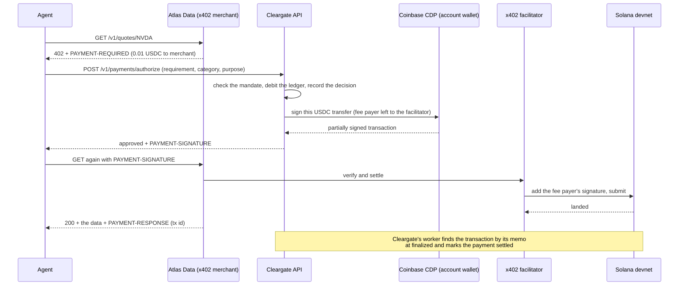

# Cleargate demo: an agent buys data on Solana within a mandate

A research agent is given a task and a Cleargate API key. It buys market data
from **Atlas Data**, an ordinary x402 merchant, paying in devnet USDC on
Solana. It holds no wallet and no money. Every payment goes through Cleargate,
which checks it against the **mandate** the account's owner approved. If the
payment fits, the account's wallet signs it. If not, the agent gets the reason
and pays nothing.

This directory is self-contained. It is its own Go module, has its own Postgres
and Redis, and runs Cleargate's API and worker from the repository unchanged.

## What happens in one payment



A declined payment stops at the third step. Cleargate answers `declined` with a
reason code, nothing is signed, and nothing moves.

## The pieces

| Piece | What it is | Runs as |
|---|---|---|
| `merchant/` | Atlas Data, an x402 resource server built with the x402 Go SDK. It knows nothing about Cleargate. | `go run ./merchant` |
| `agent/` | The buyer. A scripted agent that runs the scenario below. | `go run ./agent` |
| `console/` | Stands in for the console, which has no UI yet. It does the owner's part over the API: sign up, TOTP, agent, mandate, key, decision log, freeze. | `go run ./console …` |
| `run.sh` | Starts Cleargate's own API and worker, and the demo's Postgres and Redis. | `./run.sh …` |
| x402.org facilitator | The public facilitator. It pays the Solana fee and submits the transaction. Nothing to run. | — |

## Who holds which wallet

There are three addresses. The agent has none.

- **The account's wallet**, Cleargate's deposit address, holds the money. It is
  a Coinbase CDP Server Wallet that Cleargate creates through the CDP API the
  first time anyone asks for the deposit address, one per account and network.
  CDP keeps its key in a secure enclave and signs only when Cleargate's API asks
  with your `CDP_API_KEY_*` and `CDP_WALLET_SECRET`. Cleargate asks only after a
  payment has passed the mandate. You will see it in the CDP portal under
  Server Wallets.
- **The merchant's wallet** receives the payments. `go run ./merchant keygen`
  makes an ordinary Solana keypair and saves it in `.state/merchant.json`. The
  merchant never signs: receiving needs no signature, and the facilitator pays
  the fees.
- **The partner's address** is a second payee with no money and no key. One
  merchant route pays it, so the demo can show the mandate refusing a payee it
  does not list.

**The agent holds an API key, not a key to any wallet.** The key lets it ask
Cleargate for payments. It cannot sign a transaction or change its own mandate:
mandate routes take only the owner's session, and a key reaches no console
route.

On Solana, USDC sits in a *token account* that belongs to the wallet, at an
address derived from the wallet and the USDC mint. A wallet that has never held
USDC has no such account, and an x402 payment cannot create one. That is why the
merchant's wallet needs one faucet deposit before anyone can pay it.

## Run it

You need Docker, Go, and `../.env` with your three `CDP_*` values. The demo
generates its own database key, so nothing else in `.env` matters. Run every
command from this `demo/` directory, each long-running one in its own terminal.

```sh
./run.sh deps              # once: Postgres :5433 and Redis :6381 in Docker, then the migrations
./run.sh api               # terminal 1: the Cleargate API on :8080
./run.sh worker            # terminal 2: credits deposits, settles payments (polls Solana every 30 s)

go run ./merchant keygen   # once: the merchant's wallet
go run ./merchant          # terminal 3: Atlas Data on :4021

go run ./console setup     # the owner signs up and connects an agent with a mandate
```

`console setup` signs the owner up, picks the email verification link out of
`.state/api.log`, enrols TOTP, connects "Research agent 1", approves its mandate
behind a TOTP step-up, and issues its API key into `.state/agent.env`. At the
end it prints the account's deposit address. Every later run reuses the account
and connects a fresh agent with a fresh mandate.

## Fund it with devnet USDC

Two faucet requests, both at **https://faucet.circle.com**. Choose **USDC**,
network **Solana Devnet**, paste the address, and send.

1. **The account's wallet**, the address `console setup` printed (or run
   `go run ./console fund`, which prints it and waits). This is the money the
   agent spends. One faucet request covers many demo runs: each run spends 0.51
   USDC.
2. **The merchant's wallet**, the address `merchant keygen` printed. This creates
   its USDC token account. Until it exists, the merchant prints a warning at
   start-up and every payment to it fails. You only do this once.

```sh
go run ./console fund      # prints the deposit address, waits until the worker credits it
```

The worker credits a deposit once Solana has finalized it, about a minute after
the faucet sends. Two limits apply:

- **Funding cap.** A new account is on the basic verification tier, capped at
  **100 USD of deposits in total**. A deposit past the cap is not credited: it
  stays in the wallet, quarantined, until a person acts.
- **Only USDC counts.** USDC must come from Circle's devnet mint
  (`4zMMC9srt5Ri5X14GAgXhaHii3GnPAEERYPJgZJDncDU`). Other tokens, and SOL, sent
  to the deposit address are never credited. The account's wallet needs no SOL,
  because the facilitator pays every fee.

## The mandate

A mandate is the owner's signed-off spending rules for one agent. Cleargate
checks every payment against it before anything is signed. `console setup`
approves this one:

| Rule | Value | Meaning |
|---|---|---|
| `asset` | `USD` | Amounts are in USD, each backed by one USDC. |
| `max_per_tx` | `0.60` | No single payment above 0.60. |
| `max_per_day` | `1.00` | At most 1.00 per UTC calendar day, resetting at 00:00 UTC. |
| `max_per_month` | `20.00` | At most 20.00 per calendar month. |
| `categories` | `market_data`, `research` | The agent states a category with each payment, and it must be on this list. |
| `pay_to` | the merchant's wallet | Payees allowed. Empty would mean any payee. |
| `expires_at` | 30 days from setup | After this, every payment is declined until the owner renews it. |

How it behaves:

- **The owner sets it, never the agent.** `PUT /v1/agents/{id}/mandate` takes
  the owner's console session and a TOTP step-up from the last 15 minutes. An
  agent's API key cannot reach it.
- **It is immutable and versioned.** A change inserts version 2 and keeps
  version 1. Each decision records the exact version and a SHA-256 digest of the
  mandate it was checked against.
- **The amount and payee come from the merchant's requirement**, which the
  agent passes on unchanged. The agent cannot understate a price or misname a
  payee.
- **Checks run in a fixed order, and the first failure wins.** The order is:
  invalid amount, account frozen, no mandate, expired, asset, category, payee,
  per-payment cap, daily cap, monthly cap, funds.
- **Approval and spend commit together.** An approval debits the account,
  raises the agent's spend counters and writes the decision record in one
  database transaction. Two payments at once cannot both squeeze under a cap.
  A payment that later fails or expires on-chain gives the money and the budget
  back.
- **Every decision is recorded, declines included.** Each record lists the
  checks that ran and is hash-chained to the one before it.

## The scenario

`go run ./agent` gives the agent one task, "Brief me on semiconductors: NVDA's
price and an analyst view of the sector", and five purchases:

| # | Purchase | Price | Category | Result | Why |
|---|---|---|---|---|---|
| 1 | `/v1/quotes/NVDA` | 0.01 | market_data | **paid** | within every rule |
| 2 | `/v1/reports/semiconductors` | 0.50 | research | **paid** | within every rule; 0.51 spent today |
| 3 | `/v1/datasets/full` | 5.00 | market_data | declined `over_per_tx_cap` | 5.00 is over 0.60 a payment |
| 4 | `/v1/partner/signals` | 0.05 | market_data | declined `payee_not_permitted` | pays the partner, who is not on `pay_to` |
| 5 | `/v1/reports/energy` | 0.50 | research | declined `over_daily_cap` | 0.51 + 0.50 = 1.01, over 1.00 a day |

Payments 1 and 2 print a Solana Explorer link to the transaction. Then:

```sh
go run ./console decisions   # the decision log: outcome, reason, payment status, latency
go run ./console status      # balance, spend today against the caps, declines
```

Payments 1 and 2 show as `authorized` at first. Within about a minute the
worker finds them on-chain and they turn `settled`.

**The kill switch** (optional):

```sh
go run ./console freeze                          # owner, no step-up: stops every agent at once
go run ./agent /v1/quotes/SOL market_data        # → declined account_blocked
go run ./console unfreeze                        # needs a TOTP step-up
```

**Running it again.** Spend caps are per agent and per UTC day, so a second run
on the same day finds the day mostly spent. Run `go run ./console setup` again
first: it connects "Research agent 2" with a fresh mandate, and the scenario
plays out exactly as before.

## A recording script (2–4 minutes)

1. **The problem (20 s).** Agents can pay over x402 now, but whoever holds the
   key holds the money. Cleargate gives agents spending authority, not money.
2. **The setup (40 s).** Run `console setup`. Point out the mandate table, the
   TOTP step-up, and that the agent gets only an API key. Show the deposit
   address, and the funded balance in `console status`.
3. **The agent at work (60 s).** Run `go run ./agent`. The two purchases that
   fit are paid, and the Explorer link shows the USDC transfer on devnet with
   the facilitator as fee payer. The three that don't fit are refused, each
   with the rule that refused it, in a few milliseconds.
4. **The owner's view (30 s).** `console decisions` shows every decision,
   declines included, with the payments now `settled`. `console status` shows
   0.51 of the 1.00 daily cap spent.
5. **The kill switch (20 s).** `console freeze`, then one more purchase is
   declined `account_blocked`.

## Troubleshooting

- **The merchant warns "has no USDC token account yet".** Send its wallet USDC
  once from the faucet, then restart the merchant.
- **The merchant answers 402 again after an approval.** The facilitator refused
  or could not land the transaction, and the merchant's log says why. The
  payment stays `authorized` until its blockhash expires, about a minute, then
  the worker marks it `expired` and returns the money and budget.
- **`insufficient_funds`.** The deposit has not been credited yet. Check
  `console status`, and make sure the worker is running.
- **Public devnet RPC is slow or rate-limited.** Set `SOLANA_RPC_URL` in
  `../.env` to a free Helius or QuickNode devnet URL, and export the same
  variable for the merchant.
- **Start over.** `./run.sh reset` deletes the demo's database and console
  state. It keeps the merchant's wallet, which has its USDC account already.

Everything the demo writes lives in `.state/` and is git-ignored. That includes
the owner's demo password and TOTP secret, and the agent's key. They are
devnet-only credentials, kept in plain files for convenience.
