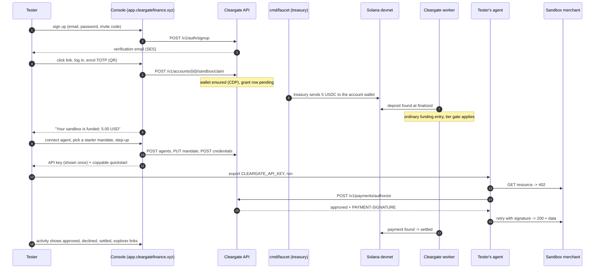
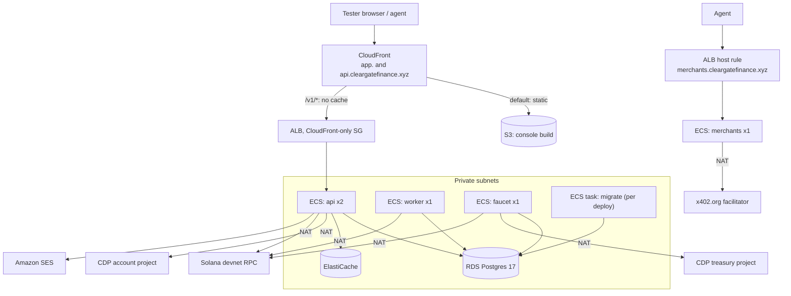
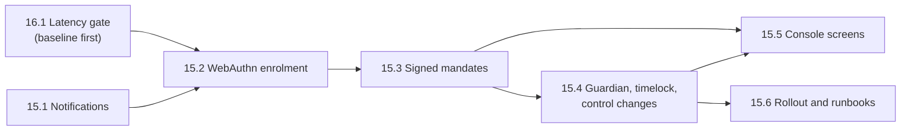
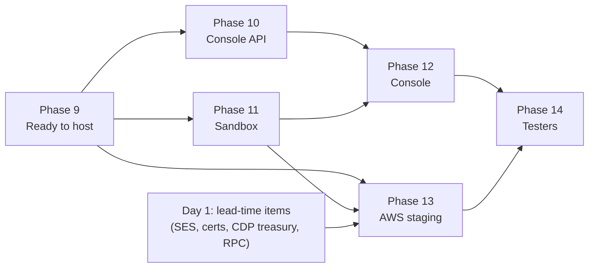
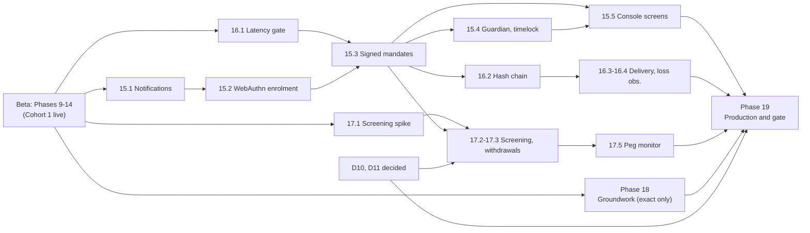

# Implementation Plan V2: from hackathon MVP to a hosted testnet beta, and on to mainnet readiness

> **For agentic workers:** REQUIRED SUB-SKILL: use `superpowers:subagent-driven-development` (recommended) or `superpowers:executing-plans` to implement this task-by-task. Steps use checkbox (`- [ ]`) syntax for tracking. Before starting a task, write its step-by-step plan (failing test, implementation, passing test, commit) with `superpowers:writing-plans`; this document fixes the scope, the files, the tests and the decisions, not every line of code.

**Goal:** A stranger opens `https://app.cleargatefinance.xyz`, signs up, and finds an account already funded with devnet USDC and a catalogue of test merchants. They connect their agent with one API key, and within 15 minutes it has made a payment that settles on Solana devnet. They never touch a faucet, a CLI or a block explorer unless they want to.

**Architecture:** This changes nothing about the core design. It is the same Go modular monolith with the same invariants (AGENTS.md). Four additions:

- **The console**, a TypeScript client of `consoleAPI` in `web/console/`.
- **A `sandbox` module and a `cmd/faucet` binary.** The faucet funds new accounts with real devnet USDC from a treasury in a separate CDP project.
- **Hosted test merchants**, grown from the demo's Atlas Data.
- **AWS staging infrastructure** in `eu-central-1`, managed with Terraform. The console and the API share one origin behind CloudFront.

**Tech stack:** everything in the V1 plan, plus:
- TypeScript, and React with Vite (pending decision D1).
- `go-webauthn` for passkeys, and AWS KMS for decision-log checkpoints (Phases 15 and 16).
- `openapi-typescript` and `openapi-fetch`.
- Amazon SES v2.
- Terraform on AWS: ECS Fargate, RDS for PostgreSQL 17, ElastiCache, ALB, CloudFront, S3, Secrets Manager, CloudWatch and ECR.
- GitHub Actions with OIDC.

**Migration numbers.** Migrations below are written `NNNNNN_name`: take the next free number when the task is built (000012 at the time of writing), since tasks may land in a different order from this document.

**Relationship to the V1 plan.** [mvp-implementation-plan.md](mvp-implementation-plan.md) stays the record for Phases 0–8: its ticks, its Why boxes and its Revision notes. This plan continues its numbering from **Phase 9**, so `grep '### Task 9.3'` still finds exactly one task across both files. A V1 task that this plan pulls forward keeps its V1 number and is referenced, not copied. Record deliberate changes in this plan's own Revision notes at the bottom.

---

## Contents

1. [Where we are, 13 November 2026](#where-we-are-13-november-2026)
2. [What V2 builds, and what it does not](#what-v2-builds-and-what-it-does-not)
3. [The tester journey this plan is built around](#the-tester-journey-this-plan-is-built-around)
4. [Decisions for the owner](#decisions-for-the-owner)
5. [Start on day one: lead-time items](#start-on-day-one-lead-time-items)
6. [Phase 9: Ready to host](#phase-9--ready-to-host)
7. [Phase 10: The API the console needs](#phase-10--the-api-the-console-needs)
8. [Phase 11: The sandbox, funded accounts and test merchants](#phase-11--the-sandbox-funded-accounts-and-test-merchants)
9. [Phase 12: The console](#phase-12--the-console)
10. [Phase 13: AWS staging environment](#phase-13--aws-staging-environment)
11. [Phase 14: Delivering it to testers](#phase-14--delivering-it-to-testers)
12. [Phase 15: Signed authority and account controls](#phase-15--signed-authority-and-account-controls)
13. [Phase 16: Evidence and integrity](#phase-16--evidence-and-integrity)
14. [Phase 17: Money in and out, for real money](#phase-17--money-in-and-out-for-real-money)
15. [Phase 18: Batch-settlement groundwork (exact only)](#phase-18--batch-settlement-groundwork-exact-only)
16. [Phase 19: Production and the mainnet gate](#phase-19--production-and-the-mainnet-gate)
17. [Sequencing and estimate](#sequencing-and-estimate)
18. [Definition of done](#definition-of-done)
19. [Risks](#risks)
20. [Revision notes](#revision-notes)

---

## Where we are, 13 November 2026

The hackathon MVP is built, and it was demonstrated at Encode Club's Solana hackathon (track *Best Use of x402 on Solana*). The V1 plan's Definition of done is met. `TestMVP_DefinitionOfDone` walks it through the real API and worker jobs, and the demo ran it on devnet against a real x402 merchant and the x402.org facilitator ([this transaction](https://explorer.solana.com/tx/3av7JQG5ZCZ1y9FersMXhyy1XKMrxcxfZ9WxF2oNcDT5mA4Yugaih4JeSB14enZMZuWAg9B4tyn58vYnWEqtR3Ts?cluster=devnet), 8 November 2026).

### Built and tested

| Area | What exists | Where |
|---|---|---|
| Money | `currency.Amount`, USD unit of account at par with USDC | `internal/shared/currency` |
| Ledger | Double-entry and append-only. Postings sum to zero (trigger and Go). Customer funds never negative. Spend counters. Hourly book check, daily counter re-derivation, partition maintenance. | `internal/modules/ledger`, migrations 000002–000003 |
| Identity | Sign-up with no account enumeration, email verification, login, sessions, password reset, TOTP, 15-minute step-up, invitations and membership (service only, no routes), freeze and unfreeze, funding tiers (basic cap 100 USD per principal) | `internal/modules/account`, migrations 000004–000005 |
| Agents | Connect, revoke, API keys `cg_live_…` stored as digests, rotation | `internal/modules/account` |
| Mandates | Immutable and versioned, approved behind a TOTP step-up (the stand-in for passkeys, owner decision of 4 November) | `internal/modules/mandate`, migration 000006 |
| Decisions | Pure `authz.Decide`, feature snapshot, append-only decision log recording declines, cursor-paginated route | `internal/modules/authz`, `decisionlog` |
| Payments | Idempotent `POST /v1/payments/authorize`, one transaction for payment, ledger, counters and decision | `internal/modules/payment`, migrations 000007, 000011 |
| Settlement | One CDP Server Wallet per account per chain. x402 `exact` signing on Solana. Confirmation, failure and expiry from the chain at `finalized`. Deposit detection with the funding gate. Hourly wallet-vs-ledger check. | `internal/modules/settlement`, `internal/infrastructure/{solana,cdp}`, migrations 000009–000010 |
| Contract | `api/openapi.yaml`, held to the server by `openapi_routes_test.go` | `api/` |
| Demo | Atlas Data merchant, scripted agent, a Go console stand-in, CDP faucet funding, the video script | `demo/` |
| CI | Build, vet, unit, integration (testcontainers), lint with depguard, demo module | `.github/workflows/ci.yml` |

### Not built, and why it matters now

These block a hosted beta and are the subject of Phases 9–13:

| Gap | Consequence today |
|---|---|
| **No container image or deploy config.** `deploy/` is a local compose file; CI never deploys. | Nothing can run outside a laptop. |
| **No production mail transport.** `newMailer` accepts only `log`, which is refused outside `SERVER_MODE=debug` (`internal/app/routes.go`). | Nobody can verify an email on a hosted instance, so nobody can sign up. |
| **No console UI.** `web/console/` does not exist yet; `demo/console` is a 718-line Go CLI stand-in. | Only someone who reads the README and uses `curl` can use the product. |
| **Funding requires faucets by hand.** CDP's faucet allows at most 10 USDC a day per project and per address, and Circle's is manual. | Every tester has to work out devnet USDC and token accounts first. |
| **No test merchants anyone can reach.** Atlas Data runs on `localhost:4021`. | A tester has nothing to buy. |
| **Client IP behind a proxy.** `SERVER_TRUSTED_PROXIES` takes CIDRs, which is right behind an ALB alone but not behind CloudFront and an ALB. | The public rate limit would bucket every tester under a handful of edge addresses. |
| **Worker has no single-runner guard.** Jobs are not locked against a second worker process (`internal/app/worker.go`). | A rolling deploy or an accidental second task runs every job twice at once. Safety then depends on each job's own locking, which nothing tests. |
| **Redis client has no TLS.** `internal/infrastructure/cache/redis.go` | ElastiCache with in-transit encryption cannot be reached. |
| **Alerts are log lines and there are no metrics.** | `alert=funds_above_wallet` reaches nobody. |

The console also needs a few routes that do not exist; Phase 10 covers them.

### Still open from V1, and where each goes

**Everything V1 deferred now has a home in V2.** The V1 plan keeps each task's design and Why boxes; V2 says when it is built and what changed.

| V1 item | V2 placement |
|---|---|
| Tasks 2.9 and 3.1: WebAuthn enrolment, signed mandates | Tasks 15.2 and 15.3 |
| Task 2.10: administrative notifications | Task 15.1, built first (the controls depend on somebody noticing) |
| Task 2.8: guardian, timelock, control changes | Task 15.4 |
| Task 6.3 and Phase 8: latency gate, load test to 100 ms p99 | Task 16.1, built **before** signed mandates land on the hot path |
| Task 5.4: hash-chained decision log | Task 16.2. **AGENTS.md states hash-chaining as an invariant, but it is not built.** The README's Known gaps says so; keep them consistent. |
| Task 5.5 (listings, delivery) and Task 5.6 (loss observation) | Tasks 16.3 and 16.4. Loss observation must run before real money (V1 Sequencing risks). |
| Task 2.7: address screening, KYC mirror, withdrawals | Tasks 17.1 to 17.4 (screening is a **mainnet blocker**) |
| Phase 8: peg monitor | Task 17.5 (**mainnet blocker**) |
| Phase 8: CDP Spend Permissions and Policies | Task 17.6, a spike only. It depends on the open decision D11. |
| Task 1.5: holds | Task 18.1, built dormant |
| Phase 7: channels, vouchers, `batch-settlement` | **Not built (owner decision, 13 November).** Task 18.2 to 18.4 prepare the seams and a design note. |
| Base as a second rail | After the mainnet gate (Phase 19) |
| Task 6.2: `llms.txt` docs index | Task 11.6 |
| Phase 8: alerting (§8.10), runbooks, structured trace logging (§8.9) | Tasks 13.8, 13.10 and 9.5; production paging in Task 19.2 |
| `authz` module wrapper files marked `TODO(scaffold)` | Task 9.7: delete or fill. `Decide` itself is built and used by `payment`. |
| `crypto/crypto.go` `TODO(scaffold)` for canonical JSON, Ed25519, hash chain | Canonical JSON in Task 15.3, the chain in Task 16.2 |
| `internal/app/app.go` `TODO(scaffold)` for a shared `buildModules` | Task 9.7 |


---

## What V2 builds, and what it does not

V2 has two halves with a deliberate break between them.

**Phases 9–14: a hosted testnet beta** on Solana devnet:

- the console;
- self-serve funded accounts;
- hosted test merchants;
- a quickstart for connecting an agent;
- AWS staging infrastructure with alerts;
- a rollout to invited testers.

**Phases 15–19: everything V1 deferred, then the gate to real money:**

- **Phase 15:** signed authority and account controls (passkeys, signed mandates, notifications, guardian and timelock).
- **Phase 16:** evidence and integrity (a latency gate, a hash-chained decision log, delivery reports, loss observation).
- **Phase 17:** funding hardening (address screening, withdrawals, KYC, the peg monitor).
- **Phase 18:** batch-settlement **groundwork only**.
- **Phase 19:** the production environment and the mainnet gate.

**The settlement decision (owner, 13 November 2026): payments stay `exact`.** V2 builds no channels, vouchers, netting or redemption. Phase 18 prepares only what is expensive to retrofit (hold states on the ledger, the scheme recorded on every transfer, one entry point for realising a payment) and produces a design note from the x402 spec as it stands that day.

**Does not build:** anything that holds real money before the Phase 19 gate. The README's Known gaps still hold until then. The sandbox is devnet-only **by construction** (Task 11.1), not by convention.

**Does not change:**

- the money path;
- the ledger's rules;
- the two caller surfaces;
- the `Rail` and `WalletProvider` seams;
- the rule that no process but `cmd/api` (account wallets) and `cmd/faucet` (treasury, devnet only) can sign a transfer. The worker may sign a decision-log checkpoint (Task 16.2), an attestation that cannot move funds.

Every addition below respects them, and the Why boxes say how.

---

## The tester journey this plan is built around

Every task serves one of these steps. A task that serves none is out of scope.



**Target times:**

| Stretch | Target |
|---|---|
| Sign-up to funded | Under 2 minutes, most of it waiting for `finalized` |
| Funded to first settled payment | Under 10 minutes |
| A tester who already has an agent framework (MCP, SDK or plain HTTP) | One environment variable |

---

## Decisions for the owner

Each has a recommendation. AGENTS.md says open product decisions are the owner's to settle. Record each answer as a Revision note, then strike it from this table.

| # | Decision | Recommendation | Why | Blocks |
|---|---|---|---|---|
| D1 | Console framework | **React + Vite + TypeScript, a static SPA.** TanStack Query for server state, `openapi-fetch` for the generated client. | A static build fits S3 and CloudFront with no server to run. It also holds no server-side secrets, so the console can never grow a private path past the contract (V1 Revision note, 13 November). WebAuthn and wallet libraries are first-class in this ecosystem. Next.js is set aside: its server runtime would be a second backend. | Phase 12 |
| D2 | Who gets a funded sandbox | **Invite codes for the first cohorts, one grant per verified person.** A global daily grant budget is the backstop. Sign-up itself stays open. | Devnet USDC is scarce (see Task 11.3), so the grant is what to ration, not the account. Leaving sign-up open keeps its anti-enumeration logic untouched. Codes can be issued from the existing `cleargate-waitlist` DynamoDB table. | Task 11.2 |
| D3 | Grant size | **5 USD** (`SANDBOX_GRANT_AMOUNT`) | 500 one-cent quotes or 10 reports: enough to hit every cap and decline. It is 5% of the basic tier's 100 USD cap, so a tester can still top up by hand. | Task 11.3 |
| D4 | Hostnames | `app.cleargatefinance.xyz` (console and `/v1`). `api.cleargatefinance.xyz` (the same distribution, for agents). `merchants.cleargatefinance.xyz` (test merchants). | One origin for the console avoids CORS and keeps the host-only `SameSite=Strict` cookie first-party. `api.` gives SDKs a clean default. All sit under the passkey Relying Party ID `cleargatefinance.xyz` (owner decision, 4 November), so passkeys will work later without re-enrolment. | Phase 13 |
| D5 | Mail | **Amazon SES** in `eu-central-1`, sender `no-reply@cleargatefinance.xyz` | It is already in the AWS account, needs no new vendor, and is cheap. The account is in the **SES sandbox** (200 messages a day, verified recipients only), so production access must be requested on day one. | Task 9.2 |
| D6 | Solana devnet RPC | A paid provider plan (Helius, Triton or QuickNode), chosen on price for its devnet limits | The public endpoint rate-limits hard. The worker reads every wallet every 30 seconds (Task 9.6). | Phase 13 |
| D7 | Facilitator | **The public x402.org facilitator for the beta.** Self-hosting one is the fallback. | It is what the demo proved. It has no SLA, so Task 13.8 watches it, and Risk R4 covers an outage. | Task 11.5 |
| D8 | Infrastructure as code | **Terraform in `deploy/terraform/`**, state in the existing `cleargatefinance-xyz-tfstate` bucket under key `core/staging.tfstate` | The landing page is already managed with Terraform (`frontend/production.tfstate`). One tool and one state bucket, separate state files. | Phase 13 |

**Decisions for Phases 15–19:**

| # | Decision | Recommendation | Why | Blocks |
|---|---|---|---|---|
| D9 | When passkeys reach testers | **Build Phase 15 during Cohort 1 and ship it before Cohort 2.** Cohort 1 keeps the TOTP step-up, and its owners re-sign with a passkey when it arrives. | Cohort 1's job is to find out whether the core flow works. Two credentials and a QR code in the first ten minutes would test onboarding friction instead of the product. The cost is a re-sign step for Cohort 1, which Task 15.5 prompts for. The alternative, passkeys before Cohort 1, is safer but slows the first feedback by weeks. | Task 15.3 rollout |
| D10 | Identity verification and the on-ramp | **Mirror an on-ramp's verdict, as V1 designed, and start with the one CDP already offers.** Pick it only when Phase 17 starts. | The provider must verify a buyer to sell stablecoin at all, so mirroring avoids a second verification and a second store of documents. If the first mainnet launch is stablecoin-only, the 100 USD basic cap is acceptable and Task 17.4 can wait. | Task 17.4 |
| D11 | The primary control model on mainnet (V1's open decision) | **No recommendation here.** AGENTS.md says to stop and ask. Task 17.6's spike produces the evidence. | It sets what CDP can enforce below our backend, plus KYC, gas and licensing. | Task 17.6, the mainnet gate |
| D12 | New credentials cannot sign immediately (Task 15.2) | **A 24-hour cooldown in production, none in the sandbox.** | A brand-new passkey is the one thing an attacker with a stolen session and a relayed TOTP code can add. A day's delay, with every other credential's owner notified, is the friction they cannot get around. It is an addition to V1's design. | Task 15.2 |
| D13 | Decision-log signatures as checkpoints (Task 16.2) | **Hash every record in the transaction and sign a checkpoint of the chain head every minute.** | A KMS call per record would hold an account's locks for tens of milliseconds. One signature over the head covers every earlier record. It is a change from V1 Task 5.4. | Task 16.2 |
| D14 | The on-ramp webhook never posts to the ledger (Task 17.4) | **Confirm.** | Deposit detection already credits what arrives on chain, and a second credit path is a double-credit risk. A change from V1 Phase 8. | Task 17.4 |

---

## Start on day one: lead-time items

These take calendar time, not engineering time. Start them before any code; each is a few minutes of clicking and then a wait.

- [ ] **SES production access.** Verify the domain identity `cleargatefinance.xyz` with Easy DKIM, and set a custom MAIL FROM domain (`mail.cleargatefinance.xyz`). Publish DMARC (`p=none` to start, with a reporting address). Then request production access in `eu-central-1`. The DNS is not in Route 53, so the records go in at the registrar. AWS's review takes about a day and can ask questions.
- [ ] **ACM certificates.** Request:
  - in `us-east-1`, for CloudFront: `app.cleargatefinance.xyz` and `api.cleargatefinance.xyz`;
  - in `eu-central-1`, for the ALB: `*.cleargatefinance.xyz`.

  Both use DNS validation at the registrar. The existing landing-page certificate covers only the apex and `www`. Do not reissue it.
- [ ] **A second CDP project, "Cleargate Treasury (devnet)".** It gets its own API key and wallet secret. Its rationale is Task 11.3's Why box.
- [ ] **Start accumulating treasury USDC now.** Run the CDP faucet against the treasury address daily, and top up by hand from Circle's faucet. Recheck both faucets' limits on the day: they change. At a 5 USD grant, a first cohort of 20 needs 100 USDC plus merchant token-account seeding.
- [ ] **RPC provider account** (D6).

---

# Phase 9 — Ready to host

Changes to Core that any hosted environment needs, whatever the platform. All are small and independent. Each ends with `make check` green and one commit.

### Task 9.1: Container image

**Goal:** one image holding the three binaries `api`, `worker` and `migrate`, and later `faucet`. The command is chosen per container, so the same image runs every role.

**Files:**
- Create: `Dockerfile`, `.dockerignore`
- Modify: `Makefile` (add `image`), `.github/workflows/ci.yml` (build the image on PRs, do not push)

- [ ] Multi-stage build. The first stage is `golang:1.26` building with `CGO_ENABLED=0` and `-trimpath -ldflags "-s -w -X main.version=$GIT_SHA"`, for `linux/arm64` (Graviton is cheaper on Fargate). The second stage is `gcr.io/distroless/static-debian12:nonroot`.
- [ ] Copy `migrations/` into the image at `/migrations`, and make `cmd/migrate` read `MIGRATIONS_DIR`, defaulting to the current relative path so `make migrate-up` is unchanged.
- [ ] No shell in the image. The container's health check is the ALB's `GET /v1/health`, not a `HEALTHCHECK` instruction.
- [ ] `.dockerignore` excludes `.env`, `.git`, `demo/.state`, `web/` and `.vscode/`, so no local secret reaches a layer.
- [ ] **Test:** CI job `image` runs `docker build` and then `docker run --rm <image> /migrate version` against a throwaway Postgres service container. The command must exit 0.

> **Why one image and not three**
> The three binaries come from the same modules and must agree on the schema. Shipping them as one artifact with one tag makes "the migrate that ran is the code that is serving" true by construction. Three images can drift by one build.

### Task 9.2: SES mail transport

**Goal:** `MAIL_TRANSPORT=ses` sends verification, password-reset and invitation mail through Amazon SES v2.

**Files:**
- Create: `internal/infrastructure/mail/ses.go`, `internal/infrastructure/mail/templates/` (embedded text and HTML for the three messages), `internal/infrastructure/mail/ses_test.go`
- Modify: `internal/app/routes.go` (`newMailer`), `internal/infrastructure/config/config.go` (`MAIL_FROM`, `MAIL_SES_REGION`, `MAIL_SES_CONFIGURATION_SET`), `.env.example`

- [ ] Implement `account.Mailer` (`SendEmailVerification`, `SendPasswordReset`, `SendInvitation`) with `github.com/aws/aws-sdk-go-v2/service/sesv2`. Credentials come from the default chain, which on ECS is the task role. No keys go in the environment.
- [ ] Links are built exactly as `LoggingMailer` builds them, from `CONSOLE_URL`. Extract the link builder so both transports share it and cannot disagree.
- [ ] Each message has a plain-text and an HTML part. Link text names the action. The text says it can be ignored if the reader did not ask. There are no tracking pixels and no click tracking: a rewritten link in a credential email trains people to click redirectors.
- [ ] `newMailer` accepts `ses` in any mode and still refuses `log` outside debug. An unknown or empty transport still refuses to start.
- [ ] **Tests:**
  - `TestSESMailer_SendsVerificationLink`: an `httptest` server stands in for the SES endpoint through `BaseEndpoint`. The test asserts the destination, the sender and that the link contains the token once.
  - `TestSESMailer_ErrorIsReturnedNotSwallowed`
  - `TestNewMailer_AcceptsSESOutsideDebug`
  - `TestNewMailer_StillRefusesLogOutsideDebug`

> **Why SES and not a third-party sender**
> The deployment is AWS, SES needs no new vendor contract or secret (the task role authorizes it), and the volume is tiny. The `Mailer` port means changing provider later is one file. Bounce and complaint handling (V1 Task 2.10's `notification.failed_at`) arrives with notifications in Phase 15. Until then the account-level suppression list SES already applies is enough.

### Task 9.3: Client IP behind CloudFront and the ALB

**Goal:** the public rate limit and the audit trail see the tester's address, not CloudFront's.

**Files:**
- Modify: `internal/infrastructure/server/server.go`, `server_test.go`, `internal/infrastructure/config/config.go` (`SERVER_CLIENT_IP_HEADER`), `.env.example`

- [ ] Add `SERVER_CLIENT_IP_HEADER`. When it is set, the client address is parsed from that header and `X-Forwarded-For` is ignored. CloudFront's `CloudFront-Viewer-Address` is `ip:port`, and IPv6 comes as `[::1]:port`.
- [ ] When it is empty, behaviour is exactly today's: `SERVER_TRUSTED_PROXIES` and `X-Forwarded-For`.
- [ ] This is safe only because the ALB accepts traffic from CloudFront alone (Task 13.6). Say so in the config comment, and have the API log a warning at boot if the header is set and `SERVER_MODE=debug`.
- [ ] **Tests:**
  - `TestClientIP_FromViewerAddressHeader`, covering IPv4 and IPv6.
  - `TestClientIP_IgnoresForwardedForWhenHeaderConfigured`
  - `TestClientIP_MalformedHeaderFallsBackToPeer`: never an empty address, which the limiter would treat as unlimited.

> **Why a header and not CloudFront's IP ranges as trusted proxies**
> CloudFront publishes hundreds of ranges, and they change. A stale list silently turns into "every tester shares one bucket". The origin-facing security group already guarantees that every request reaching the task came through CloudFront. Reading the one header CloudFront sets, and never one a client can set, is both simpler and stricter.

### Task 9.4: One worker at a time

**Goal:** two worker processes, during a deploy or by mistake, never run the same job at the same moment.

**Files:**
- Create: `internal/infrastructure/database/advisorylock.go` and `advisorylock_test.go` (integration)
- Modify: `internal/app/worker.go` (`runJob`)

- [ ] Each job run takes `pg_try_advisory_lock(<stable 64-bit key from the job name>)` on a dedicated connection and releases it after the run. If the lock is not acquired, the run is skipped and logged at debug, not treated as an error.
- [ ] The key comes from a hash of the job name, so it is stable across releases. Document the derivation beside it; a collision with another job is checked by a unit test over the job list.
- [ ] **Tests (integration):** `TestAdvisoryLock_SecondHolderSkips`, `TestAdvisoryLock_ReleasedAfterRun`, `TestAdvisoryLock_ReleasedWhenConnectionDies`, and the unit test `TestWorkerJobs_LockKeysAreDistinct`.

> **Why a lock and not only "desired count = 1"**
> ECS is still configured for one worker, with no overlap on deploy (Task 13.5). But that is a deploy setting, and a person running `cmd/worker` against staging from a laptop bypasses it. The jobs' own row locks probably make most overlaps harmless, but "probably" about the jobs that release funds is not good enough. A session-level advisory lock costs one round trip per run.

### Task 9.5: Production logging and the alert catalogue

**Goal:** logs that CloudWatch can filter, and one list of every alert key.

**Files:**
- Create: `docs/alerts.md`
- Modify: `internal/infrastructure/logger/logger.go`, and wherever `alert=` is logged (grep `alert=`)

- [ ] `LOG_FORMAT=json` in every hosted environment. Every log line in a request carries `request_id` (it already flows as `X-Request-ID`), and every worker line carries `job`.
- [ ] Make `alert` a structured attribute (`slog.String("alert", "funds_above_wallet")`) everywhere, so one CloudWatch metric filter `{ $.alert = * }` catches them all.
- [ ] `docs/alerts.md` lists each alert key with:
  - what it means;
  - its severity (`page` or `ticket`);
  - the first thing to check;
  - its runbook (Task 13.10).

  The known keys today:
  - `funds_above_wallet`
  - `deposit_quarantined`
  - the book-check failure
  - the counter mismatch
  - job failure

  Task 11.3 adds the treasury alerts.
- [ ] **Test:** `TestAlertKeys_AreDocumented`. It scans `internal/` for `"alert"` attribute values and fails if one is missing from `docs/alerts.md`, so an alert never exists that nobody knows how to answer.

### Task 9.6: Deposit polling that scales with wallets

**Goal:** RPC load grows with *active* wallets, not with every wallet ever created.

**Files:**
- Modify: `internal/modules/settlement/deposits.go`, `repo_postgres.go`, a migration `NNNNNN_wallet_poll.{up,down}.sql` (a `next_poll_at` column with an index)

- [ ] Each wallet has a `next_poll_at`. A wallet with chain activity, or with a deposit address read, in the last 24 hours is polled every 30 seconds. Otherwise it is polled every 10 minutes. A `sandbox_grant` that is sent but not credited makes its wallet hot (Task 11.3).
- [ ] `Poll` selects due wallets `ORDER BY next_poll_at LIMIT n` and advances each one's time in the same statement that claims it.
- [ ] **Tests:**
  - `TestDepositWatcher_IdleWalletPolledLessOften`
  - `TestDepositWatcher_DepositAddressReadMakesWalletHot`
  - `TestDepositWatcher_NoDepositMissedAcrossCadenceChange`. The cursor is per wallet, so a slow poll is late, never lossy.

> **Why now and not at scale**
> Today the worker issues at least one `getSignaturesForAddress` per wallet per 30 seconds. That is 200 RPC calls a minute at 100 testers, almost all of them for wallets nobody is using, and the RPC plan (D6) is priced on calls. Being late on an idle wallet is harmless, because deposits are keyed by transaction and the cursor never skips.

### Task 9.7: Clear the scaffolding

- [ ] Decide the `authz` module's `TODO(scaffold)` files one at a time. If nothing will ever live there (the decision is pure, and the payment module owns its I/O), delete them and update `doc.go` to say why the module has no service or repository. Otherwise, fill them with a task of their own.
- [ ] Do the same for `internal/app/app.go`'s `buildModules`. Fill it only if Task 11.3's `cmd/faucet` needs to share module construction with `BuildAPI`. Otherwise delete the comment.
- [ ] **Done when:** `grep -rn 'TODO(scaffold)' internal` lists only `crypto/crypto.go`, which waits for Task 5.4.

### Task 9.8: Cache over TLS

**Files:** `internal/infrastructure/cache/redis.go`, `config.go` (`CACHE_TLS`), `.env.example`

- [ ] `CACHE_TLS=true` dials with `tls.Config{MinVersion: tls.VersionTLS12}`. The local default stays off.
- [ ] **Test:** `TestCache_DialsTLSWhenConfigured`, against a TLS listener that asserts the handshake.

---

# Phase 10 — The API the console needs

The console is a pure client of the public contract (AGENTS.md). Every screen in Phase 12 must be buildable from `api/openapi.yaml` alone. These routes fill the gaps found while planning the screens. Each task changes `openapi.yaml`, and `openapi_routes_test.go` enforces that.

### Task 10.1: Read an agent's mandate

- [ ] `GET /v1/agents/{id}/mandate` returns the mandate in force: the full `Mandate` schema, including `categories` and `pay_to`. The summary carries only caps. With no mandate it returns `404 not_found`. Any member may read it.
- [ ] `GET /v1/agents/{id}/mandates` returns every version, newest first, cursor-paginated like decisions. The decision log already names a mandate version, so the console must be able to show what that version said.
- [ ] Rules are returned as the server stored them. The console renders them and never recomputes them.
- [ ] **Tests:** `TestGetMandate_ReturnsRulesInForce`, `TestGetMandate_NoneIsNotFound`, `TestListMandates_NewestFirst`, `TestGetMandate_OtherAccountIsNotFound`

### Task 10.2: Funding history

- [ ] `GET /v1/accounts/{id}/deposits` returns, per deposit:
  - `id`
  - `amount`
  - `status`: `credited` or `quarantined`
  - `transaction` (the signature)
  - `observed_at`
  - `credited_at`
  - `source`: `deposit` or `sandbox_grant`, once Phase 11 exists

  It is cursor-paginated and readable by any member.
- [ ] A quarantined deposit carries its reason, such as `funding_cap`, so a tester who sends more than the cap sees why it is not in their balance.
- [ ] **Tests:** `TestListDeposits_ShowsQuarantinedWithReason`, `TestListDeposits_PaginatesStably`

### Task 10.3: The chain link on a payment

- [ ] Add `transaction` (nullable string) to `Decision.payment`: the signature of the transfer that landed, or null. The console turns it into an explorer link using the network the API reports (Task 10.4), never a hard-coded cluster.
- [ ] This is one `exact` transfer per payment, so the V1 risk "no tx-hash column on an individual payment" does not apply. That risk is about netted batches, where a batch hash identifies no single payment. When `batch-settlement` arrives, the field stays null for netted payments, and the Revision note at that time must say so.
- [ ] **Test:** `TestDecisionLog_SettledPaymentCarriesTransaction`, and a declined payment carries null.

### Task 10.4: Environment descriptor

- [ ] `GET /v1/environment` is public. It returns:
  - `network`: the CAIP-2 id;
  - `cluster`: `devnet` or `mainnet-beta`, for explorer links;
  - the `usdc_mint`;
  - `sandbox`: Phase 11's directory, or null when sandbox is off.

  The console reads it once at start-up.
- [ ] **Why:** the console must not hard-code devnet. When mainnet exists, the same build has to show the right explorer and no sandbox, from the server's answer.
- [ ] **Test:** `TestEnvironment_ReportsConfiguredNetwork`, `TestEnvironment_SandboxNullWhenDisabled`

### Task 10.5: Members and invitations on the wire

Task 2.5's service is built and tested. Only the routes are missing. This is not needed for the first cohort, since testers are solo, so build it last in Phase 10 or defer it.

- [ ] `POST /v1/accounts/{id}/invitations` (owner or admin, step-up), `GET /v1/accounts/{id}/members`, and `POST /v1/invitations/accept` (public, token).
- [ ] `PUT` and `DELETE /v1/accounts/{id}/members/{uid}`, subject to Task 2.5's matrix, refusing `guardian` outright (V1 Task 6.2 open step).
- [ ] **Tests:** reuse Task 2.5's matrix as route tests, including `TestMembershipRoutes_AdminCannotManageAdmins` and `TestMembershipRoutes_GuardianRefused`.

### Task 10.6: A requirement Cleargate cannot pay is a recorded decline

**Goal:** close the Known gap "a requirement the rail cannot pay is a `400`, not a recorded decline". Testers will point agents at merchants on the wrong network, and they need to see why in the console.

- [ ] Add reason code `requirement_unpayable` at the front of the check order (stage `request`), with the advice "This merchant does not accept USDC on this network; do not retry". Then change, in one PR:
  - the `ReasonCode` enum in `openapi.yaml`;
  - the `reason_code` CHECK in a new migration (`NNNNNN_reason_requirement_unpayable`; the down file restores the old CHECK, and so fails while any row uses the new code, which is the correct refusal);
  - the `mandate_id IS NULL` CHECK list;
  - `Decide`'s ordering table.
- [ ] Record it only when the requirement parses and names an `exact` option that Cleargate cannot use, such as the wrong network, a non-USDC asset or an atomic amount out of range. The record names the offered network and asset in the feature snapshot.
- [ ] A body that does not parse at all stays a `400`. There is no amount or payee to record, and a decision with invented fields is worse than none.
- [ ] Response: `200`, `outcome: declined`, as for every other decline. **This is a public contract change.** It adds an enum value, and clients generated from the old spec must tolerate unknown codes. Check the SDK and MCP repos handle that before releasing.
- [ ] **Tests:** `TestAuthorize_WrongNetworkIsRecordedDecline`, `TestAuthorize_MalformedRequirementStays400`, `TestDecide_RequirementUnpayableComesFirst`

> **Why decide here and not in the console**
> The console holds no rules. "This merchant cannot be paid" must come from the same pipeline, with the same snapshot, as every other decline, or the decision log stops being the complete record of what agents tried.

---

# Phase 11 — The sandbox: funded accounts and test merchants

This is the tester experience: sign up and find money already there, plus merchants to buy from. It is built so that nothing in it can reach mainnet, nothing in it bypasses the ledger, and the worker still never signs.

```mermaid
flowchart LR
    subgraph API["cmd/api (account CDP project)"]
      claim["POST /accounts/{id}/sandbox/claim<br/>ensure wallet, insert grant"]
    end
    subgraph DB[(Postgres)]
      grant["sandbox_grant<br/>one per principal"]
      dep["deposit / ledger funding"]
    end
    subgraph FAUCET["cmd/faucet (treasury CDP project)"]
      send["send pending grants<br/>sweep merchant payees"]
    end
    subgraph WORKER["cmd/worker (no signer)"]
      watch["deposit_detection"]
    end
    claim --> grant
    send -- reads/updates --> grant
    send -- signed transfer --> SOL[(Solana devnet)]
    watch -- reads finalized --> SOL
    watch --> dep
    watch -- marks credited --> grant
    M["sandbox merchants<br/>payees = treasury addresses"] -. payments land at .-> SOL
```

### Task 11.1: The sandbox switch, devnet only by construction

**Files:**
- Modify: `internal/infrastructure/config/config.go`, `config_test.go`, `.env.example`
- Create: `internal/modules/sandbox/doc.go`

- [ ] `SANDBOX_ENABLED` (default `false`), `SANDBOX_GRANT_AMOUNT` (default `5`), `SANDBOX_GRANTS_PER_DAY` (a global budget, default `50`), and `SANDBOX_INVITE_REQUIRED` (default `true`, D2).
- [ ] Config loading **refuses to start** when `SANDBOX_ENABLED=true` and `SOLANA_NETWORK` is not the devnet CAIP-2 id `solana:EtWTRABZaYq6iMfeYKouRu166VU2xqa1`, or `SOLANA_USDC_MINT` is not devnet USDC `4zMMC9srt5Ri5X14GAgXhaHii3GnPAEERYPJgZJDncDU`.
- [ ] `doc.go` states what the module owns and the rules below.
- [ ] **Tests:** `TestConfig_SandboxRefusedOffDevnet`, `TestConfig_SandboxRefusedWithMainnetMint`, `TestConfig_SandboxOffByDefault`

> **Why a refusal at boot and not a check in the handler**
> The failure this prevents, a production deployment handing out real USDC, has to be impossible, not merely unlikely. A handler check is one code path among many. A config refusal means the binary will not run at all in a configuration where the mistake is possible.

### Task 11.2: Schema, invites and the claim

**Files:**
- Create: `migrations/NNNNNN_sandbox.{up,down}.sql`, plus `internal/modules/sandbox/{domain.go,ports.go,service.go,repo_postgres.go,handler_http.go,module.go}` and their tests
- Modify: `internal/app/api.go`, `routes.go`, `api/openapi.yaml`

Read `docs/data-architecture.md` and the `add-migration` and `add-module` skills first.

- [ ] **`sandbox_invite`:**
  - `id`
  - `code_digest` (sha256 of a 128-bit code, unique). Store the digest, never the code (AGENTS.md).
  - `note`: who it was issued to, free text
  - `created_at`
  - `expires_at`
  - `redeemed_by_principal`: nullable, set once by a trigger or a single conditional `UPDATE … WHERE redeemed_by_principal IS NULL`
  - `redeemed_at`
- [ ] **`sandbox_grant`:**
  - `id`
  - `principal_id` (**UNIQUE**: one grant per person, across all their accounts, whatever the code does)
  - `account_id`
  - `wallet_address`
  - `amount` (numeric, USD, CHECK > 0)
  - `status`: `pending`, `sent`, `credited` or `failed`, with a CHECK
  - `transaction`: nullable, and UNIQUE when set
  - `last_valid_block_height`
  - `invite_id`
  - `created_at`, `sent_at`, `credited_at`, `failure`

  CHECK that `transaction` is set when `status IN ('sent','credited')`.
- [ ] **Route** `POST /v1/accounts/{id}/sandbox/claim` (console surface, owner only, `X-Cleargate-Console`), body `{ "invite_code": "…" }`. Order of operations:
  1. Refuse unless sandbox is on, the caller's email is verified and the account is not frozen.
  2. Ensure the account wallet exists, through the same `WalletProvider.Create` the deposit address uses. It is idempotent per account. Do this **outside** the transaction, since it is a CDP call.
  3. In one `UnitOfWork.Do`: redeem the invite (atomic conditional update, `409` if already used), check the daily budget (`count(*) … WHERE created_at >= today` under a lock on a single budget row), and insert the grant.
  4. Return the `SandboxGrant`: `status` and `amount`, plus `transaction` once sent.
- [ ] **Idempotent:** a second claim by the same principal returns the existing grant with `200`, not an error. The console calls it on every dashboard load until it sees `credited`.
- [ ] `GET /v1/accounts/{id}/sandbox` returns the grant or `404`. Any member may read it.
- [ ] Ops command `go run ./cmd/faucet invites create --count 20 --note "cohort-1" --expires 30d` prints codes once and stores digests. It goes in `cmd/faucet` so the API binary has no invite-minting path.
- [ ] **Tests:**
  - `TestClaim_OneGrantPerPrincipalEnforcedByDatabase`. Insert twice directly and expect the unique violation, so the rule holds even if Go forgets.
  - `TestClaim_SecondClaimReturnsSameGrant`
  - `TestClaim_InviteSingleUseUnderConcurrency`: two goroutines, one wins.
  - `TestClaim_ExpiredInviteRefused`
  - `TestClaim_DailyBudgetRefusesWithRetryAfter`
  - `TestClaim_RequiresVerifiedEmail`
  - `TestClaim_FrozenAccountRefused`
  - `TestClaim_NotOwnerForbidden`
  - `TestClaim_DisabledSandboxIsNotFound`
  - `TestInviteCode_StoredAsDigestOnly`

> **Why the console claims, rather than sign-up or verification triggering the grant**
> The grant needs the account's wallet. Creating a wallet is a CDP call that only the API process may make, because only it holds the account project's credentials. Doing it inside `verify-email` would put a third-party call on a credential flow, and hand that flow a failure mode unrelated to email. A claim the console fires on the first dashboard load gives the tester the same "it was just there" experience. It keeps an explicit, owner-only, idempotent step with its own errors, and it is where the invite code naturally goes.

> **Why the grant is a real transfer and not a ledger credit**
> A credit with no USDC behind it would break three things at once:
> - the invariant that every USD in the ledger is backed one for one by USDC in the wallet;
> - the hourly `wallet_reconcile`, which would correctly page `funds_above_wallet`;
> - the first payment, because the facilitator verifies the wallet actually holds the USDC.
>
> The grant therefore travels the exact path a customer deposit does, and the ledger records it as an ordinary `funding` entry. A test that passes in the sandbox has exercised the real money path.

### Task 11.3: `cmd/faucet`, the treasury

**Goal:** a small, separate process that holds the treasury's CDP credentials and nothing else that can move money. It sends pending grants, sweeps merchant revenue back, and reports its own balance.

**Files:**
- Create: `cmd/faucet/main.go`, `internal/modules/sandbox/faucet.go`, `faucet_test.go`, `internal/infrastructure/solana/submit.go` and `submit_test.go`
- Modify: `internal/infrastructure/solana/solanatest` (add `sendTransaction` and `getLatestBlockhash` if missing), `Dockerfile` (fourth binary), `.env.example` (`TREASURY_CDP_*`, `FAUCET_*`)

- [ ] **Credentials.** It reads `TREASURY_CDP_API_KEY_ID`, `TREASURY_CDP_API_KEY_SECRET` and `TREASURY_CDP_WALLET_SECRET`, and refuses to start if the account project's `CDP_*` variables are present in its environment. It also refuses unless `SANDBOX_ENABLED` passes Task 11.1's devnet check.
- [ ] **Addresses.** It reuses the `internal/infrastructure/cdp` adapter, constructed with the treasury credentials, to hold named treasury addresses: `treasury` (source of grants and fee payer) and one payee address per merchant persona (Task 11.5). It creates them idempotently at start-up, and the ops command `faucet addresses` prints them.
- [ ] **Sending a grant**, a loop every 10 seconds:
  1. Claim the oldest `pending` grant (`FOR UPDATE SKIP LOCKED`).
  2. Build one transaction with the treasury as fee payer: `CreateAssociatedTokenAccountIdempotent` for the destination wallet's USDC account, then `TransferChecked` of the grant amount, then a memo `cg-grant:<grant id>`.
  3. Have the treasury sign it.
  4. **Persist the signed bytes, the signature and `last_valid_block_height` with `status = sent` before submitting.**
  5. Submit with `sendTransaction` (skip preflight off), and resubmit the *same bytes* on later loops until it is seen at `finalized` or the block height passes.
  6. If the height passes with no landing (plus the same 150-block margin payments use), set `status = pending` again with the old signature recorded in `failure`, so a fresh transaction is built.
  7. Never build a second transaction while the first can still land.
- [ ] **Credited, not sent, is done.** The worker's deposit watcher credits the deposit exactly as any other, through the funding gate. In the same transaction it links the deposit to the grant by `transaction` and sets `status = credited`. Add this as a port in `settlement` (`GrantRecorder`) that the sandbox implements. The worker gains a *write to a table*, not a signer. A `sent` grant makes its wallet hot for Task 9.6.
- [ ] **Sweep:** hourly, move USDC from each merchant payee address back to `treasury`, leaving 0.01 so the token accounts stay open. The treasury is fee payer. This is what makes the supply mostly self-refilling.
- [ ] **Health:**
  - The faucet logs `alert=treasury_low` when the treasury's USDC is below 10 grants, or its SOL below 0.5.
  - It logs `alert=grant_stuck` when a grant has been `pending` or `sent` for over 15 minutes.
  - Add both to `docs/alerts.md`.
- [ ] **Ops command** `faucet seed-merchants` sends 0.01 USDC to each merchant payee that has no USDC token account. A wallet without one cannot be paid by an x402 transfer, which was the demo's one-time setup.
- [ ] **Tests:**
  - `TestFaucet_PersistsBeforeSubmit`. The fake node fails the first submit, and the bytes on the next loop are identical.
  - `TestFaucet_NeverRebuildsWhileBlockhashValid`
  - `TestFaucet_RebuildsAfterExpiryWithMargin`
  - `TestFaucet_CreatesDestinationTokenAccount`
  - `TestFaucet_RefusesAccountProjectCredentials`
  - `TestFaucet_RefusesOffDevnet`
  - `TestGrant_CreditedOnlyByDepositWatcher`
  - `TestGrant_CreditPassesFundingGate`, using a principal already at its cap so the deposit is quarantined and the grant is `failed` with a reason
  - `TestSweep_LeavesTokenAccountOpen`
  - `TestTreasuryLow_Alerts`

> **Why a separate process and a separate CDP project**
> A CDP wallet secret authorizes signing for **every** wallet in its project. Putting the treasury in the account project would mean the faucet's credential could also sign from every customer wallet. Putting faucet logic inside `cmd/api` would mean the hot-path process holds two signing authorities instead of one. A separate project with a separate process gives each process exactly one authority:
>
> | Process | Can sign for |
> |---|---|
> | `cmd/api` | Account wallets, and only after the mandate passes |
> | `cmd/faucet` | Treasury addresses |
> | `cmd/worker` | Nothing |
>
> This is the README's "What each process can do" table with one row added. A compromise of the faucet costs devnet USDC and nothing else.

> **Why persist before submit**
> It is the same discipline as payments (Task 7.6). A transaction submitted but not recorded is one we might build again, and two transfers can then land. Recording the exact bytes first means a crash at any point leads to resubmitting the same transaction, which Solana deduplicates by signature, never to a second one.

> **Why the faucet submits, when the API never does**
> The API's rule is "never submit" because the merchant's facilitator submits payments, and submitting would make Cleargate a party to the merchant's settlement. A grant has no facilitator: the treasury is both payer and fee payer. Submission is confined to `cmd/faucet`, and `internal/infrastructure/solana/submit.go` is imported by nothing else, which a depguard rule enforces.

**Treasury arithmetic, so nobody is surprised.** Inflow is about 10 USDC a day from CDP's faucet, plus manual Circle top-ups (check current limits). Outflow is 5 per new tester. Sweeping returns whatever testers *spend* at sandbox merchants. The net cost is only what testers leave unspent. Start accumulating now (lead-time list) and size cohorts to the treasury, not the other way round.

### Task 11.4: The sandbox directory

- [ ] Configure merchants with `SANDBOX_MERCHANTS`, a JSON array validated at boot. Each entry has:
  - `slug`
  - `name`
  - `description`
  - `base_url`
  - `pay_to`
  - `categories`
  - `endpoints`, each with `method`, `path`, `price` (decimal string, USD) and `teaches` (a short sentence, for example "Over a 0.60 per-payment cap: a decline")

  The values come from `faucet addresses` and the merchant service's config.
- [ ] Serve it inside `GET /v1/environment` (Task 10.4) as `sandbox.merchants`, and as `GET /v1/sandbox/merchants` on the public surface for agents and docs.
- [ ] Prices in the directory are **descriptive**. Cleargate still reads the amount and payee from the merchant's own `PAYMENT-REQUIRED`, never from the directory. Say so in the spec description.
- [ ] **Tests:** `TestSandboxMerchants_InvalidConfigRefusesBoot`, `TestSandboxMerchants_ListedWhenEnabled`, `TestAuthorize_IgnoresDirectoryPrice`

> **Why configuration and not a table**
> There are four merchants, they change only when we redeploy them, and their addresses are per environment. A table would need an admin surface that does not exist. When third-party merchants list themselves, that is V1 Task 5.5's directory, a different thing with its own design.

### Task 11.5: Hosted test merchants

**Goal:** a few ordinary x402 merchants on `merchants.cleargatefinance.xyz`, each designed to teach one part of the product. They still know nothing about Cleargate.

**Files:**
- Modify: `demo/merchant/main.go` (split it into persona handlers), `demo/README.md`
- Create: `demo/merchant/personas.go`, `demo/merchant/personas_test.go`, `demo/Dockerfile` (merchant image)

- [ ] One process serves every persona under a path prefix. Each persona has its own payee, a treasury-project address from Task 11.3, so the allowlist can tell them apart and sweeping recycles the USDC. `.state/merchant.json` and raw keypairs remain for local demo runs only.

  | Persona | Category | Endpoints and prices (USD) | What it teaches |
  |---|---|---|---|
  | **Atlas Data** `/atlas` | `market_data` | quote 0.01, sector report 0.50, full dataset 5.00 | Approval, the per-payment cap, the daily cap (the demo's scenario) |
  | **Atlas Partner Feed** `/atlas-partner` | `market_data` | signals 0.05, paid to a **different** payee | `payee_not_permitted` when the mandate lists only Atlas |
  | **Lexicon** `/lexicon` | `research` | summary 0.02, deep brief 0.25 | A second payee, and spend across merchants against one daily cap |
  | **Pixel Forge** `/pixel` | `media` | image 0.05 | `category_not_permitted` under the starter mandate |
  | **Dropout** `/dropout` | `research` | brief 0.10. It returns `402`, accepts the `PAYMENT-SIGNATURE`, then answers `503` **without** sending it to the facilitator | A signed payment that never lands. It expires after the blockhash, the funds and budget come back, and the console shows `expired`. |

- [ ] `GET /` on each persona returns its catalogue as JSON, and the service root lists the personas, matching the `SANDBOX_MERCHANTS` shape so ops can generate one from the other.
- [ ] Dropout's behaviour is stated in its own `402` description and in the directory, so nobody mistakes it for a bug.
- [ ] Per-IP and per-payer rate limits on the merchant, so one runaway agent cannot exhaust the facilitator's goodwill for everyone.
- [ ] **Tests:** `TestPersonas_EachHasDistinctPayee`, `TestDropout_NeverCallsFacilitator`, `TestCatalogue_MatchesDirectoryShape`

> **Why Dropout is worth the oddness**
> "A signed payment that never lands gives everything back" is one of Cleargate's strongest claims (SUBMISSION, Failed payments), and without a merchant that misbehaves it is invisible. A merchant that *settles and then fails to deliver* is deliberately **not** included. `exact` payments are final, so that case would teach testers that they lost money, which is true but belongs in documentation, not in a funded sandbox.

### Task 11.6: Quickstart for connecting an agent

**Files:**
- Create: `docs/quickstart.md`, `docs/llms.txt` (V1 Task 6.2 open step)
- Modify: `demo/agent/main.go`

- [ ] `demo/agent` reads `CLEARGATE_API_URL` (default `https://api.cleargatefinance.xyz`), `CLEARGATE_API_KEY` and `SANDBOX_MERCHANTS_URL`. It runs the scenario against the hosted personas, so `go run github.com/CleargateFinance/cleargate-core/demo/agent@latest` works from anywhere.
- [ ] `docs/quickstart.md` contains:
  - a plain-HTTP example of the two-step loop (402, then authorize, then retry);
  - the MCP server and SDK snippets, taken from those repos once their state is confirmed;
  - the `reason_code` table with what an agent should do;
  - "treat a timeout or `5xx` as not paid".

  The console's key-issued screen shows the same snippet with the key filled in.
- [ ] `llms.txt` links the quickstart, the OpenAPI spec and the reason codes, with one line each.

---

# Phase 12 — The console

`web/console/` is a TypeScript client of `consoleAPI` (AGENTS.md and the V1 Revision note of 13 November). Each step below is a screen or a piece of plumbing that renders what the server returns. **The console decides nothing:**

- no balance arithmetic;
- no "remaining today" computed in the browser;
- no client-side mandate validation beyond types;
- no bytes built for signing.

Where it needs a number, Phase 10 supplies it.

### Task 12.1: Scaffold, generated client, CI

**Owner decision D1 first.** The steps assume React, Vite and TypeScript.

- [ ] `web/console/`:
  - Vite, React and TypeScript in strict mode;
  - `openapi-typescript` generating `src/api/schema.d.ts` from `../../api/openapi.yaml`;
  - `openapi-fetch` as the client;
  - TanStack Query for server state.

  The generated file is committed, and CI fails if regenerating changes it, so a contract change can never land without the console compiling against it.
- [ ] One `fetch` wrapper does three things:
  - sends `credentials: 'same-origin'`;
  - adds `X-Cleargate-Console: 1` to every mutating request;
  - maps `Error.code` (`mfa_required`, `mfa_enrolment_required`, `rate_limited`, `transaction_in_flight`) to UI flows: step-up modal, enrol redirect, `Retry-After` countdown.
- [ ] The Vite dev server proxies `/v1` to `localhost:8080`, giving one origin locally too. Document `make dev-console` in the Makefile.
- [ ] `.github/workflows/console.yml` runs on `web/console/**` and `api/openapi.yaml` only: install, typecheck, lint, unit tests, build. **It gets no deploy credentials** (V1 Revision note: `npm install` runs third-party code). The Go workflow's paths ignore `web/**`.
- [ ] Pin dependencies with a lockfile. Enable Dependabot for `web/console`.

### Task 12.2: Sign-up, verification, login, reset

- [ ] Sign-up shows the same "check your email" screen whatever happened. The API answers identically for a new and an existing address, and the UI must not undo that.
- [ ] `/verify?token=` posts the token and moves on to login. Reset request and reset follow the same pattern.
- [ ] Every page shows a "Testnet: devnet USDC, not real money" banner, driven by `GET /v1/environment`.

### Task 12.3: Second factor

- [ ] **Enrolment:** a QR code built from the server's `otpauth://` URI, using a QR library and no network call. The secret is shown for manual entry, then the code is confirmed. The step is required before anything that needs step-up, so it is part of onboarding, not a surprise at the first mandate.
- [ ] **Step-up:** a modal triggered by `mfa_required`. It replays the original request after success and shows the 15-minute window's expiry.

### Task 12.4: Dashboard

- [ ] Sources: `GET /v1/accounts`, then `/summary`, `/sandbox`, `/deposit-address` and `/deposits`.
- [ ] **First visit:** if sandbox is on and there is no grant, call `POST …/sandbox/claim`, using the invite code captured at sign-up and kept in `sessionStorage` until then. Then show "Funding your sandbox… usually under 2 minutes", polling `/sandbox` every 5 seconds until `credited`. Show the explorer link once `transaction` is set.
- [ ] Shown: balance (labelled "USD, held as USDC on Solana devnet"), each agent with spent today and this month against its caps as returned, declines this month, and the deposit address with QR and copy.
- [ ] Empty states lead to the next step: no agents → "Connect your first agent".

### Task 12.5: Agents and keys

- [ ] List, connect (name), revoke agent. For keys: list, issue, revoke.
- [ ] The issued key appears **once** in a dialog that cannot be dismissed without "I've copied it", together with the quickstart snippet from Task 11.6 with the key and API URL filled in. It is never stored in browser storage.

### Task 12.6: Mandate editor

- [ ] The form has a field for each `MandateRules` property:
  - amounts as decimal strings, with no `Number()` conversion anywhere;
  - categories as tags;
  - `pay_to` as a list;
  - expiry as a date.

  The server validates, and its `invalid` errors are shown against the fields.
- [ ] **Starter presets** only fill the form. The person still reviews it and approves behind step-up. "Explorer" uses 0.60 per payment, 1.00 per day, 20.00 per month, categories `market_data` and `research`, payees Atlas and Lexicon from the sandbox directory, and a 30-day expiry. "Open" uses the same caps with any payee. Presets live in the console as form defaults. They are not rules, because the server is what checks.
- [ ] **Current mandate and history:** Task 10.1. Each version is shown as the server returned it.

### Task 12.7: Activity

- [ ] The decision log per agent, plus an account-wide view that merges agents client-side by `evaluated_at`. If that proves slow, add `GET /v1/accounts/{id}/decisions` to the contract.
- [ ] Each row shows the outcome, the `reason_code` with its human `reason`, the amount, the payee (named from the sandbox directory where known), the status (`authorized`, `settled`, `expired` or `failed`), the explorer link (Task 10.3) and the mandate version.
- [ ] Poll every 10 seconds while any row is `authorized`, so testers watch `settled` arrive.

### Task 12.8: Freeze, and the rest

- [ ] Freeze sits as a prominent button on the dashboard: one click plus confirm, which stops every agent. Unfreeze requires step-up.
- [ ] Settings: change password through reset, sign out, MFA status.
- [ ] Accessibility: keyboard-reachable dialogs, labelled inputs, colour not the only signal for approved and declined. Use `design:accessibility-review` before the first cohort.

### Task 12.9: End-to-end test

- [ ] Playwright, in `web/console/e2e/`, against `make run-api` with the fake chain and custodian (`solanatest`, `cdptest`) and a fake faucet that marks grants credited. It runs in the console workflow with Postgres and Redis service containers.
- [ ] One journey: sign up, verify (token read from the logging mailer through a test-only log file), log in, enrol TOTP (code computed in the test), claim, see funded, connect agent, preset mandate, issue key. Then call `authorize` with that key from the test, and see the decision and the `settled` status.
- [ ] **Done when:** the journey passes in CI and a person completes it against staging in under 15 minutes.

---

# Phase 13 — AWS staging environment

The region is **`eu-central-1`**, beside the landing page's bucket. AWS account `714386598111`. CloudFront certificates live in `us-east-1`. The DNS for `cleargatefinance.xyz` is **not** in Route 53, so every DNS record below is added by hand at the registrar. Terraform outputs the exact records to add.



### Task 13.1: Terraform layout and state

**Files:** create `deploy/terraform/` as a reusable module `modules/core/` (one file per area below, with `variables.tf` and `outputs.tf`) and an environment directory `envs/staging/` holding `versions.tf`, `providers.tf`, `backend.tf` and `staging.tfvars`. Production (Task 19.1) becomes a second environment directory that instantiates the same module, not a copy.

- [ ] Backend: the S3 bucket `cleargatefinance-xyz-tfstate`, key `core/staging.tfstate`, `use_lockfile = true`. That is S3-native locking: there is no DynamoDB lock table, and the landing page's state does not use one either. Check that the bucket has versioning and default encryption on before the first apply.
- [ ] Providers: `aws` in `eu-central-1`, and an aliased `aws.us_east_1` for the CloudFront certificate.
- [ ] Tag everything `project=cleargate`, `env=staging`, `managed_by=terraform`.
- [ ] **Done when:** `terraform plan` from a clean checkout shows only additions and touches nothing of the landing page.

### Task 13.2: Network

- [ ] A new VPC (not the default VPC) across two AZs. Public subnets hold the ALB and a **single** NAT gateway. Private subnets hold ECS tasks, RDS and ElastiCache.
- [ ] Gateway endpoint for S3. Skip interface endpoints for staging: at this traffic, the NAT costs less than five interface endpoints.
- [ ] Security groups:
  - ALB: 443 from the CloudFront origin-facing managed prefix list, for the `app.` and `api.` origin host. For `merchants.`: 443 from anywhere, on a separate listener rule.
  - Tasks: from the ALB only.
  - RDS: 5432 from task SGs only.
  - Redis: 6379 from the API SG only.

> **Why one NAT gateway**
> Staging is devnet and holds no real money. An AZ outage taking egress down for an hour is acceptable, and a second NAT roughly doubles that line of the bill. Production gets one per AZ.

### Task 13.3: Data stores

- [ ] **RDS for PostgreSQL 17:**
  - `db.t4g.small`, 20 GB gp3 with autoscaling storage;
  - single-AZ for staging;
  - encryption on;
  - automated backups for 7 days;
  - deletion protection on;
  - `rds.force_ssl=1`;
  - Performance Insights on (free tier).

  `pgcrypto` is the only extension the migrations need, and RDS supports it.
- [ ] Set `DATABASE_DSN` with `sslmode=verify-full` and the RDS CA bundle in the image (Task 9.1 copies it), and size `DATABASE_MAX_CONNS` per task so that two API tasks, the worker, the faucet and migrate fit within the instance's connection limit with room to spare.
- [ ] **ElastiCache** (Valkey or Redis OSS 7), `cache.t4g.micro`, in-transit encryption on, `CACHE_TLS=true` (Task 9.8). It holds rate limits and throttles. Losing it is harmless by design ("a disposable cache"), so there is no replica in staging.

### Task 13.4: Secrets and IAM

- [ ] Secrets Manager entries, created **empty** by Terraform, with values put by hand (`aws secretsmanager put-secret-value`) so they never enter Terraform state:
  - `cleargate/staging/crypto_master_keys`: freshly generated, never reused from any `.env` (`.env.example` says why).
  - `cleargate/staging/cdp_account`: the account project's API key ID, secret and wallet secret.
  - `cleargate/staging/cdp_treasury`: the treasury project's three values.
  - `cleargate/staging/database_dsn`. The RDS master password is generated by RDS-managed secrets. An app user `cleargate_app`, created by a one-off migration task step, gets the DSN.
- [ ] One task role and one execution role per service, each able to read **only** its own secrets:

  | Service | Secrets it can read | Other permissions |
  |---|---|---|
  | `api` | `crypto_master_keys`, `cdp_account`, `database_dsn` | `ses:SendEmail` on the domain identity |
  | `worker` | `database_dsn`, `crypto_master_keys` (if the worker unseals anything; check, and drop it if not) | — |
  | `faucet` | `cdp_treasury`, `database_dsn` | — |
  | `merchants` | none | — |
  | `migrate` | `database_dsn` | — |

- [ ] **Test:** after the first apply, run `aws iam simulate-principal-policy` for the worker role against `cdp_account` and expect `implicitDeny`. Record it in the runbook. The worker-never-signs rule is now enforced by IAM as well as by code.

### Task 13.5: Images and services

- [ ] ECR repositories `cleargate-core` and `cleargate-merchants`. Immutable tags (the git SHA). A lifecycle policy keeps the last 30.
- [ ] One ECS cluster on Fargate ARM64. Services:

  | Service | Command | Count | Deploy | Size |
  |---|---|---|---|---|
  | `api` | `/api` | 2 | rolling, min 100% / max 200%, ALB health `GET /v1/health` | 0.5 vCPU / 1 GB |
  | `worker` | `/worker` | 1 | **min 0% / max 100%**: stop old, then start new | 0.25 / 0.5 |
  | `faucet` | `/faucet` | 1 | min 0% / max 100% | 0.25 / 0.5 |
  | `merchants` | `/merchant` | 1 | rolling | 0.25 / 0.5 |

- [ ] A `migrate` task definition with no service, run by the pipeline.
- [ ] Environment, set per service in Terraform:
  - `SERVER_MODE=release`
  - `LOG_FORMAT=json`
  - `MAIL_TRANSPORT=ses`
  - `CONSOLE_URL=https://app.cleargatefinance.xyz`
  - `SERVER_CLIENT_IP_HEADER=CloudFront-Viewer-Address`
  - `SOLANA_*`, with the RPC URL from D6 in a secret
  - `SANDBOX_*`
  - `SANDBOX_MERCHANTS`
- [ ] ECS deployment circuit breaker with rollback on, for `api` and `merchants`.

### Task 13.6: Edge: CloudFront, ALB, certificates, DNS

- [ ] **ALB:**
  - HTTPS listener with the `*.cleargatefinance.xyz` certificate in `eu-central-1`.
  - Host rule `origin.cleargatefinance.xyz` goes to `api`, and accepts only requests carrying the secret header `X-Origin-Verify`, which CloudFront adds.
  - Host rule `merchants.cleargatefinance.xyz` goes to `merchants`.
  - Default action is `404`.
- [ ] **S3 bucket** `cleargatefinance-xyz-console-staging`: private, origin access control, versioned.
- [ ] **CloudFront distribution**, aliases `app.cleargatefinance.xyz` and `api.cleargatefinance.xyz`, `us-east-1` certificate:
  - **Default behaviour:** the S3 console, with a CloudFront Function that rewrites non-file paths to `/index.html` for SPA routing. Long cache for hashed assets and no cache for `index.html`. A response-headers policy with a strict CSP (`default-src 'self'`; `connect-src 'self'`), HSTS, `X-Content-Type-Options` and `frame-ancestors 'none'`.
  - **`/v1/*` behaviour:** the ALB origin (`origin.cleargatefinance.xyz`, HTTPS only). `CachingDisabled`. An origin-request policy forwarding all viewer headers except Host, all cookies, all query strings, plus `CloudFront-Viewer-Address`. All HTTP methods.
- [ ] **AWS WAF** on the distribution, with the managed common rule set and an IP rate rule on `/v1/auth/*`. This is cheap insurance in front of the public sign-up surface. It is optional for the first cohort and required before the invite gate is removed.
- [ ] **DNS records at the registrar**, listed in a Terraform output:
  - `app`, `api` → CloudFront (CNAME)
  - `origin`, `merchants` → ALB (CNAME)
  - the ACM validation CNAMEs
  - the SES DKIM, MAIL FROM and DMARC records
- [ ] **Smoke test after apply:**
  - `curl https://api.cleargatefinance.xyz/v1/health` returns `ok`.
  - `curl https://origin.cleargatefinance.xyz/v1/health` without the secret header returns `403`, and from the internet the ALB origin is unreachable anyway.

> **Why agents also go through CloudFront**
> One hostname scheme, one TLS configuration, WAF in front of everything, and client addresses resolved the same way for both surfaces (Task 9.3). The cost is a hop near the edge of a few milliseconds. That falls outside the server-side 100 ms decision budget (§6.6), which Task 15.1 measures at the ALB.

### Task 13.7: SES

- [ ] Terraform the domain identity, Easy DKIM, MAIL FROM `mail.cleargatefinance.xyz`, and a configuration set with event publishing for bounces and complaints to CloudWatch. Production access is the lead-time item.
- [ ] Until production access arrives, testers' addresses can be added as verified identities. This works for an internal dry run of up to about ten people.

### Task 13.8: Observability and alerts

- [ ] CloudWatch log groups per service, kept 30 days.
- [ ] Metric filter `{ $.alert = * }` per service, with a dimension on the alert key. One alarm per `page` alert from `docs/alerts.md`, sent to SNS topic `cleargate-staging-alerts`, which delivers by email and to Slack through AWS Chatbot.
- [ ] Alarms beyond logs:
  - ALB target 5xx above 1% over 5 minutes;
  - unhealthy API targets;
  - RDS CPU above 80%, free storage below 20%, connections near the limit;
  - `worker` or `faucet` running count of 0;
  - no `deposit_detection` run logged in 5 minutes (a heartbeat metric filter);
  - `treasury_low`, `grant_stuck`, `funds_above_wallet`.
- [ ] **Facilitator canary:** a CloudWatch Synthetics canary every 10 minutes calls a sandbox merchant, expects `402`, and alarms on anything else. It does not pay.
- [ ] A dashboard covering: requests by surface, decision outcomes, p50 and p99 latency of `authorize` at the ALB, settlement backlog (payments `authorized` for over 5 minutes, from a worker log line), and treasury balance.

### Task 13.9: CI/CD

**Files:** `.github/workflows/deploy-staging.yml`, `.github/workflows/console.yml` (add a deploy job), and `deploy/terraform/github_oidc.tf`.

- [ ] The GitHub OIDC provider already exists in the account. Add role `cleargate-github-deploy-staging`, trusted only for `repo:CleargateFinance/cleargate-core:environment:staging`, and allowed to:
  - push to the two ECR repositories;
  - register task definitions;
  - run the migrate task;
  - update the four services;
  - sync the console bucket;
  - invalidate the distribution.

  It may do nothing else: no IAM, no Secrets Manager reads.
- [ ] **Core pipeline**, on merge to `main` after CI passes, with the GitHub `staging` environment requiring a manual approval:
  1. Build and push `cleargate-core:<sha>` and `cleargate-merchants:<sha>`.
  2. Run task `migrate up` with the new image and wait for exit 0. A failure stops the deploy with the old code still serving.
  3. Update `worker`, `faucet`, `api` and `merchants` to the new task definitions, and wait for stability.
  4. Run the smoke test: health, environment, and the merchant directory.
- [ ] **Console pipeline**, on merge touching `web/console/**`:
  1. Build in a job with no AWS credentials, and upload the artifact.
  2. A second job, in the `staging` environment, downloads it, runs `aws s3 sync` with immutable cache headers for hashed files, uploads `index.html` last, and invalidates `/index.html`.

  The job that runs `npm install` never sees credentials (V1 Revision note, 13 November).
- [ ] **Migrations must be backward compatible with the release before them** (expand, then contract). During step 3 the old API still runs against the new schema. Add this rule to the `add-migration` skill.

> **Why migrate before updating services, and never on boot**
> AGENTS.md: migrations are a deploy step. Running them first, as a separate task that must succeed, means a failed migration leaves the old version serving untouched. Backward compatibility means the brief overlap during a rolling API deploy is safe.

### Task 13.10: Runbooks

**Files:** `docs/runbooks/` (V1 Phase 8 open step), one page each. Each says how to detect it, what to check first, how to stop the damage, how to fix it and how to verify.

- [ ] `deploy-and-rollback.md`: rollback means redeploying the previous SHA's task definitions. Roll back a migration only if its down file is safe and nothing has written to the new shape.
- [ ] `ledger-imbalance.md`: the book check failed. Freeze affected accounts. Never "fix" with an `UPDATE`, only with a reversing entry.
- [ ] `funds-above-wallet.md`
- [ ] `stuck-settlement.md`: payments `authorized` past their expiry, an RPC outage, a facilitator outage.
- [ ] `credential-compromise.md`: an agent key (revoke the credential or agent, or freeze), the CDP account project, the treasury project, `CRYPTO_MASTER_KEYS` rotation.
- [ ] `treasury-refill.md`: faucet links, the current limits as checked, the addresses (`faucet addresses`), and what grant pace the treasury supports.
- [ ] `reset-staging.md`: wiping staging. **Not** for a cohort in progress. It requires a database snapshot first and an announcement to testers.

---

# Phase 14 — Delivering it to testers

### Task 14.1: Internal dry run

- [ ] Both team members, plus up to three friendly people, run the full journey on staging from a fresh email, with SES recipients verified if production access is still pending.
- [ ] Each writes down every moment of confusion. Fix the top five before Cohort 1.
- [ ] Run the demo's scenario against staging with `demo/agent` (Task 11.6). Confirm approvals, all three decline types, Dropout's expiry and refund in the console, and `settled` with explorer links.
- [ ] Fire each `page` alert at least once (for example, stop the worker) and confirm it arrives.

### Task 14.2: Go / no-go checklist for Cohort 1

- [ ] `make check` is green on the deployed SHA, and the console workflow is green.
- [ ] SES production access has been granted, and DKIM passes on a received message.
- [ ] The treasury holds at least `cohort size × grant + 20` USDC and 2 SOL. Every merchant payee has a token account.
- [ ] Alarms deliver to a person who has agreed to watch them during cohort hours.
- [ ] A database snapshot has been taken, and restoring one has been tried once.
- [ ] The README's Known gaps, the testnet banner and the quickstart all say devnet and not real money.
- [ ] Invite codes have been generated, with expiry and a note per cohort.
- [ ] **Terms of Service and Privacy Policy text exist and say this is a testnet.** Sign-up already records consent to both documents (`DocumentTermsOfService`, `DocumentPrivacyPolicy`), so the console must link real text, not placeholders.

### Task 14.3: Cohorts

| Cohort | Who | Size | Gate to the next |
|---|---|---|---|
| 1 | Hand-picked design partners, hackathon contacts who asked | 5–10 | A week with no `page` alert unexplained, and at least half reach a settled payment unaided |
| 2 | The waitlist (`cleargate-waitlist`), by invite | 20–50 | Treasury holds; p99 `authorize` at the ALB under budget; support load manageable |
| 3 | Open sign-up for grants with a daily budget (`SANDBOX_INVITE_REQUIRED=false`, WAF on) | Budget-limited | — |

- [ ] **Feedback:** a link in the console header (a form or a shared channel), plus a short call with each Cohort 1 tester.
- [ ] **Measure:**
  - sign-up to funded;
  - funded to first settled payment;
  - percentage reaching a payment;
  - declines by reason code, since a lot of `category_not_permitted` means the presets are wrong;
  - grants unspent after 7 days.

  Read them weekly. Phases 15 to 19 are reordered by what this shows, within the dependencies in their diagrams.

---

# Phase 15 — Signed authority and account controls

**Outcome:** a mandate is an assertion signed by a key that lives in the owner's device, never something the server can mint. A compromised server, or a stolen session cookie plus a relayed TOTP code, cannot create or widen spending authority. This is V1's Tasks 2.9, 3.1, 2.10 and 2.8, deferred by the owner decision of 4 November 2026 ("passkeys after the first version"). The design and the Why boxes stay in the V1 plan. This phase adds what is new: the order, the files, the rollout, and the gaps found while re-reading them.

**What already exists, so nobody rebuilds it:**

| Exists | Where |
|---|---|
| `user_webauthn_credential` (public key, `sign_count`, `backup_eligible`, `backup_state`, `revoked_at`) | migration 000004 |
| `webauthn_challenge`, with purposes `enrol`, `sign_mandate` and `confirm_control_change`, single-use via `consumed_at`, and a `bound_to` that a CHECK requires for every purpose but `enrol` | migration 000004 |
| `account_control_change` (five change types, `effective_at` fixed at proposal, one live proposal per type) and `account.timelock_hours` | migration 000004 |
| One guardian per account (`account_one_guardian`) | migration 000004 |
| `notification` (per-delivery record with `failed_at`) and `event_outbox` (written in the same transaction as the change) | migrations 000004, 000007 |
| Mandate columns for a WebAuthn approval (`signature`, `authenticator_data`, `client_data_json`, `credential_id`, `signed_by`), the `pending`, `vetoed` and `active` statuses, and CHECKs tying `signature_scheme` to them | migration 000006 |
| A mandate repository that **refuses** a stored `webauthn` row, since no verifier exists | `internal/modules/mandate` |

**What does not exist:** the `go-webauthn` dependency, any verifier, any enrolment route, any code that reads `event_outbox` (it is written and never relayed), and the console.

**Order matters, and it is not V1's numbering.** Notifications come first, because enrolling a credential and every later control change must tell somebody, and a control nobody hears about is only a delay (V1 Task 2.10). Latency (Task 16.1) also comes first: the signed-mandate check lands on the hot path, so a baseline has to exist before it does.



### Task 15.1: Notifications that reach a person

**Files:**
- Create: `internal/modules/notify/{doc.go,domain.go,ports.go,service.go,repo_postgres.go,module.go}` and tests, `internal/infrastructure/mail/ses_notify.go`, a migration `NNNNNN_notification_event.{up,down}.sql`
- Modify: `internal/app/worker.go` (a new job `outbox_relay`), `internal/app/routes.go` and the account, mandate and settlement services (emit events), `api/openapi.yaml`

Read V1 Task 2.10 first; its list of what to emit, and its Why boxes, hold.

- [ ] **Relay.** `outbox_relay` runs every 10 seconds. It reads `event_outbox WHERE published_at IS NULL ORDER BY id LIMIT 100 FOR UPDATE SKIP LOCKED`. For each event it creates one `notification` row per recipient and sets `published_at`, in one transaction. Delivery then happens after the commit, so a slow mail provider never holds the lock.
- [ ] **Idempotent per recipient.** Add `notification.event_id` with `UNIQUE (event_id, user_id)`, so a relay that runs twice, or two relays racing, sends once.
- [ ] **Delivery.** A `notify.Sender` port with one SES implementation. Each kind has an embedded template (text and HTML) whose links are deep links into the console (`CONSOLE_URL/...`), **never an action**: a one-click veto in an email would hand the control to whoever holds the inbox (V1 Why box). `sent_at` or `failed_at` and `failure` are written back.
- [ ] **Emit, in the same transaction as the change.** Wherever the change commits, append to the outbox through the existing `outbox.Writer`. The events to cover are V1's list: proposal created, reminder 6 hours before `effective_at`, applied, vetoed, cancelled; freeze and unfreeze; membership and role changes; credential enrolled or revoked; agent connected or revoked; a payout destination changed (Phase 17); each stage of an ownership transfer.
- [ ] **Notify the party acted upon**, not only the actor. Removing a guardian notifies that guardian; demoting an admin notifies them.
- [ ] **Security notifications cannot be disabled.** There is deliberately **no preference table**. A test asserts that no code path suppresses a `security.*` kind.
- [ ] **Bounces are an account-health problem.** The SES configuration set (Task 13.7) publishes bounce and complaint events to an SNS topic delivered into an SQS queue. A worker job `ses_feedback` reads the queue, sets `notification.failed_at` for the matching delivery, and the account's summary gains `health: [{kind: "notification_failing", user_id, since}]`. SQS is private; an SNS HTTPS endpoint would have been a new public route to authenticate. Add the queue and the worker's `sqs:ReceiveMessage` permission to Terraform (Tasks 13.4 and 13.7).
- [ ] `GET /v1/accounts/{id}/notifications`, cursor-paginated, readable by any member (V1 Task 6.2's open step).
- [ ] The worker's task role gains `ses:SendEmail`. It still holds no signer.
- [ ] **Tests:** V1's list (`TestProposalNotifiesGuardianImmediately`, `TestExpiringProposalSendsReminder`, `TestTargetOfActionIsNotified`, `TestSecurityNotificationsCannotBeDisabled`, `TestBouncedNotificationSurfacesAsAccountHealth`, `TestNotificationRidesTheSameTransaction`) plus `TestRelay_RunTwiceSendsOnce`, `TestRelay_SendFailureDoesNotLoseTheEvent`, `TestNotificationLinks_NeverCarryAnAction`.

> **Why a relay and not sending inline**
> An inline send inside the request makes every administrative change depend on SES being up, and sends mail for a change whose transaction later rolls back. The outbox row commits or rolls back with the change, so a notification exists exactly when the change does.

### Task 15.2: WebAuthn enrolment

**Files:**
- Create: `internal/modules/account/webauthn.go`, `webauthn_test.go`, `internal/modules/account/webauthntest/` (a software ES256 authenticator that produces valid registration and assertion payloads, for unit and integration tests)
- Modify: `go.mod` (`github.com/go-webauthn/webauthn`, pinned), `internal/modules/account/ports.go` (a `WebAuthnVerifier` port that wraps the library, so `service.go` never imports it), `internal/infrastructure/config/config.go`, `.env.example`, `internal/app/routes.go`, `api/openapi.yaml`

- [ ] **Config.** `WEBAUTHN_RP_ID` (the owner's decision: `cleargatefinance.xyz`), `WEBAUTHN_RP_NAME`, `WEBAUTHN_ORIGINS` (a comma-separated list: `https://app.cleargatefinance.xyz`, and `http://localhost:5173` for development). Boot refuses when the RP ID is not a suffix of every origin's host, when an origin is plain `http` and not `localhost`, or when the list is empty with WebAuthn on. The RP ID is permanent: changing it later means every customer enrols again (V1 Revision note, 4 November).
- [ ] **Endpoints** (V1 Task 2.9): `POST /v1/webauthn/credentials/begin`, `POST /v1/webauthn/credentials/finish`, `GET /v1/webauthn/credentials`, `DELETE /v1/webauthn/credentials/{id}`.
- [ ] **Accepted algorithms:** ES256 and EdDSA, and nothing else, rejected explicitly rather than inherited from the library's defaults. Attestation `none`. `userVerification: required`. The origin and RP ID hash are checked on every ceremony.
- [ ] **Challenges live in Postgres, not Redis.** Redis is disposable by design, and a flush inside the five-minute window would reopen a consumed challenge. Consume with `UPDATE webauthn_challenge SET consumed_at = now() WHERE challenge = $1 AND consumed_at IS NULL AND expires_at > now() RETURNING …`, so concurrent use has exactly one winner.
- [ ] **Two credentials before signing** (V1's gate), and revoking below two is refused while the user holds `owner`, `admin` or `guardian`. The second credential must be a distinct authenticator (a different `aaguid`, or a different `credential_id` when the `aaguid` is zero, as with synced passkeys).
- [ ] **`sign_count`** is stored. A decrease from a non-zero value logs `alert=webauthn_counter_regressed`, and **never rejects on its own**, since synced passkeys return zero forever (V1 Why box). `backup_eligible` and `backup_state` are stored and returned, so the console can show a device-bound or synced posture.
- [ ] **Addition to V1's design, for the owner to confirm: enrolling a credential must be harder than using one.** V1 makes signing strictly stronger than TOTP step-up, but a credential's *enrolment* is the weak link: an attacker with a stolen session and one relayed TOTP code could enrol their own passkey, then sign mandates. So:
  - the user's **first** credential needs the TOTP step-up (there is nothing stronger yet);
  - every **later** credential also needs an assertion from an existing one;
  - a newly enrolled credential **cannot sign for `WEBAUTHN_NEW_CREDENTIAL_COOLDOWN`** (default `24h`, `0` in the sandbox), and enrolment notifies every other credential's owner (Task 15.1).

  This is a deliberate friction at the one moment an attacker needs it. The cost is a day's wait before a brand-new device can sign, and a lost-all-credentials case that goes through the break-glass runbook (Task 15.6).
- [ ] **Tests:** V1's list (`TestEnrol_StoresPublicKeyOnly`, `TestCannotSignWithFewerThanTwoCredentials`, `TestSecondCredentialMustBeDistinctAuthenticator`, `TestRevokedCredentialCannotSign`, `TestCannotRevokeBelowTwoWhilePrivileged`, `TestChallengeIsSingleUse`, `TestChallengeExpires`, `TestEnrolRejectsUnsupportedAlgorithm`) plus:
  - `TestChallenge_ConsumedByExactlyOneOfTwoConcurrentCalls`
  - `TestOrigin_MustMatchConfiguredList`
  - `TestConfig_RPIDMustBeSuffixOfEveryOrigin`
  - `TestEnrol_LaterCredentialRequiresExistingAssertion`
  - `TestNewCredential_CannotSignDuringCooldown`
  - `TestCounterRegression_AlertsButDoesNotReject`

### Task 15.3: Signed mandates

**Files:**
- Create: `internal/infrastructure/crypto/canonical.go` and tests (RFC 8785 JCS, which clears the `TODO(scaffold)` in `crypto.go` for canonical JSON; Task 16.2 reuses it), `internal/modules/mandate/signing.go`, `migrations/NNNNNN_mandate_draft.{up,down}.sql`
- Modify: `internal/modules/mandate/{service.go,repo_postgres.go,domain.go}`, `internal/modules/payment` (the authorization path), `api/openapi.yaml`, `internal/infrastructure/config/config.go` (`MANDATE_APPROVAL_SCHEMES`)

Read V1 Tasks 3.1 and 3.2 first: signed bytes are stored opaque and never re-marshalled, and the challenge is the SHA-256 of the canonical payload, so the assertion proves *what* was approved.

- [ ] **Flow** (V1 Task 3.1), as two routes so that neither is overloaded:
  1. `POST /v1/agents/{id}/mandate-drafts` takes the rules. The server canonicalises once, stores a `mandate_draft` row (the exact bytes, their digest, the agent, the proposer, `expires_at`, `consumed_at`), and returns `{ draft_id, payload (base64), challenge (base64url of the digest), rules (parsed from the payload, for display), expires_at }`.
  2. `POST /v1/mandate-drafts/{id}/sign` takes the WebAuthn assertion. The server checks the four things V1 lists before writing anything: the challenge equals the digest of the bytes **it** holds, the origin is allowed, the UV flag is set, and the challenge is unconsumed. Then it inserts the mandate as `webauthn`, from the draft's stored bytes.
- [ ] **The console builds nothing.** It displays `rules` as returned, passes `challenge` to `navigator.credentials.get`, and posts the assertion back (AGENTS.md).
- [ ] **The authorization path verifies the signature before it trusts a cap.** `mandate.Current` verifies a `webauthn` row against the credential's stored public key, then parses the caps from the verified bytes. A row that does not verify is **not enforced**: the payment declines with a new reason code **`mandate_unverifiable`** (advice: "Stop; a person must re-approve the mandate"), logs `alert=mandate_signature_invalid` at `page` severity, and records the failing check. This is the one place a forged row is caught (V1's Why box on `TestAuthorizationRejectsMandateWithInvalidSignature`), so it is not optional. Like Task 10.6, it is a public contract change: the `ReasonCode` enum, the `reason_code` CHECK and `Decide`'s order table change together, and clients must tolerate an unknown code.
- [ ] **A mandate signed by a credential that was later revoked stays valid.** The signature was valid when it was made, and revocation stops *future* signing. A compromised credential is handled by freezing the account and re-signing, which the compromise runbook says.
- [ ] **Approval policy.** `MANDATE_APPROVAL_SCHEMES` is a list of `webauthn` and `session_stepup`. It governs both who may approve a *new* mandate and which stored mandates are *enforced*. Boot refuses an empty list. Local development and the demo run `session_stepup`. Staging runs `webauthn,session_stepup` from the day this ships, and drops to `webauthn` once every Cohort 1 owner has re-signed (the console prompts, Task 15.5; a query lists who has not). Production runs `webauthn` only, which Task 19.4's gate checks.
- [ ] **Every new version is signed, tightening included.** Tightening only skips the timelock (V1 Task 3.2), not the signature.
- [ ] **Hot-path cost.** One ES256 or EdDSA verification and one credential lookup per authorization, in-process, with no cache: a cache of "this mandate verified" that fails open would defeat the check. Task 16.1's gate measures it. If it costs more than a few milliseconds, the answer is to batch the lookup into the existing mandate query, not to skip the check.
- [ ] **Tests:** V1's list (`TestCanonicalise_IsStableAcrossMarshals`, `TestChallengeIsDigestOfCanonicalPayload`, `TestVerify_FailsOnAnyMutation`, `TestVerify_FailsOnWrongCredential`, `TestVerify_RejectsMismatchedChallenge`, `TestVerify_RejectsWrongOrigin`, `TestVerify_RejectsMissingUserVerification`, `TestVerify_RejectsReplayedChallenge`, `TestServerHoldsNoMandateSigningKey`, `TestAuthorizationRejectsMandateWithInvalidSignature`, `TestSignedByMatchesCredentialOwner`) plus:
  - `TestDraft_ExpiresAndIsSingleUse`
  - `TestSign_RefusedUnderTwoCredentials`
  - `TestSign_RefusedDuringCredentialCooldown`
  - `TestAuthorize_TamperedCapsDeclineAsMandateUnverifiable`. It edits `signed_payload` directly in the database; the generated cap columns follow the tampered bytes, and only the verification catches it.
  - `TestAuthorize_StepupMandateRefusedWhenSchemeNotApproved`
  - `TestApprovalPolicy_EmptyListRefusesBoot`
  - `TestRevokedCredential_PastMandateStillEnforced`

### Task 15.4: Guardian, timelock and control changes

**Files:**
- Create: `internal/modules/account/{guardian.go,controlchange.go}` and tests, a worker job file `internal/app/jobs_controls.go`
- Modify: `internal/modules/mandate`, `internal/modules/account/accounts.go` (freeze provenance), `api/openapi.yaml`, a migration only if `account` has no record of who froze it (check for `frozen_by`; add it with the time an unfreeze was requested if absent)

V1 Task 2.8 is the design: three tiers (Simple, Self-guarded, Guarded), a guardian whose power is subtractive only, three classes of change, and the asymmetry "turning protection on is instant, turning it off is slow and loud". Read its Why boxes before changing any rule.

- [ ] **Routes** (V1 Task 6.2's open list):
  - `POST /v1/mandates/{id}/veto` (guardian only) and `DELETE /v1/mandates/{id}` (the proposer withdraws a pending proposal);
  - `POST /v1/accounts/{id}/control-changes` (**owner only**), with `POST …/{cid}/veto` and `DELETE …/{cid}`;
  - appointing the first guardian (instant, owner) and `PUT /v1/accounts/{id}/timelock` (raising is instant; lowering is the `lower_timelock` control change);
  - guardian freeze; unfreeze instant for whoever froze and delayed for anyone else;
  - `PUT` and `DELETE /v1/accounts/{id}/members/{uid}`, which refuse `guardian` outright (Task 10.5 builds the rest of the membership routes).
- [ ] **Every proposal, veto and confirmation carries a WebAuthn assertion** over its canonical payload (purposes `sign_mandate` and `confirm_control_change`, with `bound_to` the proposal's id), so a server compromise cannot manufacture either party's decision.
- [ ] **Worker jobs** (neither signs anything): `pending_mandate_promotion` promotes a `pending` mandate to `active` once `effective_from` has passed with no veto, superseding its predecessor, in one conditional statement. `control_change_apply` applies a due `account_control_change`, and sends the 6-hour reminder (Task 15.1). Both are safe to run twice, and Task 9.4's advisory lock keeps two from running at once.
- [ ] **`effective_at` is fixed at proposal time and never recomputed**, and removing a guardian does not accelerate or apply pending proposals (V1's two edge cases). Both have named tests below.
- [ ] **Tests:** V1's list in full (`TestSimpleTierAppliesChangesInstantly`, `TestFirstGuardianCanBeAppointed`, `TestGuardianCannotVetoOwnRemoval`, `TestGuardianCanVetoTimelockReduction`, `TestRaisingTimelockIsInstant`, `TestLoweringTimelockWaitsCurrentTimelock`, `TestGuardianCannotProposeAnyChange`, `TestGuardianVetoStopsPendingMandate`, `TestVetoedProposalCanBeReProposed`, `TestProposerCanCancelOwnProposal`, `TestFrozenAccountDeclinesAllAgentPayments`, `TestFreezerCanUnfreezeInstantly`, `TestOtherUserUnfreezeIsDelayed`, `TestPendingProposalKeepsOriginalEffectiveAt`, `TestRemovingGuardianDoesNotApplyPendingProposals`, `TestOnlyOwnerCanProposeControlChange`, and `TestVetoedMandateNeverActivates`, `TestTighteningSkipsTimelock` from Task 3.2) plus `TestPromotionJob_RunTwiceActivatesOnce` and `TestControlChangeAssertion_BoundToProposal`.

### Task 15.5: The console for signed authority

All screens render what the server returns (Phase 12's rule). The browser calls `navigator.credentials`, using a small pinned helper library such as `@simplewebauthn/browser` or the raw API, and does no cryptography of its own.

- [ ] **Onboarding.** After TOTP enrolment, a guided "Add a passkey" step, then "Add a second one (a phone or a security key)". V1's risk row says enrolment friction is discovered at the worst moment, so it belongs in sign-up, not at the first mandate. Show `backup_eligible` as "synced" or "this device only", with one sentence on what that means.
- [ ] **Sign a mandate.** The Task 12.6 editor now creates a draft, shows the server's `rules` ("review what you are approving"), asks the authenticator, then posts the assertion. Copy says plainly what the passkey prompt cannot show: a prompt names the site, not the amount (V1's "what this does not defend" box).
- [ ] **Re-sign prompt** for any agent whose mandate is `session_stepup` while staging is migrating (Task 15.3).
- [ ] **Credentials screen:** list, add, revoke, with the cooldown shown as the server returns it.
- [ ] **Notifications** list, and the account-health banner for a failing recipient.
- [ ] **Guardian and pending changes:** appoint a guardian, a pending-change list with `effective_at` as given, a veto button for the guardian, a cancel button for the proposer, and a freeze button for the guardian.
- [ ] **Tests:** Playwright runs Chromium's **virtual authenticator** (`WebAuthn.addVirtualAuthenticator` over the DevTools protocol), so the whole journey, including enrolling two credentials, signing, and a guardian veto, runs in CI without hardware. Run `design:accessibility-review` on these screens; a passkey flow with no keyboard path is a lockout.

### Task 15.6: Rollout and runbooks

- [ ] **Order of deployment to staging:** 15.1 (notifications) first and soak for a few days, then 15.2 with `WEBAUTHN_*` set but nothing requiring it, then 15.3 with `MANDATE_APPROVAL_SCHEMES=webauthn,session_stepup`, then 15.4. Each step ships behind its own config, so a rollback is a redeploy and not a migration.
- [ ] **Runbooks** (V1's Sequencing risks require them *before the first customer account has a guardian*): `break-glass.md` (a human verifies identity at Cleargate; deliberately not an endpoint, because a reset that mints authority from an email link is a backdoor around everything above it), `lost-all-credentials.md`, `owner-and-guardian-compromised.md`, `owner-gone.md`.
- [ ] **Done when:** a Cohort 1 owner has re-signed their mandate with a passkey, the staging list is `webauthn` only, and a guardian veto, a timelocked raise and a tightening have each been exercised end to end on staging.

---

# Phase 16 — Evidence and integrity

**Outcome:** the record of what agents tried and what was decided is complete, tamper-evident and measured. This is V1's Tasks 6.3, 5.4, 5.6 and 5.5, in an order chosen so that cost is measured before it is added.

### Task 16.1: The latency gate

**Build this before Task 15.3 merges.** Signed-mandate verification (15.3) and the chain-head lock (16.2) both land on the path whose budget is 100 ms (§6.6). Without a baseline there is nobody to blame for the day it slips.

**Files:** `test/bench/authorize_test.go` (`//go:build integration`), `Makefile` (`make bench`), `.github/workflows/ci.yml` (a job), `docs/performance.md`

- [ ] Benchmark `POST /v1/payments/authorize` through the real HTTP handler against a seeded database: 1,000 accounts, 5 agents each, a month of decisions, and realistic concurrency (8 to 64 workers), using the fake chain and custodian (`solanatest`, `cdptest`). It measures the **decision**, the part the whitepaper budgets, and reports the signing step separately, since signing adds a custodian round trip and two chain reads that the budget does not cover (README, Known gaps).
- [ ] CI **fails the build above 100 ms p99 for the decision** on the CI runner, with a documented margin for runner noise. Record the baseline numbers in `docs/performance.md`, and update them with each task that adds to the path.
- [ ] A **staging load test** (k6 or similar) at the ALB with a fake merchant, to put an honest number on the whole request, CloudFront included. Run it before each cohort.
- [ ] **Tests:** `TestBench_FailsAboveBudget` proves the gate itself, with a deliberately slow stub.

### Task 16.2: The hash-chained decision log

**Files:** `internal/modules/decisionlog/chain.go` and tests, `migrations/NNNNNN_decision_chain.{up,down}.sql`, `internal/infrastructure/crypto/` (shares Task 15.3's canonical JSON), a worker job, `docs/data-architecture.md` (update)

Read V1 Task 5.4 and data-architecture.md §8 first.

- [ ] **First, move free text out of `decision.features`.** The snapshot holds the agent's `purpose` and `task` and the full `resource_url`, any of which can carry personal data or a secret in a query string (V1 Task 5.4). Once records are hash-chained, a field that has to be erased cannot be. Store such fields encrypted per account through `crypto` envelope encryption (AGENTS.md: a secret the server must read back goes through it), and keep a reference plus a digest in the snapshot, so destroying an account's key is erasure (crypto-shredding). The features replay test (Task 4.2) must still reconstruct the same decision from the digest and reference. **This is a one-way door for every record written after the chain starts, so do it first.**
- [ ] **One chain per account**, not one global chain. A global chain would serialize every authorization in the system behind one row. A per-account chain serializes only one account's payments, which the transaction already does through its bucket locks. Add a `decision_chain_head (account_id PK, hash, seq)` row, locked `FOR UPDATE` **last** in the transaction's fixed lock order, and document that order beside the code.
- [ ] **Hash in the transaction, sign as a checkpoint.** Computing `hash = SHA-256(prev_hash ‖ canonical_record)` is microseconds and belongs inside the authorize transaction. **A signature does not**: a KMS call is tens of milliseconds, and it would hold the account's locks while it ran. So instead of V1's signature per record, a worker job signs a **checkpoint**, `{account_id, seq, head_hash, at}`, every minute for each chain that moved. The head hash covers every earlier record, so one signature attests to all of them. **This is a deliberate change from V1 Task 5.4, for the owner to confirm.** The nullable `signature` column on `decision` stays unused, or is dropped in the migration.
- [ ] **The signing key** lives in AWS KMS, with `kms:Sign` granted to one role and one key. **Confirm which asymmetric key spec KMS offers in `eu-central-1` for Ed25519 before choosing**, and fall back to ECDSA P-256 if not. The checkpoint job runs in the worker, whose README claim "holds no credential that can move money" stays true, since the key signs attestations and can never move funds. Update the README's "What each process can do" table to say so.
- [ ] **Verification.** `decision_chain_verify` runs daily: recompute each chain from its start (or from the last verified checkpoint), compare against the stored hashes and verify the checkpoint signatures. A break logs `alert=decision_chain_broken` at `page` severity. The console shows "verified through <time>" per account, as returned by the server.
- [ ] **Tests:** V1's (`TestRecord_LinksToPreviousHash`, `TestVerifyChain_DetectsTampering`, `TestRecord_SignatureVerifies`, the last as a checkpoint test) plus `TestChain_ConcurrentAuthorizationsKeepOneLinearChain`, `TestChain_TwoAccountsDoNotContend`, `TestFreeText_ErasableWithoutBreakingChain`, `TestCheckpoint_SignatureVerifiesAgainstPublicKey`, `TestAuthorize_StaysUnderBudgetWithChain`, which is Task 16.1's gate.
- [ ] **Docs.** AGENTS.md states hash-chaining as an invariant while the README's Known gaps says it is not built. Update both once this lands, and until then keep them consistent.

### Task 16.3: Delivery reports and counterparty listings

**Files:** `internal/modules/payment` (the delivery route), `internal/modules/counterparty` (listing tiers), a migration, `api/openapi.yaml`

- [ ] **`POST /v1/payments/{id}/delivery`** on the agent surface (V1 Task 6.2): the agent reports whether it received what it paid for. Record **payment observed** and **delivery observed** as two distinct facts and never collapse them into one status (V1 Task 5.5). The merchant's own `200` is not evidence of delivery of anything but a response; an agent's report is a **self-report**, stored as `reported_by_agent` and never treated as truth. It feeds loss observation (16.4) and listing statistics with that caveat.
- [ ] **Listing tiers:** `observed` (created by traffic, limited display, carrying a claim hook) and `registered` (claimed by a verified payee, full statistics). Only the schema and the hook are built. The claim flow waits for merchant onboarding, which is out of scope (V1).
- [ ] **A read-only directory** is open and rate-limited, never gated to customers (V1 §11.1 box): `GET /v1/directory/payees`. It shows payment counts and, only where delivery was reported, delivery statistics, labelled as reported.
- [ ] The quickstart, the demo agent and the SDK snippets call the delivery route after each paid response. Missing reports are normal and mean "unknown", never "failed".
- [ ] **Tests:** V1's (`TestObservedListingShowsNoDeliveryStatsWithoutConfirmation`, `TestClaimingListingPreservesHistory`, `TestPaymentObservedIsNotDeliveryObserved`) plus `TestDeliveryReport_OnlyByTheAgentThatPaid`, `TestDeliveryReport_IsIdempotent`.

### Task 16.4: Silent loss observation

**Files:** `internal/modules/payment/lossobservation.go`, a migration

- [ ] Record every event that **would** have been a covered loss had a guarantee existed: non-delivery (from 16.3), dispute, and approvals that turned out to be wrong, with full context: payee, category, amount, reason, and which check let it through. The record comes from the same transaction that writes the triggering fact.
- [ ] **Pay out nothing, show nothing.** The table has no route, no console screen, no summary field and no export. `TestLossObservation_NeverAppearsInTheContract` scans `api/openapi.yaml` for any property or path derived from it and fails if one exists. AGENTS.md: no code references a reserve, a coverage limit or absorbing a loss.
- [ ] **Tests:** V1's (`TestNonDeliveryWritesLossObservation`, `TestLossObservationNeverAffectsBalance`, `TestLossObservationCapturesFailingCheck`).

---

# Phase 17 — Money in and out, for real money

**Outcome:** the funding side is safe to run with real USDC: deposits are screened, withdrawals exist and are constrained, verification tiers can be lifted, and a depeg is visible. Everything here is a **mainnet blocker** (V1 Revision note, 7 November) and none of it matters on devnet, which is why it comes after the beta. Phase 17 needs two owner decisions first (D10, D11).

### Task 17.1: Spike: what screening exists on Solana

- [ ] V1 assumed CDP's built-in KYT, **which this plan has not verified for Solana.** Before designing anything, write `docs/research/address-screening.md` (dated, as AGENTS.md says of that directory) answering:
  - does CDP offer address screening, on Solana, through an API we can call from the deposit path;
  - what does a verdict look like, and how fast;
  - what do the alternatives cost (a dedicated vendor);
  - what the legal owner of the decision requires.
- [ ] **Done when** the owner has chosen a provider. The tasks below are written against a port, so the choice changes one adapter.

### Task 17.2: Screening in the funding path

**Files:** `internal/modules/account/funding.go` (the `TODO(mvp)` in `internal/app/adapters.go`), `internal/modules/settlement/deposits.go`, a migration `address_screening`

- [ ] An `AddressScreener` port, with an adapter from 17.1 and a fake. A table `address_screening (chain, address, verdict, provider, reference, screened_at)`: one verdict per address and provider, append-only, with a staleness window.
- [ ] **A deposit is credited only after its source is screened.** The `DepositWatcher` records a deposit as `pending_screening` and a job screens each source owner whose balance decreased in the transaction (a multi-source transfer screens each source). Clear sources let the credit proceed through the existing gate. Today the gate is called with no chain or address, which skips screening (V1 Revision note, 7 November), so removing that bypass is part of this task, and `TestFundingRefusedWhenHistoryNotWired`'s sibling, `TestFundingRefusedWhenScreenerNotWired`, proves it fails closed.
- [ ] **A flagged source is quarantined, alerted (`alert=deposit_flagged`, `page`), and never automatically returned.** Returning sanctioned funds is a compliance action for a person, not a job. The runbook says who decides.
- [ ] **Quarantined deposits get an ops return path** (resolving the README's Known gap, "a deposit past the funding cap is not credited or returned"): `cmd/ops return-deposit <deposit id>`, which needs no ledger entry since the deposit was never credited. It logs who ran it and why, and requires a second operator's confirmation for flagged deposits.
- [ ] **Tests:** `TestDeposit_NotCreditedUntilSourceScreened`, `TestDeposit_FlaggedSourceQuarantinedAndAlerted`, `TestDeposit_MultiSourceScreensEachSource`, `TestFunding_RefusedWhenScreenerNotWired`, `TestReturnDeposit_NeverWritesLedgerEntry`.

### Task 17.3: Withdrawals and return to source

**Files:** `internal/modules/settlement/withdrawal.go`, `internal/modules/account`, a migration (`payout_destination`, `withdrawal`), `api/openapi.yaml`, the console

V1 Task 2.7's rules: a `basic` principal may only withdraw to an address that funded them; a `verified` principal may withdraw anywhere; the destination is screened at **every** tier; and "anything that creates authority or redirects money is signed, never merely stepped up" (V1 Task 2.4's Why box).

- [ ] **Payout destinations** are added with a **WebAuthn assertion** over the destination (purpose `confirm_control_change`, or a new `sign_payout_destination` purpose added to the CHECK in a migration), subject to the timelock when one is set, and notified (Task 15.1).
- [ ] **`POST /v1/accounts/{id}/withdrawals`** creates a withdrawal: a `withdrawal` ledger entry (customer funds to the on-chain float) in the same transaction that records it, then the **API** has the account's CDP wallet sign the transfer, since only the API holds that credential. The worker confirms it from the chain exactly as it confirms payments, and an expired or failed withdrawal posts a reversing entry.
- [ ] **Order of locks and checks:** the same rule as a payment: lock the debited `customer_funds` buckets, check the balance, post, and never go negative.
- [ ] **The wallet check** (`wallet_reconcile`) must treat a withdrawal in flight like a payment in flight: the ledger drops before the chain does, which can only make the wallet look fuller than promised.
- [ ] **Tests:** V1's (`TestUnverifiedWithdrawalMustReturnToSource`, `TestVerifiedPrincipalMayWithdrawAnywhere`, `TestWithdrawalScreensDestinationAtEveryTier`, `TestAddressComparisonIgnoresCase`) plus `TestWithdrawal_BalanceNeverGoesNegativeUnderConcurrency`, `TestWithdrawal_ExpiryRestoresFunds`, `TestPayoutDestination_RequiresPasskeyAssertion`.

### Task 17.4: KYC mirror and the on-ramp (after D10)

- [ ] **Per V1 Task 2.7:** `onramp_customer (provider, external_id) → principal_id`, the provider's verdict mirrored onto `principal_identity.kyc_status` with its `kyc_reference`, `retention_hold_until` set on the first successful funding, and tiers lifted on a `verified` verdict. Webhooks are untrusted input: verify the signature, make them idempotent by provider reference, and treat a customer we cannot map to a principal as an **alert, never a credit**.
- [ ] **A deviation from V1's Phase 8, for the owner to confirm: the webhook never posts to the ledger.** V1 had the on-ramp webhook produce the `funding` entry. But deposit detection (built) already credits what arrives on chain, keyed by transaction and wallet, and a second credit path is a double-credit waiting to happen. The on-ramp delivers USDC **to the account wallet's address**, so it arrives through the one existing path, and the webhook only carries the KYC verdict and ties the deposit to the customer.
- [ ] **Tests:** V1's (`TestFundingRejectedWhenKycNotVerified`, `TestKycWebhookIsIdempotent`, `TestKycWebhookRequiresValidSignature`, `TestUnknownOnrampCustomerIsRejected`, `TestFirstFundingSetsRetentionHold`) plus `TestOnrampWebhook_NeverWritesToTheLedger`.

### Task 17.5: Peg monitor

**Files:** `internal/modules/settlement/peg.go` and tests, a migration (`token_price_reading`, `token_status`), a worker job, `internal/modules/summary`, `api/openapi.yaml`, the console

V1 Phase 8 specifies it fully; build it as written:

- a worker reads USDC/USD from two independent sources every minute and stores each reading as a fact;
- a token is `pegged`, `impaired` or `unknown`: `impaired` only after both sources stay outside ±0.5% of $1 for 15 consecutive minutes, back to `pegged` only after 60 minutes inside, and `unknown` when sources disagree by more than the band or are both stale;
- while not `pegged`, every balance surface shows what backs the balance and its market value beside it (never par as if par were a price when `unknown`);
- it **never posts to the ledger, never declines a payment, never blocks a deposit**, and owners are notified on entering and leaving `impaired` (Task 15.1);
- the status and price at decision time join the feature snapshot as **features v2**. Version the snapshot format and keep `Decide`'s replay test (Task 4.2) green for both versions, since old decision records must still replay.
- [ ] **Choose the two price sources** (they must be independent of each other and of CDP) and record the choice in a Revision note.
- [ ] **Tests:** V1's four (`TestPegMonitor_ImpairedOnlyAfterSustainedDeviation`, `TestPegMonitor_UnknownWhenSourcesDisagree`, `TestPegMonitor_NeverPostsToLedger`, `TestSummary_ImpairedShowsMarketValueBesideBalance`) plus `TestSnapshot_V1RecordsStillReplay`.

### Task 17.6: Spike: enforcement below our backend (blocked on D11)

- [ ] V1 Phase 8 proposed expressing mandates partly as CDP Spend Permissions and Policies, so a compromise of our servers still cannot exceed them. Whether that is the primary control model is the **owner's open decision from V1, which this plan does not presume.** The spike only produces evidence: `docs/research/cdp-policies-on-solana.md`, answering whether CDP Server Wallet policies on Solana can express per-transaction caps and payee allowlists, with what latency and failure behaviour, and what it costs. No code until the owner decides.

---

# Phase 18 — Batch-settlement groundwork (exact only)

**Decision (owner, 13 November 2026):** payments stay `exact`. Netting, channels, vouchers and redemption are **not built** in V2. Only the parts that are expensive to retrofit later are prepared. The rule for what counts: *prepare what touches historic rows or public contracts; leave out what adds new tables.* A table can be added later without touching one existing row, whereas a column or a state on a live money table cannot.

**Prepared (this phase):**

| Item | Why it cannot wait |
|---|---|
| Hold states on ledger entries (Task 18.1) | A new state on a live ledger table is a migration over every historical row, run against real balances (V1 Task 1.5) |
| A `scheme` on every transfer, and scheme chosen through one function (Tasks 18.2, 18.3) | Every existing `payment_transfer` row needs a value, and merchants will start to offer `batch-settlement` options |
| A design note with the migrations a future batch rail needs (Task 18.4) | V1 Phase 7 was written before the SDK's batch scheme was read; building from an unverified sketch puts a wrong schema on money tables |

**Deliberately not built, and where to find the design when it is wanted:** `settlement_profile`, `settlement_channel` and `settlement_voucher` tables (V1 Task 7.2), the delegated voucher-signing key and its metered-signing economics, channel opening and top-up, redemption and cadence (V1 Task 7.3), promotion policy (V1 Task 7.1), treasury reconciliation and the hourly solvency invariant (V1 Task 7.4). All stay in the V1 plan, marked **Not in MVP**, as the starting point for a future decision.

### Task 18.1: Hold states, dormant

**Files:** a migration `NNNNNN_ledger_holds.{up,down}.sql`, `internal/modules/ledger`, `internal/app/worker.go` (a job `hold_expiry`, which finds nothing)

Read V1 Task 1.5 and data-architecture.md's ledger section first.

- [ ] Model `committed`, `released`, `refunded` and `expired` on the ledger entry, with an `expires_at`. A hold that expires posts a **reversing entry** to the buyer, never an update (§8.3).
- [ ] **Dormant:** nothing but tests puts an entry in a hold state, and a test asserts that no production code path does. A hold needs an on-platform payee whose settlement timing Cleargate controls, which does not exist on `exact`.
- [ ] No code references a reserve, a coverage limit or absorbing a loss (AGENTS.md).
- [ ] **Tests:** V1's (`TestHold_CommitsWithoutReleasing`, `TestHold_ReleaseRequiresDeliveryConfirmation`, `TestHold_ExpiryRefundsBuyer`, `TestHold_DoubleReleaseIsRefused`) plus `TestNoProductionPathCreatesAHold`, and a run of `ledger_book_check` over a book that includes held entries.

### Task 18.2: Scheme as data

**Files:** a migration `NNNNNN_transfer_scheme.{up,down}.sql`, `internal/modules/settlement/{domain.go,ports.go,requirement.go}`, `internal/infrastructure/solana/x402.go`

- [ ] `payment_transfer.scheme text NOT NULL DEFAULT 'exact' CHECK (scheme IN ('exact','upto','batch-settlement'))`. The CHECK admits values nothing writes yet, so a future rail needs no migration to start writing them.
- [ ] A `Scheme` type in the settlement domain, with the three values (V1 Task 7.1), and `Rail.Supports(Scheme) bool`. The Solana rail supports `exact` only.
- [ ] **Option selection becomes one function:** `Select(options []Option, supports func(Scheme) bool, network, mint string) (Option, error)`. Today `requirement.go` hard-codes `option.Scheme != "exact"`. With only `exact` supported the behaviour is unchanged. A merchant that offers `batch-settlement` first and `exact` second is paid with `exact`; a merchant that offers **only** `batch-settlement` gets the recorded decline from Task 10.6, with the reason "this merchant requires a payment scheme Cleargate does not support yet", which is the honest answer to the question testers will ask the first time they meet one.
- [ ] **Tests:** `TestSelect_SkipsUnsupportedSchemes`, `TestSelect_OnlyBatchOfferIsUnpayableNotMalformed`, `TestTransfer_RecordsScheme`, `TestRail_SupportsExactOnly`

### Task 18.3: One entry point for realising a payment

- [ ] V1 Task 7.1 makes the whole scheme-selection algorithm one branch inside `Realize(ctx, RealizeParams)`. Today the payment module calls settlement to sign directly. Route that call through a `Realize` method whose body is "look up the (account, payee) profile through a `Profiles` port, which returns `exact` for everyone, and sign through the rail". The port has one in-memory implementation and **no table**.
- [ ] **The point is the seam:** when netting arrives, the branch and the profile table appear behind `Realize`, and the payment module, the authorization pipeline and the console change not at all.
- [ ] **Tests:** `TestRealize_DefaultsToExact`, `TestRealize_ProfilesPortErrorFallsBackToNothing`. A profile lookup that fails must fail the payment closed and never guess a scheme.

### Task 18.4: Design note: what a batch rail would change

- [ ] Write `docs/research/batch-settlement-notes.md`, dated, from the **x402 specification and the Go SDK as they are on the day**, not from V1's sketch. It must state:
  - what the SDK actually provides for `batch-settlement` (client, server, facilitator);
  - **which migrations a batch rail needs** (new tables, and which existing ones change), so Phase 18's choices can be checked against them;
  - what a payment's status would mean when its voucher is signed but not redeemed, and whether the `settled` vocabulary needs a new value (a public enum change, so it is a contract decision);
  - that `Decision.payment.transaction` (Task 10.3) is **null for a netted payment**, since a batch hash identifies no single payment (V1 Sequencing risks);
  - **the billing boundary with CDP**: V1 records that CDP prices wallet operations per call (at the time, $0.005 each after a free allowance), which would make per-voucher signing cost more than the payments. Confirm the current pricing before any design relies on it.
- [ ] **Done when** the owner can read one page and decide whether and when to build a batch rail. This task is the whole of the "decision input" for it.

---

# Phase 19 — Production and the mainnet gate

**Outcome:** a separate production environment, and a written gate that must be green before it holds real money. **Nothing in this phase is started before the gate's inputs exist** (Phases 15 to 17 and decisions D10 and D11), because an environment built early becomes the thing that gets used before it is ready.

### Task 19.1: Production environment

- [ ] **A separate AWS account**, under AWS Organizations, with its own Terraform state. This is why Task 13.1 lays Terraform out as a reusable module (`deploy/terraform/modules/core`) with one environment directory per environment: production is a second instance of it, not a copy.
- [ ] Differences from staging, all in variables: multi-AZ RDS with PITR and AWS Backup copies to a second region, one NAT gateway per AZ, customer-managed KMS keys for RDS and secrets, **WAF on and required**, GuardDuty and CloudTrail on with logs delivered to a locked bucket, ECS desired counts of at least 2 for `api`, and deletion protection everywhere.
- [ ] **Separate CDP projects and keys** for production accounts, and **no treasury**: the faucet and the sandbox merchants are not deployed.
- [ ] **A hostname plan for passkeys:** staging and production origins are both under `cleargatefinance.xyz`, and each environment's `WEBAUTHN_ORIGINS` lists only its own origin, so a passkey assertion for one is never accepted by the other (Task 15.2).

### Task 19.2: Paging and incident response

- [ ] A paging service behind the SNS alert topic (PagerDuty, Opsgenie or AWS-native), with an on-call rotation of the two of you at minimum, and every `page`-severity alert from `docs/alerts.md` routed to it. **Fire each once** and confirm a person is woken.
- [ ] A severity table and an incident template; a status page; a published way to report a vulnerability.

### Task 19.3: Security review

- [ ] `govulncheck` and `npm audit` as required CI checks (the repository already patches findings, per its history), Dependabot on Go, npm and Terraform providers.
- [ ] **An external penetration test** of the API and console, scoped to the signed-authority flow, the funding path and the session and CSRF design.
- [ ] A secrets-rotation drill: rotate `CRYPTO_MASTER_KEYS` through the key-id mechanism, and rotate the CDP keys, on staging, and write down how long each took.
- [ ] A review of Phase 15's threat model against the finished code: what a compromised server, a stolen session and a compromised browser can each do (V1's Task 3.1 box).

### Task 19.4: The mainnet gate

Nothing goes to mainnet until every box is ticked and the date is recorded in a Revision note:

- [ ] Phases 15 and 16 are built, and production runs `MANDATE_APPROVAL_SCHEMES=webauthn` only (a boot check refuses anything else when `SOLANA_NETWORK` is mainnet).
- [ ] Task 16.1's gate is green with every addition to the path, and the staging load test is within budget.
- [ ] Task 16.2 (the hash chain) and Task 16.4 (loss observation) have been collecting for at least one cohort's worth of traffic.
- [ ] Phase 17 is built: screening (17.2), withdrawals (17.3), the peg monitor (17.5), and KYC or on-ramp per D10 (17.4) if the first launch needs verified tiers.
- [ ] **D10 and D11 are decided**, and the CDP control model is the one the code reflects.
- [ ] The sandbox is off in production, and its boot refusal (Task 11.1) has been tested against the production configuration.
- [ ] Paging works (19.2), every runbook exists (13.10, 15.6, and the mainnet ones), and the break-glass procedure has been rehearsed.
- [ ] The penetration test's findings are closed or consciously accepted in writing.
- [ ] **Legal review is done.** This plan does not cover it: money-transmission and sanctions obligations, and real Terms of Service and a Privacy Policy (sign-up already records consent to both documents, `account.DocumentTermsOfService` and `DocumentPrivacyPolicy`). V1's whitepaper §18 warns that discovering the custody and licensing model late costs a rewrite plus a year. Get advice before real money, not after.
- [ ] The launch limits are conservative and recorded: start with the basic tier's cap as it stands (100 USD per person), and raise it deliberately.

### After the gate

Not planned in detail, in the order currently expected: **Base as a second rail** (EIP-3009 `exact`, behind the existing `Rail` and `WalletProvider`, with nothing chain-specific outside them), then a batch rail if the Task 18.4 note says it is worth it, then merchant onboarding and the directory's claim flow, which the V1 plan scoped out of the MVP.

---

## Sequencing and estimate

The team is two people (V1 Revision note, 13 November). The tracks run in parallel once Phase 9 is merged.



| Phase | Days, one engineer | Track |
|---|---|---|
| 9 Ready to host | 4–5 | Backend |
| 10 Console API | 3–4 (+1–2 for 10.5) | Backend |
| 11 Sandbox and merchants | 7–9 | Backend |
| 12 Console | 10–14 | Frontend, starting on 12.1–12.3 while Phase 10 lands |
| 13 AWS staging | 5–7 | Either. Start 13.1–13.4 early: they depend only on Task 9.1. |
| 14 Dry run and Cohort 1 | 3–4 | Both |
| **Total** | **≈ 32–43 engineer-days**, about **4–5 weeks** for two people working in parallel | |

These are estimates, not commitments. The long poles are not code:

- SES production access;
- accumulating treasury USDC;
- the console, which is the largest piece of new work and the first frontend in the repo.

**Suggested split.**

| Person | Order of work |
|---|---|
| A | Phase 9, then Phases 10 and 11 |
| B | Lead-time items, then Phase 13 (13.1–13.5) while A finishes Phase 9, then Phase 12 |

Both meet at Task 12.9 and Phase 14.

### After the beta: Phases 15–19



| Phase | Days, one engineer | Notes |
|---|---|---|
| 15 Signed authority and controls | 28–36 (notifications 4–5, enrolment 3–4, signed mandates 5–6, guardian and timelock 7–9, console 8–10, rollout 1–2) | Schema exists, so most of the work is services, routes and screens |
| 16 Evidence and integrity | 15–19 (latency gate 4–5, hash chain 6–8, delivery and listings 3–4, loss observation 2–3) | 16.1 must precede 15.3 |
| 17 Money in and out | 23–29 (screening spike 2, screening 5–6, withdrawals 7–9, KYC and on-ramp 4–6, peg monitor 5–6) | Blocked on D10; the spike in 17.1 is independent |
| 18 Groundwork | 9–12 (holds 3–4, scheme as data 2–3, `Realize` seam 2–3, design note 2) | Can run any time after Phase 10.6 |
| 19 Production and the gate | 10–15, **excluding** the external penetration test and legal review, which are calendar time | Starts only when its inputs exist |
| **Total after the beta** | **≈ 85–111 engineer-days**, about **9–12 weeks** for two people in parallel | |

These are rougher than the beta's, **±50%**, because they depend on decisions not made yet (D10, D11) and on external services not yet looked at (screening, KMS key specs, the price sources). Re-estimate each phase when it starts.

**Suggested order for the two of you, once Cohort 1 is live:** one person takes Phase 16.1 and then Phases 15.1 to 15.4 (they touch the same modules in sequence); the other takes the console screens for 15.5 as each backend task lands, then Phase 18 and the Phase 17 spikes, which are independent and can fill gaps while waiting on feedback.


---

## Definition of done

### The beta (Phases 9–14)

Demonstrable on staging, by someone who is not on the team:

1. With an invite code, they sign up at `app.cleargatefinance.xyz` and receive the verification email (SES).
2. After verifying and enrolling TOTP, their dashboard shows **5.00 USD** within two minutes. That money is a real devnet USDC transfer from the treasury, credited through the ordinary deposit path (`funding` entry, tier gate applied).
3. They connect an agent, apply the "Explorer" preset, approve it behind step-up, and copy a key that is shown once.
4. Their agent, using `demo/agent` or the quickstart over plain HTTP, buys from the sandbox merchants and gets:
   - an approval that settles on devnet, with an explorer link in the console;
   - `over_per_tx_cap`;
   - `payee_not_permitted`;
   - `category_not_permitted`;
   - a Dropout payment that expires and gives its funds and budget back.
5. Freezing stops the agent's next payment with `account_blocked`.
6. During all of it, `ledger_book_check` and `wallet_reconcile` stay clean. An induced fault (worker stopped) reaches a person through an alarm.
7. Every route the console used is in `api/openapi.yaml`, and the console compiled against the generated client.

### Signed authority and integrity (Phases 15–16)

1. A new owner enrols two passkeys during onboarding, and their mandate is approved only by a passkey assertion over the exact bytes the server stored. Editing `signed_payload` in the database makes the next payment decline `mandate_unverifiable` and page.
2. A new credential cannot sign for 24 hours, and the owner's other credentials are told it was added.
3. A guardian vetoes a pending mandate and a timelocked cap increase, and every action sent a notification in the same transaction as the change. A bounced address shows as an account-health problem.
4. `authorize` stays under 100 ms p99 in CI with signature verification and the hash chain both in place, and the numbers are in `docs/performance.md`.
5. The decision chain verifies for every account, a checkpoint signature verifies against the KMS public key, and erasing an account's key leaves the chain intact.

### Real money (Phases 17–19)

6. A flagged deposit is quarantined and paged, an unverified owner can withdraw only to the address that funded them, and the peg monitor shows market value beside a balance during a simulated depeg without ever declining a payment.
7. Every box in Task 19.4's gate is ticked and dated in a Revision note.

### Throughout

8. Payments are `exact`. Nothing in V2 writes a channel, a voucher or a netted payment, and the one `Realize` seam (Task 18.3) is where a batch rail would plug in.

---

## Risks

| # | Risk | Why it bites | Mitigation |
|---|---|---|---|
| R1 | Devnet USDC runs out | Faucets are rate-limited and the grant is real USDC | Start accumulating on day one. Sweeping recycles spent USDC. Cohorts are sized to the treasury. `treasury_low` alarm. Daily grant budget. |
| R2 | SES production access is slow or refused | No email means no sign-up | Request on day one with a clear use description (transactional only, invite-gated). Verified-recipient mode works for the dry run. A second provider is one file behind the `Mailer` port. |
| R3 | Public devnet instability, or RPC limits | Deposits and settlement stall | Paid RPC (D6). The worker is designed to conclude nothing from an incomplete read. Task 9.6 cuts call volume. The `stuck-settlement` runbook. |
| R4 | x402.org facilitator outage | Every payment stays `authorized` and then expires | Synthetics canary. Expiry already returns funds. Fallback: a self-hosted facilitator from the x402 Go SDK, fee payer a treasury address, as a follow-up task if the canary fires often. |
| R5 | The sandbox reaches a mainnet config | Real money handed out | Task 11.1's boot refusal. A separate CDP treasury project with only devnet funds. The faucet refuses off devnet independently. |
| R6 | The console accretes rules | A second copy of a rule that can disagree with the server | AGENTS.md boundary; generated client; Phase 10 supplies every number; review checklist item. |
| R7 | Abuse of open sign-up (spam, SES reputation) | Sending suspended | Invite gate for grants. Public rate limits per real client IP (Task 9.3). WAF before Cohort 3. SES configuration-set bounce monitoring. |
| R8 | Shared mutable staging used for demos and testers at once | A demo reset wipes testers' state | `reset-staging.md` forbids it during a cohort. Keep `demo/` runnable locally for recordings. |
| R9 | Cost creep | NAT, RDS and Fargate run around the clock | Single NAT, small instances, ARM64. **Rough** expectation: low hundreds of USD a month; check with the AWS Pricing Calculator before the first apply. Turn `faucet` and `merchants` off between cohorts if needed. |
| R10 | Migration incompatible with the running API during deploy | 5xx during every deploy | The expand-then-contract rule in Task 13.9 and the `add-migration` skill |
| R11 | Passkey lockout | A user who loses every credential cannot sign, and a reset that mints authority from an email link is the backdoor an attacker would use | Two credentials before signing (Task 15.2), a cooldown on new ones, and a human break-glass runbook that is deliberately not an endpoint (Task 15.6). Written before the first guardian exists. |
| R12 | Signed-mandate verification slows the hot path | It runs on every authorization | Task 16.1's gate exists first and fails the build above budget. Fold the credential lookup into the mandate query before ever caching a "verified" result. |
| R13 | The beta's TOTP-approved mandates outlive the policy | Cohort 1 owners keep spending authority approved by something phishable | `MANDATE_APPROVAL_SCHEMES` governs enforcement as well as approval, a query lists owners who have not re-signed, and staging drops `session_stepup` on a date (Task 15.3). Production never has it. |
| R14 | The hash chain serialises authorization | One chain-head lock per account could add latency | One chain per account, the head locked last in a documented order, hashing in the transaction and signing outside it (Task 16.2). `TestChain_TwoAccountsDoNotContend`. |
| R15 | Screening is unavailable on Solana, or too slow | Deposits cannot be credited safely | Task 17.1's spike runs first and its result picks the provider. A deposit waits as `pending_screening` rather than being credited unscreened. |
| R16 | A merchant requires `batch-settlement` | Testers meet an unpayable merchant | A recorded decline that names the reason (Task 18.2) instead of a bare `400`, and the design note (Task 18.4) so a decision has evidence. |
| R17 | Real money arrives before the legal review | Licensing and sanctions obligations are discovered late (V1 Sequencing risks, §18) | The review is an explicit box in the mainnet gate (Task 19.4), outside this plan's estimate. |

---

## Revision notes

**13 November 2026.** Plan created after the hackathon demo. It summarises the state after V1 Phases 0–8 and adds Phases 9–15:

- production readiness;
- the console's API gaps;
- the sandbox (treasury-funded accounts and hosted test merchants);
- the console;
- AWS staging in `eu-central-1`;
- the tester rollout;
- the path to mainnet.

AWS is the hosting platform (owner decision), because the landing page already runs there: S3 and CloudFront in account `714386598111`, with Terraform state in `cleargatefinance-xyz-tfstate`. Decisions D1–D8 are open.

**13 November 2026, scope extended (owner decision).** V2 is no longer only the beta:

- **Everything V1 deferred is now scheduled**: passkeys and signed mandates, notifications, guardian and timelock, the hash-chained decision log, loss observation, delivery reports, address screening, withdrawals, KYC, the peg monitor, and holds. Each keeps its V1 design and Why boxes, and V2 adds the order, the files and what changed. They are Phases 15–19, after Cohort 1.
- **Settlement stays `exact`.** V2 builds no channels, vouchers, netting or redemption. Phase 18 prepares only what is costly to retrofit (hold states, `scheme` on every transfer, one `Realize` entry point) and writes a design note from the x402 spec as it stands that day. The settlement-profile, channel and voucher tables are deliberately **not** created: new tables can be added later without touching an existing row, and V1's sketch for them predates reading the SDK's batch scheme. This settles the V1 open decision "`batch-settlement` support" for now.
- **Changes from V1's design, flagged for the owner (D12 to D14):** a cooldown on newly enrolled credentials (15.2), decision-log signatures as periodic checkpoints rather than per record (16.2), and an on-ramp webhook that never posts to the ledger (17.4).
- **Still open, and not decided here:** the primary CDP control model on mainnet (D11), and the choice of verification provider (D10).
