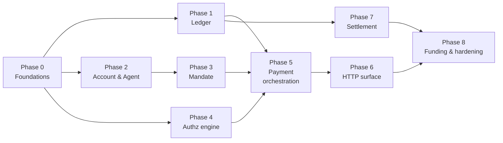

# MVP Implementation Plan

> **For agentic workers:** REQUIRED SUB-SKILL: use `superpowers:subagent-driven-development` (recommended) or `superpowers:executing-plans` to implement this task-by-task. Steps use checkbox (`- [ ]`) syntax for tracking.

**Goal:** An agent owner funds an account, connects an agent with spending rules, that agent pays for things through Cleargate, and the owner sees every payment and every block. (Whitepaper §22)

**Architecture:** One Go modular monolith. **Module-first** — vertical slices by feature — with clean-architecture **layers inside each module** (domain, service, repository, handler). The domain defines its repository *interfaces*; dependencies point inward; cross-module calls go through service interfaces only; concrete infrastructure is wired in `main` and nowhere else. Gin at the edge, Postgres as the system of record, Redis as a disposable cache. Two binaries — `api` (hot path) and `worker` (everything slow) — built from the same modules.

**Tech stack:** Go 1.26 · Gin · pgx/v5 · shopspring/decimal · golang-migrate · testcontainers-go · go-webauthn · Ed25519 · **Coinbase CDP** (custody, policies, gas, KYT) · **x402-foundation Go SDK** (scheme logic) · on-ramp (Coinbase or MoonPay) · Solana/USDC.

**What this MVP is, in one line:** the **buyer-side** product. It is deliberately useful with **zero merchants integrated** (whitepaper §3), because every check that matters runs before money leaves the account, and every payment settles `exact` to whatever endpoint the agent found.

**Explicitly out of scope for MVP** (whitepaper §22): **guarantees and any loss absorption**, merchant onboarding, reputation scoring, intent check, behaviour check, agent-to-agent subcontracting (Case B). The pipeline *shape* for those exists; the logic is stubbed.

**In scope even though it looks deferrable.** One thing is cheap now and unrecoverable later, so it ships with the MVP rather than after it:

| Item | Why now |
|---|---|
| **Scheme-selecting rail adapter** (§8.6) | `exact` is the only implementation that ships, but netting arrives as a second implementation rather than a rewrite of the money path |

**Holds: mechanism now, activation later.** The hold is a settlement mechanic with zero capital at risk (§7.2), and its ledger states belong in Phase 1 where the ledger is being designed anyway. It cannot *function* until there is an on-platform payee whose settlement timing we control, which arrives with netting in the second act. Build the states, leave them dormant.

**Separate repositories:** TypeScript SDK, MCP server, console frontend. This repo owns the API and the contract in `api/openapi.yaml`.

---

## How to read this plan

Each phase ends with something that works and is committed. Each task follows the same rhythm: **write a failing test → watch it fail → minimal implementation → watch it pass → commit.**

Boxes marked **Why this and not that** explain a decision that has a plausible-looking alternative. Read those; they are where the reasoning lives.

When a task is built, its code and SQL sketches go: replace them with a **Built** line that names the files and tests, and keep the Why boxes and any difference from the original design. The code is then the only copy of the code, and an agent cannot mistake a stale sketch for the real thing.

---

## Phase ordering, and why it is not the obvious one

The instinct is to build the API endpoint first, because it demos. This plan builds the **ledger** first and the API sixth. Three reasons:

1. **Cost of being wrong.** A ledger bug moves money incorrectly and does so *silently*. A routing bug is a 404 you notice in a minute. Spend the fresh attention on the thing whose failures are invisible.
2. **Dependency direction.** Ledger depends on nothing. Payment depends on everything. Building bottom-up means every phase is testable in isolation the day it is written.
3. **The compiler works for you.** Once `currency.Amount` exists and refuses `float64`, every later phase inherits that safety for free.

The objection — "then we have nothing to show for two weeks" — is answered by Phase 0, which puts a deployable service with a health check in CI on day two. After that each phase is 2–5 days and independently demonstrable.



Phases 2/3 and 4 are independent of Phase 1 — parallelisable if more than one person is working.

---

# Phase 0 — Foundations

**Outcome:** `make dev-up && make run-api` serves `GET /v1/health` against a real Postgres, and `make test-int` runs the same in CI against a throwaway container.

### Task 0.1: Money type

**Files:** `internal/shared/currency/currency.go`, `internal/shared/currency/currency_test.go`

**Built.** `currency.Amount` is an exact decimal bound to an asset; adding or comparing across assets is an error, and nothing accepts a `float64`. The tests are in `currency_test.go`, and the 0.1 + 0.2 case is the one that guards the rule.

> **Why this and not that — no `float64` constructor**
> `0.1 + 0.2 != 0.3` in IEEE-754. The ledger's defining invariant is that postings sum to exactly zero, so a type that cannot represent its own inputs cannot satisfy it. The protection is not "remember to use decimal" — it is that no function in this package accepts a `float64`, so the mistake does not compile. Whitepaper §8.3 depends on this.

### Task 0.2: Config, database pool, unit of work

**Files:** `internal/infrastructure/config/config.go`, `internal/infrastructure/database/postgres.go`, `internal/infrastructure/database/unitofwork.go`

**Built.** `config.Load` reads the environment only. `database.DB` holds the pool and `UnitOfWork.Do` carries the transaction in `ctx`; its tests are `internal/infrastructure/database/unitofwork_test.go`. The test fixtures are in `test/fixtures` (one Postgres and one Redis per test process, a database cloned from a migrated template per test).

> **Why this and not that — the unit of work takes a `context.Context`, not a `*sql.Tx`**
> Repositories need to run inside a caller-controlled transaction, but a repository method signature must not leak the transaction type — that would force every module to import pgx and would break the dependency rule. Stashing the transaction in the context means `Post(ctx, ...)` joins whatever transaction is open, and works identically outside one. One signature, both cases.

> **Why this and not that — a real container, not `sqlmock`**
> Most of the ledger's correctness lives in *database* constructs: the zero-sum constraint, the partial unique index enforcing one live mandate, generated columns keeping signed and queryable data in sync. `sqlmock` tests your Go against an imaginary database — it would pass while production is broken. One container per package costs a few seconds and tests the thing that actually enforces the invariant.

### Task 0.3: Migration tooling and the walking skeleton

- [x] **Step 1:** `cmd/migrate` wrapping `golang-migrate`, subcommands `up`/`down`/`version`.
- [x] **Step 2:** `migrations/000001_extensions.up.sql` — `CREATE EXTENSION IF NOT EXISTS pgcrypto;`
- [x] **Step 3:** `internal/infrastructure/server` — Gin engine with request-ID, structured logging, panic recovery, and the single `apperr.Kind → HTTP status` mapper.
- [x] **Step 4:** `internal/app/api.go` — `BuildAPI(ctx, cfg, log) (*API, func(), error)` registering only `GET /v1/health` (checks DB and Redis).
- [x] **Step 5:** `cmd/api/main.go` — graceful shutdown as sketched in the scaffold.

> **Why this and not that — migrations never run on API boot**
> A rolling deploy starts several instances at once. If each runs migrations, they race on the same DDL and one wins arbitrarily. `cmd/migrate` runs as an explicit deploy step, before the new version starts.

- [x] **Step 6: E2E test and commit**

```go
// test/e2e/health_test.go — asserts 200 and {"status":"ok"} from a fully built app
```

```bash
git commit -m "feat: walking skeleton — migrations, gin bootstrap, health endpoint"
```

**Phase 0 done when:** CI runs unit + integration tests green, and `make run-api` answers `/v1/health`.

---

# Phase 1 — Ledger

**Outcome:** money can be recorded correctly. Unbalanced entries are impossible. Balances and spend counters are derivable and reconciled.

### Task 1.1: Schema

**Files:** `migrations/000002_ledger.up.sql` / `.down.sql`

**Built** in `migrations/000002_ledger.up.sql`: `ledger_account`, `journal_entry` and `posting`, with a deferred constraint trigger that refuses an entry whose postings do not sum to zero. The trigger's test is in `internal/modules/ledger/repo_postgres_test.go`.

> **Why this and not that — enforce in the database, not in Go**
> Application-level validation protects only the paths that remember to call it. Backfills, admin scripts, a future service and a 3am hotfix all bypass it. The constraint is the last line that cannot be bypassed. Go validates too — for a good error message — but the database is what makes the invariant true.

> **Why signed amounts rather than a `direction` column**
> The invariant becomes `SUM(amount) = 0`, which the trigger checks directly. A `direction` enum turns it into `SUM(CASE WHEN direction='debit' THEN -amount ELSE amount END)`, which is slower, harder to index, and easy to get backwards.

### Task 1.2: Post and Balance

**Files:** `internal/modules/ledger/{domain,service,ports,repo_postgres}.go` + tests

**Built** in `internal/modules/ledger` (`domain.go`, `service.go`, `ports.go`, `repo_postgres.go`). `Post` writes a balanced entry, locking the debited `customer_funds` buckets in id order and returning `ErrInsufficientFunds` without writing; `Balance` derives from postings.

### Task 1.3: Spend counters

**Files:** `migrations/000003_spend_counters.up.sql`, `internal/modules/ledger/counter.go`

**Built** in `migrations/000003_spend_counters.up.sql` and `internal/modules/ledger/counter.go`. The increment is one atomic upsert; tests are in `repo_postgres_test.go`.

> **Why this and not that — a counter, never a balance on `agent`**
> Whitepaper §9.3: *"Agents do not hold money. They hold spending authority."* Giving an agent a balance rebuilds per-agent wallets and inherits stranded capital, multiplied key management, and painful reconciliation. The counter is a meter that enforces a cap; the money stays pooled at the account. This is the corporate-card model.
>
> The counter is technically derivable from postings, but deriving it costs a scan on the 100ms path — so it is *maintained* and *reconciled* nightly, the same pattern §8.3 prescribes for the ledger itself.

> **Why this and not that — upsert rather than read-modify-write**
> Whitepaper §8.5 describes the exact bug: two concurrent requests both read the same remaining balance and both approve. A read in Go followed by a write is that bug. The single atomic statement makes the increment indivisible, and returning the new total lets the caller detect a cap breach *after* the fact within the same transaction, then roll back.

### Task 1.4: Reconciliation job

- [ ] Worker job, hourly: `SELECT SUM(amount) FROM posting` must be `0`; non-zero pages immediately (§8.3).
- [x] Nightly: recompute counters from postings, alarm on drift.
- [ ] Test: inject an imbalance in a test DB, assert the job reports it.
- [ ] Commit `feat(worker): ledger zero-sum and counter reconciliation`

### Task 1.5: Hold states — the mechanism, dormant

A hold commits funds without releasing them, verifies delivery, and returns the money automatically if delivery never comes (§7.2). It **risks no capital**, because the money being withheld is money already held — it is a settlement mechanic, not underwriting.

- [ ] Model the states on the ledger entry: `committed`, `released`, `refunded`, `expired`. Expiry is a timestamp, and the sweep is a worker job.
- [ ] A hold that expires posts a reversing entry to the buyer. Append-only means a refund is a new entry, never an update (§8.3).
- [ ] **Tests:** `TestHold_CommitsWithoutReleasing`, `TestHold_ReleaseRequiresDeliveryConfirmation`, `TestHold_ExpiryRefundsBuyer`, `TestHold_DoubleReleaseIsRefused`

> **Why build it now if nothing can use it yet**
> A hold requires controlling settlement timing, which means an on-platform payee, which arrives with netting in the second act — so in this MVP it is dormant. But these are *ledger states*, and the one moment to get ledger states right is while the ledger is being designed. Adding a fourth state to a live money table is a migration over every historical row, run against real balances.

> **Why holds are not a guarantee, stated in the plan as well as the whitepaper**
> They will be confused, repeatedly, by anyone reading quickly. A hold withholds money we already have. A guarantee pays out money we do not. The first costs nothing and ships; the second requires a loss book and does not (§7.3). No code in this task may reference a reserve, a coverage limit, or absorbing a loss.

**Phase 1 done when:** an unbalanced entry cannot be committed by any path, the reconciliation job proves the book balances, and a hold can be committed, released and expired without any path releasing money twice.

---

# Phase 2 — Account and agent

**Outcome:** the entity model of §4.1 exists, a human can sign up and log in safely, agents authenticate, revocation is instant.

**Two authentication surfaces, deliberately separate.** Humans authenticate with email, password and TOTP, and get a revocable server-side session. Agents authenticate with a bearer credential and no session at all. The surfaces share no credential, no token format and no route: a stolen agent key can never reach a console route, and a stolen console session can never sign a payment. Phase 6 enforces that split structurally with route groups.

**Two authorization models, for the same reason.** A human is authorized by *role* — what kind of action may this person take. An agent is authorized by *mandate* — how much money may this program move, and within what caps (Phase 3). Roles never apply to agents, mandates never apply to humans, and an agent's authority is always derived from a human's: an admin signs the mandate that grants it.

**And on a guarded account, no single human can widen that authority alone.** Raising a spending cap is proposed by an owner or admin, waits out the account's timelock, and lands only if the guardian does not veto it. The guardian can stop but never propose, so a stolen guardian credential is worth nothing on its own and a stolen admin credential is worth nothing before the window expires.

**Those protections are opt-in.** An account with no guardian and no timelock — the retail default — applies changes immediately and simply gets notified. Appointing a guardian or setting a timelock switches the controls on, and the asymmetry that keeps this honest is that **enabling protection is instant while disabling it is delayed, notified and vetoable**. Task 2.8 has the mechanism; the roles are `owner`, `admin`, `guardian`, `viewer`.

**Two separations do all the work.** *Propose versus stop* (owner and admin versus guardian) is the security boundary. *Own versus operate* (owner versus admin) is the organisational one — who Cleargate holds accountable, versus who runs the agents day to day.

**Nor can Cleargate.** The key that authorises spending lives in the admin's own device (Task 2.9) and signs the mandate payload directly (Task 3.1). We store public keys and verify; we hold nothing that can mint authority. An attacker who owns every server we run can corrupt records but cannot forge a mandate.

### Task 2.1: Schema

**Files:** `migrations/000004_identity.up.sql`

**Built** in `migrations/000004_identity.up.sql`: the entity model of §4.1 (`principal`, `app_user`, `account`, `account_membership`, `agent`, `agent_credential`, `agent_session`), login sessions and MFA factors, invitations, `account_control_change`, `notification` and `auth_event`. `000005` adds verification tiers and address screening. `docs/data-architecture.md` §5 describes the schema, and the migration's comments carry the reasoning for each constraint.

> **Why the login email is not PII-table PII**
> An authentication identifier and a compliance identity are different facts with different lifecycles: you are KYC'd under a legal name and you sign in with an address, and the two change independently. Putting the login email in `principal_identity` forces a unique index onto the most sensitive table in the system and puts that table in the read path of an unauthenticated endpoint. `principal_identity` is therefore the only home of *compliance* identity, and `app_user.email` is an authentication key. Erasure is correspondingly two steps, not one: delete `principal_identity`, and rewrite `app_user.email` to a unique tombstone.

> **Why `email = lower(email)` as a CHECK rather than normalising in Go**
> Application-side normalisation is one forgotten call site away from letting `A@x.com` and `a@x.com` both register, and the resulting duplicate is discovered when someone cannot log in. The database refusing the write makes the invariant unforgeable, in the same spirit as the ledger's balance constraints.

> **Why exactly one owner per account**
> The partial unique index makes "one accountable party per account" a database fact rather than a convention. Ownership is the role that can transfer the account and remove other members; two of them means two people who can lock each other out, and no answer to "who authorised this" in a dispute. Admins get everything else. Transfer is an explicit flow, which is also why `account_invitation.role` cannot be `owner` — nobody is invited into ownership by email.

> **Why `parent_account_id` now, when nothing uses it**
> §9: *"Multi-tenancy is designed in from the first commit because retrofitting it is a rewrite."* A nullable self-reference costs one column today. Adding it later means backfilling every account, rewriting every authorization query to be hierarchy-aware, and re-testing the whole permission model.

> **Why `agent_session` now, when the MVP has no behaviour check**
> Same argument, sharper: session membership is knowable *only* at request time. If the SDK does not send a session ID from day one, the data for §6.4's "rate of novel merchants per session" is not late — it never existed.

> **Why erasure is not a single delete once money has moved**
> AML record-keeping obligations run five to seven years and override an erasure request as a legal obligation. A design that promises "erasure is one row" will be broken by compliance the first time an erased principal is subpoenaed. `retention_hold_until` is set when a principal first funds; erasure before that date restricts and anonymises rather than deletes, and the API says so honestly.

- [ ] **Tests:** `TestEmailUniquenessIsCaseInsensitive`, `TestSecondOwnerIsRejected`, `TestRevokedAgentRequiresTimestamp`, `TestVerifiedKycRequiresTimestamp`

### Task 2.2: Password, session and validation primitives

**Files:** `internal/modules/account/credential.go`, `internal/infrastructure/crypto/`, `internal/infrastructure/cache/`

- [x] **Tests:** `TestHashPassword_ProducesPHCString`, `TestVerify_RejectsWrongPassword`, `TestVerify_UnknownEmailCostsSameTime`, `TestNeedsRehash_WhenParamsChange`, `TestSessionToken_HasFullEntropy`, `TestSessionLookup_NeverStoresPlaintext`
- [x] Argon2id at OWASP defaults (19 MiB, t=2, p=1), stored as a PHC string.
- [x] Session tokens: 32 bytes from `crypto/rand`, base64url, stored as `sha256`.

> **Why a PHC string and not a bare hash**
> `$argon2id$v=19$m=19456,t=2,p=1$...` carries its own parameters, so raising the cost next year is a config change plus an opportunistic rehash on next login, not a migration that cannot read the old rows. This applies to everything a human chooses or types — `app_user.password_hash` and `user_recovery_code.code_hash` — and to nothing else.

> **Why SHA-256 for session tokens when passwords get argon2id**
> Argon2id is expensive on purpose because a password is low-entropy and offline-guessable. A session token is 256 bits from a CSPRNG; there is nothing to guess, so the only requirements are that a database leak must not yield usable tokens and that lookup must be indexable. A fast digest satisfies both. Using argon2id here would add ~50ms to every console request and buy nothing.

> **Why opaque tokens and not JWTs**
> This phase's outcome says revocation is instant. A JWT is valid until it expires, so revocation means either a blocklist — which is the session table with extra steps — or waiting. A row you can `UPDATE ... SET revoked_at = now()` is the simpler thing that actually meets the requirement, and it makes "show me my active sessions and sign them all out" a `SELECT`.

**Session validation cache.** Validating a session is a read on every authenticated request, so it gets a Redis fast path in front of Postgres:

- [x] Session lifetime `account.DefaultSessionLifetime = 12h`; cache window `account.DefaultCacheWindow = 1m`.
- [x] Key `sess:<token_hash>`, value `{user_id, mfa_satisfied_at, expires_at}`, TTL `min(60s, time until expires_at)`.
- [x] **Read:** hash the cookie, `GET`. On a hit, authorise from the cached value. On a miss *or any Redis error*, read `user_session` in Postgres and repopulate.
- [x] **Revoke:** write `revoked_at` in Postgres, commit, then `DEL` the key.
- [x] Invalid tokens are not cached; the per-IP throttle in Task 2.3 covers hammering, and a negative entry is one more thing that can be wrong.
- [x] **Tests:** `TestSessionCache_HitAvoidsPostgres`, `TestRevokeDeletesCacheEntry`, `TestRedisDownFallsBackToPostgres`, `TestCacheEntryNeverOutlivesSession`, `TestCachedSessionCarriesNoRoles`

> **Why a 60-second TTL and not the session's own lifetime**
> The `DEL` on revoke is what makes revocation instant; the TTL exists for when that `DEL` does not happen. Three ways it does not: the call errors and something swallows it, the process dies between the commit and the delete, or a concurrent request misses the cache and repopulates it from a not-yet-committed read. All three leave a revoked session cached as valid. With a session-lifetime TTL that stale entry is usable for days — which is exactly the JWT failure mode this design exists to avoid, reintroduced through the back door. At 60 seconds the worst case is a minute, and the cost of the shorter window is one indexed lookup per active session per minute.

> **Why Redis errors are treated as cache misses**
> A cache that fails closed turns a Redis blip into an outage; a cache that is authoritative turns a Redis flush into a security incident. Neither applies here, because Postgres remains the source of truth and Redis holds a derived copy with a bounded lifetime. Every failure — down, flushed, evicted, partitioned — degrades to the Postgres path that was correct before the cache existed. This is precisely the property a JWT blocklist cannot have: there, losing the store silently makes revoked tokens valid again, because the signature still verifies on its own.

> **Why roles are not in the cached value**
> Cache only what the cache key's deletion already invalidates. Session identity is keyed by the token, so `DEL sess:<hash>` covers all of it. A membership role is keyed by `(account, user)` and changes on its own schedule — cached next to the session, it would outlive its own revocation, and demoting an admin would not take effect until that person happened to log out. Membership stays an indexed read against Postgres, for the same reason everything else in this phase does.

### Task 2.3: Sign-up, verification and login

- [x] **Tests:** `TestSignup_DoesNotRevealExistingEmail`, `TestLogin_RejectsUnverifiedEmail`, `TestLogin_RejectsSuspendedUser`, `TestSessionsDieOnPasswordChange`, `TestResetToken_IsSingleUse`, `TestResetToken_Expires`, `TestFailedLoginIsAudited`

Endpoints (Phase 6 registers these on an *unauthenticated* group):

- [x] `POST /v1/auth/signup` — creates `principal(kind='person')`, `principal_identity`, `app_user`, and an `email_verify` token. Records `user_consent` for the ToS version shown. Always answers `202`.
- [x] `POST /v1/auth/verify-email`, `POST /v1/auth/login`, `POST /v1/auth/logout`
- [x] `POST /v1/auth/password/reset-request`, `POST /v1/auth/password/reset`

> **Why every one of these answers the same way for known and unknown addresses**
> Signup, reset and login are the three endpoints that will tell an attacker which of a leaked address list are Cleargate customers — a list of people known to hold crypto balances, which is exactly the targeting data a phisher wants. All three return the same status and body either way, and login runs a dummy argon2id verify on unknown addresses so the response time does not leak what the body conceals.

> **Why `password_changed_at` instead of deleting sessions on change**
> Sessions issued before `password_changed_at` are rejected at validation time. One column invalidates every device atomically, including sessions created by a race during the change itself, and it cannot be defeated by a session row the delete query missed.

- [x] Throttle login and reset in Redis on `(ip, email)` with exponential backoff.

> **Why throttling and not account lockout**
> Lockout on failed attempts lets anyone who knows an address deny that person access to their own money, and during an incident the locked-out party is usually the legitimate owner trying to revoke an agent. Backoff raises the cost of guessing without handing an attacker a remote off switch. MFA, not lockout, is what makes a guessed password insufficient.

### Task 2.4: MFA and step-up authorization

- [x] **Tests:** `TestTotpEnrollment_RequiresConfirmingCode`, `TestTotpCode_CannotBeReplayed`, `TestRecoveryCode_IsSingleUse`, `TestFundingWithoutMfaIsRejected`, `TestStepUpExpiresAfterWindow`, `TestMandateSigningIgnoresStepUpWindow`

- [x] TOTP (RFC 6238), 30s step, ±1 step skew, secret envelope-encrypted with a key from config.
- [x] Ten recovery codes issued once at enrolment, argon2id-hashed.
- [x] **Gate:** enrolling TOTP is required before funding an account or inviting a user.
- [x] **Step-up:** those actions require `mfa_satisfied_at > now() - 15 minutes` (`account.DefaultStepUpWindow`), else `403` with kind `forbidden` and a `mfa_required` code.
- [ ] Signing a mandate, adding a payout destination, and proposing a control change are **not** covered by this window at all. They carry their own WebAuthn assertion (Task 2.9), which is strictly stronger: it proves presence over *that exact payload*, rather than presence at some point in the last quarter hour.

> **Why a payout destination is WebAuthn-signed rather than step-up gated**
> It decides where money lands, which makes it authority-creating in exactly the sense a mandate is — and the step-up window is backed by TOTP, which is phishable. An attacker who relays one code through a convincing proxy holds a valid step-up for fifteen minutes and can point the payouts at themselves. The rule that removes the inconsistency: **anything that creates authority or redirects money is signed, never merely stepped up.** TOTP step-up remains proportionate for funding and invites, which add money or people rather than redirecting either.

> **Why the TOTP secret is encrypted and the password is hashed**
> Verifying a TOTP code means recomputing HMAC over the shared secret, so the server must be able to read it back — hashing it would make verification impossible. That makes the encryption key a real secret with a real blast radius, which is the argument for keeping it in the same managed store as the §8.10 signing keys rather than in an environment variable.

> **Why `last_used_step` exists**
> A TOTP code is valid for a whole 30-second window, so an attacker who observes one — over the shoulder, in a phishing proxy, in a log — can replay it until the window closes. Recording the highest step already accepted makes each code usable exactly once.

> **Why step-up gates these actions specifically**
> An invite adds a person and funding brings real money in, so a stolen session cookie alone should not be enough for either. Everything else in the console is reading, where a session by itself is proportionate — and everything *above* them, in the signed tier, is covered by WebAuthn instead.

> **Why TOTP survives at all once WebAuthn exists**
> WebAuthn is the better second factor — it is phishing-resistant, and a TOTP code can be typed into a convincing fake site. But the two are doing different jobs here. TOTP is the *login* factor, backed by recovery codes, so losing a device is an inconvenience rather than a lockout. WebAuthn is the *authorisation* factor, deliberately not recoverable by anything the server can mint, which is what gives a mandate signature its value. Collapsing login onto WebAuthn too is a reasonable later move; doing it now would put device loss on the critical path of simply signing in.

### Task 2.5: Invitations and membership

- [x] **Tests:** `TestInvite_CannotGrantOwner`, `TestInvite_TokenIsSingleUseAndExpires`, `TestAcceptInvite_CreatesMembership`, `TestRevokedInviteCannotBeAccepted`, `TestLastOwnerCannotLeaveAccount`, `TestAdminCannotManageOtherAdmins`, `TestGuardianCannotBeRemovedByMembershipDelete`, `TestFirstGuardianInviteIsInstant`
- [x] Accepting an invite for an unknown address runs the signup flow first, then the membership insert, in one transaction.

**Who may manage whom:**

| Target role | Invite / remove / demote by |
|---|---|
| `viewer` | owner, admin |
| `admin` | **owner only** |
| `guardian` (first, when none exists) | owner — instant, it enables protection |
| `guardian` (replacing or removing one) | owner — via `account_control_change` only |
| `owner` | nobody; `transfer_owner` instead |

> **Why guardian membership cannot be edited through this table**
> Every control in Task 2.8 assumes the guardian row exists. If an admin — or an owner — could simply `DELETE` it here, the entire veto mechanism would be bypassable with a write to a different table, and none of the delays or notifications above would fire. Removing or replacing a guardian is therefore *only* reachable through `account_control_change`, and the membership path must refuse it outright. This is the single most important test in this task.

> **Why an admin cannot manage other admins**
> Two admins who can each remove the other is a lockout race, and during a compromise the attacker wins it by acting first. Routing admin changes through the owner keeps a single accountable party for "who is allowed in", and it is the one place the owner/admin split does real work rather than being an org chart.

### Task 2.6: Connecting an agent, and its credentials

Three separate things, in order, and each is useless without the next: the **registration** is an identity (`agent`), the **credential** lets it authenticate (`agent_credential`), and the **mandate** lets it spend (Phase 3). Connecting an agent grants nothing on its own.

**`agent_credential` stays authentication-only — it is not, and never becomes, a money-movement key.** It answers "who is asking," nothing more, exactly as built. Two other key roles exist in the finished system — the CDP account wallet and a delegated voucher-signing EOA (§8.8) — and **both are scoped to the account, not the agent**, because they draw against the same pooled balance spend counters already meter (§9.3): two agents calling the same payee share one wallet and, once a channel opens, one delegated key. Neither belongs on this table. The wallet is provisioned in Task 7.5; the delegated key is generated lazily on first channel promotion in Task 7.2, sealed with the same `SecretSealer` built for TOTP secrets in Task 2.4.

- [x] **Tests:** `TestIssueCredential_ReturnsSecretOnlyOnce`, `TestGeneratedSecret_Is256BitsOfCSPRNG`, `TestVerify_RejectsRevoked`, `TestVerify_RejectsCredentialOfRevokedAgent`, `TestVerify_ConstantTimeOnMismatch`, `TestAgentCredentialCannotOpenUserSession`, `TestConnectedAgentWithoutMandateCannotSpend`, `TestRotateCredentialWithoutDowntime`

> **Why credentials are separate objects from the agent**
> So a key can be rotated without destroying the identity that carries the mandate and the decision history. Issue the new key, deploy it, revoke the old one — both are valid during the overlap, so nothing breaks. It also gives revocation three widths: a **credential** (that one key dies), an **agent** (all its keys and its mandate die), or a **freeze** (every agent on the account stops). You reach for the third when you do not yet know which agent is compromised. All three are instant, because an agent never held funds — only a counter.
- [x] Format: `cg_live_<prefix>_<secret>`, where `secret` is 32 bytes from `crypto/rand` in base64url and `prefix` is a non-secret handle from the same source.
- [x] Store `sha256(secret)`; the prefix is the index. Compare in constant time.

> **Why a prefix plus a hash rather than hashing the whole key**
> You need an indexed lookup, and you cannot index a salted hash. The prefix is a non-secret handle that finds one row; the hash then verifies the secret. It is also safe in logs, which means a support engineer can identify a credential without ever seeing it.

> **Why this and not that — SHA-256 here, argon2id for passwords**
> The choice follows the *entropy of the secret*, not the importance of what it protects. Argon2id is slow deliberately, to make guessing a human-chosen password expensive. This secret is not human-chosen: it is 256 bits from `crypto/rand`, so there is no candidate list to guess from and no work factor that would make an already-infeasible search harder. That is the same reasoning Task 2.2 applies to session tokens, and an agent credential has the same shape.
>
> Using argon2id here would also be actively harmful, because an agent credential is presented on *every* request — agents have no session to amortise it over, unlike a human who pays that cost once at login. At ~50ms and 19 MiB per verification it would consume half the p99 budget Task 6.3 gates on, and it would hand an attacker an amplification vector: a well-formed prefix with a garbage secret is enough to make the server burn memory and CPU rejecting it, no valid credential required.
>
> The load-bearing assumption is that the secret really is full-entropy, which is why `TestGeneratedSecret_Is256BitsOfCSPRNG` exists. Shorten the secret or make it human-readable and this reasoning collapses.

### Task 2.7: KYC mirror and the funding gate

- [ ] **Tests:** `TestFundingRejectedWhenKycNotVerified`, `TestKycWebhookIsIdempotent`, `TestKycWebhookRequiresValidSignature`, `TestUnknownOnrampCustomerIsRejected`, `TestFirstFundingSetsRetentionHold`

- [ ] Register the on-ramp customer at first funding attempt; store `(provider, external_id) → principal_id` in `onramp_customer`.
- [ ] Mirror the provider's verification verdict onto `principal_identity.kyc_status` with its `kyc_reference`.
- [ ] Set `retention_hold_until` on the first successful funding.

**Verification is gated by spend tier, never by funding method** (§8.9). Tying KYC to *how* money arrives produces the wrong shape: a $20 card top-up would face more friction than $20,000 in stablecoin.

| Tier | Requires | Unlocks |
|---|---|---|
| `basic` | Email | Low cap, trial-sized spending |
| `verified` | Identity verification | Standard limits |
| `business` | Legal entity plus beneficial ownership | High limits |

- [x] Store the tier on `principal_identity` and enforce **limits** against it, not against the funding route.
- [ ] **Card and bank funding:** the on-ramp is the regulated party and sets an unavoidable verification floor even for small amounts. Inherit their tiers; do not attempt to undercut them.
- [x] **Direct stablecoin funding:** we set the terms. Allow a low-cap trial with **no formal KYC** but **mandatory on-chain address screening** via CDP KYT. Screening is not KYC and the schema must not conflate them — screening asks whether an address is associated with sanctioned or criminal activity, KYC asks who the person is.
- [ ] **Withdrawals mirror this:** to a crypto wallet we control the path, screen the address, and keep friction low for small amounts; to a bank an off-ramp is involved and KYC is unavoidable.
- [x] **Return-to-source withdrawal is what makes the unverified tier safe to offer.** A `basic` principal may only withdraw to an address that actually funded them, so an unverified account cannot move value between two addresses — only return what it brought. Without this, funding anonymously and withdrawing elsewhere is a laundering route, and repeated across accounts it is textbook structuring. Verification lifts the restriction, which is the honest trade: tell us who you are and you may send money where you like.
- [x] The destination is screened at **every** tier. Verification was never a claim about where somebody sends money.
- [x] **Tests:** `TestUnverifiedPrincipalCanFundSmallAmountWithoutKyc`, `TestUnverifiedFundingStillRequiresScreening`, `TestSpendLimitFollowsTierNotFundingMethod`, `TestTierAboveBasicRequiresVerifiedKyc`, `TestUnverifiedWithdrawalMustReturnToSource`, `TestVerifiedPrincipalMayWithdrawAnywhere`, `TestWithdrawalScreensDestinationAtEveryTier`, `TestAddressComparisonIgnoresCase`, `TestFundingRefusedWhenHistoryNotWired`

> **Why funded-to-date comes from the ledger through a port, not from a column here**
> A running total kept alongside the entries it summarises is a total that can disagree with them. The ledger is the system of record for money that moved, so the cap is measured against the ledger — reached through a `FundingHistory` port rather than by reading its tables, because a module reading another module's schema is the shared-database coupling that module boundaries exist to prevent. The gate **refuses** when that port is unwired rather than assuming zero: a missing dependency must not silently become an unbounded cap.

> **Why screening rather than verification on the low-friction path**
> A frictionless trial is the whole reason direct crypto funding exists as a route, and requiring identity documents for a $20 experiment kills it. AML responsibility remains ours on that path regardless of how the money arrived — **screening is precisely what makes low friction non-reckless rather than merely non-compliant.** Dropping it in the name of onboarding speed is the version of this decision that ends in an enforcement action.

> **Why mirror the on-ramp's verdict rather than run our own KYC**
> The provider must KYC the buyer to sell them stablecoin at all, so running a second verification duplicates the friction and doubles the sensitive documents we hold. Mirroring keeps the verdict authoritative where the obligation sits. The cost is that a user cannot be verified before their first funding attempt, and coverage is the provider's; `kyc_provider` and `kyc_reference` exist so that adding an owned provider later is a new row, not a schema change.

> **Why the gate is in the funding service and not only in the webhook handler**
> The webhook is one path to a `funding` entry today; reconciliation repair, manual credits and a second provider are the paths that arrive later. Putting the check where the journal entry is written means every future path inherits it, rather than each new caller being asked to remember.

### Task 2.8: Guardian, timelock and account control changes

**Not in MVP.** Every account is Simple tier. Only freeze ships: owner or admin sets `frozen_at`, authorization declines everything (Task 4.1), and unfreezing is instant (Task 6.2).

Protection here is **opt-in and tiered**. An account with no guardian and no timelock behaves simply: changes take effect immediately. Appointing a guardian, or setting a timelock, switches the controls on.

| Tier | Configuration | Behaviour |
|---|---|---|
| **Simple** — the default | no guardian, `timelock_hours = 0` | Everything instant. Notifications still fire. |
| **Self-guarded** | timelock set, no guardian | Delays apply, nobody vetoes. The account still gets the email and can freeze inside the window — this protects a solo operator against *their own* stolen session. |
| **Guarded** — business | guardian appointed, timelock set | Full model below. |

**The guardian's power is subtractive only.** It vetoes and freezes; it never proposes, invites, or creates. A stolen guardian credential is therefore worth zero dollars on its own.

**Three classes of change:**

**1. Risk-increasing** — raising a cap, adding a payout destination. Owner or admin proposes; it waits out `timelock_hours`; the guardian may veto inside the window. With no timelock it is instant; with no guardian nothing vetoes and it simply lands when the clock runs out.

**2. Control-altering** — `transfer_owner`, `reassign_guardian`, `remove_guardian`, `lower_timelock`, `close_account`. **Owner proposes only.** Delayed and notified. Vetoable as follows, and the split matters:

| Change | Vetoable by |
|---|---|
| `transfer_owner` | current owner **and** guardian |
| `lower_timelock` | guardian |
| `reassign_guardian`, `remove_guardian` | **nobody** |
| `close_account` | guardian |

**3. Risk-reducing** — revoking an agent or a credential, tightening a cap, freezing the account. Instant, no delay, available to owner, admin *or* guardian.

**Freeze semantics.** Freezing sets `account.status = 'suspended'`, and a suspended account **declines every agent payment authorization for every agent under it** — the account-wide version of revoking one agent. Unfreezing is instant *for the user who froze* and delayed for anyone else.

- [ ] **Tests:** `TestSimpleTierAppliesChangesInstantly`, `TestFirstGuardianCanBeAppointed`, `TestGuardianCannotVetoOwnRemoval`, `TestGuardianCanVetoTimelockReduction`, `TestRaisingTimelockIsInstant`, `TestLoweringTimelockWaitsCurrentTimelock`, `TestGuardianCannotProposeAnyChange`, `TestGuardianVetoStopsPendingMandate`, `TestVetoedProposalCanBeReProposed`, `TestProposerCanCancelOwnProposal`, `TestFrozenAccountDeclinesAllAgentPayments`, `TestFreezerCanUnfreezeInstantly`, `TestOtherUserUnfreezeIsDelayed`, `TestPendingProposalKeepsOriginalEffectiveAt`, `TestRemovingGuardianDoesNotApplyPendingProposals`, `TestOnlyOwnerCanProposeControlChange`
- [ ] Proposing a control change requires a **WebAuthn assertion** over its canonical payload (Task 2.9), as does vetoing one — a server compromise must not be able to manufacture either party's decision.

> **Why protection is opt-in, and why that is not a bypass**
> Requiring a guardian would have made the model unbuildable: appointing the first one needed a current guardian to approve it, so no account could ever have one. Making it optional removes that circularity and stops charging a solo retail user a 24-hour delay that protects them from nobody. What keeps it from becoming a bypass is the asymmetry — **turning protection on is instant, turning it off is delayed, notified and vetoable.** An attacker's first move is always to disable the alarm, so that is the move the design makes slow and loud.

> **Why lowering the timelock waits out the *current* timelock**
> Otherwise the shortest path to a fast malicious change is to shorten the wait first. Setting the delay to zero must itself sit through the delay that was in force when it was proposed, which makes the attack no faster than the change it was meant to accelerate.

> **Why the guardian cannot veto their own removal**
> The earlier design let them, which meant a compromised or simply uncooperative guardian could never be dislodged — the control became the lockout. They do not need that veto, because they hold something better: they are **notified immediately and can freeze the account instantly**, while their removal takes days. A guardian who believes they are being removed by a hijacked owner stops all money in one click and calls Cleargate; the removal is slow, the brake is instant, and the human process resolves who is legitimate.
>
> They keep the veto on `lower_timelock` and `close_account`, which reduce protection without touching their tenure — there is no conflict of interest in those, and no lockout risk.

> **Why unfreezing is instant for the freezer and delayed for everyone else**
> Freezing must be instant for everyone, because stopping harm should never be slower than causing it. But if unfreezing were equally instant, a compromised owner would simply undo a legitimate guardian's freeze. Delaying the cross-user case means the guardian can always re-freeze faster than an attacker can lift it — the brake wins the race — while an accidental freeze is still a one-click undo by the person who made the mistake.

> **Why a veto cancels a proposal rather than killing the subject**
> A veto stops *that proposal*; the same change may be proposed again. This keeps a hostile guardian from permanently bricking an account's ability to operate — repeated vetoes degrade rather than destroy, and they are visible in `auth_event` and in the notification trail, which is what turns obstruction into break-glass evidence rather than a silent stalemate.

> **Two edge cases the implementation has to get right**
> A pending proposal is governed by the timelock **in force when it was proposed** — `effective_at` is fixed at write time and never recomputed. Otherwise "disable the timelock" becomes a way to instantly land an already-pending malicious change, and the bypass swallows the whole mechanism.
>
> Removing a guardian does **not** apply their outstanding vetoes or accelerate pending proposals. Proposals keep their original clock; a removed guardian simply stops being able to veto new ones.

> **What this still does not solve**
> An owner and a guardian compromised simultaneously, an owner who is gone entirely (only the owner may propose `transfer_owner`), and a user who has lost every WebAuthn credential. All three need identity re-verification by a human at Cleargate — deliberately **not** an endpoint, because a break-glass path that mints authority from an email link is a backdoor around everything above it. Three runbook entries, written before the first customer account has a guardian rather than after the first support ticket.

### Task 2.9: WebAuthn enrolment

**Not in MVP.**

The keys that authorise spending live in the humans' devices, not in Cleargate. This task registers them; Task 3.1 uses them.

**Files:** `internal/modules/account/webauthn.go`

- [ ] **Tests:** `TestEnrol_StoresPublicKeyOnly`, `TestCannotSignWithFewerThanTwoCredentials`, `TestSecondCredentialMustBeDistinctAuthenticator`, `TestRevokedCredentialCannotSign`, `TestCannotRevokeBelowTwoWhilePrivileged`, `TestChallengeIsSingleUse`, `TestChallengeExpires`, `TestEnrolRejectsUnsupportedAlgorithm`
- [ ] Endpoints: `POST /v1/webauthn/credentials/begin`, `POST /v1/webauthn/credentials/finish`, `GET /v1/webauthn/credentials`, `DELETE /v1/webauthn/credentials/{id}`.
- [ ] Relying Party ID is the console's registrable domain; reject assertions from any other origin.
- [ ] **Gate:** two confirmed credentials before a user may sign a mandate or confirm a control change. Revoking below two is refused while that user holds `owner`, `admin` or `guardian`.
- [ ] The console repository implements the `navigator.credentials` calls; this repo owns challenge issuance and verification only.

> **Why two credentials, and why that is what made this MVP-viable**
> A single passkey turns device loss into an account lockout, which is the reason this was originally deferred past the MVP. Requiring a second — a phone beside a laptop, or a security key in a drawer — turns loss into an inconvenience: sign with the other, enrol a replacement. The alternative was a reset path that mints signing authority from an email link, which is precisely the backdoor an attacker would reach for first, and would have made the whole mechanism decorative.

> **Why cloud-synced passkeys are allowed, with the trade-off recorded rather than hidden**
> `backup_eligible` says whether a credential is a synced passkey (iCloud Keychain, Google Password Manager) or bound to one device. Synced is far more recoverable; device-bound is stronger, because the key was never inside anyone's cloud account and its security does not reduce to the strength of an Apple ID. Both are accepted and the flag is stored and shown in the console, so an account's real posture is visible rather than assumed — and a customer who later demands device-bound only is expressing a policy that this column is what a check would read.

> **Why the sign counter is stored but never trusted alone**
> `sign_count` exists to catch a cloned authenticator, and hardware keys increment it honestly. Synced passkeys typically return zero forever, because the same credential legitimately lives on several devices at once. Record it, alert on a *decrease* from a previously non-zero value, and never reject on it by itself — do that and you lock out every passkey user the first time they sign from their second device.

### Task 2.10: Administrative notifications

**Not in MVP.**

Every control in Task 2.8 depends on somebody *noticing*. A timelock nobody hears about is not a control, it is a delay — so notification is load-bearing security here, not product polish.

**Files:** `internal/modules/notify/`

- [ ] **Tests:** `TestProposalNotifiesGuardianImmediately`, `TestExpiringProposalSendsReminder`, `TestTargetOfActionIsNotified`, `TestSecurityNotificationsCannotBeDisabled`, `TestBouncedNotificationSurfacesAsAccountHealth`, `TestNotificationRidesTheSameTransaction`

- [ ] Emit on: proposal created, ~6h before `effective_at`, applied, vetoed, cancelled; freeze and unfreeze; membership and role changes; credential enrolled or revoked; agent connected or revoked; payout destination changed; every stage of an ownership transfer.
- [ ] **Notify the party acted upon, not only the actor** — removing a guardian notifies that guardian, demoting an admin notifies them.
- [ ] Written to the outbox in the **same transaction** as the change, so a change can never land without its notification being queued.
- [ ] Security notifications are **not suppressible** by any in-app preference.
- [ ] Links are deep links into the console, never one-click actions.
- [ ] A bounce or hard failure marks `notification.failed_at` and surfaces on the account as a health problem.

> **Why the email cannot carry a one-click veto**
> A one-click link in email hands the whole mechanism to whoever holds the inbox, and email is precisely the channel most likely to be compromised alongside a password. The link goes to the console; the veto itself still costs a WebAuthn assertion. Convenience here would delete the control it is attached to.

> **Why notification is out-of-band detection, not just a reminder**
> An attacker holding a session cookie almost certainly does not hold the victim's mailbox. Mailing every administrative change means a compromise surfaces through a channel the attacker does not control — which is why this fires even in the Simple tier, where there is no guardian and no delay. A solo operator with no guardian still learns that their agent's cap was just raised.

> **Why a bounce is an account-health problem**
> A guardian whose address bounces has silently stopped being a control while still appearing on the account as one. The veto window keeps elapsing and nobody is reading it. Surfacing failed delivery is what stops the model from quietly degrading into theatre.

- [ ] Commit `feat(account): entity model, human auth, webauthn, agent credentials, notifications`

---

# Phase 3 — Mandate

**Outcome:** spending authority is signed, versioned and verifiable — the control that makes §6.1 true.

### Task 3.1: Canonical payload and user-signed authority

**Not in MVP.** Until then the server creates the mandate after a TOTP step-up (Task 3.2).

**Cleargate holds no key that can create spending authority.** The admin's own authenticator signs the mandate; the server's only job is to verify the assertion and record it. Enrolment is Task 2.9.

> **Why this and not that — sign stored bytes, never a re-marshalled struct**
> The classic bug: sign `json.Marshal(rules)`, store the struct, later re-marshal to verify. Go map iteration order and future field additions produce *different bytes*, so the signature fails to verify and your evidence is worthless — discovered during a dispute, which is the worst possible moment.
> The fix is to treat the signed payload as opaque bytes: canonicalise once (RFC 8785 JCS), sign, store the exact bytes, and verify against those bytes forever. The typed rules are parsed *from* the payload, never back into it.

**The flow:**

1. Console posts the proposed rules. Server canonicalises, stores a draft, returns `challenge = SHA256(canonical_payload)`.
2. Browser calls `navigator.credentials.get({ challenge, userVerification: "required" })`.
3. The authenticator signs `authenticatorData ‖ SHA256(clientDataJSON)` with a key that has never left its hardware.
4. Server verifies against the enrolled public key, and checks four things before writing anything: the challenge equals the digest of the payload *it* holds, the origin is the console's, the UV flag is set, and the challenge has not already been consumed.

- [ ] **Step 1: Failing tests**

```go
func TestCanonicalise_IsStableAcrossMarshals(t *testing.T)  // byte-identical 100x
func TestChallengeIsDigestOfCanonicalPayload(t *testing.T)
func TestVerify_FailsOnAnyMutation(t *testing.T)            // flip one byte -> reject
func TestVerify_FailsOnWrongCredential(t *testing.T)
func TestVerify_RejectsMismatchedChallenge(t *testing.T)    // signature for another mandate
func TestVerify_RejectsWrongOrigin(t *testing.T)
func TestVerify_RejectsMissingUserVerification(t *testing.T)
func TestVerify_RejectsReplayedChallenge(t *testing.T)
func TestServerHoldsNoMandateSigningKey(t *testing.T)       // assert the invariant
```

- [ ] **Step 3: Implement** — assertion verification via `github.com/go-webauthn/webauthn`.

> **Why the challenge is the payload digest and not a random nonce**
> A random challenge proves someone was present. This one proves *what they approved*. The challenge is embedded in `clientDataJSON`, and the signature covers `SHA256(clientDataJSON)`, so the assertion commits to those exact mandate bytes and no others. That single substitution is what lets a login mechanism carry spending authority.
> (WebAuthn's `txAuthSimple` extension was designed for this and is effectively unimplemented across authenticators. Digest-as-challenge is what production systems actually use.)

> **Why the algorithm is no longer ours to choose**
> Ed25519 was the right pick for a server key. With user-held keys the *authenticator* decides, and the common denominator across Touch ID, Windows Hello and security keys is **ES256** (ECDSA P-256). Accept ES256 and EdDSA and reject everything else explicitly, rather than inheriting whatever a library's defaults allow. Ed25519 stays in `internal/infrastructure/crypto` for the decision log (Task 5.4), which is a server attestation and correctly server-signed.

> **What this defends against, and what it does not**
> **Defends:** an attacker with total control of your servers cannot forge a mandate. They can write any row they like, but they cannot produce a signature that verifies against a private key sitting in someone's laptop, so the forged row fails verification on the authorization path.
> **Does not defend — what you see is what you sign.** The prompt says "console.cleargate.com", not "$5,000 per day". The browser renders the figure, so a compromised *browser* could show one number and sign another. Only an authenticator with its own screen closes that gap, and the mainstream ones have none.
> **Does not defend — acceleration.** A compromised server can still promote a genuinely signed `pending` mandate past its timelock, or drop a veto. It cannot invent authority, only mishandle authority a real admin granted. Smaller blast radius, and worth saying plainly rather than claiming the mechanism does more than it does.

### Task 3.2: Versioned storage

**Built** in `migrations/000006_mandate.up.sql` and `internal/modules/mandate`. The task's original sketch differed from the migration in three ways, recorded in the Revision notes for 30 October 2026: the payload is `bytea`, the projections are filled by an insert trigger instead of `GENERATED`, and every cap is in the one `asset` the mandate names.

> **Why generated columns and not application-written ones**
> You need `max_per_tx` as a column for queries and reporting, but the signed payload is the source of truth. If the application writes both, one day a code path updates one and not the other, and the number the console shows is not the number that was enforced. `GENERATED ALWAYS ... STORED` makes divergence impossible at the database level.

> **Why the partial unique indexes**
> "Exactly one live mandate per agent" is an invariant the authorization path depends on. Expressed as an index, a bug that tries to create a second one fails loudly at write time instead of silently making `ORDER BY version DESC LIMIT 1` the only thing standing between you and enforcing the wrong rules. The second index says the same thing about proposals: one pending change at a time per agent, so a compromised admin cannot queue a dozen and hope the guardian misses one.
>
> Note these key on `status`, not on `effective_to IS NULL`. A pending mandate has no end date either, so the original predicate would have counted a not-yet-effective proposal as the live one — precisely the row the authorization path must *not* enforce yet.

**Lifecycle.** A proposed mandate enters `pending` with `effective_from = now() + account.timelock_hours`, and is promoted to `active` once that passes with no veto, superseding its predecessor. Guardian veto sets `vetoed` and the mandate never takes effect (Task 2.8).

**Until Task 2.8** there is no guardian to veto and no timelock to wait out: a `session_stepup` mandate needs a step-up within the window (Task 2.4) and is inserted straight as `active`, superseding its predecessor.

- [ ] **Exception — tightening is instant** (with Task 2.8; until then every mandate is instant). If every cap in the proposal is less than or equal to the current active mandate's, insert it directly as `active` with `effective_from = now()`. Reducing what an agent may spend never needs a waiting period.

- [x] **Tests:** `TestIssue_RequiresRecentStepUp`, `TestIssue_SupersedesPrevious`, `TestOnlyOneActiveVersion`, `TestOnlyOnePendingVersion`, `TestActiveAt_ReturnsHistoricalVersion` (the dispute query), `TestUpdate_IsRejected`, `TestPendingMandateIsNotEnforced`. Until Task 3.1, `TestAuthorizationRejectsMandateWithInvalidSignature` takes the form `TestCurrent_RefusesUnverifiableScheme` and `TestCurrent_RefusesStoredWebAuthnMandate`: no verifier exists, so a `webauthn` row is refused, not trusted.
- [ ] **Tests with Task 2.8:** `TestVetoedMandateNeverActivates`, `TestTighteningSkipsTimelock`. **With Task 3.1:** `TestAuthorizationRejectsMandateWithInvalidSignature`, `TestSignedByMatchesCredentialOwner`.

> **Why `TestAuthorizationRejectsMandateWithInvalidSignature` is not optional**
> `max_per_tx` is `GENERATED` from `signed_payload`, so anyone who can edit that JSONB changes the cap the engine enforces — the generated column follows the tampered bytes exactly as designed. The assertion is what makes that edit detectable, and it only does so if something actually verifies it before the caps are trusted. Without this test the signature is decoration, and a database compromise silently becomes an authorization compromise. With user-held keys this test is the *entire* payoff of Task 3.1: it is the moment the forged row is caught.

> **Why `signed_by` is kept even though `credential_id` already implies it**
> `credential_id` is the cryptographic truth — it identifies the key that actually signed, and therefore its owner. `signed_by` is a denormalised convenience so the console's "who changed this" query is one join shorter. They must never disagree, so derive `signed_by` from the credential at write time and assert it: `TestSignedByMatchesCredentialOwner`.
- [ ] Commit `feat(mandate): signed, versioned, immutable spending authority`

---

# Phase 4 — Authorization engine

**Outcome:** the decision function, pure and exhaustively table-tested.

### Task 4.1: The pure Decide function

**Built** in `internal/modules/authz` (`domain.go`, `engine.go`). The task's original sketch differed from the build in four ways, recorded in the Revision notes for 31 October 2026: `Snapshot.Mandate` is a pointer and nil declines `no_mandate`; the request's asset is checked against the mandate's and every comparison fails closed; the unbuilt checks are recorded as `skipped`, not `pass`; and `buildFeatures` is left to Task 4.2.

> **Why this and not that — the signature has no `context.Context` and no `error`**
> This is not a style preference; it is the latency constraint made mechanical. §6.6: *"Nothing slow runs in the request path: no chain calls, no model inference, no external HTTP."* A function that takes no context and returns no error **cannot perform I/O** — there is no way to express a network call in that signature. The compiler enforces the rule that would otherwise rely on code review forever.
>
> The second payoff is evidential. §7.1 says most disputes should become *"a lookup, not a debate."* A pure function is a table of inputs and expected outputs, which is exactly what you show an auditor and exactly what a regression test looks like.
>
> The cost — every input must be fetched before calling — is a feature: it makes the engine's data dependencies explicit and reviewable in one struct.

> **Why stub the three unbuilt checks rather than omit them**
> §22 scopes MVP to the mandate check. But §6's pipeline is the product's shape. Leaving the call sites in place — each returning `Pass` and recording a `decision_check` row — means Phase 2 of the detection roadmap (§6.5) is a function body, and the decision record already has the right structure for the day it is filled in.

**Reason codes are a public contract.** The SDK and MCP server branch on them, and an agent uses them to recover (retry smaller after `over_per_tx_cap`, stop after `account_blocked`). So the codes and the order they are checked in are published in `api/openapi.yaml` (Task 6.2), and renaming a code or reordering the checks is a breaking API change. The order, first failure wins:

| # | Code | Meaning |
|---|---|---|
| 1 | `invalid_amount` | Amount is zero or negative |
| 2 | `account_blocked` | Account is suspended or frozen |
| 3 | `no_mandate` | The agent has no mandate in force |
| 4 | `mandate_expired` | The mandate's expiry has passed |
| 5 | `asset_not_permitted` | The payment is in an asset the mandate does not name |
| 6 | `category_not_permitted` | Category not on the mandate |
| 7 | `payee_not_permitted` | Payee not on a non-empty allowlist |
| 8 | `over_per_tx_cap` | Amount above the per-transaction cap |
| 9 | `over_daily_cap` | Today's spend plus this payment would exceed the daily cap |
| 10 | `over_monthly_cap` | This month's spend plus this payment would exceed the monthly cap |
| 11 | `insufficient_funds` | The account's balance does not cover the payment |
| — | `processing_error` | The inputs disagree with each other (a Cleargate bug); nothing is charged |

- [x] **No mandate is a decline, not an error.** An agent without authority that tries to pay is exactly the attempt the console exists to show (§12.1), so it gets a `payment` and a `decision` row like any other decline.
- [x] **Fail closed on every comparison.** `currency.Amount` refuses to compare or add across assets. The original sketch discarded that error (`over, _ :=`), which would let a mismatched amount pass a cap. `Decide` checks the request's asset against the mandate first, and any arithmetic error after that declines with `processing_error`.

- [x] **Step 4: Verify** — every row of the table above has a subtest, plus the boundaries (exactly at each cap, at the expiry instant). Also `TestDecide_FailsClosedOnMismatchedInputs`, `TestDecide_FirstFailureWins`, `TestDecide_RecordsTheStagesThatRan`.
- [x] **Step 5: Commit** `feat(authz): pure mandate-check decision engine`

### Task 4.2: Feature snapshot

**Built** in `internal/modules/authz/features.go`. `Decision.Features` is a versioned (`"v": 1`) record of every input, and `Features.Inputs()` rebuilds the request and snapshot from it. Task 5.3 stores it as `json.Marshal(d.Features)`.

- [x] `buildFeatures` returns versioned JSONB capturing every input, plus the Bucket-C fields from the request: URL provenance, stated purpose, session novel-counterparty count, quoted price. The agent's reports arrive as `Request.Signals`: resource URL, `url_source` (`task` | `fetched` | `unknown`, and an unreported source is `unknown`, never `task`), purpose, task, session id, and novel counterparties this session (absent, not zero, when unreported). The quoted price is the request amount, since an x402 `exact` payment pays exactly what was quoted.
- [x] **Test:** `TestFeatures_CapturesAllDecisionInputs` — asserts the snapshot is sufficient to replay the decision. It replays every `TestDecide` case and every mismatched-asset case through JSON. `TestFeatures_EncodingIsPinned` fails on any accidental change to the stored shape.

> **Why:** data-architecture.md §2, Bucket C. These fields are unrecoverable after the instant passes and are the only possible training data for §6.5's year-2 models. Cost now: a few hundred bytes per payment.

> **Why replayable rather than just complete**
> "Captures every input" is easy to claim and hard to check. "Decide over the stored record gives the same decision" is a test. It also makes two later features nearly free: a dispute shows the decision being reproduced, and a proposed mandate can be run against past traffic before it is issued.

- [x] Commit `feat(authz): immutable decision feature snapshot`

---

# Phase 5 — Payment orchestration

**Outcome:** the atomic core. This is the task where the monolith decision pays for itself.

### Task 5.1: Payment and decision schema

**Built** in `migrations/000007_payment.up.sql` (000006 is the mandate) with `payment`, `decision` and `decision_check` (both partitioned monthly), `idempotency_key` and `event_outbox`. The tests are `internal/modules/payment/schema_test.go`. `counterparty` and `fulfillment` are not here: each arrives with the code that writes it (Tasks 5.3 and 5.5). The differences from the sketch are recorded in the Revision notes for 2 November 2026.

Schema per [data-architecture.md](data-architecture.md) §5.3.

- [x] Payment status is `declined`, or `authorized` → `settled` | `expired` | `failed` (Task 7.7). Authorizing posts customer funds → payee payable; settling and expiring are later entries, never updates. A trigger enforces it: a payment is inserted `declined` or `authorized`, its request columns never change, and its status moves once.
- [x] `decision.mandate_id`, `mandate_version` and `mandate_digest` are nullable, all three together. Null is allowed only for the reasons checked before the mandate: `no_mandate`, `invalid_amount` and `account_blocked`. `no_mandate` always has them null. (The first draft of this step said null "only when `no_mandate`", which would refuse an agent with no mandate that also sent a zero amount.) When present, a foreign key holds them to a mandate that exists with exactly that version and digest, for that agent.
- [x] Record the rail on every payment (`rail text NOT NULL`, `x402-exact-solana` for now). It is a label for reporting and reconciliation only: no mandate rule reads it and no signed payload includes it, so adding Base or another protocol never changes policy or invalidates a signature. The value comes from the settlement `Rail` (Task 7.1). Also record `token` and `network` (`USDC` and a CAIP-2 chain id), because the ledger counts USD and only the payment says what moved on-chain.
- [x] **One decision per payment, enforced.** A partitioned table cannot have a unique constraint on `payment_id` alone, so the decision's foreign key pins `evaluated_at` to the payment's `decided_at`, and `UNIQUE (payment_id, evaluated_at)` does the rest. A deferred trigger refuses a payment that commits without a decision, or with one whose outcome disagrees.
- [x] **The reason codes are a CHECK list**, held to `authz.ReasonCodes()` by `TestDecision_ReasonCodesMatchTheEngine`. Adding a code (Task 7.6's "no usable x402 option") is therefore a migration as well as an API change.
- [x] **Partitions are kept ahead** by `ensure_decision_partitions`, run daily by the worker through the `decisionlog` module.
- [x] **Tests** (integration): every invariant above is shown refusing a direct write, including the down migration run up, down and up again.

> **Why declines get a full `payment` row**
> §12.1: *"What exists only inside Cleargate Finance are the declines and holds — and those are the proof of value."* If blocked attempts go to a log line or a side table, the console's headline report ("blocked 14 payments, $3,200 at risk") becomes a log-scraping exercise instead of a `SELECT`. Model them as first-class payments with a non-approving outcome.

### Task 5.2: Idempotency

**Built** in `internal/modules/payment` (`domain.go`, `service.go`, `repo_postgres.go`) on the `idempotency_key` table of Task 5.1, with the expiry job in `internal/app/worker.go`. The tests are in `internal/app/authorize_test.go` and `internal/modules/payment/domain_test.go`.

- [x] **Tests:** `TestAuthorize_ReplayReturnsOriginalResult`, `TestAuthorize_ConcurrentSameKeyChargesOnce`, `TestAuthorize_DifferentKeySameParamsChargesTwice`, and `TestAuthorize_ReplayOfADeclineDoesNotReEvaluate`.

> **Why the durable constraint is in Postgres and Redis is only a fast path**
> §8.4: *"Without this, a timeout inside a retry loop produces thousands of duplicate payments in minutes with no attacker involved. This is the most common way payment systems lose money."*
> Redis evicts under memory pressure and can be flushed by an operator. If it were the only guard, a cache miss would authorise a duplicate payment. The primary key on `(account_id, key)` makes duplicates impossible even with every cache cold; Redis exists only to avoid a database round-trip on the common miss.

> **Why the request hash is stored**
> If a client reuses a key with different parameters, that is a client bug, and silently returning the old result hides it. Compare the hash; on mismatch return `409 Conflict`. This is standard practice (Stripe behaves this way) and turns a silent data corruption into a loud integration error.

- [x] **Only final outcomes are remembered.** An approval or a decline is stored against the key. A server error is not: the transaction rolled back and nothing moved, so a retry with the same key is evaluated again rather than replaying the failure forever.
- [x] **Keys are kept for 24 hours** (`payment.KeyRetention`), and the API docs must say so (Task 6.2). A key older than that is ignored at once and replaced on its next use, and an hourly worker job deletes old rows. A retry after that window is a new payment, which is why the SDK generates one key per logical payment and reuses it only for retries of that payment.
- [x] **Tests:** `TestAuthorize_ServerErrorIsNotRemembered`, `TestAuthorize_SameKeyDifferentBodyConflicts`, `TestIdempotencyKey_ExpiresAfterRetention`, and `TestRequest_HashChangesWithEveryField`.

### Task 5.3: The transaction boundary

**Built** as `payment.Service.Authorize`. The adapters in `internal/app/adapters.go` translate the account, mandate, ledger and decisionlog services into the payment module's ports. `decisionlog.Service.Record` writes the decision and its checks, and `outbox.Writer.Append` writes the event. All of it commits in one transaction: the payment, its idempotency key, the ledger debit (customer funds to payee payable) and the spend counters when approved, then the decision and the outbox event. The differences from the sketch are in the Revision notes for 3 November 2026.

- [x] **Test that justifies the architecture:** `TestAuthorize_LedgerAndDecisionAreAtomic`. When the decision cannot be written, the balance, postings, counters, payment, key and outbox are all unchanged.
- [x] **Declines are recorded and move nothing:** `TestAuthorize_DeclineIsRecordedAndMovesNothing`, `TestAuthorize_NoMandateIsARecordedDecline`, `TestAuthorize_FrozenAccountIsARecordedDecline`. A revoked agent is refused, not recorded (`TestAuthorize_RevokedAgentIsRefused`).
- [x] **Concurrent payments cannot pass a cap or overdraw:** `TestAuthorize_ConcurrentPaymentsCannotExceedDailyCap`, `TestAuthorize_ConcurrentPaymentsCannotOverdraw`. Each loser is recorded as the decline it became.
- [x] **A freeze, a revocation or a new mandate version stops payments already in flight:** `TestAuthorize_FreezeAfterTheReadsStillStopsThePayment`, `TestAuthorize_RevocationAfterTheReadsStillStopsThePayment`, `TestAuthorize_NewMandateAfterTheReadsIsTheOneApplied`, `TestAuthorize_FreezeWaitsForAPaymentAlreadyCommitting`.

> **Why the reads are outside the transaction and the writes inside**
> Holding a transaction open across reads lengthens lock duration and pushes p99 latency past the 100ms budget under load. Reads take a consistent-enough snapshot; the atomic increment inside the transaction is what actually prevents the §8.5 double-spend, not the read.

- [x] Commit `feat(payment): atomic, idempotent authorize (Tasks 5.2, 5.3)`

### Task 5.4: Hash-chained decision log

**Not in MVP.** Until then `decision` is append-only (a trigger rejects `UPDATE` and `DELETE`) and `prev_hash`, `hash` and `signature` are nullable, so the chain can start later.

**Before the chain starts, move free text out of `decision.features`.** The snapshot holds the agent's `purpose` and `task` and the full `resource_url` (Task 4.2), any of which can carry personal data or a secret in a query string. data-architecture.md §8 keeps personal data out of `decision` so a deletion request can be met by destroying a key (crypto-shredding). Once records are hash-chained, a field that has to be erased can't be. Store such fields encrypted per account, with the snapshot keeping a reference and a digest.

- [ ] **Tests:** `TestRecord_LinksToPreviousHash`, `TestVerifyChain_DetectsTampering`, `TestRecord_SignatureVerifies`
- [ ] Commit `feat(decisionlog): hash-chained signed decision records`

### Task 5.5: Counterparty records and observed directory listings

**Not in MVP**, except resolve-or-create keyed by endpoint and `payTo` address: every payment needs a payee id.

**Built** (the MVP part) in `migrations/000008_counterparty.up.sql` and `internal/modules/counterparty`. `Authorize` resolves the payee before it decides and records `payment.counterparty_id`. The identity rule is in the Revision notes for 3 November 2026. The tests are `internal/modules/counterparty/domain_test.go`, `repo_postgres_test.go`, and `TestAuthorize_EveryPaymentNamesItsCounterparty`.

Counterparty is its **own entity, never a column on an account** (§4.1). It may be an external endpoint or another account, and reputation attaches to the counterparty rather than to whoever it turns out to belong to — which is what lets a record accumulate before anyone signs up and be *linked* to an account later without losing its history.

- [x] Every payment resolves or creates a counterparty record, keyed by endpoint identity.
- [ ] Two listing tiers (§11): `observed` — created by routed traffic, limited display — and `registered` — claimed by a verified payee, full statistics. An observed listing carries a claim hook.
- [ ] Record **payment observed** and **delivery observed** as two distinct facts. Never collapse them into one status: we always know the first, and know the second only where delivery was confirmed.
- [ ] Linking an observed record to an account later must preserve its accumulated history.
- [ ] **Tests:** `TestCounterpartyCreatedOnFirstPayment`, `TestObservedListingShowsNoDeliveryStatsWithoutConfirmation`, `TestClaimingListingPreservesHistory`, `TestPaymentObservedIsNotDeliveryObserved`

> **Why the directory is built from traffic rather than from signups**
> This is the merchant conversion mechanism (§15). A payee is approached with its own demonstrated demand — *agents already paid you $X through Cleargate* — and an observed listing is what that pitch points at. Building the registry only from registered merchants means having nothing to show them, which is the cold-start problem the buyer-first sequence exists to avoid.

> **Why read access is open rather than gated to customers** (§11.1)
> The temptation is to lock the directory as a signup incentive. That trades a compounding network effect for a modest conversion bump: a widely-read registry pulls merchants (reach) and agents (inbound) and makes *Cleargate-verified* a standard that carries beyond our own customers. What is gated is **protection** — mandate checks, holds, netted settlement, key safety — not **information**. Write and claim access is gated to verified payees. The read surface needs rate limiting against bulk exfiltration, not authentication.

### Task 5.6: Silent loss-observation ledger

**Not in MVP.**

- [ ] Record every event that **would** have been a covered loss had a guarantee been in force: non-delivery, dispute, and approvals that turned out to be wrong.
- [ ] Capture full context per event — payee, category, amount, reason, and which check let it through.
- [ ] **Pay out nothing. Show the customer nothing.** This table has no user-facing surface and no settlement consequence in the MVP.
- [ ] **Tests:** `TestNonDeliveryWritesLossObservation`, `TestLossObservationNeverAffectsBalance`, `TestLossObservationCapturesFailingCheck`

> **Why measure something we have decided not to sell**
> Deferring the guarantee *product* does not require deferring the *measurement*, and the two are constantly conflated. Collection is nearly free; the data is unrecoverable once the traffic has passed. Without it, the decision to offer a guarantee in 2028 has to be made on no evidence, which is underwriting blind — the specific failure mode §7.3 exists to prevent. A competitor starting two years later can copy the rules engine in a quarter and cannot copy two years of observed delivery failure.

> **Why it must never surface to a customer**
> A number that looks like coverage will be read as coverage. Nothing in the console, the API or an export may expose this table, because the first customer who sees *"$4,200 of losses observed"* will reasonably ask which of them we are paying.

---

# Phase 6 — HTTP surface

**Outcome:** the API an SDK can integrate against.

### Task 6.1: Route groups as an authorization boundary

```go
// internal/app/api.go
v1 := r.Group("/v1")

// Unauthenticated by definition: this is where sessions come from (Task 2.3).
// Throttled hard, because these are the endpoints an attacker can reach first.
publicAPI := v1.Group("", server.RateLimitPerIP(cfg.Limits))
accountMod.RegisterAuthRoutes(publicAPI)   // signup, login, verify, reset

agentAPI := v1.Group("",
	server.AgentAuth(accountMod.Service()),
	server.Idempotency(idemStore),
	server.RateLimitPerAgent(cfg.Limits),
)
paymentMod.RegisterAgentRoutes(agentAPI)   // POST /payments/authorize

consoleAPI := v1.Group("", server.UserAuth(sessions), server.RateLimitPerAccount(cfg.Limits))
accountMod.RegisterRoutes(consoleAPI)
decisionMod.RegisterRoutes(consoleAPI)

// Authority-granting routes require a WebAuthn assertion over the exact
// payload, not a step-up window — the role says who may propose, the
// signature says who actually approved these bytes (Tasks 2.4, 3.1).
// Until Task 3.1 ships, a recent TOTP step-up stands in for the assertion.
mandateMod.RegisterRoutes(consoleAPI,
	server.RequireRole(domain.RoleAdmin),
	server.RequireStepUp(), // server.RequireAssertion() with Task 3.1
)

// Veto is the guardian's only power here, and admins do not hold it —
// otherwise a single compromised admin could clear its own proposal (Task 2.8).
// Vetoing, like proposing, is a signature over the exact payload being
// stopped, not a step-up window — the same reasoning as the mandate group
// above, applied to the party on the other side of it.
guardianAPI := consoleAPI.Group("",
	server.RequireRole(domain.RoleGuardian),
	server.RequireAssertion(),
)
mandateMod.RegisterVetoRoute(guardianAPI)
accountMod.RegisterControlVetoRoute(guardianAPI)
```

> **Why grouping rather than per-handler checks**
> Mandate-mutating routes are registered *only* under `consoleAPI`. An agent credential therefore cannot reach them even if a handler forgets its check — the route does not exist on that surface. This is the structural expression of §6.1: model output is a request, never an instruction, and a compromised agent must not be able to widen its own authority. A per-handler check is one forgotten line away from failing; an unregistered route is not reachable at all.

- [ ] **Test:** `TestAgentCredentialCannotReachMandateRoutes` — asserts `404`/`401`, never `200`.

### Task 6.2: Endpoints

- [ ] `POST /v1/payments/authorize` — the hot path. Requires `Idempotency-Key`. Takes the merchant's x402 payment requirements and returns the signed `PAYMENT-SIGNATURE` payload, or the decline and its reason (Task 7.6).
- [ ] `GET /v1/agents/{id}/decisions` — the console's decision log, including declines.
- [ ] `POST /v1/accounts/{id}/agents` — **connects** an existing external agent, returning a registration. `POST /v1/agents/{id}/revoke` disconnects it.
- [ ] `POST /v1/agents/{id}/credentials` · `POST /v1/agents/{id}/credentials/{cid}/revoke` — issue and revoke named keys, so rotation never requires destroying the agent.
- [ ] `GET /v1/accounts/{id}/summary` — balance, spend against caps, blocked count.
- [ ] `GET /v1/accounts/{id}/deposit-address` — the account wallet's address (Task 7.5).
- [ ] `POST /v1/accounts/{id}/freeze` · `/unfreeze` — owner or admin, instant (Task 2.8).
- [ ] `POST /v1/mfa/totp` · `/totp/confirm` · `/step-up` · `/recovery-codes` — Task 2.4 has the service and no routes yet.
- [ ] `PUT /v1/agents/{id}/mandate` — sets the rules behind a recent TOTP step-up (Task 3.2). With Task 3.1, `POST /v1/agents/{id}/mandate/draft` canonicalises the rules and returns the WebAuthn challenge, and the `PUT` carries the assertion instead.
- [ ] Update `api/openapi.yaml`; the SDK and MCP repos generate from it.
- [ ] `POST /v1/payments/authorize` accepts the optional signals of Task 4.2 (`resource_url`, `url_source`, `purpose`, `task`, `session_id`, `session_novel_counterparties`) and bounds their length, refusing with `400` rather than truncating. They are stored on every decision, so the bound is what keeps a decision record a few hundred bytes, and truncating would alter evidence. The SDK docs say not to put personal data or credentials in `purpose`, `task` or a URL's query string, since they are kept as evidence (Task 5.4).
- [ ] Publish the reason codes and their order (Task 4.1) as an enum in `api/openapi.yaml`, each with a one-line meaning and what an agent should do about it.
- [ ] State the spend windows in the API docs: the daily cap resets at 00:00 UTC and the monthly cap on the 1st at 00:00 UTC (Task 1.3). They are calendar windows, not rolling ones, so a customer can predict exactly when an agent may spend again.
- [ ] State the denomination: amounts are USD, each backed by one USDC, and caps count USDC at face value whatever its market price (the 2 November note).
- [ ] Recommend failing closed in the SDK: a timeout, a network error or a 5xx means the payment did not happen, and the agent must not pay by another route.
- [ ] A **"Known gaps"** page in the API docs, listing plainly what the MVP does not yet do: mandates are approved with a TOTP step-up, not a passkey signature (Task 3.1); there is no guardian or timelock (Task 2.8); balances are shown at par with no market price beside them (the peg monitor in Phase 8); `exact` payments to off-platform payees are final, with no hold (§5.5). Overclaiming creates exposure (§6.7), and an integrator who finds a gap we didn't mention stops trusting the rest of the docs.
- [ ] An **`llms.txt`** index at the docs root, linking each page with a one-line summary, so an agent or a coding assistant can find the integration guide without crawling the site.

Not in MVP:

- [ ] `POST /v1/webauthn/credentials/begin` · `/finish`, `GET`/`DELETE /v1/webauthn/credentials/{id}` (Task 2.9).
- [ ] `POST /v1/mandates/{id}/veto` — guardian only. `DELETE /v1/mandates/{id}` — the proposer withdraws their own pending proposal.
- [ ] `POST /v1/accounts/{id}/control-changes` — **owner only**, proposes a transfer, guardian change, timelock reduction or closure. `POST /.../{cid}/veto` and `DELETE /.../{cid}` cover veto and proposer-cancel (Task 2.8).
- [ ] Guardian freeze, and unfreeze delayed for anyone but whoever froze it (Task 2.8).
- [ ] `POST /v1/payments/{id}/delivery` — the agent reports whether it got what it paid for (Task 5.5).
- [ ] `PUT`/`DELETE /v1/accounts/{id}/members/{uid}` — role changes and removal, subject to Task 2.5's matrix; refuses `guardian` outright.
- [ ] `GET /v1/accounts/{id}/notifications` — the account's own administrative trail (Task 2.10).

### Task 6.3: Latency gate in CI

**Not in MVP.**

- [ ] Benchmark `POST /payments/authorize` against a seeded database; **fail the build above 100ms p99** (§6.6).

> **Why a CI gate and not a dashboard**
> A dashboard tells you the budget was blown after it shipped. §6.6 makes sub-100ms a product commitment under a guarantee, so it belongs where the commit is rejected. It also catches the specific regression this architecture is vulnerable to: someone adding an I/O call inside what should be the pure path.

- [ ] Commit `feat(api): gin surface with segregated agent and console route groups`

---

# Phase 7 — Settlement

**Outcome:** ledger positions become real USDC movement on Solana, through the x402 scheme appropriate to each payee.

**Netting is x402's, not ours.** Aggregation is the official **`batch-settlement` scheme** — escrow deposit, off-chain cumulative vouchers, one on-chain redemption — and the implementation comes from the **x402-foundation Go SDK**. Do not write a netting engine. A proprietary one would be a worse version of a standard our merchants' other counterparties already speak, and it would have to be maintained forever.

**The two schemes are not a global mode — they are a property of one (account, payee) relationship, decided independently for every payee an account has ever dealt with.** An account can be paying `exact` to forty payees it bought from once and running a `batch-settlement` channel with three it calls constantly, in the same hour, with zero coordination between them. Nothing about this is visible to the agent, and nothing about it changes what the authorization engine decided — by the time settlement is involved, the ledger has already posted the payment as final (Task 5.1). Scheme selection only decides *how the money reaches the chain*, never *whether* it moves.

**Both schemes are fast for the same reason: at payment time, neither touches the chain.** An `exact` payment is a signed transfer authorization (e.g. `transferWithAuthorization`) — that signature is the proof of payment the payee's endpoint accepts and delivers against. A `batch-settlement` payment is a signed voucher asserting a new cumulative total. Both are local signing operations, sub-millisecond, nothing broadcast yet. What differs is only *when* something eventually reaches the chain and *how often*: an `exact` authorization is submitted soon after, roughly one-to-one; a channel's vouchers are submitted only as the single latest one, periodically, no matter how many were signed in between. This is what makes the split compatible with the sub-100ms authorization budget in §6.6 — that budget was never a promise about block confirmation, and settlement of either kind is architected to never sit in the request path.

### Task 7.1: Settlement profile and scheme selection

**Not in MVP**, except a `Rail` interface with one `Transfer` method, implemented by Task 7.6.

```go
// internal/modules/settlement/domain.go
type Scheme string

const (
	SchemeExact Scheme = "exact"            // one-off, and every off-platform payee
	SchemeUpTo  Scheme = "upto"              // metered or variable cost, settle the actual
	SchemeBatch Scheme = "batch-settlement"  // netted, high-frequency, one payee
)

type ProfileState string

const (
	StateExact   ProfileState = "exact"    // no channel, or none yet justified
	StateOpening ProfileState = "opening"  // escrow tx submitted, not yet confirmed
	StateBatch   ProfileState = "batch"    // channel live
	StateClosing ProfileState = "closing"  // redemption/close submitted, not yet confirmed
)

// SettlementProfile is keyed by (account, payee) — never by agent. Spend
// counters already pool multiple agents against one account balance (§9.3);
// a channel is escrow drawn from that same pool, so two agents calling the
// same payee share one channel rather than each paying to open their own.
type SettlementProfile struct {
	AccountID id.AccountID
	PayeeID   id.CounterpartyID
	State     ProfileState
	ChannelID *string
}
```

- [ ] `Realize(ctx, accountID, payeeID, amount) error` — the entire selection algorithm is one branch:

```go
func (s *Service) Realize(ctx context.Context, p RealizeParams) error {
	profile, err := s.repo.SettlementProfile(ctx, p.AccountID, p.PayeeID)
	if err != nil {
		return err
	}

	if profile.State == StateBatch && profile.Channel.RemainingCapacity() >= p.Amount {
		return s.signVoucher(ctx, profile.Channel, p) // local signature, no chain call
	}

	// Covers StateExact, StateOpening, StateClosing, an unknown payee, and a
	// batch channel that is temporarily out of room. One path, not four —
	// the caller never needs to know which reason applied, and a payment
	// never blocks waiting for money it could move the boring way instead.
	if _, err := s.rail.Transfer(ctx, TransferRequest{Scheme: SchemeExact, ...}); err != nil {
		return err
	}
	s.evaluatePromotion(ctx, p.AccountID, p.PayeeID) // async, never delays this payment
	return nil
}
```

- [ ] Off-platform payees never enter `StateOpening` — they have no relationship with Cleargate to redeem a voucher against, so `SettlementProfile` for them is permanently `exact`, by construction rather than by threshold.
- [ ] **Promotion policy** (background, evaluated after settling, never inline): promote when `count(payments to this payee, trailing 7 days) >= 10 AND avg(amount) <= $5`. Both numbers are configuration, not constants — the amount ceiling matters as much as the count, since a payee getting paid rarely but for large amounts wants `exact`'s immediacy, not a netting delay.
- [ ] **Tests:** `TestSchemeSelection_DefaultsToExact`, `TestSchemeSelection_UsesOpenChannelWhenCapacityAllows`, `TestSchemeSelection_FallsBackToExactWhenChannelOpening`, `TestSchemeSelection_FallsBackToExactWhenCapacityExhausted`, `TestSchemeSelection_OffPlatformPayeeNeverPromotes`, `TestPromotion_RequiresBothVolumeAndAmountCeiling`

> **Why an interface with one implementation ships first**
> §8.1: *"Rails are adapters, not dependencies. The authorization engine never knows what a chain is."* Only `exact` is implemented in this task; `Supports(scheme)` returns false for the others and selection degrades to `exact`. §14.1's roadmap adds ACP, AP2 and card rails; each should be a new file, not a refactor of this one.

### Task 7.2: Channel and voucher schema, and the delegated signing key

**Not in MVP.**

```sql
CREATE TABLE settlement_profile (
  account_id  uuid NOT NULL REFERENCES account(id),
  payee_id    uuid NOT NULL,
  state       text NOT NULL CHECK (state IN ('exact','opening','batch','closing')),
  channel_id  uuid REFERENCES settlement_channel(id),
  PRIMARY KEY (account_id, payee_id)
);

CREATE TABLE settlement_channel (
  id                    uuid PRIMARY KEY DEFAULT gen_random_uuid(),
  account_id            uuid NOT NULL REFERENCES account(id),
  payee_id              uuid NOT NULL,
  escrow_deposited      numeric NOT NULL,             -- ever deposited, on-chain
  latest_voucher_amount numeric NOT NULL DEFAULT 0,    -- our own running counter
  on_chain_claimed      numeric NOT NULL DEFAULT 0,    -- last amount actually redeemed
  status                text NOT NULL CHECK (status IN ('open','closing','closed')),
  opened_at             timestamptz NOT NULL DEFAULT now()
);

-- Append-only, same discipline as `posting` (§8.3) — a voucher is evidence,
-- never updated. `latest_voucher_amount` above is a live pointer; this table
-- is the full audit trail behind it.
CREATE TABLE settlement_voucher (
  id                 uuid PRIMARY KEY DEFAULT gen_random_uuid(),
  channel_id         uuid NOT NULL REFERENCES settlement_channel(id),
  payment_id         uuid NOT NULL,
  cumulative_amount  numeric NOT NULL,
  signature          bytea NOT NULL,
  signed_at          timestamptz NOT NULL DEFAULT now()
);
```

- [ ] `signVoucher` reads `latest_voucher_amount` **under the same row-level locking discipline §8.5 already requires for ledger balances** — two payments to the same channel arriving concurrently must not both read the same stale total and each sign a voucher claiming to be the latest.
- [ ] **The delegated signing key is scoped to the account, one per account, generated lazily** on first promotion — not one per agent. An agent's own `agent_credential` (Task 2.6, already built) authenticates *who is asking*; it has never been a signing key for money movement, and this does not change that. The delegated key answers a different question — whose pooled balance this is — so it lives where the pool lives.
- [ ] Store the key sealed with the **same `SecretSealer` built for TOTP secrets** (Task 2.4) — `context = "settlement:key:<account_id>"`. This is a secret that must be recoverable to sign with, not merely compared, which is exactly the property that pattern exists for. No new secret-handling infrastructure needed.
- [ ] **Tests:** `TestSignVoucher_IncrementsUnderConcurrentPayments`, `TestSignVoucher_RejectsWhenCapacityExceeded`, `TestDelegatedKey_SharedAcrossAgentsOnOneAccount`, `TestDelegatedKey_SealedAtRest`, `TestVoucherIsAppendOnly`

> **Why the key is not per agent**
> Revisits and corrects an earlier draft of this task. Channels are keyed by `(account, payee)` because escrow is drawn from the pooled account balance (§9.3), not from an agent's own funds — agents never hold funds, only spend authority against the pool. Two agents both calling the same payee should share one channel: opening a second one because a different agent happened to make the call would double the escrow lockup and the gas cost of opening, for a distinction the money doesn't actually have.

### Task 7.3: Channel lifecycle — opening, redemption, top-up

**Not in MVP.**

Three background workers, none in the payment hot path, each solving a distinct clock:

| Worker | Cadence | Job |
|---|---|---|
| Opener | On promotion | Submit the escrow-open tx, size the initial deposit to ~14 days of the payee's observed weekly rate, flip `StateOpening` → `StateBatch` on confirmation |
| Redemption | Hourly | For each `open` channel, if `latest_voucher_amount > on_chain_claimed`, submit the latest voucher — one transaction, whatever the gap is |
| Top-up | Daily | If remaining capacity (`escrow_deposited − latest_voucher_amount`) drops below ~3 days of trailing velocity, deposit back up to the ~14-day target |

- [ ] **Redemption needs no summing logic.** A voucher's amount is already the running total since the channel opened, so "how much is owed since last redemption" is `new_voucher_amount − on_chain_claimed`, computed by the contract during redemption, never by us. This also makes redemption naturally idempotent: if the worker crashes and reruns, it compares again and either resubmits the same voucher harmlessly or finds nothing new. A missed cycle needs no backlog replay — the very next run catches everything in the one number that matters, the latest total.
- [ ] **Redemption cadence is set by our own counterparty exposure, not by payee payout speed.** An unredeemed voucher is a claim not yet converted to actual custody; if a channel contract lets a payer reclaim unclaimed escrow after some timeout, redemption must run comfortably inside that window. This is independent of — and normally faster than — whatever cadence the payee is actually paid out on (§8.6's delayed-settlement tiers), because those solve a different problem.
- [ ] **Top-up is bounded by the account's real liquid balance**, the same `min(agent remaining, account balance)` reasoning that already governs ordinary spend (§9.3) — escrowed funds are a third bucket alongside liquid and spent, and a channel does not get to over-draw an account any more than an agent does. If liquid balance can't cover the target top-up, size down to what's available rather than failing; if a channel genuinely runs dry before top-up catches up, `Realize` already falls back to `exact` for that one payment (Task 7.1) and flags the channel urgent.
- [ ] Redemption feeds a **treasury reconciliation**, not the payee directly. The escrow's beneficiary is Cleargate's own settlement address, exactly as an `exact` on-platform payment's beneficiary is — this is what makes a hold possible for an on-platform payee under either scheme (§7.2): Cleargate has custody the instant money lands, and release-to-payee is a separate, later, delivery-gated step regardless of which scheme got the money there. Off-platform `exact` payments specify the payee's own wallet as beneficiary, which is exactly why Cleargate never has custody to hold there.
- [ ] **Tests:** `TestOpener_SizesInitialDepositFromObservedVelocity`, `TestRedemption_ResubmitsOnlyWhenVoucherAdvanced`, `TestRedemption_SurvivesAMissedCycleWithoutBacklog`, `TestTopUp_CappedByLiquidBalance`, `TestTopUp_DegradesGracefullyWhenUnderfunded`

> **Why redemption doesn't close the channel**
> "800 payments become one settlement" (§8.6) describes steady state, not a reset. Redeeming the latest voucher and leaving the channel open is the normal cycle, repeating every period for as long as the relationship stays active; closing is a separate, rare event — payee opt-out, prolonged inactivity, or a deliberate rebalance — and gets its own task if Phase 7's scope grows to need one.

### Task 7.4: Reconciliation, and what is *not* evidence

**Not in MVP.**

- [ ] Three artifacts, three jobs: the **ledger** holds per-payment truth, **vouchers** are per-payment audit evidence, the **on-chain batch** proves net settlement and nothing finer.
- [ ] Solvency is proved by an **hourly invariant — payables never exceed holdings** — not by publishing per-payment hashes.
- [ ] **Tests:** `TestSolvencyInvariantHoldsAfterBatch`, `TestIndividualPaymentHasNoChainReference`

> **Never reconcile against the chain**
> In a batch settlement the chain records the *facilitator or executor* firing a transaction — not the payer, not the individual payments, not the purpose. Any code, dashboard or support process that treats a block explorer as the audit trail is reconciling against the wrong object, and any promise to produce on-chain evidence of one payment cannot be met, because that evidence does not exist. An individual payment in the netted flow has **no transaction hash** (§12.2); the console must not have a column for one.

> **Running batch-settlement makes us the facilitator**
> That concentrates authority across every open channel at once — a compromised facilitator can misauthorize or misdirect broadly, not per payment. The delegated signing key from Task 7.2 is a production secret of the same class as the settlement wallet key.

- [ ] Commit `feat(settlement): scheme-selecting rail adapter and Base USDC exact settlement`

### Task 7.5: Account wallet

- [ ] `WalletProvider` with one wallet per account, never per agent: `Address(ctx, accountID)` and `SignTransaction(ctx, accountID, tx)`.
- [ ] Implemented with Coinbase CDP server wallets (§8.8 — no private keys in-house), on Solana devnet for testnet; CDP's faucet funds demo wallets. CDP has no Go SDK, so the adapter is either direct REST from Go for the handful of endpoints used, or a thin TypeScript sidecar behind the same interface. **That choice is sealed inside the adapter** and must not leak into any module that authorizes payments.
- [ ] **Tests:** `TestWallet_OnePerAccount`, `TestWallet_SignsVerifiableTransaction`

### Task 7.6: Signing `exact` payments on Solana

- [ ] Parse the merchant's `PAYMENT-REQUIRED` (x402 v2) and take, from its `accepts` list, the `exact` option whose `network` is our configured Solana network (`solana:EtWTRABZaYq6iMfeYKouRu166VU2xqa1` on devnet) and whose `asset` is that network's USDC mint. No such option is a decline with its own reason code, recorded like any other. The code is new, so it needs a migration for `decision`'s reason code CHECK (Task 5.1).
- [ ] Convert the requirement's `amount` to USD at par before `Decide` sees it. The spec defines `amount` as "required payment amount in atomic token units", so `"10000"` is 0.01 USDC. Divide by 10^6 exactly, as a decimal and never a float. The 6 is fixed by the USDC mint and configured with it, never read from the requirement or anything else the merchant sends. An `amount` that is not a positive integer string is a malformed requirement and declines the same way as no usable option. Building the transaction reverses the conversion: the USD debit times 10^6 must come back to the exact integer the merchant asked for (see the 31 October note on USD). A token that is not USDC on the configured network is "no option", not a conversion.

> **Why par is the protocol's own convention, not an assumption we add**
> Sellers price in dollars: the x402 seller SDK takes `price: "$0.01"` and, per its docs, "dollar prices automatically use the network's default USDC asset", with no exchange-rate step. So "$0.01" goes on the wire as `amount: "10000"` of USDC. The seller, the agent and Cleargate all count one USDC as one dollar. In a depeg, each side carries the risk of the coins it holds: the seller receives coins worth less, and a seller who reprices to compensate simply asks for more USDC, which the caps then count (2 November note on stablecoin price risk).
- [ ] Before signing, check the requirement against the decision: amount, asset, network, and `payTo` on the mandate's allowlist.
- [ ] Build the `exact` transaction (a USDC `TransferChecked` plus a memo) with the x402 Go SDK and sign it through `WalletProvider`, as the `Rail` from Task 7.1. The memo is the payment ID, unless the merchant sets `extra.memo`. Store the memo and the blockhash's `lastValidBlockHeight` on the payment.
- [ ] `Authorize` commits first (Task 5.3), then signs, since CDP is a network call. It stores the signed transaction before returning it, so an idempotent replay returns the same one; if none was stored, nobody holds the first and signing again is safe. The agent retries the merchant with the `PAYMENT-SIGNATURE` payload. The merchant's facilitator is the fee payer, so account wallets never hold SOL.
- [ ] **Tests:** `TestSign_RefusesRequirementThatDiffersFromDecision`, `TestSign_MemoIsPaymentID`, `TestSign_ReplayReturnsStoredTransaction`, `TestSign_NoSolanaUSDCOptionIsDeclined`, `TestRequirement_ConvertsAtomicUnitsExactly`, `TestRequirement_MalformedAmountIsDeclined`, `TestRequirement_DecimalsComeFromConfigNotMerchant`

> **Why the memo carries the payment ID**
> It is the only link between an on-chain transaction and our payment row. The transaction's id is the fee payer's signature, which we never see, so Task 7.7 finds the payment by its memo.

### Task 7.7: Confirmation, expiry and chain reconciliation

- [ ] Worker over `authorized` payments: look for a finalized transaction from the account wallet carrying the payment's memo (`getSignaturesForAddress`). Succeeded: post payee payable → on-chain float and mark the payment `settled`. Failed, or not found once the finalized block height passes `lastValidBlockHeight`, means it can never land: post a reversal (`Reverses`), call `ReleaseSpend` with the authorization time, and mark it `failed` or `expired`.
- [ ] Hourly: each account's customer funds in the ledger never exceed the USDC in its wallet on-chain. It is the one check tying the ledger to real balances.
- [ ] **Tests:** `TestConfirm_SettlesLandedTransaction`, `TestExpire_ReleasesFundsAndBudget`, `TestExpire_NeverBeforeBlockhashExpires`, `TestChainReconciliation_FlagsFundsAboveWalletBalance`
- [ ] Commit `feat(settlement): exact payments on Solana — sign, confirm, expire`

---

# Phase 8 — Funding and hardening

- [ ] **Deposit detection.** Watch USDC transfers into account wallets' token accounts (Task 7.5). Record each deposit once, keyed by transaction signature and instruction index, run Task 2.7's funding gate, then post a `funding` entry or quarantine the deposit for return to sender. A `FundingHistory` adapter sums a principal's funding from the ledger.

Everything below is not in the MVP.

- [ ] On-ramp webhook (Coinbase on-ramp or MoonPay) → `funding` journal entry. Keep both behind one abstraction so either works. Verify signatures; treat webhooks as untrusted input and idempotent by provider reference. Resolve the payer through `onramp_customer` and post only when Task 2.7's KYC gate passes — a webhook naming a customer we cannot map to a principal is an alert, never a credit.
- [ ] **Voucher signing runs on our own delegated EOA, not through CDP.** CDP prices wallet operations at $0.005 each (first 5,000/month free). At 8,000 vouchers a day that is $40 of signing against roughly $32 of payments, which inverts the economics of the netted flow entirely. The delegated key — x402's `payerAuthorizer` — signs server-side, outside the meter, where the marginal cost is one ECDSA operation. **This is a cost boundary, not a throughput optimisation.**
- [ ] CDP is used for what it is priced for: account-wallet custody, funding operations, on-chain settlement and redemption, and Spend Permission / Policy enforcement.
- [ ] **Mandate enforcement partly below our own backend.** Express per-agent limits as CDP **Spend Permissions** (allowance per spender per period) and **Policies** (value caps, address allow/blocklists, USD limits, network and function restrictions). Our engine enforces what CDP cannot express — intent, behaviour, category, provenance. Where a CDP policy covers a rule, a compromise of our servers still cannot exceed it.
- [ ] **Gas:** CDP sponsorship covers on-chain agent actions and `exact` payments — no separate paymaster in the common path. Keep the ops requirement regardless: **monitor and auto-refill the settlement wallet's native gas balance.** A settlement failing on an empty own-wallet is a preventable outage.
- [ ] **KYT:** CDP's built-in address screening on deposits and payouts.
- [ ] **Peg monitor.** Required before mainnet, pointless before it: devnet USDC has no market price.
  - A worker reads the USDC/USD price from two independent sources every minute and stores every reading as a fact.
  - Each token has a status: `pegged`, `impaired` or `unknown`. It becomes `impaired` when both sources stay outside ±0.5% of $1 for 15 consecutive minutes, and returns to `pegged` after both stay inside for 60 minutes, so one bad tick or a flapping price never toggles it. Sources that disagree by more than the band, or that are both stale, make it `unknown`.
  - While a token is not `pegged`, every balance surface (console, `GET /v1/accounts/{id}/summary`, exports) shows what backs the balance and its market value beside the USD figure: *1,000.00 USD, held as 1,000.00 USDC, worth about $900.00 at $0.90*. `unknown` shows no market value at all, never par as if par were a price.
  - It never posts to the ledger, never pauses withdrawals and never declines a payment.
  - Owners are notified when a token enters and leaves `impaired` (Task 2.10). An owner who wants their agents stopped freezes the account (Task 2.8).
  - The token's status and price at decision time join the feature snapshot as features v2. They are Bucket C: observable only at that instant (data-architecture.md §2).
  - **Tests:** `TestPegMonitor_ImpairedOnlyAfterSustainedDeviation`, `TestPegMonitor_UnknownWhenSourcesDisagree`, `TestPegMonitor_NeverPostsToLedger`, `TestSummary_ImpairedShowsMarketValueBesideBalance`

> **Why the monitor informs rather than blocks**
> A balance is a claim on USDC, so a depeg costs its holder whatever they do, and Cleargate covers none of it. Spending the tokens at face value with a merchant who still accepts them is, if anything, the best use of them, so blocking payments would only add a failed task to the customer's loss. That is the false positive §6.6 calls more damaging than with cards, since a blocked agent fails mid-run with nobody watching. Pausing deposits protects nobody either: a deposit of 1,000 cheap USDC is credited as a claim on exactly those 1,000 USDC. The real failure is a customer reading "$1,000" when it isn't, so the monitor's job is the display. Stopping spending stays the owner's decision, through freeze.

- [ ] Alerting: ledger imbalance, spend spikes, elevated decline rate, settlement backlog (§8.10).
- [ ] Load test to the 100ms p99 budget under realistic concurrency.
- [ ] Runbooks in `docs/runbooks/`: ledger imbalance, stuck settlement, credential compromise.
- [ ] Structured logging with a trace ID spanning gateway → authorize → ledger → settlement (§8.9).

---

## Definition of done for the MVP

Demonstrable end to end:

1. Create an account, fund it, connect an agent, sign a mandate.
2. The agent requests a $0.40 payment → approved → ledger debited, spend counter incremented, decision recorded.
3. The agent requests $85 against a $20 cap → **declined**, no money moves, and the decline appears in the console with reason and mandate version.
4. The agent retries a timed-out request with the same idempotency key → the original result returns; no second payment.
5. Each approved payment is confirmed on-chain, or expires and gives back its funds and budget.
6. The hourly reconciliation job confirms the ledger sums to zero.

That is whitepaper §22 exactly, and it is enough to put design partners on live transactions.

---

## Sequencing risks

| Risk | Why it bites | Mitigation |
|---|---|---|
| Custody model decided late | §18 names this: *"Discovery at month 18 means a rewrite plus a year of licensing"* | Resolve §20's open question **before Phase 1**. It is now narrower — *which CDP control model is primary* — but no smaller: it sets KYC, gas, licensing and schema. |
| Feature snapshot skipped as "not MVP" | The data is unrecoverable; §19.3 says it is architectural | Task 4.2 is not optional. It is ~50 lines. |
| Ledger built after the API | A silent money bug found in month 4 costs more than the whole MVP | Phase ordering above |
| `float64` slipping in via a JSON DTO | `encoding/json` decodes numbers to `float64` by default | Decode amounts as `json.Number`/string; add a lint rule banning `float64` in `internal/modules/**` |
| Mandate signature unverifiable later | Re-marshalling produces different bytes | Task 3.1 — sign and store opaque bytes, never re-marshal |
| Transactional email treated as a detail | Phase 2 cannot ship without it — verification, reset and invites are all email — and deliverability (SPF/DKIM/DMARC, a warmed domain) takes days of calendar time, not hours of work | Pick the provider and start domain warm-up during Phase 0, behind a `Mailer` port so tests never send |
| MFA encryption key stored like config | `user_mfa_factor.secret_enc` is recoverable by design, so the key that protects it is as sensitive as a signing key | Keep it in the §8.10 managed store from the first commit, not in an env var |
| Break-glass left undesigned | Three cases have no in-app path by design: owner and guardian compromised together, an owner who is gone (only the owner may propose `transfer_owner`), and a user who lost every WebAuthn credential. A rushed reset path is a backdoor around every control above it | Write the identity re-verification runbook **before the first customer account has a guardian** |
| Notifications treated as product polish | Task 2.8's delays are only a control if somebody is told; unnoticed, a timelock is just latency. This is also the only detection channel an attacker with a session cookie probably does not hold | Task 2.10 ships with Task 2.8, not after; bounces surface as account health |
| Console repo not ready for WebAuthn | The `navigator.credentials` calls live in a separate repository, and until they exist **no mandate can be signed at all** — this is a hard cross-repo dependency on the critical path, not a UI polish item | Not before Task 3.1, since MVP mandates use a TOTP step-up. Agree the challenge/assertion contract with the console repo before it; stub the browser side in integration tests |
| Voucher signing routed through a metered API | At $0.005 per operation the netted flow costs more to sign than it moves (§8.8). Discovered after the schema is live, it is a key-role migration across every channel row | Delegated EOA outside the meter, scoped to the account (Task 7.2). **Confirm the billing boundary with CDP before Phase 7** |
| Netting reimplemented instead of adopted | A proprietary netting engine is a worse version of x402's `batch-settlement`, maintained forever, and incompatible with what our merchants' other counterparties speak | Use the x402-foundation Go SDK. The rail adapter selects a scheme; it does not invent one |
| On-chain data treated as the audit trail | The chain shows the *facilitator* firing, not the payer or the individual payments (§8.6). A support process or dashboard built on block explorers reconciles against the wrong object, and a promise to produce per-payment on-chain evidence cannot be met | Ledger plus vouchers plus batch hashes are the record. Hourly solvency invariant, not per-payment hashes. No tx-hash column on an individual payment |
| Loss observation deferred as "not MVP" | It is free to collect and unrecoverable afterwards, and without it the guarantee decision is made on no evidence | Task 5.6 ships before launch. It pays nobody and shows nobody |
| Directory gated behind signup | Trades a compounding network effect for a modest conversion bump, and starves the asset that becomes the reputation bureau (§11.1) | Gate *protection*, not *information*. Read is open and rate-limited; write and claim are gated to verified payees |
| Enrolment friction blocks onboarding | Two credentials before a design partner can sign their first mandate is real setup cost, discovered at the worst moment | Walk partners through enrolment during onboarding, not at first mandate; make the second-credential prompt part of signup |

---

## Estimate

| Phase | Days (one engineer) |
|---|---|
| 0 Foundations | 3–4 |
| 1 Ledger | 5–6 |
| 2 Account & agent | 13–16 |
| 3 Mandate | 5–6 |
| 4 Authz | 2–3 |
| 5 Payment orchestration | 5–6 |
| 6 HTTP surface | 4–5 |
| 7 Settlement | 6–8 |
| 8 Funding & hardening | 5–7 |
| **Total** | **≈ 50–66 days (10–13 weeks)** |

The increase over the previous estimate is the scheme-selecting adapter and channel schema in Phase 7, plus hold states in Phase 1 and the counterparty/loss-observation tasks in Phase 5. All four are seams and schema rather than features — they are cheap now precisely because they are expensive to retrofit.

Consistent with §17's Phase 0 window of months 0–3, leaving room for the SDK, MCP server and console in their own repositories.

**The testnet MVP, from here:**

| Phase | Days (one engineer) |
|---|---|
| 3 Mandate (TOTP step-up) | 3–4 |
| 4 Authz | 3–4 |
| 5 Payment orchestration | 6–7 |
| 6 HTTP surface | 5–7 |
| 7 `exact` on Solana, CDP wallets | 6–8 |
| 8 Deposit detection | 2–3 |
| **Total** | **≈ 25–33 days** |

Tasks marked **Not in MVP** are outside this total. Phase 6 grows because no handlers exist yet beyond `/v1/health`.


---

## Revision notes

**3 November 2026, Task 5.5 counterparty identity (owner decision).** A counterparty is identified by the endpoint the agent reports paying for, normalised to host and path: lower-case ASCII host, no default port or trailing dot, cleaned path, and no scheme, user info, query or fragment. The query is left out because it varies per request and can carry an API key. Its registrable domain (from the public suffix list) and its host are stored beside it, the two levels data-architecture.md §4.4 scores distrust at. With no usable URL, the payee is the network and `payTo` address the money went to. A payment that names neither has no counterparty and can still be judged.

- **Why the endpoint and not the address.** A merchant keeps its endpoint but can rotate its address for nothing, so reputation keyed to the address would reset on every rotation. The address stays on each payment, so an address change behind a known endpoint is visible. The URL is the agent's own report, though, and a compromised agent can name a reputable endpoint for a payment that went elsewhere. Scoring (not in the MVP) must weigh the endpoint against the address before trusting either.
- **The table is a projection of facts that are kept.** `pay_to`, `resource_url` and `network` stay on every payment, so the counterparties can be rebuilt if the rule changes.
- **Enforced in the database:** `canonical_key` is generated from the identity columns and unique, identity columns are immutable, a counterparty is never deleted and is claimed once, and `payment.counterparty_id` joins the payment's immutable request.
- **Resolved outside the payment's transaction**, so a counterparty can outlive a payment that then fails. It was still observed, and the directory is built from observations.
- **Paths are kept whole.** An endpoint with an identifier in its path (`/v1/orders/123`) becomes one counterparty per identifier. Grouping those needs the merchant's own description of its routes, which arrives with registered listings.

**3 November 2026, Tasks 5.2 and 5.3.** Built `Authorize`. Differences from the tasks as written:

- **The idempotency key is stored first, not last.** It is inserted right after the payment row and before any money moves. A concurrent request with the same key waits on that key's primary key, then answers with the first request's result. It never takes a lock on the account's funds.
- **A lost race is decided again, not returned.** The sketch returned `ErrCapRace` to the caller. Now a debit that would overdraw, or a counter that lands past its cap, rolls the transaction back, and `Authorize` decides again on fresh inputs. The loser is then recorded as the `over_daily_cap` or `insufficient_funds` decline it became. After three lost races it returns `ErrBusy` (429) and records nothing.
- **Decisions are written by `decisionlog`**, which owns the decision tables and will own their hash chain (Task 5.4). `payment` reaches it through a port.
- **No Redis fast path yet.** The key lookup is one primary-key read in Postgres. Whether a cache in front of it is worth it is for Task 6.3's latency gate to show.
- **Expiry does not wait for the worker.** A key older than 24 hours is ignored, and the next request under it deletes and replaces the row (rows are never updated).
- **The request hash covers the agent, the amount and asset, the category, the payee and every signal.** Empty fields are left out, so a field added in a later release does not turn an in-flight retry into a conflict.
- **The payee is not resolved to a counterparty yet.** The Task 5.1 note placed that here. It is the in-MVP part of Task 5.5, and until then `payment` keeps the raw `pay_to` and `resource_url`.
- **The rows a status lives on are re-checked inside the transaction.** The reads stay outside it, as the Why box says. Before debiting, though, an approval re-checks the account, the agent and the mandate version, and holds them `FOR SHARE` until commit. Without that, a freeze committed between the reads and the transaction was still followed by an approval, which breaks "freezing must be instant for everyone" (Task 2.8). Now a freeze, a revocation or a new version waits for the payments already committing, and every later payment sees it and is decided again. Concurrent payments share the lock, so they do not wait on each other. Found by an independent review of the build.
- **The service bounds the agent's text, and refuses NUL characters and invalid UTF-8.** Postgres cannot store those, so letting them through would fail the decision's insert on every retry and the attempt would never be recorded. The bounds are starting values for Task 6.2 to publish: idempotency key 255, category 256, payee 256, resource URL 2048, purpose 512, task 1024, session id 128 characters.
- **Not wired into `BuildAPI` yet.** That comes with the route in Task 6.2, as the mandate module's does.
- **Latency to watch (Task 6.3):** each approval looks up both ledger buckets with `EnsureAccount`, which adds round trips that a cached bucket id would save.

**30 October 2026.** Built Task 3.2 with a TOTP step-up standing in for the passkey signature. It differs from the task's SQL in three deliberate ways:

- **The payload is `bytea`, not `jsonb`.** `jsonb` re-serialises on output, reordering keys and dropping whitespace. The bytes read back would not be the bytes approved, so Task 3.1's signatures over them could never verify. The payload is encoded once at issue, in a JCS-compatible form (`internal/modules/mandate/payload.go`), and only ever parsed afterwards. It names its agent and version, and the database refuses a payload filed against another row.
- **Projections come from an insert trigger, not `GENERATED`.** Reading `bytea` as JSON needs `convert_from`, which Postgres marks `STABLE`, and generated columns accept only `IMMUTABLE` expressions. The trigger overwrites whatever a writer supplies. An update guard then refuses any change except the lifecycle transitions `pending → active | vetoed` and `active → superseded`, and refuses every delete. `payload_digest` stays `GENERATED` as `sha256(payload)`.
- **Every cap is in one named `asset`.** Bare `numeric` caps had no unit. A payment in another asset finds no mandate rather than being converted. This was an open owner decision (per-asset caps or a unit of account) and is settled on 31 October 2026: the system is in USD, see the note of that date.

Also recorded:

- **Accepted gap.** A `session_stepup` mandate proves that someone with a valid code was signed in, not what they saw, and a write that bypasses the service can't be detected from the row. Task 3.1 closes this. Until then the service refuses any `webauthn` row, since it has no verifier.
- **Concurrency.** Two concurrent issues for one agent are settled by the unique indexes. The loser gets `ErrConcurrentChange` and nothing is written, so it never replaces rules it didn't see.
- **Module boundary.** `mandate` reaches the account module only through its `Accounts` port (`internal/app/adapters.go`). `account.RequireMandateIssuer` requires owner or admin plus a recent step-up. Console routes for this arrive with Task 6.2.

**2 November 2026, Task 5.1.** Built the payment schema as migration 000007. Differences from the task as written:

- **No `fulfillment` or `counterparty` yet.** Delivery reporting is Task 5.5 and not in the MVP, so a `fulfillment` table now would only ever sweep `pending` to `expired`. The payee identity rule (endpoint and `payTo`) belongs with the code that resolves it in Task 5.3. Until then `payment` records the raw `pay_to` and `resource_url`, which is what resolution needs anyway.
- **`token` and `network`, not `settled_token` and `settled_network`.** A decline settles nothing, but it still has a rail, a token and a network.
- **The null rule for a decision's mandate is wider than the step said.** See the step, and `TestDecision_MandateIsAbsentOnlyWhenItCouldBe`.
- **Consistency is held by composite keys**: `agent (id, account_id)` and `mandate (id, agent_id, version, payload_digest)` gain unique constraints so `payment` and `decision` can reference them.
- **`idempotency_key.payment_id` and `response` are `NOT NULL`**, because only final outcomes are stored (Task 5.2). An expired key is deleted; a stored one is never updated.
- **Found while building:** `decision.features` holds free text that may need erasing, which conflicts with the hash chain of Task 5.4. Recorded there.

**2 November 2026, stablecoin price risk (owner decision).** The platform never covers a stablecoin's price gap, and USDC is the only token, now and for the foreseeable future. x402 is the only rail; a later one (MPP) fits as is if it settles in USDC.

- **A balance is a claim on the USDC held.** 1,000 USD in the ledger means 1,000 USDC held for that customer. The ledger counts token units at par, so reconciliation against the chain is exact whatever the price does, and a depeg creates no gap in the books. That replaces the 31 October wording, which said the gap would surface in float reconciliation as a platform loss. In units there is no gap, and there is no platform loss, because the platform owes tokens, not dollars.
- **Par normally, with a peg monitor** (Phase 8, required before mainnet). As proposed on 31 October, the monitor was a circuit breaker that declined payments and paused deposits during a depeg, and revalued balances with ledger entries. On analysis, three parts were wrong and are dropped:
  - *Revaluation entries.* A revalued balance of 900 USD would no longer say the customer owns 1,000 USDC, so withdrawals would need a rate and the platform would be setting prices. Market value is a display computed from the price, never a ledger fact.
  - *Declining payments.* It would add a failed task to the customer's loss without saving them anything. See the box in Phase 8.
  - *Pausing deposits.* No one is harmed by a deposit credited unit for unit.
- **What a dollar cap means during a depeg.** Caps count USDC at par, so with USDC at $0.90 a 20 USD per-transaction cap lets through payments worth $18. That is the conservative direction. A move above $1 would let through slightly more than the cap in dollar terms; such moves have been rare and small, so this is accepted and stated in the API docs.
- **A second token changes this.** USDT, or USDC bridged by a third party, needs its own ledger buckets and its own monitor status before it is accepted. Pooling it with USDC would move one token's price risk onto the other's holders, which is the platform covering a gap by another route.

**31 October 2026, USD is the unit of account.** The system counts money in USD (`currency.USD`, replacing `USDCBase`): ledger balances, spend counters, mandate caps, decision records and the console. Which stablecoin carries a payment is a property of the settlement rail, not of the money. Today that is only USDC.

- **The conversion is at the rail's edge, at par.** The rail turns a quoted `1.50 USDC` into `1.50 USD` before `Decide` sees it, and a USD debit into the token amount when it signs. Nothing else in the codebase converts, and `currency` still refuses to mix assets, so a missed conversion fails closed instead of passing a cap.
- **Par is an assumption.** Corrected on 2 November 2026: a balance is a claim on the USDC held, so a price move changes its market value, not the ledger, and the platform covers nothing. See that note.
- **The payment records what actually moved:** the token and the network, next to the `rail` label (Task 5.1), so reconciliation and a dispute can name the exact asset. Neither is read by a rule or covered by a signature.
- **Code:** a mandate still names its `asset` in the payload, which is `USD` for every mandate issued. Keeping the field costs nothing, keeps the signed bytes self-describing, and means `asset_not_permitted` stays a real check rather than dead code. Funding tier limits (`account`) are USD too.

**31 October 2026, Task 4.2.** Built the feature snapshot. Its completeness test is a replay: the stored JSON rebuilds a request and snapshot that `Decide` turns into the same decision. Amounts are stored with their own asset rather than assuming the mandate's, so a `processing_error` decline replays too. Two consequences for later tasks: `decision`'s mandate columns must be nullable for `no_mandate` declines (Task 5.1), and the authorize endpoint must bound the agent's signals rather than truncate them (Task 6.2).

**31 October 2026.** Built Task 4.1. It differs from the task's sketch in four deliberate ways:

- **No mandate is an input, not a precondition.** `Snapshot.Mandate` is `*Rules`, and nil declines with `no_mandate`, so Task 5.3 records the attempt instead of returning an error before `Decide` runs.
- **It fails closed.** The sketch discarded `currency`'s asset-mismatch errors (`over, _ :=`, and an `Add` error skipped the cap). The engine checks the request's asset against the mandate (`asset_not_permitted`), then checks every cap, counter and the balance are in that asset (`processing_error`). The snapshot builder must pass `currency.Zero(asset)` for an empty counter: the zero `Amount` has no asset and declines.
- **Unbuilt checks are `skipped`, not `pass`.** `Decision.Checks` lists the stages that ran (request, account, mandate, the three skipped ones, funds) and stops at the failure. A decision record must not claim a counterparty was checked when nothing checked it.
- **`buildFeatures` is Task 4.2's.** `Decision` has no `Features` yet.

Also: a mandate is expired at its `expires_at` instant, not after it. `engine.go` joins `domain.go` and `service.go` under depguard's purity rule.

**31 October 2026, API contract details.** Added to the MVP, each in the task it belongs to:

- **Reason codes as a public contract** (Tasks 4.1, 6.2). The check order and the codes are published, and changing either is a breaking change. Added `no_mandate` (a decline that is recorded, not an error), `asset_not_permitted` and `processing_error`. `Decide` now fails closed where the sketch discarded asset-mismatch errors.
- **Idempotency details** (Task 5.2). Server errors are not remembered against a key, and keys are kept for 24 hours.
- **Rail recorded on every payment** (Task 5.1), as a reporting label that no rule reads and no signature covers.
- **Docs** (Task 6.2). Calendar UTC spend windows stated explicitly, fail-closed guidance for the SDK, a "Known gaps" page and an `llms.txt` index.

Considered and left for after the MVP:

- **Observe mode.** Recording decisions without enforcing them would mean Cleargate signs payments its own rules declined, which breaks the product's promise. The safe form is a replay: evaluate a proposed mandate against past decision snapshots and show what it would have declined. `Decide` is pure and Task 4.2 keeps its inputs, so this is cheap once history exists.
- **Human approval threshold.** A `review_above` amount that holds a payment for a person to approve, with an expiry. It needs notifications (Task 2.10), a console queue and a worker to expire unanswered reviews, and it would be mandate payload format 2.
- **Portable signed approvals.** A signed token (amount, asset, payee, mandate version, nonce, short expiry) that a merchant or facilitator can verify without trusting the agent. Useful once payees are on-platform. Replay protection needs a nonce store shared by every verifier.
- **Configurable velocity.** A payments-per-interval rule, if added, belongs in the mandate rather than being a fixed platform constant.
- **Pausing one agent.** Today the options are freezing the whole account, revoking the agent permanently, or issuing a tighter mandate. A `revoked` mandate status would stop one agent without destroying it. Add it if a design partner asks.

Properties to keep, since a check-then-pay design loses them: the approval, the ledger debit, the spend counter and the decision record commit in one transaction (Task 5.3), so revoking a mandate takes effect on the next request and concurrent payments cannot together exceed a cap; and every decision records the mandate version and digest it was checked against (Task 4.2), so an old decision can always be reconstructed.

**22 October 2026, reorganization.** Refocused on a testnet MVP on Solana with CDP wallets; tasks outside it are marked **Not in MVP**.

**22 October 2026.** Ticked the Phase 0–2 steps that are built and tested, and corrected `BuildAPI`'s signature in Task 0.3.

**29 September 2026.** Reworked Phase 7 around the actual scheme-switching mechanism, and corrected a scoping mistake it exposed.

- **Tasks 7.1–7.4 rewritten.** Scheme selection is now one function (`Realize`), keyed by `(account, payee)`, with a single fallback branch covering every reason to use `exact` instead of a merged four-way conditional. Added the concrete `settlement_profile` / `settlement_channel` / `settlement_voucher` schema, the promotion policy (10 payments / 7 days, avg ≤ $5, both configurable), and three named background workers — opener, redemption, top-up — each solving a distinct clock (opening, treasury reconciliation, escrow runway) that were previously conflated into one "batching worker."
- **Redemption no longer sums positions.** Cumulative vouchers already carry the running total, so the worker compares `latest_voucher_amount` to `on_chain_claimed` and resubmits only when ahead — naturally idempotent, no backlog to replay after a missed cycle. This replaces the earlier "aggregate ledger positions per period" framing, which was the wrong mental model for this voucher design.
- **Corrected: the delegated signing key is account-scoped, not agent-scoped.** Removed the "two key roles per agent" text from Task 2.6 — `agent_credential` stays authentication-only, exactly as built. Both the CDP account wallet and the delegated voucher EOA belong with the account-level wallet work (Task 8.x) and the channel schema (Task 7.2), because escrow draws on the same pooled balance spend counters already meter (§9.3), and two agents calling the same payee must share one channel rather than each paying to open their own.
- **Clarified where holds attach**: the escrow/authorization beneficiary for an on-platform payee is Cleargate's own settlement address under either scheme, which is what makes a hold possible regardless of exact vs. batch — not a property of the scheme itself.

**28 September 2026.** Folded in the whitepaper v1.2 refinements. Build order is unchanged in spirit — ledger first, API sixth — and the changes are to scope, schema and sequencing rather than to the shape of the plan.

- **Framed the MVP explicitly as the buyer-side product**, useful with zero merchants integrated. Every payment settles `exact`; netting, holds and merchant onboarding are the second act.
- **Guarantees removed from scope entirely**; holds reframed as a settlement mechanic with zero capital at risk. Added **Task 1.5** (hold states, built now and dormant until an on-platform payee exists) and **Task 5.6** (silent loss-observation ledger — records what a guarantee would have cost, pays nobody, surfaces nowhere).
- **Phase 7 rewritten around x402 schemes.** Netting is the official `batch-settlement` scheme from the x402-foundation Go SDK, not a Cleargate invention. Added scheme selection per (account, payee) with promotion from `exact` (Task 7.1), channel and voucher schema (Task 7.2), and reconciliation with the warning that on-chain data shows the facilitator rather than the payer (Task 7.4).
- **Wallet provider is Coinbase CDP** behind a `WalletProvider` interface, replacing Turnkey/Privy. No Go SDK exists, so the adapter is REST-from-Go or a TypeScript sidecar, sealed inside the adapter. Mandates map onto CDP Spend Permissions and Policies; the engine enforces intent, behaviour, category and provenance.
- **Two key roles, both scoped to the account** — CDP account wallet plus a delegated voucher-signing EOA — because CDP's $0.005 per-operation pricing makes metered voucher signing cost more than the payments it settles (§8.8). Originally drafted onto Task 2.6's `agent_credential`; corrected to live with the account-level wallet work (Task 8.x) and the channel schema (Task 7.2) instead, since the escrow and signing key are drawn from the pooled account balance spend counters already meter, not from any one agent.
- **Task 2.7 reworked to tier KYC by spend limit rather than funding method**, with on-chain address screening distinguished from identity verification.
- **Task 5.5 added:** counterparty records and observed directory listings, with read access deliberately open and protection rather than information gated.
- **Architecture note made explicit:** module-first with layers inside each module, domain owns repository interfaces, cross-module calls through service interfaces, concrete infrastructure wired only in `main`.
- **Cross-references updated** for the whitepaper's renumbering (sections 11–21 became 12–22; platform security moved from §8.8 to §8.10, and §8.8 is now wallets and custody).

**Open decisions blocking work:** which CDP control model is primary (gates Phase 1); whether CDP implements `batch-settlement`; whether off-chain voucher signing is billable (both gate Phase 7).
