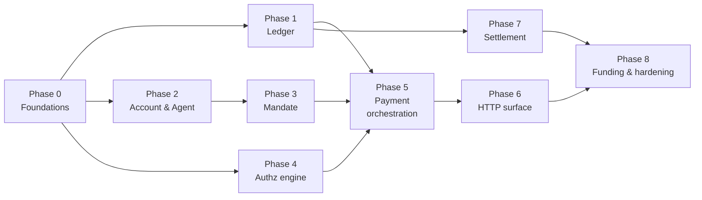

# MVP Implementation Plan

> **For agentic workers:** REQUIRED SUB-SKILL: use `superpowers:subagent-driven-development` (recommended) or `superpowers:executing-plans` to implement this task-by-task. Steps use checkbox (`- [ ]`) syntax for tracking.

**Goal:** An agent owner funds an account, connects an agent with spending rules, that agent pays for things through Cleargate, and the owner sees every payment and every block. (Whitepaper §21)

**Architecture:** One Go monolith, feature-first modules with clean-architecture layers inside each. Gin at the edge, Postgres as the system of record, Redis as a disposable cache. Two binaries — `api` (hot path) and `worker` (everything slow) — built from the same modules.

**Tech stack:** Go 1.26 · Gin · pgx/v5 · shopspring/decimal · golang-migrate · testcontainers-go · go-webauthn · Ed25519 · Base/USDC.

**Explicitly out of scope for MVP** (whitepaper §21): guarantees, holds, merchant onboarding, reputation scoring, intent check, behaviour check, agent-to-agent. The pipeline *shape* for those exists; the logic is stubbed.

**Separate repositories:** TypeScript SDK, MCP server, console frontend. This repo owns the API and the contract in `api/openapi.yaml`.

---

## How to read this plan

Each phase ends with something that works and is committed. Each task follows the same rhythm: **write a failing test → watch it fail → minimal implementation → watch it pass → commit.**

Boxes marked **Why this and not that** explain a decision that has a plausible-looking alternative. Read those; they are where the reasoning lives.

---

## Phase ordering, and why it is not the obvious one

The instinct is to build the API endpoint first, because it demos. This plan builds the **ledger** first and the API sixth. Three reasons:

1. **Cost of being wrong.** A ledger bug moves money incorrectly and does so *silently*. A routing bug is a 404 you notice in a minute. Spend the fresh attention on the thing whose failures are invisible.
2. **Dependency direction.** Ledger depends on nothing. Payment depends on everything. Building bottom-up means every phase is testable in isolation the day it is written.
3. **The compiler works for you.** Once `currency.Amount` exists and refuses `float64`, every later phase inherits that safety for free.

The objection — "then we have nothing to show for two weeks" — is answered by Phase 0, which puts a deployable service with a health check in CI on day two. After that each phase is 2–5 days and independently demonstrable.



Phases 2/3 and 4 are independent of Phase 1 — parallelisable if more than one person is working.

---

# Phase 0 — Foundations

**Outcome:** `make dev-up && make run-api` serves `GET /v1/health` against a real Postgres, and `make test-int` runs the same in CI against a throwaway container.

### Task 0.1: Money type

**Files:** `internal/shared/currency/currency.go`, `internal/shared/currency/currency_test.go`

> **Why this and not that — no `float64` constructor**
> `0.1 + 0.2 != 0.3` in IEEE-754. The ledger's defining invariant is that postings sum to exactly zero, so a type that cannot represent its own inputs cannot satisfy it. The protection is not "remember to use decimal" — it is that no function in this package accepts a `float64`, so the mistake does not compile. Whitepaper §8.3 depends on this.

- [ ] **Step 1: Write the failing tests**

```go
// internal/shared/currency/currency_test.go
package currency_test

import (
	"testing"

	"github.com/CleargateFinance/cleargate-core/internal/shared/currency"
)

func TestParse_ExactDecimal(t *testing.T) {
	a, err := currency.Parse("0.40", currency.USDC)
	if err != nil {
		t.Fatalf("Parse: %v", err)
	}
	if got := a.String(); got != "0.4" {
		t.Fatalf("String() = %q, want %q", got, "0.4")
	}
}

func TestAdd_IsExact(t *testing.T) {
	// The canonical float64 failure. This must hold exactly.
	x, _ := currency.Parse("0.1", currency.USDC)
	y, _ := currency.Parse("0.2", currency.USDC)
	sum, err := x.Add(y)
	if err != nil {
		t.Fatalf("Add: %v", err)
	}
	want, _ := currency.Parse("0.3", currency.USDC)
	if !sum.Equal(want) {
		t.Fatalf("0.1 + 0.2 = %s, want 0.3", sum)
	}
}

func TestAdd_RejectsAssetMismatch(t *testing.T) {
	usdc, _ := currency.Parse("1", currency.USDC)
	other, _ := currency.Parse("1", currency.Asset("EURC"))
	if _, err := usdc.Add(other); err == nil {
		t.Fatal("adding across assets must fail")
	}
}

func TestSum_ZeroForBalancedLines(t *testing.T) {
	debit, _ := currency.Parse("-0.40", currency.USDC)
	credit, _ := currency.Parse("0.40", currency.USDC)
	total, err := currency.Sum(currency.USDC, debit, credit)
	if err != nil {
		t.Fatalf("Sum: %v", err)
	}
	if !total.IsZero() {
		t.Fatalf("Sum = %s, want 0", total)
	}
}
```

- [ ] **Step 2: Run and confirm failure**

`go test ./internal/shared/currency/ -run . -v` → FAIL, `undefined: currency.Parse`

- [ ] **Step 3: Implement**

```go
// internal/shared/currency/currency.go
package currency

import (
	"fmt"

	"github.com/shopspring/decimal"
)

type Asset string

const USDC Asset = "USDC"

// Amount is an exact decimal quantity of a specific Asset.
//
// There is deliberately no constructor taking float64. Binary floating point
// cannot represent 0.40, and the ledger invariant is exact equality with zero.
type Amount struct {
	v     decimal.Decimal
	asset Asset
}

func Parse(s string, a Asset) (Amount, error) {
	if a == "" {
		return Amount{}, fmt.Errorf("currency: empty asset")
	}
	d, err := decimal.NewFromString(s)
	if err != nil {
		return Amount{}, fmt.Errorf("currency: parse %q: %w", s, err)
	}
	return Amount{v: d, asset: a}, nil
}

func Zero(a Asset) Amount   { return Amount{v: decimal.Zero, asset: a} }
func (a Amount) Asset() Asset { return a.asset }
func (a Amount) String() string { return a.v.String() }
func (a Amount) IsZero() bool   { return a.v.IsZero() }
func (a Amount) IsNegative() bool { return a.v.IsNegative() }
func (a Amount) Decimal() decimal.Decimal { return a.v }

func (a Amount) Equal(b Amount) bool { return a.asset == b.asset && a.v.Equal(b.v) }

// GreaterThan reports a > b. Callers must pass matching assets; mismatches
// return an error rather than a silently wrong comparison.
func (a Amount) GreaterThan(b Amount) (bool, error) {
	if a.asset != b.asset {
		return false, fmt.Errorf("currency: asset mismatch %s vs %s", a.asset, b.asset)
	}
	return a.v.GreaterThan(b.v), nil
}

func (a Amount) Add(b Amount) (Amount, error) {
	if a.asset != b.asset {
		return Amount{}, fmt.Errorf("currency: asset mismatch %s vs %s", a.asset, b.asset)
	}
	return Amount{v: a.v.Add(b.v), asset: a.asset}, nil
}

func (a Amount) Neg() Amount { return Amount{v: a.v.Neg(), asset: a.asset} }

func Sum(asset Asset, amounts ...Amount) (Amount, error) {
	total := Zero(asset)
	for _, x := range amounts {
		var err error
		if total, err = total.Add(x); err != nil {
			return Amount{}, err
		}
	}
	return total, nil
}
```

- [ ] **Step 4: Verify** — `go test ./internal/shared/currency/ -v` → PASS (4 tests)

- [ ] **Step 5: Commit**

```bash
go get github.com/shopspring/decimal
git add internal/shared/currency go.mod go.sum
git commit -m "feat(currency): exact decimal amount type with asset safety"
```

### Task 0.2: Config, database pool, unit of work

**Files:** `internal/infrastructure/config/config.go`, `internal/infrastructure/database/postgres.go`, `internal/infrastructure/database/unitofwork.go`

> **Why this and not that — the unit of work takes a `context.Context`, not a `*sql.Tx`**
> Repositories need to run inside a caller-controlled transaction, but a repository method signature must not leak the transaction type — that would force every module to import pgx and would break the dependency rule. Stashing the transaction in the context means `Post(ctx, ...)` joins whatever transaction is open, and works identically outside one. One signature, both cases.

- [ ] **Step 1: Failing test** (`internal/infrastructure/database/unitofwork_test.go`)

```go
//go:build integration

package database_test

import (
	"context"
	"errors"
	"testing"

	"github.com/CleargateFinance/cleargate-core/test/fixtures"
)

func TestUnitOfWork_RollsBackOnError(t *testing.T) {
	ctx := context.Background()
	db := fixtures.NewTestDB(t) // spins Postgres via testcontainers, runs migrations

	_, err := db.Pool.Exec(ctx, `CREATE TABLE uow_probe (id int PRIMARY KEY)`)
	if err != nil {
		t.Fatal(err)
	}

	sentinel := errors.New("boom")
	err = db.UoW.Do(ctx, func(ctx context.Context) error {
		if _, err := db.Exec(ctx, `INSERT INTO uow_probe (id) VALUES (1)`); err != nil {
			return err
		}
		return sentinel
	})
	if !errors.Is(err, sentinel) {
		t.Fatalf("err = %v, want %v", err, sentinel)
	}

	var n int
	if err := db.Pool.QueryRow(ctx, `SELECT count(*) FROM uow_probe`).Scan(&n); err != nil {
		t.Fatal(err)
	}
	if n != 0 {
		t.Fatalf("rows = %d after rollback, want 0", n)
	}
}
```

- [ ] **Step 2: Confirm failure** — `go test ./internal/infrastructure/database/ -tags=integration -v` → FAIL (undefined fixtures)

- [ ] **Step 3: Implement the DB handle and UoW**

```go
// internal/infrastructure/database/postgres.go
package database

import (
	"context"

	"github.com/jackc/pgx/v5"
	"github.com/jackc/pgx/v5/pgxpool"
)

type ctxKey struct{}

// DB is what repositories receive. Exec/Query transparently use the ambient
// transaction if one is open on the context, otherwise the pool.
type DB struct {
	Pool *pgxpool.Pool
	UoW  UnitOfWork
}

type querier interface {
	Exec(context.Context, string, ...any) (pgconnCommandTag, error)
	Query(context.Context, string, ...any) (pgx.Rows, error)
	QueryRow(context.Context, string, ...any) pgx.Row
}

func (d *DB) q(ctx context.Context) pgx.Tx { // nil means "use pool"
	if tx, ok := ctx.Value(ctxKey{}).(pgx.Tx); ok {
		return tx
	}
	return nil
}
```

> Fill in `Exec`/`Query`/`QueryRow` delegating to `d.q(ctx)` when non-nil, else `d.Pool`. Keep this file under ~120 lines; it is plumbing.

```go
// internal/infrastructure/database/unitofwork.go
package database

import (
	"context"
	"fmt"

	"github.com/jackc/pgx/v5"
	"github.com/jackc/pgx/v5/pgxpool"
)

type UnitOfWork interface {
	Do(ctx context.Context, fn func(ctx context.Context) error) error
}

type uow struct{ pool *pgxpool.Pool }

func NewUnitOfWork(pool *pgxpool.Pool) UnitOfWork { return &uow{pool: pool} }

func (u *uow) Do(ctx context.Context, fn func(context.Context) error) error {
	// Nested calls join the outer transaction rather than opening a second one.
	if _, ok := ctx.Value(ctxKey{}).(pgx.Tx); ok {
		return fn(ctx)
	}
	tx, err := u.pool.Begin(ctx)
	if err != nil {
		return fmt.Errorf("begin: %w", err)
	}
	defer func() { _ = tx.Rollback(ctx) }() // no-op after a successful commit

	if err := fn(context.WithValue(ctx, ctxKey{}, tx)); err != nil {
		return err
	}
	return tx.Commit(ctx)
}
```

- [ ] **Step 4: Build the test fixture** (`test/fixtures/db.go`)

```go
package fixtures

import (
	"context"
	"testing"

	"github.com/testcontainers/testcontainers-go/modules/postgres"
)

// NewTestDB starts a real Postgres, applies ./migrations, and returns a handle.
// Container lifetime is bound to the test via t.Cleanup.
func NewTestDB(t *testing.T) *TestDB {
	t.Helper()
	// TODO: postgres.Run(ctx, "postgres:17-alpine", ...); migrate up; return handle.
	panic("implement")
}
```

> **Why this and not that — a real container, not `sqlmock`**
> Most of the ledger's correctness lives in *database* constructs: the zero-sum constraint, the partial unique index enforcing one live mandate, generated columns keeping signed and queryable data in sync. `sqlmock` tests your Go against an imaginary database — it would pass while production is broken. Containers cost ~3 seconds per package and test the thing that actually enforces the invariant.

- [ ] **Step 5: Verify and commit**

```bash
go test ./internal/infrastructure/database/ -tags=integration -v   # PASS
git add internal/infrastructure test/fixtures go.mod go.sum
git commit -m "feat(infrastructure): database pool, context-scoped unit of work, test harness"
```

### Task 0.3: Migration tooling and the walking skeleton

- [ ] **Step 1:** `cmd/migrate` wrapping `golang-migrate`, subcommands `up`/`down`/`version`.
- [ ] **Step 2:** `migrations/000001_extensions.up.sql` — `CREATE EXTENSION IF NOT EXISTS pgcrypto;`
- [ ] **Step 3:** `internal/infrastructure/server` — Gin engine with request-ID, structured logging, panic recovery, and the single `apperr.Kind → HTTP status` mapper.
- [ ] **Step 4:** `internal/app/api.go` — `BuildAPI(cfg) (*gin.Engine, func(), error)` registering only `GET /v1/health` (checks DB and Redis).
- [ ] **Step 5:** `cmd/api/main.go` — graceful shutdown as sketched in the scaffold.

> **Why this and not that — migrations never run on API boot**
> A rolling deploy starts several instances at once. If each runs migrations, they race on the same DDL and one wins arbitrarily. `cmd/migrate` runs as an explicit deploy step, before the new version starts.

- [ ] **Step 6: E2E test and commit**

```go
// test/e2e/health_test.go — asserts 200 and {"status":"ok"} from a fully built app
```

```bash
git commit -m "feat: walking skeleton — migrations, gin bootstrap, health endpoint"
```

**Phase 0 done when:** CI runs unit + integration tests green, and `make run-api` answers `/v1/health`.

---

# Phase 1 — Ledger

**Outcome:** money can be recorded correctly. Unbalanced entries are impossible. Balances and spend counters are derivable and reconciled.

### Task 1.1: Schema

**Files:** `migrations/000002_ledger.up.sql` / `.down.sql`

- [ ] **Step 1: Write the migration**

```sql
CREATE TABLE ledger_account (
  id          uuid PRIMARY KEY DEFAULT gen_random_uuid(),
  account_id  uuid,                       -- NULL for platform-owned buckets
  type        text NOT NULL CHECK (type IN
                ('customer_funds','payee_payable','revenue','reserve','onchain_float')),
  asset       text NOT NULL,
  created_at  timestamptz NOT NULL DEFAULT now(),
  UNIQUE (account_id, type, asset)
);

CREATE TABLE journal_entry (
  id             uuid NOT NULL DEFAULT gen_random_uuid(),
  kind           text NOT NULL CHECK (kind IN
                   ('payment','funding','payout','refund','reversal','correction')),
  reference_type text,
  reference_id   uuid,
  description    text,
  created_at     timestamptz NOT NULL DEFAULT now(),
  PRIMARY KEY (id, created_at)
) PARTITION BY RANGE (created_at);

CREATE TABLE posting (
  id                uuid NOT NULL DEFAULT gen_random_uuid(),
  journal_entry_id  uuid NOT NULL,
  ledger_account_id uuid NOT NULL REFERENCES ledger_account(id),
  amount            numeric(38,18) NOT NULL,   -- signed: negative debit, positive credit
  asset             text NOT NULL,
  created_at        timestamptz NOT NULL,
  PRIMARY KEY (id, created_at)
) PARTITION BY RANGE (created_at);

CREATE INDEX posting_by_account ON posting (ledger_account_id, created_at DESC);
CREATE INDEX posting_by_entry   ON posting (journal_entry_id);

-- Append-only. Corrections are reversing entries (whitepaper §8.3).
CREATE RULE posting_no_update AS ON UPDATE TO posting DO INSTEAD NOTHING;
CREATE RULE posting_no_delete AS ON DELETE TO posting DO INSTEAD NOTHING;

-- Initial partitions; the worker creates future ones ahead of time.
CREATE TABLE journal_entry_2026m09 PARTITION OF journal_entry
  FOR VALUES FROM ('2026-09-01') TO ('2026-10-01');
CREATE TABLE posting_2026m09 PARTITION OF posting
  FOR VALUES FROM ('2026-09-01') TO ('2026-10-01');
```

- [ ] **Step 2: Add the zero-sum constraint**

```sql
-- Deferred to COMMIT so postings can be inserted one at a time inside a
-- transaction and are only judged as a complete entry.
CREATE OR REPLACE FUNCTION assert_entry_balanced() RETURNS trigger AS $$
DECLARE total numeric(38,18);
BEGIN
  SELECT COALESCE(SUM(amount), 0) INTO total
    FROM posting WHERE journal_entry_id = NEW.journal_entry_id;
  IF total <> 0 THEN
    RAISE EXCEPTION 'journal entry % is unbalanced: sums to %',
      NEW.journal_entry_id, total;
  END IF;
  RETURN NULL;
END; $$ LANGUAGE plpgsql;

CREATE CONSTRAINT TRIGGER posting_balanced
  AFTER INSERT ON posting
  DEFERRABLE INITIALLY DEFERRED
  FOR EACH ROW EXECUTE FUNCTION assert_entry_balanced();
```

> **Why this and not that — enforce in the database, not in Go**
> Application-level validation protects only the paths that remember to call it. Backfills, admin scripts, a future service and a 3am hotfix all bypass it. The constraint is the last line that cannot be bypassed. Go validates too — for a good error message — but the database is what makes the invariant true.

> **Why signed amounts rather than a `direction` column**
> The invariant becomes `SUM(amount) = 0`, which the trigger checks directly. A `direction` enum turns it into `SUM(CASE WHEN direction='debit' THEN -amount ELSE amount END)`, which is slower, harder to index, and easy to get backwards.

- [ ] **Step 3: Test the constraint fires**

```go
//go:build integration
func TestLedger_UnbalancedEntryRejectedByDatabase(t *testing.T) {
	// Insert a single posting of +5 with no counter-posting, commit, expect error.
	// Asserts the DATABASE rejects it, independent of any Go validation.
}
```

- [ ] **Step 4: Verify → PASS. Step 5: Commit** `feat(ledger): schema with database-enforced zero-sum invariant`

### Task 1.2: Post and Balance

**Files:** `internal/modules/ledger/{domain,service,ports,repo_postgres}.go` + tests

- [ ] **Step 1: Failing tests**

```go
func TestPost_RejectsUnbalancedLines(t *testing.T)     // Go-level check, clear error
func TestPost_WritesEntryAndPostings(t *testing.T)
func TestBalance_SumsPostings(t *testing.T)
func TestPost_IsAtomicWithCallerTransaction(t *testing.T) // rollback removes the entry
```

- [ ] **Step 2: Confirm failure. Step 3: Implement**

```go
// internal/modules/ledger/domain.go
package ledger

type Line struct {
	LedgerAccountID id.LedgerAccountID
	Amount          currency.Amount // signed
}

// Balanced reports whether the lines form a valid double-entry transaction.
func Balanced(asset currency.Asset, lines []Line) (bool, error) {
	amounts := make([]currency.Amount, 0, len(lines))
	for _, l := range lines {
		amounts = append(amounts, l.Amount)
	}
	total, err := currency.Sum(asset, amounts...)
	if err != nil {
		return false, err
	}
	return total.IsZero(), nil
}
```

```go
// internal/modules/ledger/service.go
func (s *Service) Post(ctx context.Context, e Entry) (id.JournalEntryID, error) {
	ok, err := Balanced(e.Asset, e.Lines)
	if err != nil {
		return "", err
	}
	if !ok {
		return "", apperr.Invalid("ledger: entry does not sum to zero")
	}
	return s.repo.Insert(ctx, e) // joins the caller's transaction via ctx
}
```

- [ ] **Step 4: Verify. Step 5: Commit** `feat(ledger): post balanced entries, derive balances`

### Task 1.3: Spend counters

**Files:** `migrations/000003_spend_counters.up.sql`, `internal/modules/ledger/counter.go`

> **Why this and not that — a counter, never a balance on `agent`**
> Whitepaper §9.3: *"Agents do not hold money. They hold spending authority."* Giving an agent a balance rebuilds per-agent wallets and inherits stranded capital, multiplied key management, and painful reconciliation. The counter is a meter that enforces a cap; the money stays pooled at the account. This is the corporate-card model.
>
> The counter is technically derivable from postings, but deriving it costs a scan on the 100ms path — so it is *maintained* and *reconciled* nightly, the same pattern §8.3 prescribes for the ledger itself.

- [ ] **Step 1: Failing tests**

```go
func TestIncrementSpend_CreatesPeriodRowOnFirstSpend(t *testing.T)
func TestIncrementSpend_IsAtomicUnderConcurrency(t *testing.T) // 50 goroutines x $1 == $50
func TestReconcile_DetectsDrift(t *testing.T)
```

- [ ] **Step 2–4: Implement with an atomic upsert**

```sql
INSERT INTO agent_spend_counter (agent_id, period_type, period_start, asset, spent)
VALUES ($1, $2, $3, $4, $5)
ON CONFLICT (agent_id, period_type, period_start, asset)
DO UPDATE SET spent = agent_spend_counter.spent + EXCLUDED.spent
RETURNING spent;
```

> **Why this and not that — upsert rather than read-modify-write**
> Whitepaper §8.5 describes the exact bug: two concurrent requests both read the same remaining balance and both approve. A read in Go followed by a write is that bug. The single atomic statement makes the increment indivisible, and returning the new total lets the caller detect a cap breach *after* the fact within the same transaction, then roll back.

- [ ] **Step 5: Commit** `feat(ledger): per-agent spend counters with atomic increment`

### Task 1.4: Reconciliation job

- [ ] Worker job, hourly: `SELECT SUM(amount) FROM posting` must be `0`; non-zero pages immediately (§8.3).
- [ ] Nightly: recompute counters from postings, alarm on drift.
- [ ] Test: inject an imbalance in a test DB, assert the job reports it.
- [ ] Commit `feat(worker): ledger zero-sum and counter reconciliation`

**Phase 1 done when:** an unbalanced entry cannot be committed by any path, and the reconciliation job proves the book balances.

---

# Phase 2 — Account and agent

**Outcome:** the entity model of §4.1 exists, a human can sign up and log in safely, agents authenticate, revocation is instant.

**Two authentication surfaces, deliberately separate.** Humans authenticate with email, password and TOTP, and get a revocable server-side session. Agents authenticate with a bearer credential and no session at all. The surfaces share no credential, no token format and no route: a stolen agent key can never reach a console route, and a stolen console session can never sign a payment. Phase 6 enforces that split structurally with route groups.

**Two authorization models, for the same reason.** A human is authorized by *role* — what kind of action may this person take. An agent is authorized by *mandate* — how much money may this program move, and within what caps (Phase 3). Roles never apply to agents, mandates never apply to humans, and an agent's authority is always derived from a human's: an admin signs the mandate that grants it.

**And on a guarded account, no single human can widen that authority alone.** Raising a spending cap is proposed by an owner or admin, waits out the account's timelock, and lands only if the guardian does not veto it. The guardian can stop but never propose, so a stolen guardian credential is worth nothing on its own and a stolen admin credential is worth nothing before the window expires.

**Those protections are opt-in.** An account with no guardian and no timelock — the retail default — applies changes immediately and simply gets notified. Appointing a guardian or setting a timelock switches the controls on, and the asymmetry that keeps this honest is that **enabling protection is instant while disabling it is delayed, notified and vetoable**. Task 2.8 has the mechanism; the roles are `owner`, `admin`, `guardian`, `viewer`.

**Two separations do all the work.** *Propose versus stop* (owner and admin versus guardian) is the security boundary. *Own versus operate* (owner versus admin) is the organisational one — who Cleargate holds accountable, versus who runs the agents day to day.

**Nor can Cleargate.** The key that authorises spending lives in the admin's own device (Task 2.9) and signs the mandate payload directly (Task 3.1). We store public keys and verify; we hold nothing that can mint authority. An attacker who owns every server we run can corrupt records but cannot forge a mandate.

### Task 2.1: Schema

**Files:** `migrations/000004_identity.up.sql`

```sql
CREATE TABLE principal (
  id uuid PRIMARY KEY DEFAULT gen_random_uuid(),
  kind text NOT NULL CHECK (kind IN ('person','legal_entity')),
  created_at timestamptz NOT NULL DEFAULT now()
);

-- Compliance identity: who this party is in law. The only home of legal name
-- and country (data-architecture.md §8). The login email is deliberately not
-- here — see "Why the login email is not PII-table PII" below.
CREATE TABLE principal_identity (
  principal_id    uuid PRIMARY KEY REFERENCES principal(id),
  legal_name      text,
  country         text CHECK (country ~ '^[A-Z]{2}$'),   -- ISO 3166-1 alpha-2
  kyc_status      text NOT NULL DEFAULT 'none'
                    CHECK (kyc_status IN ('none','pending','verified','rejected','expired')),
  kyc_provider    text,          -- 'moonpay' | 'transak'
  kyc_reference   text,          -- the provider's verification id, for audit
  kyc_verified_at timestamptz,
  erased_at       timestamptz,
  retention_hold_until date,     -- AML retention; blocks erasure once money moved

  -- A verified status without a timestamp is a bug we never want to debug.
  CHECK (kyc_status <> 'verified' OR kyc_verified_at IS NOT NULL)
);

-- A login. Exactly one per principal. The email is an authentication
-- identifier, not compliance data, which is why it lives here.
--
-- Declared before `account` so that account.frozen_by can reference it.
CREATE TABLE app_user (
  id                  uuid PRIMARY KEY DEFAULT gen_random_uuid(),
  principal_id        uuid NOT NULL UNIQUE REFERENCES principal(id),
  email               text NOT NULL UNIQUE CHECK (email = lower(email)),
  email_verified_at   timestamptz,
  password_hash       text NOT NULL,   -- argon2id, PHC string
  password_changed_at timestamptz NOT NULL DEFAULT now(),
  status              text NOT NULL DEFAULT 'active'
                        CHECK (status IN ('active','suspended','deactivated')),
  created_at          timestamptz NOT NULL DEFAULT now()
);

CREATE TABLE account (
  id                uuid PRIMARY KEY DEFAULT gen_random_uuid(),
  principal_id      uuid NOT NULL REFERENCES principal(id),
  parent_account_id uuid REFERENCES account(id),   -- platform tiering (§9)
  display_name      text NOT NULL,
  status            text NOT NULL DEFAULT 'active'
                      CHECK (status IN ('active','suspended','closed')),

  -- Who froze the account, so that person can lift it instantly while anyone
  -- else waits (Task 2.8).
  frozen_by         uuid REFERENCES app_user(id),
  frozen_at         timestamptz,

  -- How long a risk-increasing change waits before it takes effect. Zero is
  -- the default and means no delay, which is correct for an account with no
  -- guardian: a waiting period protects nobody when nobody is watching it.
  timelock_hours    int NOT NULL DEFAULT 0 CHECK (timelock_hours BETWEEN 0 AND 168),

  created_at        timestamptz NOT NULL DEFAULT now(),

  -- Suspension and its timestamp cannot disagree about whether this account
  -- is frozen.
  CHECK ((status = 'suspended') = (frozen_at IS NOT NULL))
);

CREATE TABLE account_membership (
  account_id uuid NOT NULL REFERENCES account(id),
  user_id    uuid NOT NULL REFERENCES app_user(id),
  role       text NOT NULL CHECK (role IN ('owner','admin','guardian','viewer')),
  invited_by uuid REFERENCES app_user(id),
  created_at timestamptz NOT NULL DEFAULT now(),
  PRIMARY KEY (account_id, user_id)
);

-- Exactly one owner and at most one guardian per account at any time.
CREATE UNIQUE INDEX account_one_owner ON account_membership (account_id)
  WHERE role = 'owner';
CREATE UNIQUE INDEX account_one_guardian ON account_membership (account_id)
  WHERE role = 'guardian';

-- Server-side sessions. The token is never stored, only its digest.
CREATE TABLE user_session (
  id               uuid PRIMARY KEY DEFAULT gen_random_uuid(),
  user_id          uuid NOT NULL REFERENCES app_user(id),
  token_hash       bytea NOT NULL UNIQUE,   -- sha256 of 256 random bits
  mfa_satisfied_at timestamptz,             -- drives step-up (Task 2.4)
  issued_at        timestamptz NOT NULL DEFAULT now(),
  last_seen_at     timestamptz NOT NULL DEFAULT now(),
  expires_at       timestamptz NOT NULL,
  revoked_at       timestamptz,
  ip               inet,
  user_agent       text
);
CREATE INDEX user_session_live ON user_session (user_id) WHERE revoked_at IS NULL;

CREATE TABLE user_mfa_factor (
  id             uuid PRIMARY KEY DEFAULT gen_random_uuid(),
  user_id        uuid NOT NULL REFERENCES app_user(id),
  type           text NOT NULL CHECK (type IN ('totp')),
  secret_enc     bytea NOT NULL,   -- encrypted, not hashed: verification needs it back
  last_used_step bigint,           -- replay guard, see Task 2.4
  confirmed_at   timestamptz,
  created_at     timestamptz NOT NULL DEFAULT now(),
  revoked_at     timestamptz
);
CREATE UNIQUE INDEX user_mfa_one_active ON user_mfa_factor (user_id, type)
  WHERE confirmed_at IS NOT NULL AND revoked_at IS NULL;

CREATE TABLE user_recovery_code (
  id         uuid PRIMARY KEY DEFAULT gen_random_uuid(),
  user_id    uuid NOT NULL REFERENCES app_user(id),
  code_hash  text NOT NULL,        -- argon2id; these are human-typed, so brute-forceable
  used_at    timestamptz,
  created_at timestamptz NOT NULL DEFAULT now()
);

-- Public keys only. The private half is generated inside the authenticator's
-- hardware, is not exportable, and never reaches us — which is the entire
-- point: no server compromise can sign a mandate (Task 2.9, Task 3.1).
CREATE TABLE user_webauthn_credential (
  id              uuid PRIMARY KEY DEFAULT gen_random_uuid(),
  user_id         uuid NOT NULL REFERENCES app_user(id),
  credential_id   bytea NOT NULL UNIQUE,
  public_key      bytea NOT NULL,          -- COSE-encoded
  sign_count      bigint NOT NULL DEFAULT 0,
  aaguid          uuid,                    -- authenticator model
  transports      text[],
  name            text NOT NULL,           -- "Anton's MacBook"
  backup_eligible boolean NOT NULL,        -- true for a cloud-synced passkey
  backup_state    boolean NOT NULL,
  created_at      timestamptz NOT NULL DEFAULT now(),
  last_used_at    timestamptz,
  revoked_at      timestamptz
);
CREATE INDEX user_webauthn_live ON user_webauthn_credential (user_id)
  WHERE revoked_at IS NULL;

-- Server-issued, single-use, short-lived. `bound_to` names what the assertion
-- authorises, so a signature collected for one mandate cannot be replayed onto
-- another.
CREATE TABLE webauthn_challenge (
  id          uuid PRIMARY KEY DEFAULT gen_random_uuid(),
  user_id     uuid NOT NULL REFERENCES app_user(id),
  challenge   bytea NOT NULL UNIQUE,
  purpose     text NOT NULL CHECK (purpose IN
                ('enrol','sign_mandate','confirm_control_change')),
  bound_to    uuid,
  expires_at  timestamptz NOT NULL,
  consumed_at timestamptz,
  created_at  timestamptz NOT NULL DEFAULT now(),

  CHECK (purpose = 'enrol' OR bound_to IS NOT NULL)
);

-- Single-use, expiring, hashed. One table because the lifecycle is identical.
CREATE TABLE user_token (
  id          uuid PRIMARY KEY DEFAULT gen_random_uuid(),
  user_id     uuid NOT NULL REFERENCES app_user(id),
  purpose     text NOT NULL CHECK (purpose IN ('email_verify','password_reset')),
  token_hash  bytea NOT NULL UNIQUE,
  expires_at  timestamptz NOT NULL,
  consumed_at timestamptz,
  created_at  timestamptz NOT NULL DEFAULT now()
);
CREATE INDEX user_token_live ON user_token (user_id, purpose) WHERE consumed_at IS NULL;

CREATE TABLE account_invitation (
  id          uuid PRIMARY KEY DEFAULT gen_random_uuid(),
  account_id  uuid NOT NULL REFERENCES account(id),
  email       text NOT NULL CHECK (email = lower(email)),
  role        text NOT NULL CHECK (role IN ('admin','guardian','viewer')),
  invited_by  uuid NOT NULL REFERENCES app_user(id),
  token_hash  bytea NOT NULL UNIQUE,
  expires_at  timestamptz NOT NULL,
  accepted_at timestamptz,
  revoked_at  timestamptz,
  created_at  timestamptz NOT NULL DEFAULT now()
);
CREATE UNIQUE INDEX account_invitation_pending
  ON account_invitation (account_id, email)
  WHERE accepted_at IS NULL AND revoked_at IS NULL;

-- Changes that alter the safety net itself, rather than acting within it.
-- These need the guardian's explicit "yes", not merely the absence of a veto
-- (Task 2.8).
CREATE TABLE account_control_change (
  id           uuid PRIMARY KEY DEFAULT gen_random_uuid(),
  account_id   uuid NOT NULL REFERENCES account(id),
  change_type  text NOT NULL CHECK (change_type IN
                 ('transfer_owner','reassign_guardian','remove_guardian',
                  'lower_timelock','close_account')),
  payload      jsonb NOT NULL,   -- {"user_id": ...} or {"timelock_hours": ...}
  proposed_by  uuid NOT NULL REFERENCES app_user(id),

  status       text NOT NULL DEFAULT 'pending'
                 CHECK (status IN ('pending','applied','vetoed','cancelled')),

  -- When it lands if nobody stops it. Fixed at proposal time from the timelock
  -- then in force, never re-derived later — see Task 2.8.
  effective_at timestamptz NOT NULL,

  applied_at   timestamptz,
  vetoed_by    uuid REFERENCES app_user(id),
  vetoed_at    timestamptz,
  cancelled_at timestamptz,
  created_at   timestamptz NOT NULL DEFAULT now(),

  CHECK ((status = 'vetoed')    = (vetoed_at IS NOT NULL)),
  CHECK ((status = 'applied')   = (applied_at IS NOT NULL)),
  CHECK ((status = 'cancelled') = (cancelled_at IS NOT NULL))
);

-- One live proposal of each kind at a time.
CREATE UNIQUE INDEX account_control_change_live
  ON account_control_change (account_id, change_type)
  WHERE status = 'pending';

-- What was sent, to whom, about what. Emission rides the outbox in the same
-- transaction as the change itself; this records the delivery outcome, because
-- a guardian whose mail bounces has silently stopped being a control.
CREATE TABLE notification (
  id           uuid PRIMARY KEY DEFAULT gen_random_uuid(),
  user_id      uuid NOT NULL REFERENCES app_user(id),
  account_id   uuid REFERENCES account(id),
  kind         text NOT NULL,     -- 'mandate.proposed', 'guardian.removal_proposed', ...
  subject_type text,              -- 'mandate' | 'account_control_change' | 'agent'
  subject_id   uuid,
  channel      text NOT NULL DEFAULT 'email' CHECK (channel IN ('email')),
  created_at   timestamptz NOT NULL DEFAULT now(),
  sent_at      timestamptz,
  failed_at    timestamptz,
  failure      text
);
CREATE INDEX notification_by_user ON notification (user_id, created_at DESC);
CREATE INDEX notification_failed ON notification (account_id) WHERE failed_at IS NOT NULL;

-- Every authentication outcome, including failures against unknown addresses.
CREATE TABLE auth_event (
  id         uuid PRIMARY KEY DEFAULT gen_random_uuid(),
  user_id    uuid REFERENCES app_user(id),   -- NULL when the email is unknown
  email      text,
  type       text NOT NULL CHECK (type IN
               ('signup','email_verified','login_succeeded','login_failed',
                'mfa_enrolled','mfa_succeeded','mfa_failed','recovery_code_used',
                'password_reset_requested','password_changed',
                'session_revoked','invite_accepted')),
  ip         inet,
  user_agent text,
  created_at timestamptz NOT NULL DEFAULT now()
);
CREATE INDEX auth_event_by_user ON auth_event (user_id, created_at DESC);

CREATE TABLE user_consent (
  id          uuid PRIMARY KEY DEFAULT gen_random_uuid(),
  user_id     uuid NOT NULL REFERENCES app_user(id),
  document    text NOT NULL CHECK (document IN ('terms_of_service','privacy_policy')),
  version     text NOT NULL,
  accepted_at timestamptz NOT NULL DEFAULT now(),
  ip          inet,
  UNIQUE (user_id, document, version)
);

-- A registration, not a program. The agent itself runs on the customer's own
-- infrastructure; this row is the identity it is *connected* to Cleargate as,
-- and the thing a credential authenticates and a mandate authorises.
CREATE TABLE agent (
  id         uuid PRIMARY KEY DEFAULT gen_random_uuid(),
  account_id uuid NOT NULL REFERENCES account(id),
  name       text NOT NULL,
  status     text NOT NULL DEFAULT 'active' CHECK (status IN ('active','revoked')),
  created_by uuid REFERENCES app_user(id),
  created_at timestamptz NOT NULL DEFAULT now(),
  revoked_at timestamptz,

  -- Status and timestamp cannot disagree about whether this agent can spend.
  CHECK ((status = 'revoked') = (revoked_at IS NOT NULL))
);

CREATE TABLE agent_credential (
  id           uuid PRIMARY KEY DEFAULT gen_random_uuid(),
  agent_id     uuid NOT NULL REFERENCES agent(id),
  name         text NOT NULL,          -- "prod-worker-3"; which key to revoke at 2am
  prefix       text NOT NULL UNIQUE,   -- lookup key, safe to log
  secret_hash  bytea NOT NULL,         -- sha256; the secret is 256 CSPRNG bits (Task 2.6)
  created_by   uuid REFERENCES app_user(id),
  created_at   timestamptz NOT NULL DEFAULT now(),
  revoked_at   timestamptz,
  last_used_at timestamptz
);

-- Groups payments into one agent run. Required for the per-session features of
-- §6.4 and the causal chain of §10.2. Cannot be inferred retroactively.
CREATE TABLE agent_session (
  id         uuid PRIMARY KEY DEFAULT gen_random_uuid(),
  agent_id   uuid NOT NULL REFERENCES agent(id),
  task_ref   text,
  task_text  text,
  started_at timestamptz NOT NULL DEFAULT now()
);

-- Maps the on-ramp provider's customer to our principal. Without this the
-- Phase 8 funding webhook knows a payment cleared but not whom to credit.
CREATE TABLE onramp_customer (
  id           uuid PRIMARY KEY DEFAULT gen_random_uuid(),
  principal_id uuid NOT NULL REFERENCES principal(id),
  provider     text NOT NULL CHECK (provider IN ('moonpay','transak')),
  external_id  text NOT NULL,
  created_at   timestamptz NOT NULL DEFAULT now(),
  UNIQUE (provider, external_id)
);
```

> **Why the login email is not PII-table PII**
> An authentication identifier and a compliance identity are different facts with different lifecycles: you are KYC'd under a legal name and you sign in with an address, and the two change independently. Putting the login email in `principal_identity` forces a unique index onto the most sensitive table in the system and puts that table in the read path of an unauthenticated endpoint. `principal_identity` is therefore the only home of *compliance* identity, and `app_user.email` is an authentication key. Erasure is correspondingly two steps, not one: delete `principal_identity`, and rewrite `app_user.email` to a unique tombstone.

> **Why `email = lower(email)` as a CHECK rather than normalising in Go**
> Application-side normalisation is one forgotten call site away from letting `A@x.com` and `a@x.com` both register, and the resulting duplicate is discovered when someone cannot log in. The database refusing the write makes the invariant unforgeable, in the same spirit as the ledger's balance constraints.

> **Why exactly one owner per account**
> The partial unique index makes "one accountable party per account" a database fact rather than a convention. Ownership is the role that can transfer the account and remove other members; two of them means two people who can lock each other out, and no answer to "who authorised this" in a dispute. Admins get everything else. Transfer is an explicit flow, which is also why `account_invitation.role` cannot be `owner` — nobody is invited into ownership by email.

> **Why `parent_account_id` now, when nothing uses it**
> §9: *"Multi-tenancy is designed in from the first commit because retrofitting it is a rewrite."* A nullable self-reference costs one column today. Adding it later means backfilling every account, rewriting every authorization query to be hierarchy-aware, and re-testing the whole permission model.

> **Why `agent_session` now, when the MVP has no behaviour check**
> Same argument, sharper: session membership is knowable *only* at request time. If the SDK does not send a session ID from day one, the data for §6.4's "rate of novel merchants per session" is not late — it never existed.

> **Why erasure is not a single delete once money has moved**
> AML record-keeping obligations run five to seven years and override an erasure request as a legal obligation. A design that promises "erasure is one row" will be broken by compliance the first time an erased principal is subpoenaed. `retention_hold_until` is set when a principal first funds; erasure before that date restricts and anonymises rather than deletes, and the API says so honestly.

- [ ] **Tests:** `TestEmailUniquenessIsCaseInsensitive`, `TestSecondOwnerIsRejected`, `TestRevokedAgentRequiresTimestamp`, `TestVerifiedKycRequiresTimestamp`

### Task 2.2: Password, session and validation primitives

**Files:** `internal/modules/account/credential.go`, `internal/infrastructure/crypto/`, `internal/infrastructure/cache/`

- [ ] **Tests:** `TestHashPassword_ProducesPHCString`, `TestVerify_RejectsWrongPassword`, `TestVerify_UnknownEmailCostsSameTime`, `TestNeedsRehash_WhenParamsChange`, `TestSessionToken_HasFullEntropy`, `TestSessionLookup_NeverStoresPlaintext`
- [ ] Argon2id at OWASP defaults (19 MiB, t=2, p=1), stored as a PHC string.
- [ ] Session tokens: 32 bytes from `crypto/rand`, base64url, stored as `sha256`.

> **Why a PHC string and not a bare hash**
> `$argon2id$v=19$m=19456,t=2,p=1$...` carries its own parameters, so raising the cost next year is a config change plus an opportunistic rehash on next login, not a migration that cannot read the old rows. This applies to everything a human chooses or types — `app_user.password_hash` and `user_recovery_code.code_hash` — and to nothing else.

> **Why SHA-256 for session tokens when passwords get argon2id**
> Argon2id is expensive on purpose because a password is low-entropy and offline-guessable. A session token is 256 bits from a CSPRNG; there is nothing to guess, so the only requirements are that a database leak must not yield usable tokens and that lookup must be indexable. A fast digest satisfies both. Using argon2id here would add ~50ms to every console request and buy nothing.

> **Why opaque tokens and not JWTs**
> This phase's outcome says revocation is instant. A JWT is valid until it expires, so revocation means either a blocklist — which is the session table with extra steps — or waiting. A row you can `UPDATE ... SET revoked_at = now()` is the simpler thing that actually meets the requirement, and it makes "show me my active sessions and sign them all out" a `SELECT`.

**Session validation cache.** Validating a session is a read on every authenticated request, so it gets a Redis fast path in front of Postgres:

- [ ] Session lifetime `account.DefaultSessionLifetime = 12h`; cache window `account.DefaultCacheWindow = 1m`.
- [ ] Key `sess:<token_hash>`, value `{user_id, mfa_satisfied_at, expires_at}`, TTL `min(60s, time until expires_at)`.
- [ ] **Read:** hash the cookie, `GET`. On a hit, authorise from the cached value. On a miss *or any Redis error*, read `user_session` in Postgres and repopulate.
- [ ] **Revoke:** write `revoked_at` in Postgres, commit, then `DEL` the key.
- [ ] Invalid tokens are not cached; the per-IP throttle in Task 2.3 covers hammering, and a negative entry is one more thing that can be wrong.
- [ ] **Tests:** `TestSessionCache_HitAvoidsPostgres`, `TestRevokeDeletesCacheEntry`, `TestRedisDownFallsBackToPostgres`, `TestCacheEntryNeverOutlivesSession`, `TestCachedSessionCarriesNoRoles`

> **Why a 60-second TTL and not the session's own lifetime**
> The `DEL` on revoke is what makes revocation instant; the TTL exists for when that `DEL` does not happen. Three ways it does not: the call errors and something swallows it, the process dies between the commit and the delete, or a concurrent request misses the cache and repopulates it from a not-yet-committed read. All three leave a revoked session cached as valid. With a session-lifetime TTL that stale entry is usable for days — which is exactly the JWT failure mode this design exists to avoid, reintroduced through the back door. At 60 seconds the worst case is a minute, and the cost of the shorter window is one indexed lookup per active session per minute.

> **Why Redis errors are treated as cache misses**
> A cache that fails closed turns a Redis blip into an outage; a cache that is authoritative turns a Redis flush into a security incident. Neither applies here, because Postgres remains the source of truth and Redis holds a derived copy with a bounded lifetime. Every failure — down, flushed, evicted, partitioned — degrades to the Postgres path that was correct before the cache existed. This is precisely the property a JWT blocklist cannot have: there, losing the store silently makes revoked tokens valid again, because the signature still verifies on its own.

> **Why roles are not in the cached value**
> Cache only what the cache key's deletion already invalidates. Session identity is keyed by the token, so `DEL sess:<hash>` covers all of it. A membership role is keyed by `(account, user)` and changes on its own schedule — cached next to the session, it would outlive its own revocation, and demoting an admin would not take effect until that person happened to log out. Membership stays an indexed read against Postgres, for the same reason everything else in this phase does.

### Task 2.3: Sign-up, verification and login

- [ ] **Tests:** `TestSignup_DoesNotRevealExistingEmail`, `TestLogin_RejectsUnverifiedEmail`, `TestLogin_RejectsSuspendedUser`, `TestSessionsDieOnPasswordChange`, `TestResetToken_IsSingleUse`, `TestResetToken_Expires`, `TestFailedLoginIsAudited`

Endpoints (Phase 6 registers these on an *unauthenticated* group):

- [ ] `POST /v1/auth/signup` — creates `principal(kind='person')`, `principal_identity`, `app_user`, and an `email_verify` token. Records `user_consent` for the ToS version shown. Always answers `202`.
- [ ] `POST /v1/auth/verify-email`, `POST /v1/auth/login`, `POST /v1/auth/logout`
- [ ] `POST /v1/auth/password/reset-request`, `POST /v1/auth/password/reset`

> **Why every one of these answers the same way for known and unknown addresses**
> Signup, reset and login are the three endpoints that will tell an attacker which of a leaked address list are Cleargate customers — a list of people known to hold crypto balances, which is exactly the targeting data a phisher wants. All three return the same status and body either way, and login runs a dummy argon2id verify on unknown addresses so the response time does not leak what the body conceals.

> **Why `password_changed_at` instead of deleting sessions on change**
> Sessions issued before `password_changed_at` are rejected at validation time. One column invalidates every device atomically, including sessions created by a race during the change itself, and it cannot be defeated by a session row the delete query missed.

- [ ] Throttle login and reset in Redis on `(ip, email)` with exponential backoff.

> **Why throttling and not account lockout**
> Lockout on failed attempts lets anyone who knows an address deny that person access to their own money, and during an incident the locked-out party is usually the legitimate owner trying to revoke an agent. Backoff raises the cost of guessing without handing an attacker a remote off switch. MFA, not lockout, is what makes a guessed password insufficient.

### Task 2.4: MFA and step-up authorization

- [ ] **Tests:** `TestTotpEnrollment_RequiresConfirmingCode`, `TestTotpCode_CannotBeReplayed`, `TestRecoveryCode_IsSingleUse`, `TestFundingWithoutMfaIsRejected`, `TestStepUpExpiresAfterWindow`, `TestMandateSigningIgnoresStepUpWindow`

- [ ] TOTP (RFC 6238), 30s step, ±1 step skew, secret envelope-encrypted with a key from config.
- [ ] Ten recovery codes issued once at enrolment, argon2id-hashed.
- [ ] **Gate:** enrolling TOTP is required before funding an account or inviting a user.
- [ ] **Step-up:** those actions require `mfa_satisfied_at > now() - 15 minutes` (`account.DefaultStepUpWindow`), else `403` with kind `forbidden` and a `mfa_required` code.
- [ ] Signing a mandate, adding a payout destination, and proposing a control change are **not** covered by this window at all. They carry their own WebAuthn assertion (Task 2.9), which is strictly stronger: it proves presence over *that exact payload*, rather than presence at some point in the last quarter hour.

> **Why a payout destination is WebAuthn-signed rather than step-up gated**
> It decides where money lands, which makes it authority-creating in exactly the sense a mandate is — and the step-up window is backed by TOTP, which is phishable. An attacker who relays one code through a convincing proxy holds a valid step-up for fifteen minutes and can point the payouts at themselves. The rule that removes the inconsistency: **anything that creates authority or redirects money is signed, never merely stepped up.** TOTP step-up remains proportionate for funding and invites, which add money or people rather than redirecting either.

> **Why the TOTP secret is encrypted and the password is hashed**
> Verifying a TOTP code means recomputing HMAC over the shared secret, so the server must be able to read it back — hashing it would make verification impossible. That makes the encryption key a real secret with a real blast radius, which is the argument for keeping it in the same managed store as the §8.8 signing keys rather than in an environment variable.

> **Why `last_used_step` exists**
> A TOTP code is valid for a whole 30-second window, so an attacker who observes one — over the shoulder, in a phishing proxy, in a log — can replay it until the window closes. Recording the highest step already accepted makes each code usable exactly once.

> **Why step-up gates these actions specifically**
> An invite adds a person and funding brings real money in, so a stolen session cookie alone should not be enough for either. Everything else in the console is reading, where a session by itself is proportionate — and everything *above* them, in the signed tier, is covered by WebAuthn instead.

> **Why TOTP survives at all once WebAuthn exists**
> WebAuthn is the better second factor — it is phishing-resistant, and a TOTP code can be typed into a convincing fake site. But the two are doing different jobs here. TOTP is the *login* factor, backed by recovery codes, so losing a device is an inconvenience rather than a lockout. WebAuthn is the *authorisation* factor, deliberately not recoverable by anything the server can mint, which is what gives a mandate signature its value. Collapsing login onto WebAuthn too is a reasonable later move; doing it now would put device loss on the critical path of simply signing in.

### Task 2.5: Invitations and membership

- [ ] **Tests:** `TestInvite_CannotGrantOwner`, `TestInvite_TokenIsSingleUseAndExpires`, `TestAcceptInvite_CreatesMembership`, `TestRevokedInviteCannotBeAccepted`, `TestLastOwnerCannotLeaveAccount`, `TestAdminCannotManageOtherAdmins`, `TestGuardianCannotBeRemovedByMembershipDelete`, `TestFirstGuardianInviteIsInstant`
- [ ] Accepting an invite for an unknown address runs the signup flow first, then the membership insert, in one transaction.

**Who may manage whom:**

| Target role | Invite / remove / demote by |
|---|---|
| `viewer` | owner, admin |
| `admin` | **owner only** |
| `guardian` (first, when none exists) | owner — instant, it enables protection |
| `guardian` (replacing or removing one) | owner — via `account_control_change` only |
| `owner` | nobody; `transfer_owner` instead |

> **Why guardian membership cannot be edited through this table**
> Every control in Task 2.8 assumes the guardian row exists. If an admin — or an owner — could simply `DELETE` it here, the entire veto mechanism would be bypassable with a write to a different table, and none of the delays or notifications above would fire. Removing or replacing a guardian is therefore *only* reachable through `account_control_change`, and the membership path must refuse it outright. This is the single most important test in this task.

> **Why an admin cannot manage other admins**
> Two admins who can each remove the other is a lockout race, and during a compromise the attacker wins it by acting first. Routing admin changes through the owner keeps a single accountable party for "who is allowed in", and it is the one place the owner/admin split does real work rather than being an org chart.

### Task 2.6: Connecting an agent, and its credentials

Three separate things, in order, and each is useless without the next: the **registration** is an identity (`agent`), the **credential** lets it authenticate (`agent_credential`), and the **mandate** lets it spend (Phase 3). Connecting an agent grants nothing on its own.

- [ ] **Tests:** `TestIssueCredential_ReturnsSecretOnlyOnce`, `TestGeneratedSecret_Is256BitsOfCSPRNG`, `TestVerify_RejectsRevoked`, `TestVerify_RejectsCredentialOfRevokedAgent`, `TestVerify_ConstantTimeOnMismatch`, `TestAgentCredentialCannotOpenUserSession`, `TestConnectedAgentWithoutMandateCannotSpend`, `TestRotateCredentialWithoutDowntime`

> **Why credentials are separate objects from the agent**
> So a key can be rotated without destroying the identity that carries the mandate and the decision history. Issue the new key, deploy it, revoke the old one — both are valid during the overlap, so nothing breaks. It also gives revocation three widths: a **credential** (that one key dies), an **agent** (all its keys and its mandate die), or a **freeze** (every agent on the account stops). You reach for the third when you do not yet know which agent is compromised. All three are instant, because an agent never held funds — only a counter.
- [ ] Format: `cg_live_<prefix>_<secret>`, where `secret` is 32 bytes from `crypto/rand` in base64url and `prefix` is a non-secret handle from the same source.
- [ ] Store `sha256(secret)`; the prefix is the index. Compare in constant time.

> **Why a prefix plus a hash rather than hashing the whole key**
> You need an indexed lookup, and you cannot index a salted hash. The prefix is a non-secret handle that finds one row; the hash then verifies the secret. It is also safe in logs, which means a support engineer can identify a credential without ever seeing it.

> **Why this and not that — SHA-256 here, argon2id for passwords**
> The choice follows the *entropy of the secret*, not the importance of what it protects. Argon2id is slow deliberately, to make guessing a human-chosen password expensive. This secret is not human-chosen: it is 256 bits from `crypto/rand`, so there is no candidate list to guess from and no work factor that would make an already-infeasible search harder. That is the same reasoning Task 2.2 applies to session tokens, and an agent credential has the same shape.
>
> Using argon2id here would also be actively harmful, because an agent credential is presented on *every* request — agents have no session to amortise it over, unlike a human who pays that cost once at login. At ~50ms and 19 MiB per verification it would consume half the p99 budget Task 6.3 gates on, and it would hand an attacker an amplification vector: a well-formed prefix with a garbage secret is enough to make the server burn memory and CPU rejecting it, no valid credential required.
>
> The load-bearing assumption is that the secret really is full-entropy, which is why `TestGeneratedSecret_Is256BitsOfCSPRNG` exists. Shorten the secret or make it human-readable and this reasoning collapses.

### Task 2.7: KYC mirror and the funding gate

- [ ] **Tests:** `TestFundingRejectedWhenKycNotVerified`, `TestKycWebhookIsIdempotent`, `TestKycWebhookRequiresValidSignature`, `TestUnknownOnrampCustomerIsRejected`, `TestFirstFundingSetsRetentionHold`

- [ ] Register the on-ramp customer at first funding attempt; store `(provider, external_id) → principal_id` in `onramp_customer`.
- [ ] Mirror the provider's verification verdict onto `principal_identity.kyc_status` with its `kyc_reference`.
- [ ] **Gate:** a `funding` journal entry may only post for a principal whose `kyc_status = 'verified'`. Set `retention_hold_until` on the first successful funding.

> **Why mirror the on-ramp's verdict rather than run our own KYC**
> The provider must KYC the buyer to sell them stablecoin at all, so running a second verification duplicates the friction and doubles the sensitive documents we hold. Mirroring keeps the verdict authoritative where the obligation sits. The cost is that a user cannot be verified before their first funding attempt, and coverage is the provider's; `kyc_provider` and `kyc_reference` exist so that adding an owned provider later is a new row, not a schema change.

> **Why the gate is in the funding service and not only in the webhook handler**
> The webhook is one path to a `funding` entry today; reconciliation repair, manual credits and a second provider are the paths that arrive later. Putting the check where the journal entry is written means every future path inherits it, rather than each new caller being asked to remember.

### Task 2.8: Guardian, timelock and account control changes

Protection here is **opt-in and tiered**. An account with no guardian and no timelock behaves simply: changes take effect immediately. Appointing a guardian, or setting a timelock, switches the controls on.

| Tier | Configuration | Behaviour |
|---|---|---|
| **Simple** — the default | no guardian, `timelock_hours = 0` | Everything instant. Notifications still fire. |
| **Self-guarded** | timelock set, no guardian | Delays apply, nobody vetoes. The account still gets the email and can freeze inside the window — this protects a solo operator against *their own* stolen session. |
| **Guarded** — business | guardian appointed, timelock set | Full model below. |

**The guardian's power is subtractive only.** It vetoes and freezes; it never proposes, invites, or creates. A stolen guardian credential is therefore worth zero dollars on its own.

**Three classes of change:**

**1. Risk-increasing** — raising a cap, adding a payout destination. Owner or admin proposes; it waits out `timelock_hours`; the guardian may veto inside the window. With no timelock it is instant; with no guardian nothing vetoes and it simply lands when the clock runs out.

**2. Control-altering** — `transfer_owner`, `reassign_guardian`, `remove_guardian`, `lower_timelock`, `close_account`. **Owner proposes only.** Delayed and notified. Vetoable as follows, and the split matters:

| Change | Vetoable by |
|---|---|
| `transfer_owner` | current owner **and** guardian |
| `lower_timelock` | guardian |
| `reassign_guardian`, `remove_guardian` | **nobody** |
| `close_account` | guardian |

**3. Risk-reducing** — revoking an agent or a credential, tightening a cap, freezing the account. Instant, no delay, available to owner, admin *or* guardian.

**Freeze semantics.** Freezing sets `account.status = 'suspended'`, and a suspended account **declines every agent payment authorization for every agent under it** — the account-wide version of revoking one agent. Unfreezing is instant *for the user who froze* and delayed for anyone else.

- [ ] **Tests:** `TestSimpleTierAppliesChangesInstantly`, `TestFirstGuardianCanBeAppointed`, `TestGuardianCannotVetoOwnRemoval`, `TestGuardianCanVetoTimelockReduction`, `TestRaisingTimelockIsInstant`, `TestLoweringTimelockWaitsCurrentTimelock`, `TestGuardianCannotProposeAnyChange`, `TestGuardianVetoStopsPendingMandate`, `TestVetoedProposalCanBeReProposed`, `TestProposerCanCancelOwnProposal`, `TestFrozenAccountDeclinesAllAgentPayments`, `TestFreezerCanUnfreezeInstantly`, `TestOtherUserUnfreezeIsDelayed`, `TestPendingProposalKeepsOriginalEffectiveAt`, `TestRemovingGuardianDoesNotApplyPendingProposals`, `TestOnlyOwnerCanProposeControlChange`
- [ ] Proposing a control change requires a **WebAuthn assertion** over its canonical payload (Task 2.9), as does vetoing one — a server compromise must not be able to manufacture either party's decision.

> **Why protection is opt-in, and why that is not a bypass**
> Requiring a guardian would have made the model unbuildable: appointing the first one needed a current guardian to approve it, so no account could ever have one. Making it optional removes that circularity and stops charging a solo retail user a 24-hour delay that protects them from nobody. What keeps it from becoming a bypass is the asymmetry — **turning protection on is instant, turning it off is delayed, notified and vetoable.** An attacker's first move is always to disable the alarm, so that is the move the design makes slow and loud.

> **Why lowering the timelock waits out the *current* timelock**
> Otherwise the shortest path to a fast malicious change is to shorten the wait first. Setting the delay to zero must itself sit through the delay that was in force when it was proposed, which makes the attack no faster than the change it was meant to accelerate.

> **Why the guardian cannot veto their own removal**
> The earlier design let them, which meant a compromised or simply uncooperative guardian could never be dislodged — the control became the lockout. They do not need that veto, because they hold something better: they are **notified immediately and can freeze the account instantly**, while their removal takes days. A guardian who believes they are being removed by a hijacked owner stops all money in one click and calls Cleargate; the removal is slow, the brake is instant, and the human process resolves who is legitimate.
>
> They keep the veto on `lower_timelock` and `close_account`, which reduce protection without touching their tenure — there is no conflict of interest in those, and no lockout risk.

> **Why unfreezing is instant for the freezer and delayed for everyone else**
> Freezing must be instant for everyone, because stopping harm should never be slower than causing it. But if unfreezing were equally instant, a compromised owner would simply undo a legitimate guardian's freeze. Delaying the cross-user case means the guardian can always re-freeze faster than an attacker can lift it — the brake wins the race — while an accidental freeze is still a one-click undo by the person who made the mistake.

> **Why a veto cancels a proposal rather than killing the subject**
> A veto stops *that proposal*; the same change may be proposed again. This keeps a hostile guardian from permanently bricking an account's ability to operate — repeated vetoes degrade rather than destroy, and they are visible in `auth_event` and in the notification trail, which is what turns obstruction into break-glass evidence rather than a silent stalemate.

> **Two edge cases the implementation has to get right**
> A pending proposal is governed by the timelock **in force when it was proposed** — `effective_at` is fixed at write time and never recomputed. Otherwise "disable the timelock" becomes a way to instantly land an already-pending malicious change, and the bypass swallows the whole mechanism.
>
> Removing a guardian does **not** apply their outstanding vetoes or accelerate pending proposals. Proposals keep their original clock; a removed guardian simply stops being able to veto new ones.

> **What this still does not solve**
> An owner and a guardian compromised simultaneously, an owner who is gone entirely (only the owner may propose `transfer_owner`), and a user who has lost every WebAuthn credential. All three need identity re-verification by a human at Cleargate — deliberately **not** an endpoint, because a break-glass path that mints authority from an email link is a backdoor around everything above it. Three runbook entries, written before the first customer account has a guardian rather than after the first support ticket.

### Task 2.9: WebAuthn enrolment

The keys that authorise spending live in the humans' devices, not in Cleargate. This task registers them; Task 3.1 uses them.

**Files:** `internal/modules/account/webauthn.go`

- [ ] **Tests:** `TestEnrol_StoresPublicKeyOnly`, `TestCannotSignWithFewerThanTwoCredentials`, `TestSecondCredentialMustBeDistinctAuthenticator`, `TestRevokedCredentialCannotSign`, `TestCannotRevokeBelowTwoWhilePrivileged`, `TestChallengeIsSingleUse`, `TestChallengeExpires`, `TestEnrolRejectsUnsupportedAlgorithm`
- [ ] Endpoints: `POST /v1/webauthn/credentials/begin`, `POST /v1/webauthn/credentials/finish`, `GET /v1/webauthn/credentials`, `DELETE /v1/webauthn/credentials/{id}`.
- [ ] Relying Party ID is the console's registrable domain; reject assertions from any other origin.
- [ ] **Gate:** two confirmed credentials before a user may sign a mandate or confirm a control change. Revoking below two is refused while that user holds `owner`, `admin` or `guardian`.
- [ ] The console repository implements the `navigator.credentials` calls; this repo owns challenge issuance and verification only.

> **Why two credentials, and why that is what made this MVP-viable**
> A single passkey turns device loss into an account lockout, which is the reason this was originally deferred past the MVP. Requiring a second — a phone beside a laptop, or a security key in a drawer — turns loss into an inconvenience: sign with the other, enrol a replacement. The alternative was a reset path that mints signing authority from an email link, which is precisely the backdoor an attacker would reach for first, and would have made the whole mechanism decorative.

> **Why cloud-synced passkeys are allowed, with the trade-off recorded rather than hidden**
> `backup_eligible` says whether a credential is a synced passkey (iCloud Keychain, Google Password Manager) or bound to one device. Synced is far more recoverable; device-bound is stronger, because the key was never inside anyone's cloud account and its security does not reduce to the strength of an Apple ID. Both are accepted and the flag is stored and shown in the console, so an account's real posture is visible rather than assumed — and a customer who later demands device-bound only is expressing a policy that this column is what a check would read.

> **Why the sign counter is stored but never trusted alone**
> `sign_count` exists to catch a cloned authenticator, and hardware keys increment it honestly. Synced passkeys typically return zero forever, because the same credential legitimately lives on several devices at once. Record it, alert on a *decrease* from a previously non-zero value, and never reject on it by itself — do that and you lock out every passkey user the first time they sign from their second device.

### Task 2.10: Administrative notifications

Every control in Task 2.8 depends on somebody *noticing*. A timelock nobody hears about is not a control, it is a delay — so notification is load-bearing security here, not product polish.

**Files:** `internal/modules/notify/`

- [ ] **Tests:** `TestProposalNotifiesGuardianImmediately`, `TestExpiringProposalSendsReminder`, `TestTargetOfActionIsNotified`, `TestSecurityNotificationsCannotBeDisabled`, `TestBouncedNotificationSurfacesAsAccountHealth`, `TestNotificationRidesTheSameTransaction`

- [ ] Emit on: proposal created, ~6h before `effective_at`, applied, vetoed, cancelled; freeze and unfreeze; membership and role changes; credential enrolled or revoked; agent connected or revoked; payout destination changed; every stage of an ownership transfer.
- [ ] **Notify the party acted upon, not only the actor** — removing a guardian notifies that guardian, demoting an admin notifies them.
- [ ] Written to the outbox in the **same transaction** as the change, so a change can never land without its notification being queued.
- [ ] Security notifications are **not suppressible** by any in-app preference.
- [ ] Links are deep links into the console, never one-click actions.
- [ ] A bounce or hard failure marks `notification.failed_at` and surfaces on the account as a health problem.

> **Why the email cannot carry a one-click veto**
> A one-click link in email hands the whole mechanism to whoever holds the inbox, and email is precisely the channel most likely to be compromised alongside a password. The link goes to the console; the veto itself still costs a WebAuthn assertion. Convenience here would delete the control it is attached to.

> **Why notification is out-of-band detection, not just a reminder**
> An attacker holding a session cookie almost certainly does not hold the victim's mailbox. Mailing every administrative change means a compromise surfaces through a channel the attacker does not control — which is why this fires even in the Simple tier, where there is no guardian and no delay. A solo operator with no guardian still learns that their agent's cap was just raised.

> **Why a bounce is an account-health problem**
> A guardian whose address bounces has silently stopped being a control while still appearing on the account as one. The veto window keeps elapsing and nobody is reading it. Surfacing failed delivery is what stops the model from quietly degrading into theatre.

- [ ] Commit `feat(account): entity model, human auth, webauthn, agent credentials, notifications`

---

# Phase 3 — Mandate

**Outcome:** spending authority is signed, versioned and verifiable — the control that makes §6.1 true.

### Task 3.1: Canonical payload and user-signed authority

**Cleargate holds no key that can create spending authority.** The admin's own authenticator signs the mandate; the server's only job is to verify the assertion and record it. Enrolment is Task 2.9.

> **Why this and not that — sign stored bytes, never a re-marshalled struct**
> The classic bug: sign `json.Marshal(rules)`, store the struct, later re-marshal to verify. Go map iteration order and future field additions produce *different bytes*, so the signature fails to verify and your evidence is worthless — discovered during a dispute, which is the worst possible moment.
> The fix is to treat the signed payload as opaque bytes: canonicalise once (RFC 8785 JCS), sign, store the exact bytes, and verify against those bytes forever. The typed rules are parsed *from* the payload, never back into it.

**The flow:**

1. Console posts the proposed rules. Server canonicalises, stores a draft, returns `challenge = SHA256(canonical_payload)`.
2. Browser calls `navigator.credentials.get({ challenge, userVerification: "required" })`.
3. The authenticator signs `authenticatorData ‖ SHA256(clientDataJSON)` with a key that has never left its hardware.
4. Server verifies against the enrolled public key, and checks four things before writing anything: the challenge equals the digest of the payload *it* holds, the origin is the console's, the UV flag is set, and the challenge has not already been consumed.

- [ ] **Step 1: Failing tests**

```go
func TestCanonicalise_IsStableAcrossMarshals(t *testing.T)  // byte-identical 100x
func TestChallengeIsDigestOfCanonicalPayload(t *testing.T)
func TestVerify_FailsOnAnyMutation(t *testing.T)            // flip one byte -> reject
func TestVerify_FailsOnWrongCredential(t *testing.T)
func TestVerify_RejectsMismatchedChallenge(t *testing.T)    // signature for another mandate
func TestVerify_RejectsWrongOrigin(t *testing.T)
func TestVerify_RejectsMissingUserVerification(t *testing.T)
func TestVerify_RejectsReplayedChallenge(t *testing.T)
func TestServerHoldsNoMandateSigningKey(t *testing.T)       // assert the invariant
```

- [ ] **Step 3: Implement** — assertion verification via `github.com/go-webauthn/webauthn`.

> **Why the challenge is the payload digest and not a random nonce**
> A random challenge proves someone was present. This one proves *what they approved*. The challenge is embedded in `clientDataJSON`, and the signature covers `SHA256(clientDataJSON)`, so the assertion commits to those exact mandate bytes and no others. That single substitution is what lets a login mechanism carry spending authority.
> (WebAuthn's `txAuthSimple` extension was designed for this and is effectively unimplemented across authenticators. Digest-as-challenge is what production systems actually use.)

> **Why the algorithm is no longer ours to choose**
> Ed25519 was the right pick for a server key. With user-held keys the *authenticator* decides, and the common denominator across Touch ID, Windows Hello and security keys is **ES256** (ECDSA P-256). Accept ES256 and EdDSA and reject everything else explicitly, rather than inheriting whatever a library's defaults allow. Ed25519 stays in `internal/infrastructure/crypto` for the decision log (Task 5.4), which is a server attestation and correctly server-signed.

> **What this defends against, and what it does not**
> **Defends:** an attacker with total control of your servers cannot forge a mandate. They can write any row they like, but they cannot produce a signature that verifies against a private key sitting in someone's laptop, so the forged row fails verification on the authorization path.
> **Does not defend — what you see is what you sign.** The prompt says "console.cleargate.com", not "$5,000 per day". The browser renders the figure, so a compromised *browser* could show one number and sign another. Only an authenticator with its own screen closes that gap, and the mainstream ones have none.
> **Does not defend — acceleration.** A compromised server can still promote a genuinely signed `pending` mandate past its timelock, or drop a veto. It cannot invent authority, only mishandle authority a real admin granted. Smaller blast radius, and worth saying plainly rather than claiming the mechanism does more than it does.

### Task 3.2: Versioned storage

```sql
CREATE TABLE mandate (
  id             uuid PRIMARY KEY DEFAULT gen_random_uuid(),
  agent_id       uuid NOT NULL REFERENCES agent(id),
  version        int  NOT NULL,
  signed_payload jsonb NOT NULL,
  payload_digest bytea NOT NULL,   -- also the WebAuthn challenge (Task 3.1)

  -- The full assertion, because verification needs all three parts. There is
  -- no server signature here: nothing Cleargate holds can produce one.
  signature          bytea NOT NULL,
  authenticator_data bytea NOT NULL,
  client_data_json   bytea NOT NULL,
  credential_id      bytea NOT NULL REFERENCES user_webauthn_credential(credential_id),
  signed_by          uuid  NOT NULL REFERENCES app_user(id),
  status         text NOT NULL DEFAULT 'pending'
                   CHECK (status IN ('pending','active','vetoed','superseded')),
  vetoed_by      uuid REFERENCES app_user(id),
  vetoed_at      timestamptz,
  effective_from timestamptz NOT NULL,   -- now() + account.timelock_hours, or now() if tightening
  effective_to   timestamptz,
  created_at     timestamptz NOT NULL DEFAULT now(),

  -- Queryable projections, GENERATED from the signed bytes so they cannot
  -- drift from what was actually signed.
  max_per_tx    numeric(38,18) GENERATED ALWAYS AS ((signed_payload->>'max_per_tx')::numeric)    STORED,
  max_per_day   numeric(38,18) GENERATED ALWAYS AS ((signed_payload->>'max_per_day')::numeric)   STORED,
  max_per_month numeric(38,18) GENERATED ALWAYS AS ((signed_payload->>'max_per_month')::numeric) STORED,

  CHECK ((status = 'vetoed') = (vetoed_at IS NOT NULL)),
  UNIQUE (agent_id, version)
);

CREATE UNIQUE INDEX mandate_one_active  ON mandate (agent_id) WHERE status = 'active';
CREATE UNIQUE INDEX mandate_one_pending ON mandate (agent_id) WHERE status = 'pending';
```

> **Why generated columns and not application-written ones**
> You need `max_per_tx` as a column for queries and reporting, but the signed payload is the source of truth. If the application writes both, one day a code path updates one and not the other, and the number the console shows is not the number that was enforced. `GENERATED ALWAYS ... STORED` makes divergence impossible at the database level.

> **Why the partial unique indexes**
> "Exactly one live mandate per agent" is an invariant the authorization path depends on. Expressed as an index, a bug that tries to create a second one fails loudly at write time instead of silently making `ORDER BY version DESC LIMIT 1` the only thing standing between you and enforcing the wrong rules. The second index says the same thing about proposals: one pending change at a time per agent, so a compromised admin cannot queue a dozen and hope the guardian misses one.
>
> Note these key on `status`, not on `effective_to IS NULL`. A pending mandate has no end date either, so the original predicate would have counted a not-yet-effective proposal as the live one — precisely the row the authorization path must *not* enforce yet.

**Lifecycle.** A proposed mandate enters `pending` with `effective_from = now() + account.timelock_hours`, and is promoted to `active` once that passes with no veto, superseding its predecessor. Guardian veto sets `vetoed` and the mandate never takes effect (Task 2.8).

- [ ] **Exception — tightening is instant.** If every cap in the proposal is less than or equal to the current active mandate's, insert it directly as `active` with `effective_from = now()`. Reducing what an agent may spend never needs a waiting period.

- [ ] **Tests:** `TestIssue_SupersedesPrevious`, `TestOnlyOneActiveVersion`, `TestOnlyOnePendingVersion`, `TestActiveAt_ReturnsHistoricalVersion` (the dispute query), `TestUpdate_IsRejected`, `TestPendingMandateIsNotEnforced`, `TestVetoedMandateNeverActivates`, `TestTighteningSkipsTimelock`, `TestAuthorizationRejectsMandateWithInvalidSignature`

> **Why `TestAuthorizationRejectsMandateWithInvalidSignature` is not optional**
> `max_per_tx` is `GENERATED` from `signed_payload`, so anyone who can edit that JSONB changes the cap the engine enforces — the generated column follows the tampered bytes exactly as designed. The assertion is what makes that edit detectable, and it only does so if something actually verifies it before the caps are trusted. Without this test the signature is decoration, and a database compromise silently becomes an authorization compromise. With user-held keys this test is the *entire* payoff of Task 3.1: it is the moment the forged row is caught.

> **Why `signed_by` is kept even though `credential_id` already implies it**
> `credential_id` is the cryptographic truth — it identifies the key that actually signed, and therefore its owner. `signed_by` is a denormalised convenience so the console's "who changed this" query is one join shorter. They must never disagree, so derive `signed_by` from the credential at write time and assert it: `TestSignedByMatchesCredentialOwner`.
- [ ] Commit `feat(mandate): signed, versioned, immutable spending authority`

---

# Phase 4 — Authorization engine

**Outcome:** the decision function, pure and exhaustively table-tested.

### Task 4.1: The pure Decide function

> **Why this and not that — the signature has no `context.Context` and no `error`**
> This is not a style preference; it is the latency constraint made mechanical. §6.6: *"Nothing slow runs in the request path: no chain calls, no model inference, no external HTTP."* A function that takes no context and returns no error **cannot perform I/O** — there is no way to express a network call in that signature. The compiler enforces the rule that would otherwise rely on code review forever.
>
> The second payoff is evidential. §7.1 says most disputes should become *"a lookup, not a debate."* A pure function is a table of inputs and expected outputs, which is exactly what you show an auditor and exactly what a regression test looks like.
>
> The cost — every input must be fetched before calling — is a feature: it makes the engine's data dependencies explicit and reviewable in one struct.

- [ ] **Step 1: Failing table test**

```go
// internal/modules/authz/engine_test.go
func TestDecide(t *testing.T) {
	usd := func(s string) currency.Amount { a, _ := currency.Parse(s, currency.USDC); return a }

	base := authz.Snapshot{
		Rules: authz.Rules{
			MaxPerTx:    usd("20"),
			MaxPerDay:   usd("100"),
			MaxPerMonth: usd("200"),
			Categories:  []string{"data_api", "inference"},
			ExpiresAt:   time.Date(2027, 1, 1, 0, 0, 0, 0, time.UTC),
		},
		DaySpent:       usd("12.40"),
		MonthSpent:     usd("54.00"),
		AccountBalance: usd("500"),
		Now:            time.Date(2026, 9, 1, 14, 31, 0, 0, time.UTC),
	}

	cases := []struct {
		name    string
		req     authz.Request
		mutate  func(*authz.Snapshot)
		outcome authz.Outcome
		reason  authz.ReasonCode
	}{
		{
			name:    "within all limits is approved",
			req:     authz.Request{Amount: usd("0.40"), Category: "data_api"},
			outcome: authz.Approved,
			reason:  authz.ReasonOK,
		},
		{
			// The whitepaper's own dashboard example, §5.1
			name:    "over per-transaction cap is declined",
			req:     authz.Request{Amount: usd("85"), Category: "data_api"},
			outcome: authz.Declined,
			reason:  authz.ReasonOverPerTxCap,
		},
		{
			name:    "category not permitted is declined",
			req:     authz.Request{Amount: usd("1"), Category: "gambling"},
			outcome: authz.Declined,
			reason:  authz.ReasonCategoryNotPermitted,
		},
		{
			name:    "would breach daily cap is declined",
			req:     authz.Request{Amount: usd("19"), Category: "data_api"},
			mutate:  func(s *authz.Snapshot) { s.DaySpent = usd("95") },
			outcome: authz.Declined,
			reason:  authz.ReasonOverDailyCap,
		},
		{
			name:    "insufficient account balance is declined",
			req:     authz.Request{Amount: usd("10"), Category: "data_api"},
			mutate:  func(s *authz.Snapshot) { s.AccountBalance = usd("5") },
			outcome: authz.Declined,
			reason:  authz.ReasonInsufficientFunds,
		},
		{
			name:    "expired mandate is declined",
			req:     authz.Request{Amount: usd("1"), Category: "data_api"},
			mutate:  func(s *authz.Snapshot) { s.Rules.ExpiresAt = s.Now.Add(-time.Hour) },
			outcome: authz.Declined,
			reason:  authz.ReasonMandateExpired,
		},
		{
			name:    "exactly at the cap is approved",
			req:     authz.Request{Amount: usd("20"), Category: "data_api"},
			outcome: authz.Approved,
			reason:  authz.ReasonOK,
		},
		{
			name:    "zero amount is invalid",
			req:     authz.Request{Amount: usd("0"), Category: "data_api"},
			outcome: authz.Declined,
			reason:  authz.ReasonInvalidAmount,
		},
		{
			name:    "negative amount is invalid",
			req:     authz.Request{Amount: usd("-5"), Category: "data_api"},
			outcome: authz.Declined,
			reason:  authz.ReasonInvalidAmount,
		},
	}

	for _, tc := range cases {
		t.Run(tc.name, func(t *testing.T) {
			snap := base
			if tc.mutate != nil {
				tc.mutate(&snap)
			}
			got := authz.Decide(tc.req, snap)
			if got.Outcome != tc.outcome || got.ReasonCode != tc.reason {
				t.Fatalf("got (%v, %v), want (%v, %v)",
					got.Outcome, got.ReasonCode, tc.outcome, tc.reason)
			}
		})
	}
}
```

- [ ] **Step 2: Confirm failure. Step 3: Implement**

```go
// internal/modules/authz/engine.go
package authz

// Decide evaluates a payment request against pre-fetched state.
//
// PURE BY CONTRACT: no context, no error, no I/O. Every input arrives in
// Snapshot. See doc.go for why.
func Decide(req Request, s Snapshot) Decision {
	d := Decision{Features: buildFeatures(req, s)}

	if req.Amount.IsZero() || req.Amount.IsNegative() {
		return d.decline(ReasonInvalidAmount, "amount must be positive")
	}
	if s.Now.After(s.Rules.ExpiresAt) {
		return d.decline(ReasonMandateExpired, "mandate expired")
	}
	if !s.Rules.PermitsCategory(req.Category) {
		return d.decline(ReasonCategoryNotPermitted,
			"category "+req.Category+" not permitted by mandate")
	}
	if over, _ := req.Amount.GreaterThan(s.Rules.MaxPerTx); over {
		return d.decline(ReasonOverPerTxCap,
			"over "+s.Rules.MaxPerTx.String()+" per-transaction limit")
	}
	if projected, err := s.DaySpent.Add(req.Amount); err == nil {
		if over, _ := projected.GreaterThan(s.Rules.MaxPerDay); over {
			return d.decline(ReasonOverDailyCap, "would exceed daily limit")
		}
	}
	if projected, err := s.MonthSpent.Add(req.Amount); err == nil {
		if over, _ := projected.GreaterThan(s.Rules.MaxPerMonth); over {
			return d.decline(ReasonOverMonthlyCap, "would exceed monthly limit")
		}
	}
	if over, _ := req.Amount.GreaterThan(s.AccountBalance); over {
		return d.decline(ReasonInsufficientFunds, "insufficient account balance")
	}

	// MVP: counterparty, intent and behaviour checks are stubs that pass.
	// The call sites exist so adding them later is an edit, not a redesign.
	return d.approve()
}
```

> **Why stub the three unbuilt checks rather than omit them**
> §21 scopes MVP to the mandate check. But §6's pipeline is the product's shape. Leaving the call sites in place — each returning `Pass` and recording a `decision_check` row — means Phase 2 of the detection roadmap (§6.5) is a function body, and the decision record already has the right structure for the day it is filled in.

- [ ] **Step 4: Verify** — 9 subtests pass.
- [ ] **Step 5: Commit** `feat(authz): pure mandate-check decision engine`

### Task 4.2: Feature snapshot

- [ ] `buildFeatures` returns versioned JSONB capturing every input, plus the Bucket-C fields from the request: URL provenance, stated purpose, session novel-counterparty count, quoted price.
- [ ] **Test:** `TestFeatures_CapturesAllDecisionInputs` — asserts the snapshot is sufficient to replay the decision.

> **Why:** data-architecture.md §2, Bucket C. These fields are unrecoverable after the instant passes and are the only possible training data for §6.5's year-2 models. Cost now: a few hundred bytes per payment.

- [ ] Commit `feat(authz): immutable decision feature snapshot`

---

# Phase 5 — Payment orchestration

**Outcome:** the atomic core. This is the task where the monolith decision pays for itself.

### Task 5.1: Payment and decision schema

**Files:** `migrations/000006_payment.up.sql` — `payment`, `decision` (partitioned, hash-chained), `decision_check`, `idempotency_key`, `event_outbox`, `fulfillment`.

Schema per [data-architecture.md](data-architecture.md) §5.3.

> **Why declines get a full `payment` row**
> §10.1: *"What exists only inside Cleargate Finance are the declines and holds — and those are the proof of value."* If blocked attempts go to a log line or a side table, the console's headline report ("blocked 14 payments, $3,200 at risk") becomes a log-scraping exercise instead of a `SELECT`. Model them as first-class payments with a non-approving outcome.

### Task 5.2: Idempotency

- [ ] **Tests:** `TestAuthorize_ReplayReturnsOriginalResult`, `TestAuthorize_ConcurrentSameKeyChargesOnce`, `TestAuthorize_DifferentKeySameParamsChargesTwice`

```sql
CREATE TABLE idempotency_key (
  account_id  uuid NOT NULL REFERENCES account(id),
  key         text NOT NULL,
  request_hash bytea NOT NULL,
  payment_id  uuid,
  response    jsonb,
  created_at  timestamptz NOT NULL DEFAULT now(),
  PRIMARY KEY (account_id, key)
);
```

> **Why the durable constraint is in Postgres and Redis is only a fast path**
> §8.4: *"Without this, a timeout inside a retry loop produces thousands of duplicate payments in minutes with no attacker involved. This is the most common way payment systems lose money."*
> Redis evicts under memory pressure and can be flushed by an operator. If it were the only guard, a cache miss would authorise a duplicate payment. The primary key on `(account_id, key)` makes duplicates impossible even with every cache cold; Redis exists only to avoid a database round-trip on the common miss.

> **Why the request hash is stored**
> If a client reuses a key with different parameters, that is a client bug, and silently returning the old result hides it. Compare the hash; on mismatch return `409 Conflict`. This is standard practice (Stripe behaves this way) and turns a silent data corruption into a loud integration error.

### Task 5.3: The transaction boundary

- [ ] **Step 1: Failing test** — the one that justifies the whole architecture:

```go
//go:build integration

// If the decision record cannot be written, the money must not move.
// This is the state the guarantee cannot survive: a payment with no evidence
// behind it. In a microservice split this test is not expressible without a
// saga; here it is a rollback.
func TestAuthorize_LedgerAndDecisionAreAtomic(t *testing.T) {
	db := fixtures.NewTestDB(t)
	svc := fixtures.NewPaymentService(t, db,
		fixtures.WithFailingDecisionLog(errors.New("disk full")))

	_, err := svc.Authorize(ctx, validRequest)
	if err == nil {
		t.Fatal("expected failure")
	}

	bal := fixtures.AccountBalance(t, db, accountID)
	if !bal.Equal(startingBalance) {
		t.Fatalf("balance = %s after failed authorize, want unchanged %s",
			bal, startingBalance)
	}
	fixtures.AssertNoPostings(t, db, accountID)
	fixtures.AssertSpendCounterUnchanged(t, db, agentID)
}
```

- [ ] **Step 3: Implement**

```go
// internal/modules/payment/service.go
func (s *Service) Authorize(ctx context.Context, req Request) (*Result, error) {
	if prev, found, err := s.idem.Lookup(ctx, req.AccountID, req.IdempotencyKey, req.Hash()); err != nil {
		return nil, err
	} else if found {
		return prev, nil // §8.4: retries are free
	}

	// --- Gather. All reads happen before the decision; none happen inside it.
	agent, err := s.agents.Get(ctx, req.AgentID)
	if err != nil {
		return nil, err
	}
	if agent.Revoked() {
		return nil, apperr.Forbidden("agent revoked")
	}
	m, err := s.mandates.ActiveFor(ctx, req.AgentID)
	if err != nil {
		return nil, err
	}
	snap, err := s.snapshot(ctx, agent, m) // counters + balance + clock
	if err != nil {
		return nil, err
	}

	// --- Decide. Pure. No I/O. Fast.
	d := authz.Decide(req.ToAuthz(), snap)

	// --- Persist. One transaction, all or nothing.
	var res *Result
	err = s.uow.Do(ctx, func(ctx context.Context) error {
		p, err := s.payments.Insert(ctx, req, d.Outcome)
		if err != nil {
			return err
		}
		if d.Approved() {
			if _, err := s.ledger.Post(ctx, req.LedgerEntry(p.ID)); err != nil {
				return err
			}
			if err := s.ledger.IncrementSpend(ctx, req.AgentID, req.Amount); err != nil {
				return err
			}
		}
		if err := s.decisions.Record(ctx, p.ID, d, m.Version, m.Digest); err != nil {
			return err
		}
		if err := s.outbox.Append(ctx, d.Event(p.ID)); err != nil {
			return err
		}
		res = newResult(p, d)
		return s.idem.Store(ctx, req, res)
	})
	return res, err
}
```

> **Why the reads are outside the transaction and the writes inside**
> Holding a transaction open across reads lengthens lock duration and pushes p99 latency past the 100ms budget under load. Reads take a consistent-enough snapshot; the atomic increment inside the transaction is what actually prevents the §8.5 double-spend, not the read.

- [ ] **Step 4: Verify. Step 5: Commit** `feat(payment): atomic authorize — ledger, counter, decision, outbox`

### Task 5.4: Hash-chained decision log

- [ ] **Tests:** `TestRecord_LinksToPreviousHash`, `TestVerifyChain_DetectsTampering`, `TestRecord_SignatureVerifies`
- [ ] Commit `feat(decisionlog): hash-chained signed decision records`

---

# Phase 6 — HTTP surface

**Outcome:** the API an SDK can integrate against.

### Task 6.1: Route groups as an authorization boundary

```go
// internal/app/api.go
v1 := r.Group("/v1")

// Unauthenticated by definition: this is where sessions come from (Task 2.3).
// Throttled hard, because these are the endpoints an attacker can reach first.
publicAPI := v1.Group("", server.RateLimitPerIP(cfg.Limits))
accountMod.RegisterAuthRoutes(publicAPI)   // signup, login, verify, reset

agentAPI := v1.Group("",
	server.AgentAuth(accountMod.Service()),
	server.Idempotency(idemStore),
	server.RateLimitPerAgent(cfg.Limits),
)
paymentMod.RegisterAgentRoutes(agentAPI)   // POST /payments/authorize

consoleAPI := v1.Group("", server.UserAuth(sessions), server.RateLimitPerAccount(cfg.Limits))
accountMod.RegisterRoutes(consoleAPI)
decisionMod.RegisterRoutes(consoleAPI)

// Authority-granting routes require a WebAuthn assertion over the exact
// payload, not a step-up window — the role says who may propose, the
// signature says who actually approved these bytes (Tasks 2.4, 3.1).
mandateMod.RegisterRoutes(consoleAPI,
	server.RequireRole(domain.RoleAdmin),
	server.RequireAssertion(),
)

// Veto is the guardian's only power here, and admins do not hold it —
// otherwise a single compromised admin could clear its own proposal (Task 2.8).
// Vetoing, like proposing, is a signature over the exact payload being
// stopped, not a step-up window — the same reasoning as the mandate group
// above, applied to the party on the other side of it.
guardianAPI := consoleAPI.Group("",
	server.RequireRole(domain.RoleGuardian),
	server.RequireAssertion(),
)
mandateMod.RegisterVetoRoute(guardianAPI)
accountMod.RegisterControlVetoRoute(guardianAPI)
```

> **Why grouping rather than per-handler checks**
> Mandate-mutating routes are registered *only* under `consoleAPI`. An agent credential therefore cannot reach them even if a handler forgets its check — the route does not exist on that surface. This is the structural expression of §6.1: model output is a request, never an instruction, and a compromised agent must not be able to widen its own authority. A per-handler check is one forgotten line away from failing; an unregistered route is not reachable at all.

- [ ] **Test:** `TestAgentCredentialCannotReachMandateRoutes` — asserts `404`/`401`, never `200`.

### Task 6.2: Endpoints

- [ ] `POST /v1/payments/authorize` — the hot path. Requires `Idempotency-Key`.
- [ ] `GET /v1/agents/{id}/decisions` — the console's decision log, including declines.
- [ ] `POST /v1/accounts/{id}/agents` — **connects** an existing external agent, returning a registration. `POST /v1/agents/{id}/revoke` disconnects it.
- [ ] `POST /v1/agents/{id}/credentials` · `POST /v1/agents/{id}/credentials/{cid}/revoke` — issue and revoke named keys, so rotation never requires destroying the agent.
- [ ] `GET /v1/accounts/{id}/summary` — balance, spend against caps, blocked count.
- [ ] `POST /v1/agents/{id}/mandate/draft` — canonicalises the proposed rules and returns the WebAuthn challenge; writes no mandate. `PUT /v1/agents/{id}/mandate` then submits the assertion (Task 3.1).
- [ ] `POST /v1/webauthn/credentials/begin` · `/finish`, `GET`/`DELETE /v1/webauthn/credentials/{id}` (Task 2.9).
- [ ] `POST /v1/mandates/{id}/veto` — guardian only. `DELETE /v1/mandates/{id}` — the proposer withdraws their own pending proposal.
- [ ] `POST /v1/accounts/{id}/control-changes` — **owner only**, proposes a transfer, guardian change, timelock reduction or closure. `POST /.../{cid}/veto` and `DELETE /.../{cid}` cover veto and proposer-cancel (Task 2.8).
- [ ] `POST /v1/accounts/{id}/freeze` — owner, admin *or* guardian; instant, no quorum. `POST /v1/accounts/{id}/unfreeze` — instant for whoever froze it, delayed for anyone else.
- [ ] `PUT`/`DELETE /v1/accounts/{id}/members/{uid}` — role changes and removal, subject to Task 2.5's matrix; refuses `guardian` outright.
- [ ] `GET /v1/accounts/{id}/notifications` — the account's own administrative trail (Task 2.10).
- [ ] Update `api/openapi.yaml`; the SDK and MCP repos generate from it.

### Task 6.3: Latency gate in CI

- [ ] Benchmark `POST /payments/authorize` against a seeded database; **fail the build above 100ms p99** (§6.6).

> **Why a CI gate and not a dashboard**
> A dashboard tells you the budget was blown after it shipped. §6.6 makes sub-100ms a product commitment under a guarantee, so it belongs where the commit is rejected. It also catches the specific regression this architecture is vulnerable to: someone adding an I/O call inside what should be the pure path.

- [ ] Commit `feat(api): gin surface with segregated agent and console route groups`

---

# Phase 7 — Settlement

**Outcome:** ledger positions become real USDC movement on Base.

### Task 7.1: Rail adapter interface

```go
// internal/modules/settlement/ports.go
type Rail interface {
	Name() string
	Transfer(ctx context.Context, req TransferRequest) (TransferReceipt, error)
	Status(ctx context.Context, ref string) (TransferStatus, error)
}
```

> **Why an interface with one implementation**
> §8.1: *"Rails are adapters, not dependencies. The authorization engine never knows what a chain is."* Writing the interface now costs nothing and forces the Base-specific concepts (gas, confirmations, reorgs) to stay behind it. §12.1's roadmap adds ACP, AP2 and card rails; each should be a new file, not a refactor.

### Task 7.2: Batching worker

- [ ] Aggregate ledger positions per payee per period; one on-chain transfer per net position (§8.6 — 800 payments become one settlement).
- [ ] Idempotent by `(payee, period)`; a retried batch must not double-pay.
- [ ] **Tests:** `TestBatch_NetsMultiplePaymentsToOneTransfer`, `TestBatch_RetryDoesNotDoublePay`, `TestBatch_RecordsFailureWithoutLosingPosition`

> **Why the worker and not inline settlement**
> §8.1's single early exception. Chain RPC is slow and unreliable; it must never be able to make an authorization time out. The queue is the isolation boundary.

- [ ] Commit `feat(settlement): netting batcher and Base USDC rail adapter`

---

# Phase 8 — Funding and hardening

- [ ] On-ramp webhook (MoonPay/Transak) → `funding` journal entry. Verify signatures; treat webhooks as untrusted input and idempotent by provider reference. Resolve the payer through `onramp_customer` and post only when Task 2.7's KYC gate passes — a webhook naming a customer we cannot map to a principal is an alert, never a credit.
- [ ] Key management via Turnkey/Privy (§8.8 — no private keys in-house).
- [ ] Alerting: ledger imbalance, spend spikes, elevated decline rate, settlement backlog (§8.8).
- [ ] Load test to the 100ms p99 budget under realistic concurrency.
- [ ] Runbooks in `docs/runbooks/`: ledger imbalance, stuck settlement, credential compromise.
- [ ] Structured logging with a trace ID spanning gateway → authorize → ledger → settlement (§8.9).

---

## Definition of done for the MVP

Demonstrable end to end:

1. Create an account, fund it, connect an agent, sign a mandate.
2. The agent requests a $0.40 payment → approved in under 100ms → ledger debited, spend counter incremented, decision recorded.
3. The agent requests $85 against a $20 cap → **declined**, no money moves, and the decline appears in the console with reason and mandate version.
4. The agent retries a timed-out request with the same idempotency key → the original result returns; no second payment.
5. Settlement batches the day's payments into one on-chain USDC transfer.
6. The hourly reconciliation job confirms the ledger sums to zero.

That is whitepaper §21 exactly, and it is enough to put design partners on live transactions.

---

## Sequencing risks

| Risk | Why it bites | Mitigation |
|---|---|---|
| Custody structure decided late | §17 names this: *"Discovery at month 18 means a rewrite plus a year of licensing"* | Resolve §19's open question **before Phase 1**. It determines who holds keys and therefore what settlement can do. |
| Feature snapshot skipped as "not MVP" | The data is unrecoverable; §18.3 says it is architectural | Task 4.2 is not optional. It is ~50 lines. |
| Ledger built after the API | A silent money bug found in month 4 costs more than the whole MVP | Phase ordering above |
| `float64` slipping in via a JSON DTO | `encoding/json` decodes numbers to `float64` by default | Decode amounts as `json.Number`/string; add a lint rule banning `float64` in `internal/modules/**` |
| Mandate signature unverifiable later | Re-marshalling produces different bytes | Task 3.1 — sign and store opaque bytes, never re-marshal |
| Transactional email treated as a detail | Phase 2 cannot ship without it — verification, reset and invites are all email — and deliverability (SPF/DKIM/DMARC, a warmed domain) takes days of calendar time, not hours of work | Pick the provider and start domain warm-up during Phase 0, behind a `Mailer` port so tests never send |
| MFA encryption key stored like config | `user_mfa_factor.secret_enc` is recoverable by design, so the key that protects it is as sensitive as a signing key | Keep it in the §8.8 managed store from the first commit, not in an env var |
| Break-glass left undesigned | Three cases have no in-app path by design: owner and guardian compromised together, an owner who is gone (only the owner may propose `transfer_owner`), and a user who lost every WebAuthn credential. A rushed reset path is a backdoor around every control above it | Write the identity re-verification runbook **before the first customer account has a guardian** |
| Notifications treated as product polish | Task 2.8's delays are only a control if somebody is told; unnoticed, a timelock is just latency. This is also the only detection channel an attacker with a session cookie probably does not hold | Task 2.10 ships with Phase 2, not after; bounces surface as account health |
| Console repo not ready for WebAuthn | The `navigator.credentials` calls live in a separate repository, and until they exist **no mandate can be signed at all** — this is a hard cross-repo dependency on the critical path, not a UI polish item | Agree the challenge/assertion contract with the console repo during Phase 2, not Phase 6; stub the browser side in integration tests |
| Enrolment friction blocks onboarding | Two credentials before a design partner can sign their first mandate is real setup cost, discovered at the worst moment | Walk partners through enrolment during onboarding, not at first mandate; make the second-credential prompt part of signup |

---

## Estimate

| Phase | Days (one engineer) |
|---|---|
| 0 Foundations | 3–4 |
| 1 Ledger | 5–6 |
| 2 Account & agent | 13–16 |
| 3 Mandate | 5–6 |
| 4 Authz | 2–3 |
| 5 Payment orchestration | 5–6 |
| 6 HTTP surface | 4–5 |
| 7 Settlement | 5–7 |
| 8 Funding & hardening | 5–7 |
| **Total** | **≈ 47–61 days (9–12 weeks)** |

Consistent with §16's Phase 0 window of months 0–3, leaving room for the SDK, MCP server and console in their own repositories.
