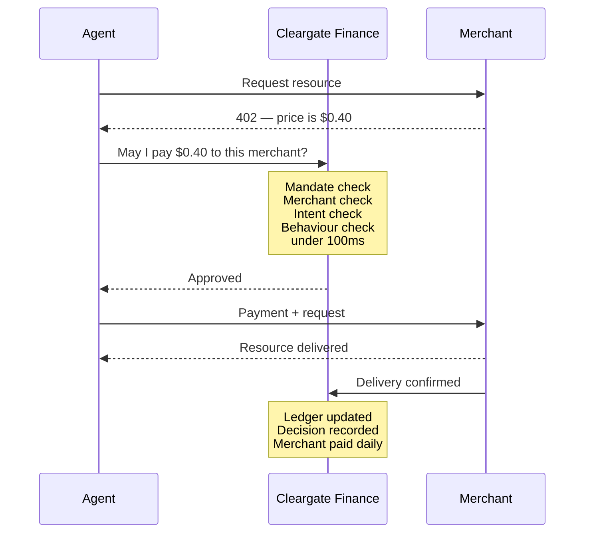
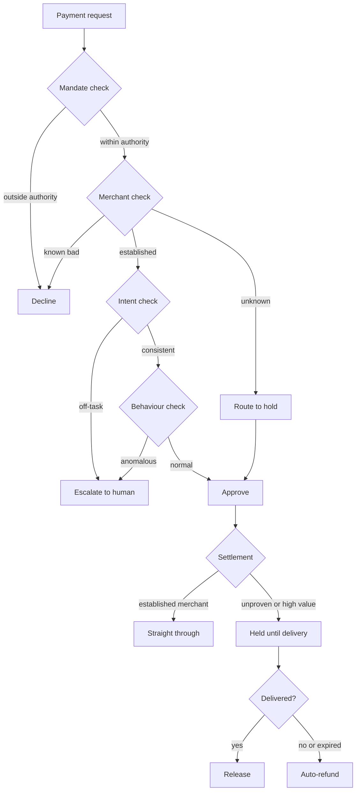
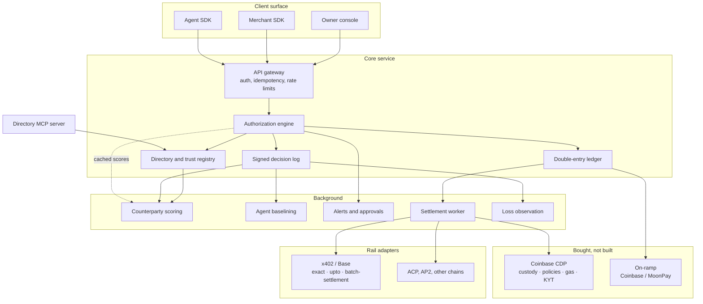
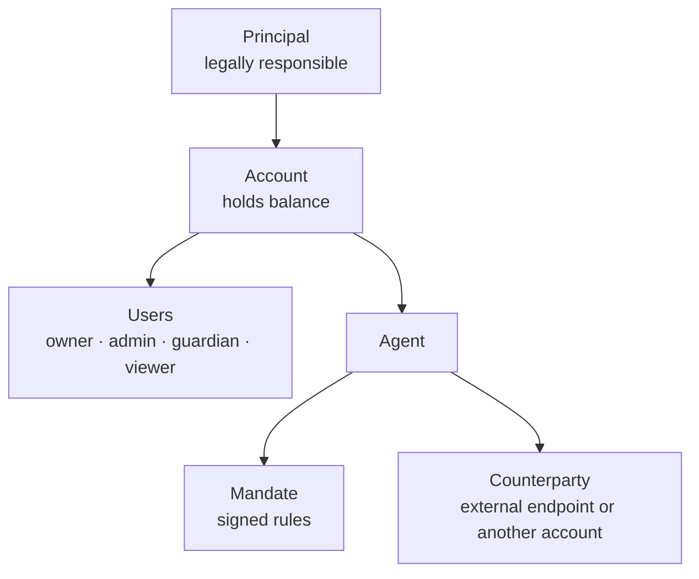
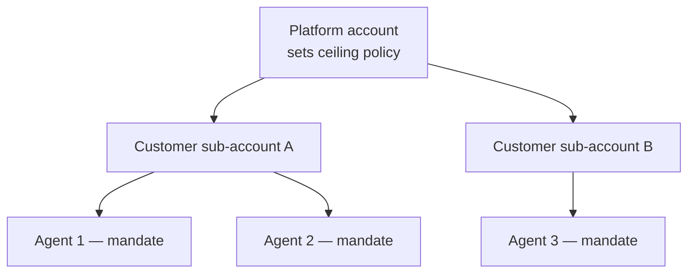

# Cleargate Finance

### The stablecoin-native authorization layer for autonomous agent payments

**Whitepaper v1.2**
*September 2026*

---

## Abstract

Autonomous agents can now pay for things. Protocols such as x402, ACP and AP2, settled in stablecoins, have made machine-to-machine payment technically trivial. What has not been built is the party that stands behind those payments.

Today an agent's purchase is a push payment: irreversible, unverified, and unbacked. If the agent is hijacked, the money is gone. If the merchant does not deliver, the money is gone. And when a purchase is disputed, no participant in the current stack accepts the loss — not the payment scheme, not the model provider, not the issuer. The merchant absorbs it, without any of the fraud signals that historically protected them.

Cleargate Finance is the control and authorization layer on the buyer's side of that transaction. Agent owners connect their agents through a simple account, fund it, and set spending rules — never touching a wallet, a chain, or a gas token. Every payment is authorized before it executes, checked against a signed mandate, a counterparty risk model, and the task the agent was actually given. Every decision is recorded in human-readable form.

**This works on day one with zero merchants integrated.** Buyer-side control protects an agent paying any endpoint on the open web, because the checks run before the money leaves. That is the product, and it is why the company does not need a two-sided network before it is useful to anybody.

Merchant-side features come second, once integration is worth a merchant's time: instant netted settlement, no gas, and a **hold** — payment withheld until delivery is confirmed, auto-refunded if it is not. A hold is a settlement mechanic, not a promise to absorb losses; it only ever controls the timing of money already held.

Bearing liability — guaranteeing a disputed payment out of Cleargate's own capital — is a later act still, and is deliberately not offered at launch. It cannot be priced before real loss data exists, so the platform measures what a guarantee *would* have cost from the first transaction and sells nothing against that number until it is real.

---

## 1. Purpose

Cleargate Finance exists to make agent commerce safe enough that both sides participate.

Three outcomes define the system:

1. **An agent cannot spend outside the authority its owner granted it.** Authority is enforced below the model, where a compromised prompt cannot reach it. This is the outcome that needs no merchant, no network and no counterparty consent, which is why it is first.
2. **A buyer does not pay for something that never arrived.** Where Cleargate controls settlement timing, payment is held until delivery is confirmed and returned automatically if it is not. Where it does not — a one-off payment to an endpoint on the open web — the protection is everything that runs *before* the money moves, and the platform says so plainly rather than implying recourse it does not have.
3. **Both sides can see and prove what happened.** Every decision — including the payments that were blocked — is recorded, signed, and readable.

Absorbing a disputed loss onto Cleargate's own balance sheet is a fourth outcome the company intends to reach and does not claim today. Section 7 sets out why, and what is being measured in the meantime.

A secondary purpose becomes the durable business: operating this layer produces the delivery and default record of the machine economy, a dataset that does not currently exist.

---

## 2. The problem

### 2.1 What is already solved

The payment primitive is finished and commoditizing. Transport protocols provide standard, low-overhead payment handshakes at zero protocol fee. Stablecoins settle in seconds at negligible cost. Wallet and key management is available from a dozen vendors. Identity registries provide a way to name an agent.

None of these are differentiated opportunities.

### 2.2 Liability is unassigned

This is the central unsolved problem, and it is not technical.

In every proposed agentic commerce protocol, the merchant remains the merchant of record. They absorb the risk of autonomous execution while losing the historical fraud signals — device fingerprints, browsing behaviour, geolocation, card-present indicators — that previously protected them. The payment schemes will not take the liability. Consumers will not. Issuers will not. Model providers explicitly will not.

Regulation E and the EU AI Act apply only partially, leaving significant gaps around authorization and liability.

Stablecoin rails make this materially worse. They settle with finality and no reversal, so they have no native answer to disputes at all. There is no chargeback mechanism to fall back on.

Critically, **recognition and authorization are separate problems that the current stack conflates**. Trusted Agent Protocol establishes whether an agent is real. Tokenized credentials establish what it is permitted to spend. Neither establishes what happens when the purchase is disputed.

Liability cannot be solved by a protocol. A protocol has no balance sheet. It can only be solved by a legal entity with capital that agrees to absorb the loss.

That is the opening Cleargate Finance intends to occupy, and the reason it is a durable position: a competitor can copy a rules engine in a quarter, but cannot copy a capitalised loss book. It is explicitly **not** the launch product. Underwriting requires loss data that does not yet exist anywhere, and pricing a guarantee without it is underwriting blind. What ships first is the control layer that prevents the loss, plus the measurement that will eventually make the guarantee priceable.

### 2.3 Security is genuinely unsolved

Agents are steered by language, which makes indirect prompt injection a permanent attack surface rather than a bug to be patched.

Benchmark work on LLM agents shows mixed-attack strategies reaching **84% average attack success across 13 model backbones**, with all eight evaluated defences bypassable through adaptive attacks. This is not a defence gap that will close with better filtering. It is structural: a model cannot reliably distinguish trusted instructions from untrusted content when both arrive as text.

Live evidence confirms the exposure. In May 2026 an attacker embedded a transfer instruction in Morse code in a public reply; a model decoded it, a connected agent treated the decoded output as an executable command, and approximately $175,000 moved to the attacker. There was no transaction limit, no secondary confirmation, and no anomaly detection anywhere in the chain.

On the commerce side specifically, Unit 42 warns that agents able to autonomously trigger refunds invite bot farms initiating thousands of returns within an hour — potentially draining a retailer's cash reserves before anyone notices. **78% of financial institutions expect fraud to spike from AI shopping agents.**

The correct security posture follows directly: **assume the model will be compromised, and constrain what a compromised model can do.** Cleargate Finance does not claim to prevent prompt injection. It guarantees containment — a compromised agent cannot exceed its mandate.

### 2.4 Trust has not arrived

A June 2026 report found that **only 14% of consumers trust AI to execute purchases without verification.**

This is a market-timing signal. Consumer agentic commerce is not imminent, which is why Cleargate Finance targets businesses running agents first. It is also a demand signal: the trust deficit is precisely what a guarantee addresses.

### 2.5 Merchants are flying blind

Merchants historically observed impressions, clicks, dwell time and funnel drop-off. Agent traffic produces almost none of these signals, making it difficult to justify investment even where the payment plumbing works.

Merchants currently face a binary choice: block agent traffic entirely, or accept it blind. There is no middle setting. Cleargate Finance provides one — accept backed agents, reject unbacked ones — which converts the platform from an optional add-on into the credential that grants access.

### 2.6 Market timing, stated honestly

Agent payment volume today is small. Protocol-level activity measures in the tens of millions of dollars per month, a meaningful share of which is not genuine commerce. The qualified merchant supply side numbers in the low thousands.

**This is not a large market today.** The strategy accounts for that explicitly: revenue in the first eighteen months comes from subscription and visibility products that do not depend on transaction volume, while the guarantee business is an option on 2028–2030 activity. Any plan requiring agent commerce to be large in 2026 fails.

---

## 3. What Cleargate Finance is

Cleargate Finance is the company that controls and protects what an autonomous agent is allowed to spend, and gives both sides of the transaction a reason to trust a purchase where no human was present.

There are two altitudes to the description, and both are true. **Near term it is the trust and authorization layer for agent payments.** Long term it is **the financial platform for the machine economy** — authorization, then holding funds, then credit, then underwriting. Stablecoins and x402 are the mechanism that makes the near term possible; they are not the headline, and a customer never needs to know they are there.

**To the agent owner:** an account with agents in it. Each agent has spending rules, a share of one pooled balance, and a readable log of everything it bought and everything it was prevented from buying. No wallet, no chain, no gas.

**To the developer:** one SDK that wraps the agent's HTTP client. Any payment request is handled automatically.

**To an enterprise:** a policy and audit layer over agent spending, with attribution, approval workflows and exportable records.

**To the merchant:** instant settlement with no gas and no chain handling, fiat payout if wanted, hold-based protection against disputes, and a place in the directory that buyers' mandates prefer. Note what this list does not say: it does not promise that Cleargate absorbs a loss. That comes later, on real data, and Section 7 is explicit about it.

The ordering above is the ordering of the build. Buyer-side control is useful with **zero merchants integrated**, because the checks that matter run before the money leaves the account, whether the payee is on the platform or an arbitrary endpoint on the open web. Merchant-side features require a merchant to integrate, so they are the second act, and the buyers routing payments are what makes that integration worth doing.

### 3.1 What it is not

- **Not a payment rail.** It routes over x402 and, later, ACP, AP2 and card rails.
- **Not a wallet.** Key custody is commoditized and bought from a specialist provider (§8.8).
- **Not an identity registry.** External registries are consumed as weak signals.
- **Not a marketplace.** It does build a **directory and trust registry** (§11) — who the payees are, what they charge, and whether they actually deliver — because x402 settles payment and says nothing about discovery. What it does not do is take a cut of matching buyers to sellers, hold inventory, or own the commercial relationship. A registry that reports verified delivery is a trust product; a marketplace is a different business.
- **Not a treasury or trading product today.** Transfers, swaps and yield are out of scope for the agent-payments product. The authorization engine is deliberately generic, though — it authorizes *movements of value against a signed policy* — and the same engine with different checks (approval caps, transaction simulation, slippage bounds, protocol allowlists) is what a DeFi-acting agent needs. That adjacency is noted as a possible second product (§14.3), not built now, and nothing in the engine should assume a payment is a purchase.

### 3.2 Where this sits in a crowded market

The honest starting point is that **the wallet-plus-spend-controls layer is crowded.** Skyfire, Nekuda, Prava, PayOS, Proxy and Nevermined are all building some version of it, most of them oriented to card rails, and at least one of them already uses the word "mandate" for what it issues. Positioning Cleargate as "an agent wallet with spending controls" would be a claim to occupied ground, and the vocabulary is taken.

The defensible lane is the **intersection** of three things, and it is the intersection rather than any single one that is hard to copy:

1. **Stablecoin-native, on x402 and Base.** Less contested than card rails, and it is the right fit for the segment that is actually transacting today: sub-dollar, high-frequency, machine-to-machine, crypto-native. Card-oriented competitors are optimising for a $40 consumer purchase; this is optimising for eight thousand payments of half a cent.
2. **Buyer-side control *and* merchant-side trust and settlement.** Most of the field picks one. Holding both is what turns a control panel into a network, because the delivery outcomes observed on the merchant side are what make the buyer-side counterparty check worth anything.
3. **A path to bearing liability.** Requires capital and a loss book, which is precisely why a protocol cannot follow. This is a *future* differentiator and is stated as one — see §7.3 — not a claim about what ships first.

**Position, in one line:** the stablecoin-native authorization layer that controls and protects agent payments.

**On incumbents.** Coinbase, Stripe and Visa are more likely acquirers than competitors, and that shapes strategy rather than threatening it. Each of them already owns rails and distribution; none of them owns the risk and authorization record for autonomous buyers, and each would rather buy that than build it. The implication is to own the layer they have not built — the decision log, the delivery graph, the loss book — rather than to compete on payment plumbing they are better placed to commoditize.


---

## 4. Core concepts

### 4.1 The entities — what things *are*

The platform is built on a small set of entities, each with its own identity and lifecycle. The governing principle is to **separate what something *is* from what it *does*.** An account is what a business *is*; paying and receiving are things it *does*.

**Principal** — the human or legal entity ultimately responsible. Liability attaches here, and identity verification (when eventually required) verifies the principal. A principal may own several accounts.

**Account** — the container that holds a balance and everything attached to it: users, agents, registered services, transaction history. When money moves, it moves in or out of an account. An account is neither buyer nor seller by nature — those are roles it takes on per transaction.

**User** — a human who logs into an account and acts, at a defined permission level. Distinct from the principal: the principal is *responsibility*, users are *access*. One company has one principal but may have many users.

**Agent** — the autonomous actor connected to an account. It holds a mandate and initiates payments. Not a human, not a login — the automated actor doing the transacting.

**Mandate** — a signed grant of spending authority issued to an agent. Contains maximum per transaction, per day and per month; permitted categories; time-to-live; subagent delegation depth; and the human approval threshold. Signed by a user with authority, versioned, and verified by Cleargate before every payment.

**Counterparty** — anyone an agent transacts *with*. May be an external endpoint or another account on the platform. Reputation attaches here — age, transaction count, delivery rate, price stability, dispute history — independent of who the counterparty is. A counterparty record can exist without an account and later be *linked* to one when that party signs up, inheriting the reputation already accumulated.

### 4.2 The roles — what things *do*

Roles are not new entities; they describe how an entity participates in a given moment.

**Transaction roles**, assumed per payment:

- **Payer** — the account whose agent is spending. Exactly one per payment.
- **Payee** — the party receiving payment and expected to deliver. This is what was historically called "the merchant." Reputation attaches to this role. A payee may be an on-platform account or an external endpoint — the role is identical either way.
- **Backer** *(later)* — whoever underwrites guarantees for a class of counterparties.

There is no separate transaction role for signing off on an escalated payment. When §12.3's approval flow fires, it is answered by whichever **owner or admin** the account has configured to receive it — the same two permission roles that manage agents and mandates day to day, not a role of its own. Introducing one would mean a sixth thing to explain for a case the existing roles already cover.

The key consequence: **"merchant" is not an entity type — it is an account acting in the payee role.** Any account can occupy it. This is what makes agent-to-agent payment the same code path as agent-to-merchant payment.

**Permission roles**, governing what a user may do within an account: **owner** (everything, including billing and the commercial relationship), **admin** (manage agents and mandates, not billing), **guardian** (stop things — veto a pending change to spending authority, freeze the account — and propose nothing), **viewer** (read-only console and reports). Four roles, deliberately no fifth: every permission an account needs is a combination of propose, operate, stop, or read, and stretching to a role for every named use case (releasing an escalated payment, say) buys precision nobody asked for at the cost of a role system nobody can hold in their head.

Two separations do the work. *Propose versus stop* — owner and admin against guardian — is the security boundary: on a guarded account no single compromised human can widen what an agent may spend, because raising a cap waits out a delay in which a second person holding separate hardware can veto it. *Own versus operate* — owner against admin — is the organisational one, so a business can hire someone to run its agents without handing them the power to close the account or move its billing.

This is also the enterprise segregation-of-duties mechanism: the user who sets a policy need not be the user who can stop it. The guardian's power is deliberately subtractive, so a stolen guardian credential is worth nothing on its own, and every blocking power it holds is bounded — a veto cancels one proposal rather than killing the subject, and the guardian itself remains removable by the owner on a delay.

### 4.3 Transaction and settlement concepts

**Decision** — the approve, hold, escalate or decline outcome for a single payment request, evaluated in under 100 milliseconds.

**Decision record** — the immutable, signed log entry for every evaluated payment, including the mandate version in force at the time. This is the evidence that makes the guarantee credible.

**Hold** — a conditional settlement where funds are committed but released only on confirmed delivery, with automatic return to the buyer on expiry. Available only where Cleargate controls settlement timing, which means the on-platform netted flow (§8.6). It is a settlement mechanic, not an underwriting product: it risks no capital, because the money being withheld is money already held.

**Guarantee** *(future — not offered at launch)* — a contractual commitment that an approved payment, if disputed under defined conditions, is covered by Cleargate rather than by the payee. Deferred deliberately; §7.3 sets out the conditions under which it becomes offerable.

**Loss observation** — an internal record of what *would* have been a covered loss had a guarantee been in force. Written from the first transaction, paid out to nobody. This is the dataset that makes §7.3 possible and it is free to collect (§7.2).

**Voucher** — an off-chain, signed message asserting the *cumulative* total owed to one payee on one payment channel. Each request produces a new voucher carrying a new running total; the latest one supersedes all before it. Vouchers are the per-payment audit evidence behind a netted settlement.

**Channel** — the on-chain escrow and its associated voucher series for one (account, payee) pair, under x402's batch-settlement scheme. It has a balance, a latest voucher, and a lifecycle of open, top up, and close.

**Internal ledger** — the double-entry record of all balances and obligations, and the system of record for what each individual payment was. Payments authorize instantly against the ledger; the chain is settled either per payment or in aggregate depending on the scheme in force (§8.6).

---

## 5. How it works

### 5.1 The agent owner journey

**Setup, once:**

1. Sign up with a company email. No crypto knowledge required.
2. Fund the account by card or bank transfer.
3. Register an agent. Set rules: maximum per purchase, monthly cap, permitted categories, approval threshold.
4. Copy an API key into the agent's configuration.

**Ongoing:** the agent works. When it needs to buy something, it buys it. The owner does nothing.

**In the dashboard**, the owner sees plain language:

```
2:14pm  paid $0.40 to weather-api.com for forecast data     delivered
2:19pm  paid $2.00 to news-api.io for article search        delivered
2:31pm  BLOCKED $85 to newsite.xyz  over $20 limit, domain 3 days old
        Spent today: $12.40 of $200 monthly
```

### 5.2 The merchant journey

**Setup, once:**

1. Register as a merchant.
2. Add one call to the server: on successful delivery, notify Cleargate.
3. Provide payout details.

**Ongoing:** agents pay. Settlement arrives daily, netted into one on-chain transfer, with no gas to fund and no chain to handle. Payout can be stablecoin or fiat through an off-ramp.

The merchant proposition is: **get paid instantly for agent traffic, without touching crypto, and be the verified option buyers' mandates prefer.** Where a payment is held pending delivery, confirming delivery releases it — so a merchant that delivers is paid and a merchant that does not was never paid in the first place.

Two things the proposition deliberately does *not* say. It does not offer aggregation as a merchant benefit: netting is a cost mechanic that serves Cleargate's economics, and dressing it up as a merchant feature invites the obvious question of who it is really for. And it does not promise that Cleargate absorbs a disputed loss — that is a later product, on real loss data (§7.3).

### 5.3 Connection models — one account, three ways to use it

After signup, a business is not forced down a single path. There is one signup for everyone — no "are you a business?" question — and an account is created with a single user who is implicitly the owner, so a retail user never encounters roles or permissions. The only branch that matters at the start is *intent*: what does the account want to do?

An account has two capabilities it can attach:

- **Connect agents** → so it can *buy* (payer side). Requires funding and mandates.
- **Register services** → so it can *sell* (payee side). Requires a payout destination and delivery confirmation.

The three models are simply which capabilities an account attaches:

**Buyer only.** A company running agents that purchase APIs, data, compute, or other agents' services. Setup: fund the account, connect an agent, set its mandate. No services registered.

**Seller only.** A headless merchant, API, or any business that only wants to *receive* payments. Setup: register a service (endpoint, price, delivery-confirmation method), set a payout destination (bank account via off-ramp partner, or stablecoin address), add one delivery-confirmation call to the server. No agents, no mandates, no funding — the mirror image of the buyer setup. Other accounts' agents pay this account; it acts as payee, delivers, is paid out daily, and accumulates payee reputation.

**Both.** The characteristic machine-economy business: it buys through its agents *and* sells through its services, on one account with one balance. It is payer when its agents spend and payee when its services are bought. No second account, no "merchant mode" — the role is decided per transaction.

Business machinery reveals itself only when needed: team roles appear when a second user is invited, tax details when an invoice is required, identity verification when volume crosses a threshold. A retail user gets a clean experience not because they were routed into a "personal mode," but because that complexity legitimately does not exist yet for an account of one. A buyer-only user who later registers a service simply adds it to the same account — no migration, no second signup.

### 5.4 A single transaction



Steps three and four are the entire company. Everything else is plumbing.

### 5.5 Two settlement flows, one set of checks

Whether the payee has integrated with Cleargate changes *how the money moves*. It does not change what is checked before it moves, and that distinction is the whole reason the product works before a network exists.

| | On-platform payee | Off-platform payee |
|---|---|---|
| Settlement | Netted — many payments, one on-chain transfer, via x402's `batch-settlement` scheme | Individual real on-chain payment, via x402's `exact` scheme |
| Buyer-side checks | Mandate, counterparty, intent, behaviour | **Identical** |
| Protection | Pre-payment checks **plus** a hold until delivery is confirmed | Pre-payment checks only |
| Recourse after payment | Hold expiry auto-refunds | Effectively none — a raw x402 payment is final |

**The same four checks run in both flows.** An agent buying from a random endpoint it discovered mid-task gets the same mandate enforcement, the same counterparty scoring, the same intent and behaviour checks as one buying from an integrated partner. Only the settlement scheme differs, and it is chosen automatically by whether the payee is integrated — never by the agent, and never by the owner.

**Holds require control over timing, which is why they are on-platform only.** A hold works by not releasing money Cleargate already holds. Once an `exact` payment lands on chain it is final and there is nothing to withhold. The platform therefore does two things rather than pretending otherwise: it discloses coverage honestly in the console, marking off-platform payees as *unverified, not covered*, and where it is worth doing it can proxy the request itself so that delivery is observed rather than assumed.

This is also the answer to the cold-start problem. Off-platform payees are not a gap in the product — they are the top of the funnel, and §15 explains how their accumulated traffic is what converts them.

### 5.6 Failure cases

| What happens | System response | Loss |
|---|---|---|
| On-platform merchant takes payment, delivers nothing | The payment was held, not released. No confirmation arrives, the hold expires, the buyer is refunded automatically and the merchant is flagged network-wide. Nothing was ever paid out, so nothing must be clawed back | None |
| Off-platform merchant takes payment, delivers nothing | Pre-payment checks ran and the payment was still made, because a raw x402 `exact` payment is final. The buyer bears it, the outcome is recorded against that counterparty, and the loss is written to the internal loss-observation ledger (§7.2). The console states plainly which payees are outside hold coverage | Buyer's, and disclosed as such |
| Agent hijacked, attempts a large transfer | Blocked at the mandate check — over limit, unknown destination; owner alerted | None |
| Owner disputes a purchase the agent made | Signed mandate and decision record checked. Inside mandate: the owner authorized it and the record proves so. Outside mandate: Cleargate approved it in error — today that is recorded as an observed loss and handled case by case, and it is the category a future guarantee would cover first | Determined by record |
| Coordinated refund farm against one merchant | Pattern visible across all merchants simultaneously; blocked centrally | None |
| Agent retries after timeout | Idempotency key returns the original result; no second payment | None |

---

## 6. The authorization engine

Four checks run in sequence before any money moves.



### 6.1 Mandate check

The owner's spending rules, cryptographically signed and evaluated server-side. Model output is treated as a *request*, never as an instruction.

This is the control that contains hijacking. An injected instruction is still followed by the model — Cleargate makes no claim to detect injection — but it meets a wall: amount above the cap, category not permitted, destination unknown, magnitude anomalous. A catastrophic loss becomes a declined transaction and an alert.

Because mandates are signed by the owner, a compromise of Cleargate's own database cannot fabricate spending authority.

### 6.2 Merchant check

**The owner never enumerates merchants.** An agent discovers most of what it buys at runtime; requiring pre-approval would make the system unusable.

Card networks resolved this decades ago. When a cardholder taps at an unfamiliar shop, the network knows the merchant even though the cardholder does not, because thousands of others have transacted there. **Identity and risk are supplied by the network, not the account holder.**

Mandates therefore express classes and limits, never instances: *data and inference APIs, maximum $20 per call, hold anything unproven.* No URLs appear in a mandate.

Merchants are scored in four layers:

**Layer 1 — Passive signals, available instantly with zero history.** Domain age, TLS certificate age and issuer, DNS and hosting reputation, threat-intelligence and phishing feeds, price sanity against category norms, consistency between advertised payment metadata and the live endpoint, and provenance — whether the URL came from the agent's original task or appeared mid-session from fetched content. That last signal is the primary tell for injection and SEO-poisoning attacks.

**Layer 2 — Network history.** Once any participant transacts with a merchant, every subsequent participant benefits. The thousandth customer to encounter an endpoint receives a score built by the previous nine hundred and ninety-nine.

**Layer 3 — Merchant opt-in.** Merchants seeking instant settlement register and, later, post a bond. This is how a legitimate new merchant escapes cold-start in days rather than months.

**Layer 4 — The hold, where it is available.** An unknown *on-platform* merchant is **held, not declined**. Funds are committed, delivery is verified, funds release. Exposure approaches zero regardless of who the merchant turns out to be, the agent still completes its task, and the transaction produces the first data point for Layer 2.

For an **off-platform** payee there is no hold to apply, because a raw `exact` payment is final the moment it settles (§5.5). Layers 1 to 3 still run, the decision is still recorded, and the counterparty still accumulates a delivery record — but the protection is entirely pre-payment, and the console says so rather than implying recourse that does not exist. Where the exposure justifies it, the request can be proxied so delivery is observed directly instead of assumed.

Cold start ceases to be a problem the moment the system stops trying to solve it through detection — and where the hold is unavailable, the honest answer is disclosure plus a bounded limit, not a silent hope.

Two asymmetries make this work: **trust accrues slowly, distrust propagates instantly** — one confirmed non-delivery flags a merchant network-wide within seconds — and **the cost of being wrong is bounded by the hold, not by the payment value.**

### 6.3 Intent check

The stated purpose of the payment is compared against the task the owner assigned. Hijacking characteristically produces payments that are *off-task* — a research agent suddenly buying a licence, an agent suddenly paying an address unrelated to its work. Off-task spending is a cheap, high-signal detection surface requiring no adversarial model analysis.

### 6.4 Behaviour check

Agent behaviour is far more predictable than human behaviour. Human card spending is noisy — travel, irregular purchases, changing habits — which is why bank fraud models need enormous data and still produce poor false-positive rates. An agent runs a loop: the same endpoints, similar amounts, similar cadence.

An agent that has paid five known endpoints ten thousand times and then sends forty times its typical amount to a domain registered days earlier is a trivially detectable anomaly. A z-score and a novelty flag catch it; no machine learning is required.

Bank fraud features cannot be ported — no device fingerprint, no geolocation, no browsing history. The feature set is machine-native: merchant age and history, price deviation, delivery rate, spend-to-task ratio, subagent depth, time since mandate issue, rate of novel merchants per session.

### 6.5 Detection roadmap

| Phase | Capability | Rationale |
|---|---|---|
| Launch | Deterministic rules: caps, categories, velocity, novel-merchant friction | ~80% of the value; the only version explicable to an auditor |
| Months 3–6 | Per-agent statistical baselining | High signal, no labelled data required |
| Months 6–12 | Merchant scoring from delivery outcomes | The proprietary dataset |
| Year 2+ | Supervised models | Requires thousands of confirmed loss events |

### 6.6 Operating constraints

**Latency.** The straight-through decision must land under 100 milliseconds. Nothing slow runs in the request path: no chain calls, no model inference, no external HTTP. Merchant scores are precomputed offline and cached.

**False positives are more damaging than with cards.** A blocked human retries with another card; a blocked agent fails its task mid-run with nobody watching. The default action on suspicion is **hold and notify**, not deny. Outright decline is reserved for hard mandate violations. False-positive rate is a headline metric from day one.

### 6.7 What the system does not stop

Stated plainly, because overclaiming creates legal exposure under a guarantee:

- Prompt injection itself. Containment is guaranteed; prevention is not available.
- A trusted merchant quietly degrading quality while still technically delivering.
- Subjective quality judgements. Verification covers deliverable-shaped conditions — status, schema, hash, completion. "Was the analysis good?" is not machine-verifiable.
- Compromise of the agent runtime itself, including malicious tools and poisoned tool descriptions. That is an agent-security problem, not a payments one.
- Poor agent decisions within policy. Cleargate bounds authority; it does not improve judgement.

---

## 7. Disputes, protection and liability

**Read this section for what it does not promise.** Cleargate launches with a *settlement mechanic* that protects buyers at zero capital risk, and with *measurement* of what a guarantee would have cost. It does not launch with a guarantee. §7.3 is explicitly a future act, and it is written down so the sequencing is deliberate rather than accidental.

### 7.1 Disputes are a design failure, not a process to optimise

A card network learns about a problem weeks later, when a cardholder reviews a statement. By then the merchant has shipped, money has moved, and both sides argue from incomplete records.

Cleargate Finance stands in the transaction as it happens. It holds the mandate that was active, the purpose that was stated, and the delivery confirmation. Most disputes should therefore not exist.

| Dispute type | Why it should not occur | Residual |
|---|---|---|
| "The agent shouldn't have bought this" | The purchase was checked against a signed mandate before approval. Inside it, the owner authorized it and the record proves so. Outside it, Cleargate erred | Becomes a lookup, not a debate |
| "The merchant didn't deliver" | On-platform, the payment was held and release requires confirmation, so expiry auto-refunds. Off-platform, the pre-payment checks are the protection and the payment is final | Near zero on-platform; disclosed off-platform |
| "Delivered but useless" | Cannot be designed away — requires human judgement | The only category needing real process |

**The operating metric is observed loss rate as a percentage of routed volume.** Card fraud runs roughly 0.05–0.1%. Above approximately 0.5%, a guarantee business would not work. This is tracked from the first transaction — not because anything is being covered yet, but because the number is the precondition for §7.3.

### 7.2 What ships at launch: holds, and silent loss observation

Two things, and neither of them risks capital.

**The hold.** In the netted on-platform flow, Cleargate controls when money reaches the payee. A payment can therefore be committed but not released, verified against delivery, and returned automatically to the buyer if delivery never comes. This is real, meaningful buyer protection — it is what makes an unknown merchant safe to transact with — and it costs nothing to offer, because the money being withheld is money Cleargate already holds. **Controlling the timing of money you hold is not underwriting.** No reserve, no coverage promise, no loss absorbed anywhere.

**The silent loss-observation ledger.** From the first transaction, every event that *would* have been a covered loss under a guarantee is recorded internally: non-deliveries, disputes, approvals that turned out to be wrong. Full context per event — payee, category, amount, reason, which check passed it. **Nothing is paid out against these records.** They are observations, and the console never shows a customer a number that implies coverage.

The reason to build this on day one is that the measurement is nearly free while the data is unrecoverable. Deferring the guarantee *product* does not require deferring the *measurement*, and the measurement is the entire thing that turns §7.3 from a hope into a decision that can be made on evidence. A competitor starting two years later can copy the rules engine in a quarter and cannot copy two years of observed delivery failure.

### 7.3 Future: guarantees and insurance — deliberately not in the MVP

This is the destination, not the starting point, and the reason for the delay is simple: **a guarantee cannot be priced correctly until real loss data exists, so offering one at launch means underwriting blind.** One badly priced quarter can end the company. Nothing below is a build commitment; it is the shape the later product takes if the data supports it.

**The loss waterfall**, in the order losses would be absorbed. Each layer exists so the one below it is rarely touched:

1. **The hold** — the payment was never released, so there is no loss to cover. This is where the overwhelming majority should land, and it is already live.
2. **Netting** — a refund owed is deducted from that payee's next payout. Economically a chargeback, requiring no reversibility.
3. **Merchant rolling reserve** — a trailing percentage of payouts retained, forming the payee's own clawback buffer.
4. **Cleargate's capped reserve** — the rare residual, hard-capped per transaction and in monthly aggregate.

**The coverage boundary**, stated before anything is sold rather than argued afterwards:

| Covered | Not covered |
|---|---|
| Verifiable non-delivery under defined, machine-checkable conditions | Subjective quality — "the analysis was poor" |
| Cleargate's own approval errors — a payment approved that the mandate did not permit | Spending the owner authorized that turned out to be unwise |
| | Off-platform payments Cleargate could neither hold nor verify |
| | Anything above the stated per-transaction and aggregate caps |

**Reserve stages.** Own reserve first, funded as a customer-acquisition cost rather than as profit; then merchant-funded mechanisms as above; then, with a real loss book, a reinsurer writes the policy and Cleargate operates as a **managing general agent** — pricing, underwriting and owning the customer relationship while the reinsurer holds the capital. Guarantee fees are risk-priced from observed data, never flat.

**The hard risk note, stated plainly.** One bad underwriting quarter can kill the company, and this failure mode does not announce itself in advance. Start with embarrassingly low caps. Widen only on proven loss data. Never guarantee an amount that a bad month could not survive, and never widen a limit because a customer asked.

### 7.4 Why the liability position cannot be copied by a protocol

A protocol has no balance sheet and cannot accept liability. Only a capitalised legal entity can. This is the structural reason the eventual position is defensible against open standards, and the reason the loss dataset built in §7.2 — which is what unlocks reinsurance — is the company's core long-term asset, even though it earns nothing on the day it is collected.

---

## 8. Architecture

### 8.1 Principles

**Start as a monolith.** Microservices solve an organizational problem that a small team does not have, while introducing distributed-transaction complexity precisely where atomicity matters most. One service with clean internal module boundaries; split only when a component demonstrably needs different scaling. The one early exception is chain interaction, isolated as a queue-driven worker so RPC unreliability never enters the decision path.

**Nothing slow in the request path.** All scoring is precomputed offline and cached. The hot path reads cache and evaluates rules.

**Rails are adapters, not dependencies.** The authorization engine never knows what a chain is. It approves or declines; a separate layer determines how value moves.

### 8.2 Component view



### 8.3 The ledger

Double-entry bookkeeping. Every movement creates two rows summing to zero:

```
Agent pays $0.40 to a merchant:
    Agent balance       -0.40   debit
    Merchant payable    +0.40   credit
```

Rows are **append-only**. Corrections are new reversing entries, never updates or deletes. This permits reconstruction of system state at any historical moment — required by auditors, regulators, and debugging.

An hourly job sums all entries and confirms the total is zero. A non-zero result pages immediately. This single check catches a large class of bugs before they compound.

**Denomination.** The ledger counts in US dollars, and every dollar is backed one for one by USDC, the only token accepted. A customer's balance is a claim on the USDC held for them, not a promise of dollars: if USDC trades away from $1, the console shows the balance's market value beside it, and the ledger is not revalued. Cleargate never covers a stablecoin's price gap, for the same reason it does not absorb losses (§7.3). Spend limits count USDC at face value, which is conservative when the price falls.

### 8.4 Idempotency

Every money-moving request carries a client-supplied key, stored with its result.

```
Request: pay $5 to merchant-X, key = "abc-123"
Stored:  "abc-123" → approved, payment #4471

Timeout. Agent retries with key "abc-123".
Key found → original result returned. No second payment.
```

Without this, a timeout inside a retry loop produces thousands of duplicate payments in minutes with no attacker involved. This is the most common way payment systems lose money.

### 8.5 Concurrency on balances

Two simultaneous requests against an agent with $10 remaining will both observe $10 and both approve $8 unless locked. Balance reads on the money path use row-level locking or atomic conditional updates.

### 8.6 Settlement, schemes, and multi-rail

Payments authorize against the internal ledger in under 100ms, independent of block time. How they reach the chain depends on which **x402 scheme** is in force.

**Netting is not a Cleargate invention, and should never be described as one.** It is x402's official `batch-settlement` scheme: the buyer deposits once into an on-chain escrow, then signs an off-chain **cumulative voucher** per request — each voucher carrying a new running total that supersedes the last — and the seller or facilitator redeems many vouchers in a single on-chain transaction through stateless unidirectional payment channels. The implementation comes from the x402-foundation Go SDK. Building a proprietary netting layer would mean maintaining a worse version of a standard our own merchants' other counterparties already speak.

Three schemes, selected per situation by the rail adapter:

| Scheme | When | Why |
|---|---|---|
| `exact` | One-off payments, and every off-platform payee | Nothing to amortise; the payment is the settlement |
| `upto` | Variable-cost or metered calls where the final price is not known up front | Authorize a ceiling, settle the actual |
| `batch-settlement` | High-frequency repeated calls to the same payee | 800 payments of $0.02 become one on-chain transfer |

Selection is per **(account, payee)** pair and **promotes**: a payee starts on `exact` and moves to `batch-settlement` once repeat volume appears and the channel is worth opening. Nothing about this is visible to the agent.

**Reconciliation, and what counts as evidence.** Three artifacts with three different jobs:

- the **internal ledger** holds per-payment truth and is the system of record;
- **signed cumulative vouchers** are the per-payment audit evidence, each one a signed assertion of what was owed at that moment;
- the **on-chain batch** is proof of net settlement, and nothing finer.

> **Never treat on-chain data as the audit trail.** In a batch settlement the chain records the *facilitator or executor* firing a transaction — not the payer, not the individual payments, not the purpose. Anyone reconciling against block explorers will reconcile against the wrong thing, and any demand to produce on-chain evidence of a specific payment cannot be met because that evidence does not exist on chain. Our books are the record: ledger plus vouchers plus batch hashes. Solvency is proved by an hourly invariant — payables never exceed holdings — not by publishing per-payment hashes.

**Running batch-settlement makes Cleargate the facilitator, which is a concentration of trust worth naming.** A facilitator that is compromised can misauthorize or misdirect across many services at once, so its blast radius is the whole channel set rather than one payment. This sits alongside platform compromise in §8.10 and is treated with the same controls: no unilateral movement, dual approval above thresholds, and independent verification of what was signed.

**Cross-chain is solved by float, not bridges.** If a payee is paid on a different chain than the buyer funded, no cross-chain transaction occurs. The ledger debits and credits internally; the payout is drawn from float held on the payee's preferred chain. Rebalancing between chains is an occasional treasury operation, not a per-transaction concern. Bridges never enter the payment path.

### 8.7 Cryptography

Three concrete uses, no exotic primitives:

- **Signed mandates.** Owner-signed, server-verified. A database compromise cannot fabricate spending authority, and disputes have a provable artifact.
- **Signed decision records.** Both parties can verify a record was not altered after the fact. A guarantee is only as credible as its evidence.
- **Hash-chained audit log.** Each entry includes the previous entry's hash, making historical tampering detectable.

### 8.8 Wallets, custody and gas

Key custody is bought, not built. The provider is **Coinbase CDP**.

The reasoning is fit rather than preference. CDP is Base-native, authored by the same team as x402, and bundles most of this layer in one provider: TEE-backed key custody, Spend Permissions, Policies, gas sponsorship, native x402 support, built-in KYT address screening, and a Coinbase on-ramp. Assembling the same capability from separate vendors means integrating four relationships and reconciling their failure modes.

**Two control models, mapped to two audiences.** CDP offers both on one infrastructure, and Cleargate uses both:

| Model | Who it is for | Control | Note |
|---|---|---|---|
| **Server Wallet** — server-controlled, API-key auth | Retail and non-crypto users | Cleargate's backend holds the keys | The "bank for agents" experience. **Custodial in the regulatory sense**, with the licensing consequences that implies |
| **Embedded Wallet** — user-controlled, email or social login | Crypto-native users who want their own custody | The user holds the keys, delegating time-bound authority to our backend | The non-custodial path |

Wallets are created from email, SMS or social login with no seed phrase, in under half a second, and can be **pre-generated and pre-funded before the user first logs in**. A web2-style signup that provisions a wallet invisibly behind it is a confirmed capability, not an aspiration — which is what makes "no wallet, no chain, no gas" true rather than marketing.

**The provider sits behind a `WalletProvider` interface.** CDP is the implementation, not the architecture. CDP has no Go SDK, so the adapter is either direct REST calls from Go for the handful of endpoints used, or a thin TypeScript sidecar behind the same interface. That choice is an implementation detail sealed inside the adapter and must not leak into any module that authorizes payments.

**Mandates map onto CDP primitives where they can.** Agents remain spend *scopes* against one pooled account wallet — never per-agent wallets (§9.3). Per-agent limits are expressed as CDP **Spend Permissions** (an allowance per spender per period) and **Policies** (value caps, address allow and blocklists, USD limits, network and function restrictions). This puts part of the mandate *below the model and below our own backend*: where a CDP policy covers a rule, a compromise of Cleargate's servers still cannot exceed it. Our engine enforces everything CDP cannot express — intent, behaviour, category, provenance.

**Voucher signing deliberately does not run through CDP, and the reason is cost.** CDP prices wallet operations — creation, signing, broadcasting, policy evaluation — at $0.005 each, with the first 5,000 per month free and reads free. High-frequency batch-settlement signing would collide with that: 8,000 vouchers a day at $0.005 is $40 of signing against roughly $32 of payments, which inverts the economics of the whole netted flow. Vouchers are therefore signed server-side with **Cleargate's own delegated EOA** — x402's `payerAuthorizer` — outside CDP's meter, where the marginal cost is an ECDSA operation.

This makes the delegated key a **cost boundary, not merely a throughput optimisation**, and it has a schema consequence: two key roles per agent — the CDP account wallet, and the delegated voucher-signing EOA — plus the channel linkage between them. CDP is used for what it is priced for: account-wallet custody, funding operations, on-chain settlement and redemption transactions, and Spend Permission and Policy enforcement.

**Gas.** CDP gas sponsorship covers on-chain agent actions and `exact` payments, so no separate paymaster is needed in the common path. In the netted flow agents mostly do not transact on chain at all — only settlement does. One operational requirement survives regardless: monitor and auto-refill the settlement wallet's native gas balance. A settlement failing because our own wallet ran dry is a preventable outage and an embarrassing one.

**Address screening.** CDP's built-in KYT screening is used on deposits and payouts.

### 8.9 KYC, funding and withdrawal

**Verification is gated by spend limit, never by funding method.** Tying KYC to *how* money arrives produces the wrong shape — a user funding $20 by card faces more friction than one funding $20,000 in stablecoin. Tiers instead:

| Tier | Requires | Unlocks |
|---|---|---|
| **Basic** | Email | Low cap, trial-sized spending |
| **Verified** | Identity verification | Standard limits |
| **Business** | Legal entity plus beneficial ownership | High limits |

Where the money comes from then determines what is *unavoidable* on top:

- **Card and bank funding through an on-ramp.** The on-ramp is the regulated party and sets its own minimum verification even for small amounts. We inherit their floor and their tiers; there is no version of this with less friction, and pretending otherwise wastes the user's time.
- **Direct stablecoin funding.** Here we set the terms. A low-cap trial runs with **no formal KYC** but **mandatory on-chain address screening**. Screening is not KYC and the two are not interchangeable: screening asks whether this address is associated with sanctioned or criminal activity, KYC asks who the person is.
- **Withdrawals mirror it.** To a crypto wallet, we control the path, screen the address, and keep friction low for small amounts. To a bank account, an off-ramp is involved and KYC is unavoidable.

**The principle:** a frictionless trial is direct crypto in and out with screening, while every fiat path carries the regulated floor. AML responsibility remains ours on both — screening is precisely what makes the low-friction path non-reckless rather than merely non-compliant.

### 8.10 Security of the platform itself

Sitting in the payment path makes Cleargate Finance a target.

- Private keys are never held in-house; custody is delegated to Coinbase CDP (§8.8), with TEE-backed key storage.
- Running x402 `batch-settlement` makes Cleargate the facilitator for its own channels, and a compromised facilitator can misauthorize or misdirect across many payees at once (§8.6). Voucher-signing authority is treated as a production secret of the same class as the settlement wallet.
- No single individual can move funds; payouts above a threshold require dual approval.
- Secrets in a managed vault, never in source control.
- All actions logged with actor, action and timestamp, including internal administration.
- Rate limits per agent and per account.
- Alerting on spend spikes, new merchants with unusual volume, elevated refund rates, and ledger imbalance.

### 8.11 Engineering practice

CI on every commit; automated deployment to staging; one-click production deploy and rollback. Feature flags to disable behaviour without deploying. Structured logging with a trace ID spanning every step of a request. Load testing before launch. Written runbooks for incident response.

---

## 9. Account model

The entity model from Section 4 arranges as follows: a principal owns an account; the account contains users and agents; each agent holds a mandate; agents transact with counterparties that may themselves be on-platform accounts.



For platform integrators, the same model nests: a platform account sets a ceiling policy, customer sub-accounts sit within it, and agents sit within those.



Retail usage is this hierarchy with the top layers collapsed — the principal is the person, the account is theirs, and there is one user who is implicitly the owner. Identical objects, identical code path. Multi-tenancy is designed in from the first commit because retrofitting it is a rewrite.

**Administrative controls are opt-in, and tier with the customer.** A retail account has one owner, no guardian and no delay: changes to spending authority apply immediately, and the owner is notified. Setting a timelock adds a waiting period even with nobody to veto — useful on its own, because it converts a stolen session from an instant loss into an emailed warning the owner can act on. Appointing a guardian adds the second pair of eyes: raising a cap then waits out the delay and can be vetoed by someone holding separate hardware. The asymmetry that keeps this from being theatre is that **enabling a protection is instant while removing one is delayed, notified and — except for the guardian's own tenure — vetoable**, since disabling the alarm is always an attacker's first move. Nothing here is a separate product tier; it is the same objects with more of them filled in.

**No wallet per agent.** One account per customer with a scoped credential per agent. Creating an agent issues a credential; revoking an agent revokes it instantly, with no funds to sweep. Funding occurs once at the customer level and agents draw just-in-time, so no capital sits idle across hundreds of wallets.

**Policy inheritance.** A platform sets a ceiling; its customer sets policy within that ceiling; the agent operates within that. A child can never widen what a parent set. This bounds platform risk regardless of end-user behaviour — the first question any platform integrator asks.

**Funding models:**

| Model | Who funds | Who bears loss |
|---|---|---|
| Platform-funded | Platform prefunds, allocates per agent | Platform |
| Customer-funded | Each end user funds their sub-account | End user |
| Platform-guaranteed | Customer funds, platform backstops | Platform, capped |

### 9.1 Platform integration

Platforms embed Cleargate Finance rather than using its console:

```
POST   /accounts                    create sub-account
POST   /accounts/{id}/agents        provision agent, return credential
PUT    /agents/{id}/mandate         set or update spending rules
POST   /agents/{id}/revoke          instant revocation
GET    /agents/{id}/decisions       decision history
POST   /mandates/bulk               fleet-wide application
```

Webhooks: `payment.approved`, `payment.held`, `payment.declined`, `approval.required`, `anomaly.detected`, `cap.approaching`, `delivery.confirmed`, `refund.issued`.

**Embeddable components** — a drop-in mandate editor and spend console under the platform's own branding — are what make platforms integrate rather than build. Platforms will not build a policy interface themselves; if forced to, they build the entire system instead.

### 9.2 Enterprise

Enterprises require: dual control above thresholds — a second admin's sign-off before an exception proceeds — policy as code within existing change management, budget attribution by agent and cost centre reconciled into ERP, immutable audit trail with SIEM export, segregation of duties between the admin who authors a policy and the admin who signs off on an exception to it, and SOC 2 Type II.

The risk question shifts. The developer product asks "did I receive my API response." The enterprise product asks "did the agent spend in accordance with a mandate a human genuinely authorized, and can that be proven to an auditor." Less fraud detection, more **provable authorization chains**.

### 9.3 Money allocation across agents

Agents do not hold money. They hold *spending authority*. The instinct to give each agent its own wallet or pre-allocated slice is the wrong design; the correct model is the corporate-card model.

**One pooled balance, many limits.** When a company gives an employee a card with a monthly limit, it does not move that amount into a separate account for the employee — the money stays pooled, and the card carries a limit that draws from the shared balance. Agents work the same way. The account holds one balance; each agent's mandate carries limits; spending draws from the pool.

This matters for three reasons. Pre-allocating per agent **strands capital** — an idle agent's slice cannot be used by a busy one, forcing constant rebalancing. Per-agent wallets **multiply the crypto problem** the platform exists to hide — every wallet needs gas, funding, and key management. And scattered balances make **reconciliation** miserable, where one pooled balance with a ledger is a single verifiable number.

**Under the hood.** Funding converts fiat to stablecoin once, at the account level — the fiat-to-crypto friction is absorbed a single time, not per agent. Setting an agent's limit moves no money; it writes a rule into the mandate. When an agent pays, the ledger debits the account balance and increments a *spent counter* for that agent — a meter that enforces the cap, not a balance that holds funds. Authorization checks both levels: does the account pool have the funds, and is the agent under its limits.

Consequently, per-agent "remaining" amounts may sum to more than the account balance — exactly as three employees with limits may collectively be allowed more than sits in the corporate account. Limits are ceilings on behaviour, not reservations of money; actual spending is bounded by `min(agent remaining limit, account balance)`. A "reserved" carve-out for a specific agent can be offered as an advanced option — still one pool, just a counter that comes off the top — but shared is the default and most accounts never need reservation.

The schema consequence is a clean separation between **balance** (actual money, account level, verifiable against on-chain holdings) and **spent counters** (per-agent meters that enforce limits and reset per period). Building agents with balances rebuilds wallets and inherits every problem above; building them with counters against a shared balance is the corporate-card model and scales to any number of agents.

---

## 10. Agent-to-agent payments

Agent-to-agent payment is not a separate product — it is the existing design with the payee happening to be another account. But "agent-to-agent" hides two distinct cases, and the distinction determines what must be built.

**Case A — an agent is a payee.** A provider agent sells a service; a client agent pays for it. From the system's perspective this is *identical* to agent-to-merchant: the provider has an endpoint, quotes a price, is paid, delivers. That the seller is itself an agent changes nothing. The four-layer counterparty check, holds, and delivery verification all apply unchanged. **This case is fully supported by the core design** — because "merchant" is a role any account can occupy, an agent selling a service is simply an account acting as payee.

**Case B — an agent subcontracts a job.** A client agent hires a provider agent to *do work* — analyse a dataset, monitor a feed, write code. This is genuinely different in three ways. Delivery is not a schema check — the deliverable may be the subjective thing itself. The work takes time — minutes, hours, or days — which breaks the short-window assumption of a simple hold. And delegation chains form — provider hires sub-provider — so authority flows through multiple hops.

The foundations for Case B already exist: the mandate model, signed authorization, the delegation-depth field, the internal ledger (an agent-to-agent payment settles as a ledger entry between two accounts, needing no new settlement mechanism), and the decision log. What is not yet built:

- **Milestone holds** — releasing a job's payment in stages against checkpoints rather than one release on delivery, bounding risk on long jobs.
- **A defined acceptance mechanism** — for deliverable-shaped work (tests pass, schema matches) this can be automated; for subjective work it cannot, and those job types are facilitated rather than guaranteed.
- **Chained mandate enforcement** — when one agent hires another, the sub-mandate must be strictly narrower than the hiring agent's authority, signed, and depth-limited. The Bankrbot lesson applies: authority must not propagate implicitly.

**Position.** Case A ships with the core and should be stated as supported today. Case B is the agent-to-agent subcontracting market that is most exciting and thinnest in reality — the qualified seller base is in the low thousands. The disciplined approach is to keep the primitives open — retain the delegation-depth field, keep the hold mechanism flexible enough to become multi-stage, and model the ledger so any account can be both payer and payee — while deferring the Case B machinery to a later phase, timed to when multi-agent commerce is real rather than promised.

The single schema decision that keeps this cheap: **model payee as a role, not a distinct entity, and model an account so it can be both payer and payee.** Get this right at the first table and agent-to-agent is a natural extension rather than a rebuild.

---

## 11. Discovery and the directory

x402 settles payment. It says nothing about **discovery** — how an agent finds a payee worth paying in the first place, and whether that payee delivers. That layer does not exist, and it is not a marketplace.

**What is built: a directory and trust registry.** Heterogeneous payees — HTTP endpoints, MCP servers, and service-providing agents — each with a description, a category, a price, and **verified statistics**: delivery rate, transaction count, age. The statistics are the product. Anyone can publish a description of themselves; only a party sitting in the payment path can report what actually happened afterwards.

**Two listing tiers**, which is what lets the directory be useful before anyone has signed up:

| Tier | How it gets there | What it shows |
|---|---|---|
| **Registered** | The payee claimed it | Full statistics, verified delivery record |
| **Observed** | Agents paid it; we recorded the outcome | Limited display, plus a *claim this listing* hook |

Observed listings are the conversion mechanism described in §15: a payee discovers it already has a record here, built from real traffic, and claiming it is the path of least resistance.

**Two facts are kept rigorously distinct: payment observed, and delivery observed.** We always know the first. We know the second only where delivery was confirmed or the request was proxied. A listing never implies quality we did not witness, and an observed-only listing says so.

### 11.1 Who can read it, and why that is deliberately open

**The directory is broadly readable — open, rate-limited against bulk exfiltration — and not gated to registered agents.** What is gated is *protection*: mandate enforcement, holds, netted settlement and key safety require an account. Write access — claiming and editing a listing — requires a verified merchant.

| Surface | Access |
|---|---|
| Read the directory and reputation | Open, rate-limited |
| Claim or edit a listing | Verified payee only |
| Mandate checks, holds, netted settlement, key safety | Registered agents only |

The temptation is to lock the directory and make it a reason to sign up. That is the wrong trade. A widely-read registry pulls both sides — merchants come for reach, agents come for inbound — and it makes *Cleargate-verified* a trust standard that carries beyond our own customers, which is the seed of the reputation bureau in §14.3. A locked directory converts a compounding network effect into a modest signup incentive, and starves the thing that eventually becomes the most valuable asset the company owns.

### 11.2 How an agent uses it

The directory is exposed as something agents query directly — an MCP server is the natural surface, since it makes consulting it a configuration line rather than an integration. A connected agent checks the directory first, and the buyer's mandate can express a preference — *prefer verified payees* — which biases selection **without coercing it**. If nothing in the directory fits, the agent falls back to the open web and is still protected by every buyer-side check in §6.

That ordering matters: the directory improves outcomes, it does not gate them. An agent that can only buy from a registry is an agent whose owner has been locked into ours.

---

## 12. The console

### 12.1 The decision log is the product

It is tempting to assume the chain already shows what happened. It does not. In the netted flow an individual agent payment **never touches the chain and has no transaction hash** — it is a ledger entry plus a signed voucher (§8.6). What exists only inside Cleargate Finance is therefore nearly everything a customer wants to see: the individual payments, and the **declines and holds** that are the proof of value. A monthly summary reading *"blocked 14 payments, $3,200 at risk, 2 unknown merchants held for review"* is the renewal justification. Most infrastructure struggles to demonstrate value; this system generates the evidence as a byproduct.

### 12.2 Contents

- **Ledger events, not hashes.** Each row is an event identifier, a time, a payee, a stated purpose, the mandate version in force, and the outcome. There is no transaction hash to show for an individual payment because none exists. Hashes appear in exactly three places — **funding, withdrawal, and batch settlement** — and showing one anywhere else would be inventing evidence.
- **On the payee side, a payout carries one hash** with its constituent payments listed beneath it. The payout-to-payments join is what lets a merchant reconcile a single on-chain receipt against hundreds of individual sales.
- **"Payment observed" and "delivery observed" are shown as separate facts**, never merged into one status.
- **Every decision, including those where no money moved**, with the reason and the mandate version in force.
- **Causal chain**: payment → the task that triggered it → the agent's stated purpose. This makes a hijack visible in retrospect.
- **Burn-down** against daily and monthly caps.
- **Merchant view**: cumulative spend per merchant with delivery rates.
- **Attribution**: which customer, task or workflow caused which spend.
- **Export**: CSV, accounting integrations, SIEM formats.

### 12.3 Human control is set once, not requested every time

**The design principle: control is configured in advance and enforced automatically.** A mandate is set once and then applies to thousands of payments without anybody being asked anything. Synchronous human approval is the *exception*, reserved for genuinely unusual events — not a routine step, and never a design default. An agent that needs a human for ordinary work is an agent nobody will deploy unattended, which defeats the point of it.

**The default on suspicion is hold and notify, not block and wait.** Blocking strands an unattended agent mid-task with nobody watching; holding lets the task continue while the money stays under control and a human is told. That asymmetry matters more here than with cards: a blocked human retries with another card, a blocked agent simply fails.

**Where approval genuinely is required, it is a latency problem.** The agent is stopped and waiting, so the flow must be near-instant: push or Slack notification, one-tap decision, hard timeout. If approval takes ten minutes, customers raise their thresholds until the control is meaningless — the standard way security features die. Auto-decline is the default on timeout; auto-approve must be explicitly chosen, never discovered.

**Strictness is configurable per account**, because the right answer differs by customer. A crypto-native trading agent wants wide autonomy and few interruptions; an enterprise wants four-eyes on anything unusual. Strict is the default and can be relaxed by users who knowingly accept more autonomy.

**Every synchronous human step in an agent's operating path is audited as a friction risk.** Those are the places where the product either works unattended or quietly stops being used.

---

## 13. Adjacent problems the platform solves

These are finance-operations problems rather than security problems, which matters commercially: security sells after an incident, finance operations sells on an ordinary Tuesday. All are byproducts of data the system already collects.

**Spend attribution.** Companies running agents cannot determine which customer, task or workflow caused which spend, making unit economics impossible for anyone reselling agent work.

**Zombie subscriptions.** Agents sign up for recurring API access with no central visibility. Across hundreds of agents, recurring charges accumulate that nobody can enumerate or cancel.

**Receipts, invoices and tax.** Thousands of machine transactions with no invoices, no VAT handling and no accounting export — a compliance problem in the EU.

**Price sanity.** Agents do not comparison shop; they pay the quoted price. Knowing category market rates allows overpayment flagging. This is value creation rather than loss prevention, and is a materially easier sale.

**Refunds for honest error.** The agent bought the wrong thing. Normal commerce has returns; agent commerce currently has nothing.

---

## 14. Business model

**The governing principle: charge for authorization and risk reduction, never a cut of payment value.** Moving money is already commoditized — x402 charges no protocol fee and stablecoin transfer costs are negligible — so a percentage of value is rent on something free, and it prices the company out of exactly the sub-dollar, high-frequency traffic it is built for. What is scarce is the decision: whether this payment should happen, and what it is worth to know that.

Revenue arrives in three layers, and the first one is deliberately **independent of transaction volume**, because the market is small today (§2.6) and a plan that needs it to be large fails.

**Now — pays the bills, volume-independent.**

| Line | Basis |
|---|---|
| Per agent or per seat, monthly | Mandate enforcement, controls, alerts, visibility |
| Enterprise tier | SSO, audit export, SOC 2, attribution, higher limits |

**Transition — scales with activity, not with payment value.**

| Line | Basis |
|---|---|
| Per decision or per authorization | Each payment evaluated, regardless of its size |
| Merchant settlement fee | Instant netted settlement, no gas, fiat payout |

**At scale — future, and gated on evidence.**

| Line | Basis | Gate |
|---|---|---|
| Guarantee spread | Basis points on guaranteed volume, risk-priced | Requires the loss book from §7.2. An option on 2028+, not a plan |
| Reputation and data licensing | Delivery reputation, category benchmarks, sold to parties who route no payments through us | Detached from our own volume, which is the point |

**Pricing is not led with a guarantee percentage, and neither is positioning.** A guarantee-spread model implies a product that does not exist yet and invites a comparison — "what percentage do you take" — against rails that take nothing. The lead is a subscription for control, which is honest about what is being sold today and survives agent payment volume growing ten times more slowly than expected.

### 14.1 Growth path

**Down the financial stack** — authorization → holding funds → credit → underwriting. Each rung unlocked by data from the one below. Once a million transactions are observed, spending limits can be extended without prefunding; once default can be priced, coverage can be sold.

**Across rails** — x402 first, then ACP, AP2 and card rails. Merchants are half the network and card rails carry merchant volume.

**Across actor types** — software agents, then robotics and industrial systems. The primitive is identical: mandate, decision, settlement, audit trail.

**Into compliance** — when regulators require proof of who authorized a machine to spend, every regulated entity running agents needs precisely this audit trail.

### 14.2 End state

Two engines operating together: an **authorization network**, where every machine payment above a trivial size is checked before executing, and a **merchant bureau**, the delivery and default record of the machine economy, licensed at near-zero marginal cost to parties who never route a payment through the platform.

Rails commoditize; reputation compounds.

### 14.3 Expansion opportunities

Every product the platform can build stands on one of two assets: **the position** (sitting in the payment path) or **the data** (the verified delivery and default record). The strongest use both. The organizing insight is that **payments is the wedge, not the destination** — the payment product exists to collect behavioural truth about machine actors, which is what gets sold, in different forms, to different buyers, for the next decade.

**Merchant onboarding (near-term).** Making a business agent-ready — wrapping an existing endpoint, generating payment and product metadata, handling the protocol — in an afternoon. This is simultaneously a product and the mechanism for acquiring the supply side; every merchant onboarded enriches the delivery graph.

**The reputation bureau (the largest opportunity).** The platform will possess the *verified* delivery record of every merchant in the machine economy — observed, not self-reported, and therefore not fakeable. This supports a displayable reputation score, a reputation-as-an-API business sold to parties who never route payments through the platform (detaching revenue from the platform's own volume), and portable merchant identity that makes the platform the issuing authority. A bureau's credibility scales with coverage, making this a year-three product enabled by a year-one data decision.

**Buyer-side intelligence.** Price intelligence (flagging overpayment against category market rates — value creation, an easy sale), spend analytics and attribution (a company's agent unit economics), and a discovery signal held as an option rather than chased, since discovery is a different business.

**Credit (where margin concentrates).** Once default is priceable from delivery history: agent credit lines (spending against a limit rather than prefunding), merchant advances (factoring priced off reputation), and guarantees-as-a-service (buyer protection sold to platforms routing over other rails). Capital-efficiently structured as an MGA. The endgame, carrying the most capital and regulatory weight.

**Compliance (a price-insensitive byproduct).** When regulators require proof that a human authorized a machine to spend, every regulated entity running agents needs exactly the audit trail the platform already produces. Sold on the regulator's timeline, so treated as upside rather than a roadmap commitment.

**DeFAI, as a deliberate second product.** The authorization engine does not actually know that a payment is a purchase — it authorizes a movement of value against a signed policy. An agent acting in DeFi needs the same engine with a different check set: approval caps, transaction simulation, slippage bounds, protocol allowlists. That is a real second product on the same core, and the only thing required to keep the option open is to not let "this is a purchase" leak into the engine. It is **not built now**, and §3.1's line about treasury and trading being out of scope refers to the agent-payments product, not to the engine's eventual reach.

The ranking by strength and timing: build the *data* for the bureau, analytics, and price intelligence from day one, since capturing it is nearly free and it compounds; build the *products* — the reputation API, credit, guarantees-as-a-service — once scale makes them credible; ship **discovery as the directory of §11**, which is no longer held as an option because it is what converts merchants; and hold compliance tooling and DeFAI as deliberate later products rather than chasing them now, since each would fragment focus today.

---

## 15. Distribution

**Ship as an MCP server.** This is the highest-leverage distribution move available. Adoption becomes one line of configuration rather than an SDK integration.

**Free tier first.** Logging and visibility are given away. This places Cleargate Finance in the payment path before any customer has been attacked, and accumulates merchant data from day one with no cold-start problem. Protection is the upsell once the platform is already load-bearing.

**Platforms over individual developers.** One integration with an agent platform or marketplace reaches thousands of agents and populates the merchant graph far faster than individual signups.

**Merchant cold-start is solved by winning buyers first, not by buying merchants.** This is the sequencing that falls out of §3: buyer-side control is useful with zero merchants integrated, so there is no chicken-and-egg problem to bribe our way out of.

The mechanism is:

1. **Win buyers.** Control, visibility and key safety are worth paying for on their own, and work against any endpoint on the open web.
2. **Route their payments,** including to merchants who have never heard of Cleargate, over the `exact` scheme.
3. **Accumulate per-merchant demand data** — who is being paid, how much, how often, and whether they delivered.
4. **Convert merchants with their own traffic.** The pitch is not a hypothetical: *agents already paid you $X through Cleargate this quarter — claim your listing, settle instantly, stop handling gas.* The observed-tier directory listing (§11) is where they land.

Off-platform merchants are therefore **the top of the funnel, not a hole in the product**. Earlier drafts proposed buying the first twenty merchants with a bounded guarantee; that is superseded. It spends risk capital to solve a problem the buyer-first sequence does not have, and it would put the company in the underwriting business before it has any loss data to underwrite from (§7.3).

**Publish the loss data.** Becoming the authoritative public source on agent payment fraud generates inbound and establishes the category.

---

## 16. Customers

The buying persona is whoever is financially liable when the agent is wrong.

| Segment | Pain | Revenue | Role |
|---|---|---|---|
| **AI companies running agents that buy APIs, data, inference** | Real today; no spend visibility, no attribution | Medium | **Start here** |
| **Agent platforms and marketplaces** | Must offer users payments; will not build risk | Medium, high leverage | Fastest data accumulation |
| **API and data merchants** | Cannot verify buyers; absorb all dispute risk | Low direct | Supply side; generates the delivery record |
| **Enterprises running internal agents** | Governance and audit pressure | Highest ACV | 2027, SOC 2 gated |
| **Consumers** | 14% trust rate | Negligible | Not a near-term market |

**Scope guardrail: physical goods are out, for now.** Shopify-style e-commerce fails the test that selects for this product. Cards already serve a $100 pair of shoes well, the economics do not need sub-cent payments, and delivery is not machine-verifiable — which removes the hold, the delivery record and the counterparty score all at once. The focus is **digital services, endpoints, MCP servers and data**, where x402 wins on cost and delivery is verifiable. Physical commerce is reachable later as an authorization layer behind a *platform* connector, never merchant by merchant.

**Design-partner fit.** The strongest early partner is an *"internet of agents"* platform — one where non-technical users describe an agent in plain English and those agents buy capabilities from other agents. It concentrates exactly what this product is best at: agent-to-agent volume in the payee-as-a-role form that ships today (§10, Case A), non-technical users who must never see a wallet, and platform distribution that reaches thousands of agents through one integration. Cleargate embeds as the invisible payment and trust layer via API plus embedded components.

One thing to scope before committing to such a partner: whether their agent interactions are **simple request and response**, which is supported now, or **open-ended subcontracting**, which needs the deferred Case B machinery — milestone holds, an acceptance mechanism, and chained mandate enforcement.

---

## 17. Roadmap

**Phase 0 — Foundations (months 0–3).** Ledger and decision log schema. Mandate model and signing. Deterministic rules engine. Wallet provider integration and `exact`-scheme payments. TypeScript SDK and MCP server. Free logging tier. Three design partners routing live transactions. **Delivery outcomes and the silent loss-observation ledger instrumented from transaction one.**

**Phase 1 — Control (months 3–9).** Mandate enforcement, caps, categories, approval workflow with sub-minute response. Owner console with full decision history. Python SDK. Per-agent baselining. Directory in observed-listing form, populated by routed traffic. First paid tier. **This is the act that needs no merchants.**

**Phase 2 — Merchants and netting (months 9–18).** Merchant SDK and delivery confirmation. `batch-settlement` channels with scheme promotion. Instant netted settlement, delayed settlement tiers, rolling reserves. **Held payments with auto-refund** — the buyer protection, still with no capital at risk. Registered directory listings and claim conversion. Counterparty scoring from delivery data.

**Phase 3 — Assurance (months 18–36).** *Gated on the loss book, not on the calendar.* Guarantees under an MGA structure with reinsurance, opened at deliberately low caps (§7.3). Enterprise features and SOC 2 Type II. Platform API, multi-tenancy, embeddable components. Additional rails.

**Phase 4 — Bureau (year 3+).** Payee reputation licensed externally. Credit extension against demonstrated history. Additional actor types.

---

## 18. Risks

| Risk | Assessment | Mitigation |
|---|---|---|
| **Market stays small through 2028** | Highest-probability failure mode | Subscription and visibility revenue independent of transaction volume |
| **Incumbent ships it as a feature** | Likely from wallet or CDN providers | They will not underwrite risk. Competing on rules loses; competing on loss data and guarantees does not |
| **Underwriting losses exceed capacity** | Ends the company in one quarter | Conservative limits; guarantee only what can be lost entirely; reach MGA structure before scaling |
| **False positives drive churn** | Blocking a legitimate agent costs more than the fraud prevented | Hold-and-notify default; publish false-positive rate |
| **Custody model decided late** | Discovery at month 18 means a rewrite plus a year of licensing. The question is now narrower — *which CDP control model is primary* (§8.8) — but not smaller, since it sets KYC, gas, licensing and schema | Decide before writing the ledger |
| **Voucher signing runs through a metered API** | Batch-settlement economics invert if each signature costs $0.005 (§8.8) | Delegated EOA outside the provider's meter; verify the billing boundary before committing to the netted flow |
| **Facilitator compromise** | Running batch-settlement concentrates authority across every open channel at once (§8.6) | Treat voucher-signing authority as a production secret; dual approval; independent verification of signed totals |
| **Verification overreach** | Promising judgement on subjective quality creates legal exposure under a guarantee | Deterministic conditions only; explicit in contracts |
| **Platform compromise** | High-value target in the payment path | External key management; no unilateral fund movement; signed mandates independently verifiable |
| **Availability** | Downtime stops customers' agents | Four nines; real on-call; honest status page |
| **Two-sided cold start** | Classically, merchants need agents and agents need merchants | Largely dissolved: buyer-side control is saleable with zero merchants (§3), and routed traffic converts merchants with their own demand data (§15) |
| **Positioning collides with a crowded field** | Wallet-plus-spend-controls is contested, and the word "mandate" is already taken by a competitor | Lead on the intersection in §3.2 — stablecoin-native, both sides, path to liability — never on "agent wallet with controls" |

---

## 19. Success factors

1. **Surviving until volume arrives.** Organize around revenue independent of payment volume.
2. **Distribution through platforms and MCP**, not individual developer signups.
3. **Instrumenting delivery outcomes from transaction one.** This is architectural, not a later feature. Without it the product is a rules engine — a three-month build for any competitor.
4. **Not blowing up on guarantees.** Start conservative; widen only on data.
5. **Boring reliability.** Retention in infrastructure is uptime, not features.
6. **False-positive discipline.**
7. **Deciding custody early.**
8. **Filling the team gaps** — agent-ecosystem distribution first, payments risk expertise second.

---

## 20. Open questions

To be resolved before or during Phase 0:

- **Custody model — the gating question, to be answered before the ledger is written.** Coinbase CDP is the provider (§8.8) and offers both control models, so the decision is which is *primary*: server-controlled wallets (custodial in the regulatory sense, the smoothest retail experience) or user-controlled embedded wallets with time-bound delegation (non-custodial, more friction, far lighter licensing). This determines KYC obligations, gas handling, licensing, geography and the schema.
- **Whether CDP implements the x402 `batch-settlement` scheme**, or only `exact`. If only `exact`, CDP custody is paired with the x402-foundation Go SDK for channel and voucher logic.
- **Whether off-chain voucher signing is a billable CDP wallet operation.** The netted flow's economics depend on it not being (§8.8); confirm before committing.
- **Verification scope** — the exact deterministic conditions under which delivery counts as confirmed, since this bounds what a hold can release against.
- **Pricing structure** — per-agent subscription versus per-decision versus hybrid for the launch product (§14).

**Deferred with the guarantee, not blocking Phase 0.** These cannot be answered before the loss book of §7.2 exists, and attempting to answer them early is the underwriting-blind failure §7.3 describes:

- Initial guarantee limits — maximum exposure per transaction, per payee and in aggregate.
- Whether guarantees are priced separately from the subscription, and how risk-pricing is expressed.
- Merchant bond mechanics — sizing, slashing conditions, and pricing a payee with no history.

---

## 21. Immediate next step

Ten conversations with companies running agents, asking what their agents spend monthly and whether they can attribute it. In parallel, ship the smallest thing that creates value at zero risk: an SDK and MCP server that logs every agent payment with merchant, amount, purpose and outcome, plus a dashboard. Give it away.

Everything in this document — the guarantee, the bureau, the credit business — is downstream of possessing a loss book nobody else has. The only way to acquire one is to begin collecting earlier than feels justified.

---

## 22. MVP
The MVP is:
An agent owner funds an account, connects an agent with spending rules, that agent pays for things through Cleargate Finance platform, and the owner sees every payment and every block in a console.

No guarantees, no holds, no merchant onboarding, no reputation scoring. Just: authorize payments against a mandate, move the money, show what happened. That's what you build first, and it's already enough to get design partners routing real transactions — which is the only thing that matters at this stage.

Two things are in scope that look like they might not be, and both are cheap now and unrecoverable later. The **silent loss-observation ledger** (§7.2) is written from the first transaction and paid out to nobody. And **settlement is built behind a scheme-selecting rail adapter** from the start, so `exact` ships first and `batch-settlement` is a second implementation rather than a rewrite of the money path.

One clarification on ordering: this MVP is the **buyer-side** product, and it is deliberately useful with zero merchants integrated. Every payment in it settles `exact` to whatever endpoint the agent found. Netting, holds and merchant onboarding arrive together in the second act, because all three require a merchant to have integrated.

### The MVP components

Here's what that smallest version actually requires, grouped by concern:

The core service (one Go monolith or micro service architecure, internal modules):
1. Gateway — receives payment requests, handles auth, enforces idempotency, rate-limits. The front door.
2. Authorization module — evaluates a payment against its mandate. For MVP this is only the mandate check (caps, categories, velocity). Skip counterparty scoring, intent, and behaviour — those come later. One check, done well.
3. Ledger module — the double-entry ledger. Balances, spent-counters per agent, append-only entries. This is the component you cannot get wrong, so it gets the most care.
4. Mandate module — create, sign, store, version, and verify mandates.
5. Account module — accounts, agents, the entity model (principal, account, users, agents) even if users is just "one owner" for now.
6. Settlement module — turns approved payments into actual USDC movement. For MVP this can be deliberately simple: settle each payment or batch on a timer. The rail adapter interface lives here, with one implementation (Base).

Outside the core:
1. The agent SDK (TypeScript first) — what the customer actually integrates. Wraps their HTTP client, catches 402s, calls your API.
2. The MCP server — the one-line-config adoption path. Can be a thin wrapper over the same API the SDK uses.
3. The console — a web dashboard. Read-heavy: show agents, balances, transactions, blocks. For MVP it can be genuinely simple.
4. On-ramp integration — funding via a partner (Coinbase on-ramp or MoonPay, behind one abstraction so either works). You integrate, you don't build.
5. Wallets, custody, gas sponsorship and KYT screening — Coinbase CDP, behind a `WalletProvider` interface (§8.8). You integrate, you don't build.

## Appendix: glossary

**Principal** — the human or legal entity ultimately responsible for an account; where liability and identity verification attach.
**Account** — the container holding a balance, users, agents and services; neither buyer nor seller by nature.
**User** — a human who logs into an account at a defined permission level (owner, admin, guardian, viewer).
**Agent** — the autonomous actor connected to an account that initiates payments under a mandate.
**Mandate** — signed grant of spending authority to an agent, enforced below the model and versioned.
**Counterparty** — any party an agent transacts with; may be an external endpoint or another account. Reputation attaches here.
**Payer / Payee** — transaction roles assumed per payment. Payee is what was historically called "the merchant"; any account can occupy it.
**Spent counter** — a per-agent meter that enforces a mandate limit; distinct from a balance, it holds no money and resets per period.
**Decision record** — immutable signed log of an evaluated payment, including approvals, holds and declines.
**Hold** — conditional settlement released on confirmed delivery, auto-refunded on expiry.
**Milestone hold** — a hold released in stages against job checkpoints, used for time-bound subcontracted work.
**Straight-through** — immediate settlement for established payees within limits.
**Rolling reserve** — trailing percentage of payee payouts retained to fund clawback.
**Netting** — deducting an owed refund from a payee's next payout.
**MGA** — managing general agent; prices and writes risk while a reinsurer holds the capital.
**Idempotency key** — client-supplied identifier ensuring a retried request cannot pay twice.
**Scheme** — which x402 settlement mechanism a payment uses: `exact` (one-off, and every off-platform payee), `upto` (metered or variable cost), `batch-settlement` (netted, high-frequency, one payee).
**Voucher** — signed off-chain message asserting the cumulative total owed on a channel; each supersedes the last, and it is the per-payment audit evidence behind a netted settlement.
**Channel** — the on-chain escrow plus voucher series for one (account, payee) pair under `batch-settlement`.
**Facilitator** — the party that redeems vouchers on chain. Running batch-settlement makes Cleargate the facilitator for its own channels, which concentrates trust (§8.6).
**Loss observation** — internal record of what would have been a covered loss had a guarantee existed. Measured from transaction one, paid to nobody (§7.2).
**Directory** — the readable trust registry of payees and their verified delivery statistics (§11). Not a marketplace.
**Spend Permission / Policy** — Coinbase CDP primitives that enforce per-spender allowances and value, address and network restrictions below our own backend (§8.8).
**Bust-out fraud** — building a clean transaction record over time, then exiting at maximum exposure.

---

## Appendix: references

**Liability and agentic commerce**
- [The Hidden Liability of Agentic Commerce](https://samboboev.medium.com/deep-dive-the-hidden-liability-of-agentic-commerce-486506864aa7) — merchant-of-record risk, Regulation E and EU AI Act gaps, separation of recognition from authorization.

**Security research**
- [Attack and defence benchmarking of LLM agents](https://arxiv.org/pdf/2510.06445) — 84% average attack success across 13 backbones; all eight evaluated defences bypassable.
- SlowMist — [Behind the Grok Exploitation: AI Agent Permission Chain Abuse](https://slowmist.medium.com/behind-the-grok-exploitation-an-analysis-of-ai-agent-permission-chain-abuse-4d832d1bfc73) — forensic account of the May 2026 incident.
- OECD AI Incidents Monitor — [Prompt Injection Exploit Drains Agent-Linked Wallet](https://oecd.ai/en/incidents/2026-05-04-4a73).
- Unit 42 — autonomous refund abuse and cash-reserve drain risk. *(Verify current URL before circulation.)*

**Market data**
- Chainalysis — [Inside x402: Agentic Payments Adoption](https://www.chainalysis.com/blog/x402-agentic-payments-adoption/) — transaction-size migration and volume composition.
- Artemis Research — [Machine Economy 2030](https://research.artemisanalytics.com/p/machine-economy-2030) — supply-side and discovery analysis.
- Forkast — [Cloudflare gives AI agents a budget](https://forkast.news/cloudflare-just-gave-ai-agents-a-budget-now-the-agents-can-finally-pay/) — 14% consumer trust figure.
- [x402.org](https://www.x402.org) — protocol specification and live metrics.

**Requiring verification before external circulation**
The 78% financial-institution fraud expectation figure, the Unit 42 refund-farm analysis URL, and consumer trust survey methodology should each be traced to primary sources before this document is shared externally.

---

## Revision notes

**v1.2.2 — 2 November 2026.** Stated the ledger's denomination (§8.3): US dollars backed one for one by USDC, with a balance being a claim on the USDC held. A depeg changes its displayed market value, never the ledger, and is never covered by the platform.

**v1.2.1 — 29 September 2026.** Removed the `approver` permission role introduced in v1.2. The four roles (owner, admin, guardian, viewer) already cover every case, including releasing an escalated payment — that is an owner or admin action, not a distinct role. Reworded §4.2's transaction-role list, §9.2's enterprise dual-control line, and the glossary's `User` entry accordingly. `guardian` is unaffected and remains exactly as built.

**v1.2 — 28 September 2026.** This revision changes what the company leads with, and removes several claims that were true of the destination but not of the product.

- **Positioning reordered to buyer-side control** (title, abstract, §1, §3). Control works with zero merchants integrated and is now stated as the first act; merchant-side features are the second; liability is a third. Added §3.2 on competitive positioning — the field is crowded and card-oriented, the defensible lane is the intersection of stablecoin-native, both-sides, and a path to bearing liability, and incumbents are likelier acquirers than competitors.
- **Guarantees moved out of the launch product** (§1, §5.2, §5.6, §7, §14, §15, §22). §7 is restructured into what ships (holds, which risk no capital, plus a silent loss-observation ledger) and what is deferred (§7.3 — guarantees, with a loss waterfall, an explicit coverage boundary, reserve stages and the reason for the delay). The bounded-guarantee merchant programme in §15 is superseded by buyer-first conversion.
- **Netting correctly attributed to x402** (§4.3, §8.6). Aggregation is the official `batch-settlement` scheme, not a Cleargate invention; three schemes are selected per (account, payee) pair with promotion from `exact`. Added the reconciliation model and the warning that on-chain data shows the facilitator, not the payer, plus the facilitator blast-radius risk.
- **Individual payments have no transaction hash** (§12.1, §12.2). The console shows ledger events; hashes appear only for funding, withdrawal and batch settlement.
- **Wallet provider is Coinbase CDP** (§8.8), replacing the earlier Turnkey/Privy line in §22. Both CDP control models are used and mapped to two audiences; mandates map onto Spend Permissions and Policies; voucher signing deliberately runs on a delegated EOA outside CDP's metered signing, which is a cost boundary rather than a throughput optimisation.
- **KYC gated by spend tier, not funding method** (§8.9), with screening distinguished from verification.
- **New §11, Discovery and the directory.** A readable trust registry with two listing tiers, deliberately open to read and gated on protection rather than on access. Sections 11–21 renumbered to 12–22, and the pre-existing subsection mis-numbering in the console and business-model sections corrected.
- **Human control clarified** (§12.3): set once and enforced automatically, hold-and-notify by default, strictness configurable per account.
- **Scope guardrails** (§16): physical goods out for now; DeFAI noted as a deliberate later product on the same engine (§14.3), reconciled with §3.1.

**Open decisions carried out of this revision:** which CDP control model is primary; whether CDP implements the `batch-settlement` scheme; whether off-chain voucher signing is billable. All three are in §20.

**v1.1.** Added the full entity and role model (principal, account, user, agent, mandate, counterparty), the payee-as-a-role framing, the three connection models (buyer, seller, both under one account), money allocation across agents, agent-to-agent payments, and expansion opportunities.

*Regulatory statements are not legal advice and require review by qualified EU payments counsel.*
